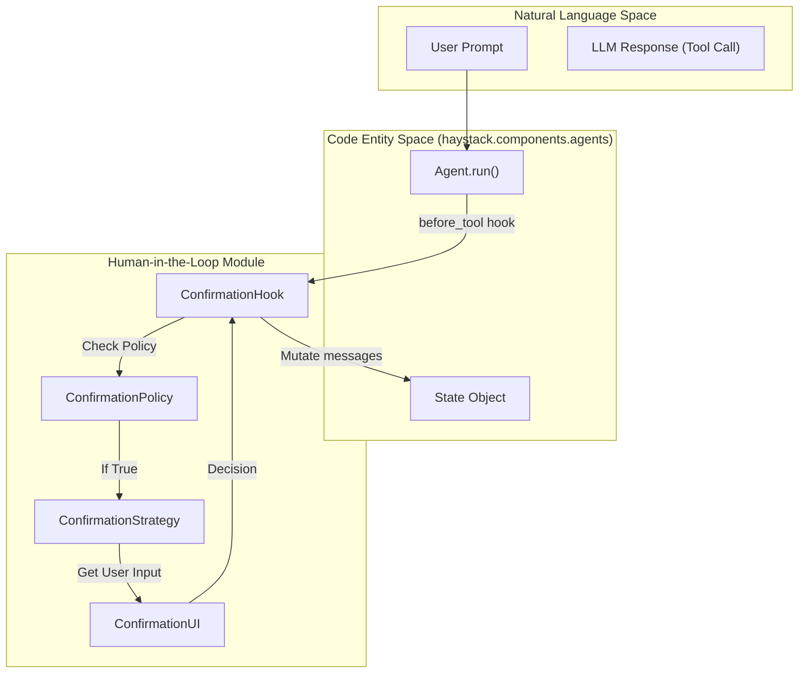
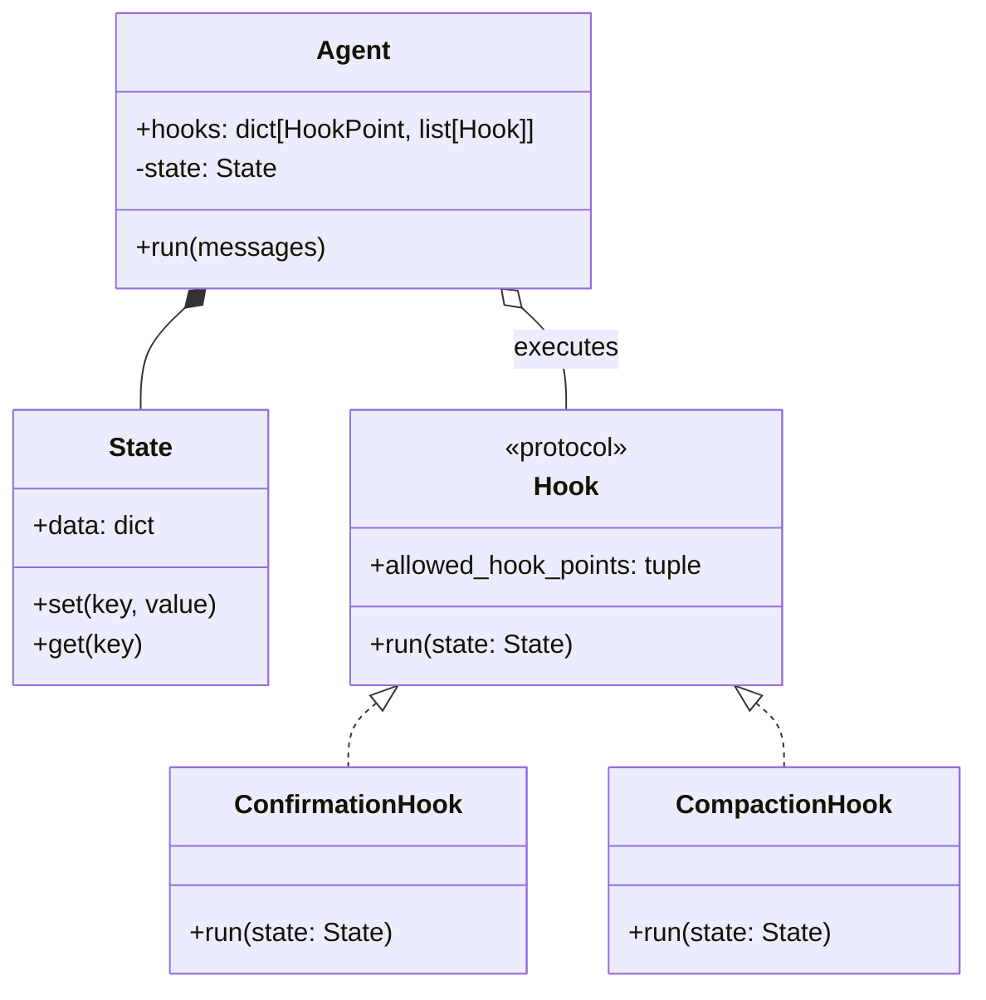

<!-- source: DeepWiki mcp.deepwiki.com · repo deepset-ai/haystack · page 6.3 Human-in-the-Loop and Context Management · fetched 2026-10-26 -->

# Human-in-the-Loop and Context Management

Relevant source files

The following files were used as context for generating this wiki page:

- [MIGRATION.md](MIGRATION.md)
- [docs-website/docs/pipeline-components/agents-1/compaction.mdx](docs-website/docs/pipeline-components/agents-1/compaction.mdx)
- [docs-website/docs/pipeline-components/agents-1/compaction/compaction-hook.mdx](docs-website/docs/pipeline-components/agents-1/compaction/compaction-hook.mdx)
- [docs-website/docs/pipeline-components/agents-1/compaction/sliding-window-compactor.mdx](docs-website/docs/pipeline-components/agents-1/compaction/sliding-window-compactor.mdx)
- [docs-website/docs/pipeline-components/agents-1/compaction/tool-result-pruning-compactor.mdx](docs-website/docs/pipeline-components/agents-1/compaction/tool-result-pruning-compactor.mdx)
- [docs-website/docs/pipeline-components/agents-1/hooks.mdx](docs-website/docs/pipeline-components/agents-1/hooks.mdx)
- [docs-website/docs/pipeline-components/agents-1/state.mdx](docs-website/docs/pipeline-components/agents-1/state.mdx)
- [haystack/components/agents/agent.py](haystack/components/agents/agent.py)
- [haystack/components/agents/state/state.py](haystack/components/agents/state/state.py)
- [haystack/components/agents/state/state_utils.py](haystack/components/agents/state/state_utils.py)
- [haystack/components/agents/utils.py](haystack/components/agents/utils.py)
- [haystack/hooks/__init__.py](haystack/hooks/__init__.py)
- [haystack/hooks/compaction/__init__.py](haystack/hooks/compaction/__init__.py)
- [haystack/hooks/compaction/hooks.py](haystack/hooks/compaction/hooks.py)
- [haystack/hooks/compaction/sliding_window.py](haystack/hooks/compaction/sliding_window.py)
- [haystack/hooks/compaction/tool_result_pruning.py](haystack/hooks/compaction/tool_result_pruning.py)
- [haystack/hooks/compaction/types/protocol.py](haystack/hooks/compaction/types/protocol.py)
- [haystack/hooks/compaction/utils.py](haystack/hooks/compaction/utils.py)
- [haystack/hooks/invocation.py](haystack/hooks/invocation.py)
- [haystack/hooks/protocol.py](haystack/hooks/protocol.py)
- [haystack/hooks/utils.py](haystack/hooks/utils.py)
- [pydoc/hooks_api.yml](pydoc/hooks_api.yml)
- [releasenotes/notes/add-after-tool-hook-d8d0779aaf65ce66.yaml](releasenotes/notes/add-after-tool-hook-d8d0779aaf65ce66.yaml)
- [releasenotes/notes/add-agent-context-compaction-3258c08dec9d2b34.yaml](releasenotes/notes/add-agent-context-compaction-3258c08dec9d2b34.yaml)
- [releasenotes/notes/add-agent-context-tokens-831273f057452c71.yaml](releasenotes/notes/add-agent-context-tokens-831273f057452c71.yaml)
- [releasenotes/notes/add-agent-hooks-4584408a3a2a2ad4.yaml](releasenotes/notes/add-agent-hooks-4584408a3a2a2ad4.yaml)
- [releasenotes/notes/add-before-run-after-run-hook-points-79609e8eda11fb6e.yaml](releasenotes/notes/add-before-run-after-run-hook-points-79609e8eda11fb6e.yaml)
- [releasenotes/notes/add-tool-result-pruning-compactor-f827857c67a6bbc6.yaml](releasenotes/notes/add-tool-result-pruning-compactor-f827857c67a6bbc6.yaml)
- [releasenotes/notes/fix-serialization-passthrough-9f1c2a4b7e6d3f08.yaml](releasenotes/notes/fix-serialization-passthrough-9f1c2a4b7e6d3f08.yaml)
- [releasenotes/notes/fix-state-validate-schema-5ae41ce9c82de61a.yaml](releasenotes/notes/fix-state-validate-schema-5ae41ce9c82de61a.yaml)
- [releasenotes/notes/schema-validation-support-chatmessage-subclass-995fcdd860786cb3.yaml](releasenotes/notes/schema-validation-support-chatmessage-subclass-995fcdd860786cb3.yaml)
- [releasenotes/notes/sync-agent-step-count-after-before-run-hooks-39cb6a98cfa5f4f4.yaml](releasenotes/notes/sync-agent-step-count-after-before-run-hooks-39cb6a98cfa5f4f4.yaml)
- [test/components/agents/__init__.py](test/components/agents/__init__.py)
- [test/components/agents/test_agent.py](test/components/agents/test_agent.py)
- [test/components/agents/test_agent_hitl.py](test/components/agents/test_agent_hitl.py)
- [test/components/agents/test_agent_hooks.py](test/components/agents/test_agent_hooks.py)
- [test/components/agents/test_state_class.py](test/components/agents/test_state_class.py)
- [test/components/agents/test_utils.py](test/components/agents/test_utils.py)
- [test/hooks/compaction/test_hooks.py](test/hooks/compaction/test_hooks.py)
- [test/hooks/compaction/test_tool_result_pruning.py](test/hooks/compaction/test_tool_result_pruning.py)
- [test/hooks/compaction/test_utils.py](test/hooks/compaction/test_utils.py)
- [test/hooks/test_invocation.py](test/hooks/test_invocation.py)

The `human_in_the_loop` module and context management hooks provide a framework for integrating human intervention and managing the LLM's context window within the Agent system. These features allow developers to define policies for manual tool approval, truncate long conversations, and offload large tool results to external storage.

## Human-in-the-Loop (HITL)

The HITL system operates by intercepting `ToolCall` objects generated by a `ChatGenerator` before they are executed. This is implemented via the `ConfirmationHook`, which is registered under the `before_tool` hook point of an `Agent` [haystack/hooks/human_in_the_loop/hooks.py:20-22]().

### Core HITL Components

| Class | Role |
| :--- | :--- |
| `ConfirmationHook` | An Agent hook that manages the lifecycle of tool confirmation [haystack/hooks/human_in_the_loop/hooks.py:23-25](). |
| `ConfirmationStrategy` | Protocol defining how to interact with the user (e.g., `BlockingConfirmationStrategy`) [haystack/hooks/human_in_the_loop/strategies.py:33-35](). |
| `ConfirmationPolicy` | Protocol defining *when* to ask for confirmation (e.g., `AlwaysAskPolicy`, `NeverAskPolicy`) [haystack/hooks/human_in_the_loop/policies.py:18-20](). |
| `ConfirmationUI` | Protocol for the interface used to communicate with the human (e.g., `RichConsoleUI`, `SimpleConsoleUI`) [haystack/hooks/human_in_the_loop/user_interfaces.py:20-22](). |

### HITL Data Flow

The following diagram illustrates how the `Agent` uses the HITL module to manage tool execution decisions.

**Agent Tool Approval Data Flow**

Sources: [haystack/components/agents/agent.py:110-142](), [haystack/hooks/human_in_the_loop/hooks.py:23-60]()

---

## Context Management and Compaction

As conversations grow, they may exceed the LLM's context window. Haystack provides a `CompactionHook` that runs at the `before_llm` hook point to estimate token usage and trigger a `Compactor` to shorten the history [haystack/hooks/compaction/hooks.py:23-57]().

### Compaction Strategies

1.  **SlidingWindowCompactor**: Retains the leading system messages (instructions), the latest user message (task anchor), and a window of complete Agent steps (assistant message + tool results) [haystack/hooks/compaction/sliding_window.py:93-115]().
2.  **ToolResultPruningCompactor**: Specifically targets `ChatMessage` objects containing tool results, pruning them based on age or size while keeping the assistant's tool calls intact [haystack/hooks/compaction/tool_result_pruning.py:20-30]().

### Compaction Mechanism
The `CompactionHook` uses a `TokenCounter` (defaulting to `ApproximateTokenCounter`) to measure the conversation [haystack/hooks/compaction/hooks.py:68-84](). It triggers when the estimated token count reaches a `compact_at` fraction of the `context_window` and aims to reduce it to `compact_to` [haystack/hooks/compaction/hooks.py:61-67]().

Sources: [haystack/hooks/compaction/hooks.py:23-98](), [haystack/hooks/compaction/sliding_window.py:93-132]()

---

## Tool Result Offloading

Large tool outputs (e.g., long document retrievals) can quickly exhaust context. Offloading moves these results to a `ToolResultStore` and replaces the message content with a reference [haystack/hooks/tool_result_offloading/hooks.py:22-35]().

### Offloading Policies
The `OffloadingHook` (registered at `after_tool`) uses policies to decide what to offload:
*   **AlwaysOffload**: Offloads every tool result [haystack/hooks/tool_result_offloading/policies.py:20-22]().
*   **OffloadOverChars**: Offloads results exceeding a specific character length [haystack/hooks/tool_result_offloading/policies.py:33-35]().
*   **NeverOffload**: Disables offloading [haystack/hooks/tool_result_offloading/policies.py:53-55]().

### Storage Backends
*   **FileSystemToolResultStore**: Stores offloaded content as files on disk [haystack/hooks/tool_result_offloading/stores.py:22-30]().

Sources: [haystack/hooks/tool_result_offloading/hooks.py:22-50](), [haystack/hooks/tool_result_offloading/policies.py:18-60]()

---

## Implementation Detail: Agent State Interaction

The `Agent` maintains a `State` object which is the primary interface for hooks. The `State` manages a `messages` list and reserved keys like `context_tokens` and `tool_call_counts` [haystack/components/agents/agent.py:76-96]().

**Code Entity Relationship: Agent and Hooks**

Sources: [haystack/components/agents/agent.py:10-28](), [haystack/components/agents/state/state.py:83-114](), [haystack/hooks/protocol.py:34-44]()

### Hook Points in the Agent Loop
1.  `before_run`: Runs once at the start [haystack/hooks/protocol.py:38]().
2.  `before_llm`: Runs before each LLM call (e.g., `CompactionHook`) [haystack/hooks/protocol.py:37]().
3.  `before_tool`: Runs after tool calls are generated but before execution (e.g., `ConfirmationHook`) [haystack/hooks/protocol.py:39]().
4.  `after_tool`: Runs after tools execute (e.g., `OffloadingHook`) [haystack/hooks/protocol.py:36]().
5.  `on_exit`: Runs when the agent is about to stop [haystack/hooks/protocol.py:40]().
6.  `after_run`: Runs once at the very end [haystack/hooks/protocol.py:35]().

Sources: [haystack/components/agents/agent.py:110-142](), [haystack/hooks/protocol.py:34-44]()

---

