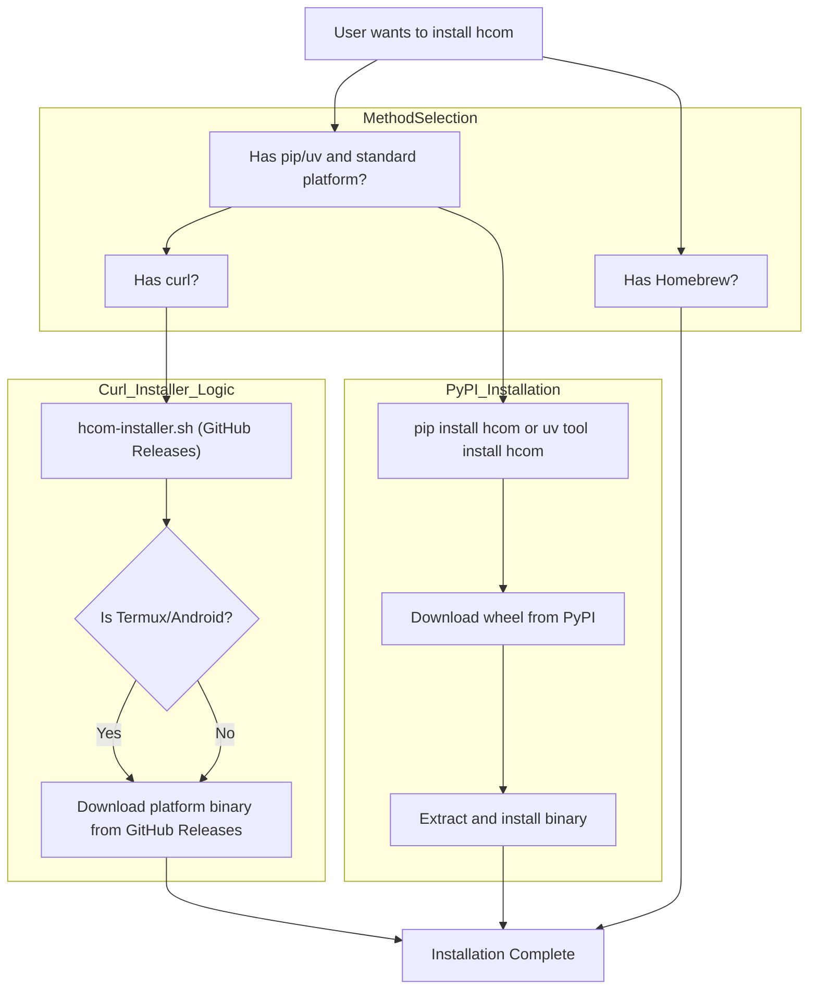
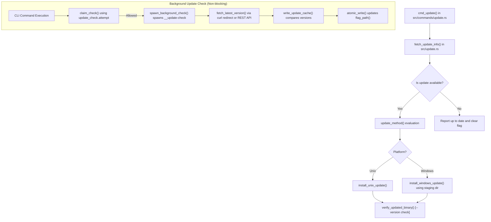
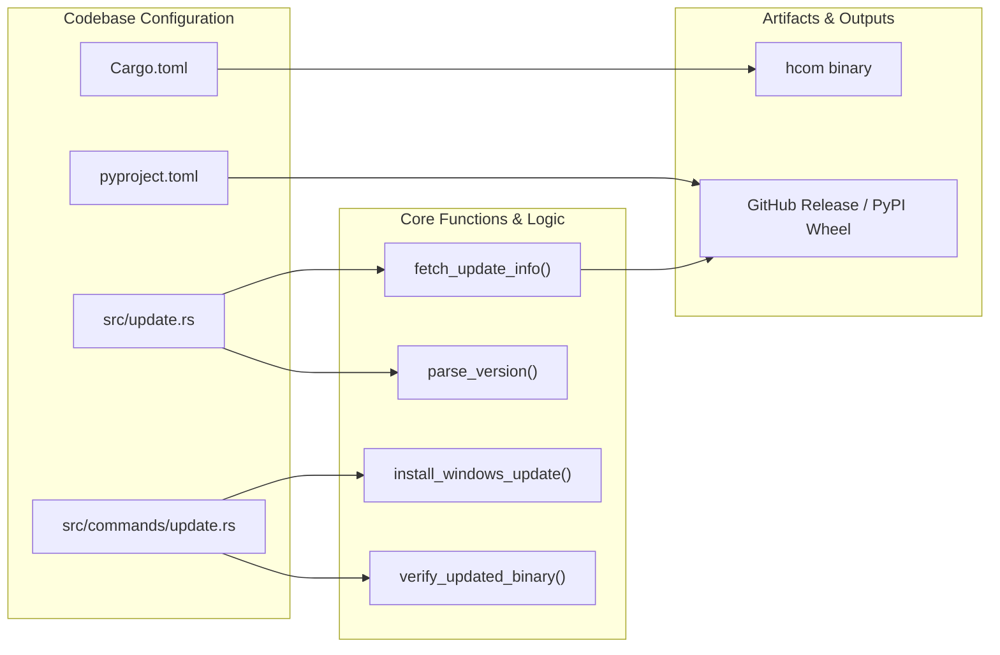

<!-- source: DeepWiki mcp.deepwiki.com · repo aannoo/hcom · page 10.2 Installation and Update Mechanisms · fetched 2026-10-26 -->

# Installation and Update Mechanisms

<details>
<summary>Relevant source files</summary>

The following files were used as context for generating this wiki page:

- [Cargo.lock](Cargo.lock)
- [Cargo.toml](Cargo.toml)
- [README.md](README.md)
- [pyproject.toml](pyproject.toml)
- [src/commands/mod.rs](src/commands/mod.rs)
- [src/commands/update.rs](src/commands/update.rs)
- [src/update.rs](src/update.rs)

</details>


## Purpose and Scope

This document describes the methods for installing `hcom`: PyPI package installation via `pip`/`uv`, direct binary installation via the `curl` installer script, and manual installation from source. It explains the platform detection logic, the dual-distribution model (PyPI vs GitHub Releases), and the self-update path implemented in `src/update.rs` and `src/commands/update.rs`.

## Installation Method Overview

`hcom` provides three primary installation paths, each serving different user needs:

| Method | Distribution | Use Case | Platforms |
|--------|-------------|----------|-----------|
| `uv tool install hcom` / `pip install hcom` | PyPI | Python users, standard Linux/macOS | Wheel targets (glibc/musl x86_64/aarch64, macOS x86_64/aarch64) |
| `curl ... hcom-installer.sh | sh` | GitHub Releases | Direct binary, all platforms | 5 binary targets including Android |
| `brew install aannoo/hcom/hcom` | Homebrew Tap | macOS users | macOS (Intel/Silicon) |

The distribution strategy leverages `maturin` for Python wheels [pyproject.toml:1-37]() and standalone release binaries.

Sources: [README.md:23-55](), [pyproject.toml:1-37]()

## Installation Flow Diagram

The following diagram maps the installation logic from the user's intent to the specific shell script logic and GitHub Release assets.



Sources: [README.md:23-55]()

## Update Command and Versioning

The `hcom` binary versioning is specified in `Cargo.toml` (`version = "0.7.30"`) [Cargo.toml:1-11]() and `pyproject.toml` [pyproject.toml:1-8](). The application provides a built-in update command:

```bash
hcom update
```

This command triggers the update logic implemented in `src/commands/update.rs` [src/commands/update.rs:27-91]() and `src/update.rs` [src/update.rs:1-211](). The binary is built using the `release` profile with `opt-level = 3`, `lto = true`, and `strip = true` to minimize artifact size [Cargo.toml:78-83]().

### Self-Update Mechanism (`src/update.rs`)

The `hcom update` command checks for and applies updates. It uses `fetch_update_info()` from `src/update.rs` to determine if a new version is available [src/commands/update.rs:31-37]().

The update process involves:
1.  **Version Parsing**: The `parse_version` function converts version strings (e.g., "v0.7.30" or "0.7.30") into a comparable tuple `(u32, u32, u32)` [src/update.rs:16-28]().
2.  **Latest Version Fetching**: `fetch_latest_version()` attempts to get the latest release tag. It tries `fetch_release_redirect()` (checking GitHub's latest-release redirect URL) or `fetch_release_api()` (`https://api.github.com/repos/aannoo/hcom/releases/latest`) [src/update.rs:96-150](). On Windows, it can also fall back to `fetch_release_powershell()` [src/update.rs:98-101,158-168]().
3.  **Update Method Determination**: `update_method()` resolves whether to use package managers (like `pip`/`uv`/`brew`) or download a direct installer executable [src/commands/update.rs:56-75]().
4.  **Application and Staging**: 
    *   On Windows, `install_windows_update()` stages the update by downloading via `WINDOWS_UPDATE_SCRIPT` into a temporary directory before replacing the running binary [src/commands/update.rs:118-181]().
    *   On Unix systems, `install_unix_update()` executes the shell installer script [src/commands/update.rs:183-414]().
5.  **Binary Verification**: `verify_updated_binary()` spawns the updated executable with `--version` and an isolated test environment (`HCOM_DIR`, `HCOM_UPDATE_VERIFY`) to ensure the version requirement has been met successfully [src/commands/update.rs:93-114]().
6.  **Background Check**: `spawn_background_check()` handles daily, non-blocking background checks using a separate attempt timestamp file (`update_check.attempt`) to respect retry intervals (`RETRY_INTERVAL = 900` seconds, `CHECK_INTERVAL = 86400` seconds) [src/update.rs:9-80]().

### Update Mechanism Data Flow



Sources: [src/commands/update.rs:27-183](), [src/update.rs:1-211]()

## Platform Specifics

### Android (Termux) and Linux/macOS
Binaries distributed via GitHub Releases and PyPI target major operating systems including Linux (glibc and musl variants), macOS (Intel and Apple Silicon), Windows, and Android via Termux. The installer scripts and Cargo build profiles adapt to platform constraints (such as handling Windows file locking by staging and renaming binaries via `install_windows_update()` [src/commands/update.rs:118-126]()).

Sources: [Cargo.toml:51-74](), [src/commands/update.rs:118-126]()

## Build Configuration Entity Mapping

The following diagram maps the build configuration entries in the codebase to their corresponding build rules and distribution artifacts.



Sources: [Cargo.toml:1-83](), [pyproject.toml:1-37](), [src/update.rs:16-184](), [src/commands/update.rs:27-114]()

---

