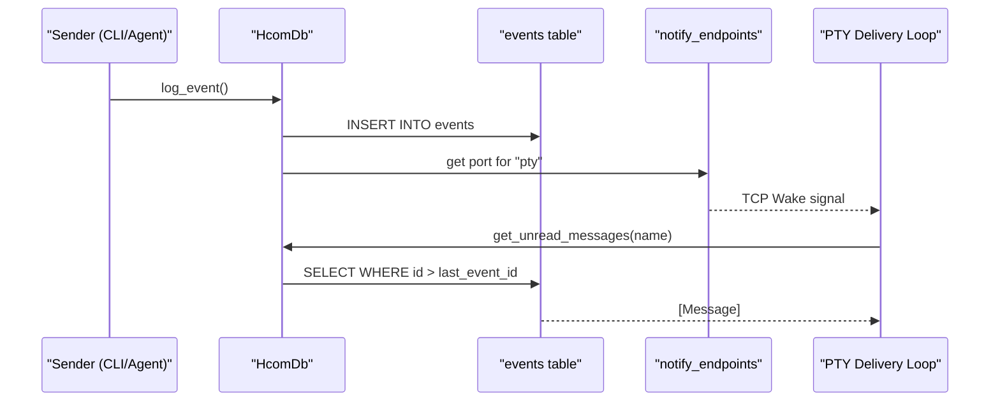
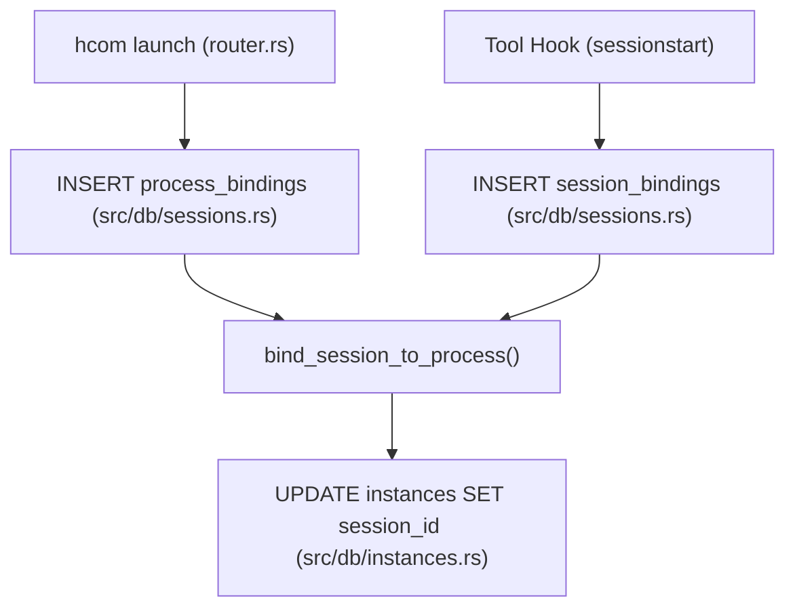

<!-- source: DeepWiki mcp.deepwiki.com · repo aannoo/hcom · page 11 Database Schema Reference · fetched 2026-10-26 -->

# Database Schema Reference

<details>
<summary>Relevant source files</summary>

The following files were used as context for generating this wiki page:

- [src/commands/list.rs](src/commands/list.rs)
- [src/commands/stop.rs](src/commands/stop.rs)
- [src/db/events.rs](src/db/events.rs)
- [src/db/instances.rs](src/db/instances.rs)
- [src/db/kv.rs](src/db/kv.rs)
- [src/db/mod.rs](src/db/mod.rs)
- [src/db/sessions.rs](src/db/sessions.rs)
- [src/identity.rs](src/identity.rs)
- [src/instance_lifecycle.rs](src/instance_lifecycle.rs)
- [src/paths.rs](src/paths.rs)
- [src/sys/fs.rs](src/sys/fs.rs)

</details>


This page provides complete SQL-level documentation for `hcom`'s SQLite database schema. It covers all tables, columns, indexes, views, and foreign key relationships defined in the `hcom.db` database file.

For conceptual understanding of how events flow through the system and how the database fits into the overall architecture, see [Database and Event Storage](). For database access patterns and query operations, see the `HcomDb` implementation in [src/db/mod.rs]().

## Schema Version Management

The database schema is versioned using SQLite's `PRAGMA user_version`. The current schema version is **20**, defined as `SCHEMA_VERSION` constant at [src/db/mod.rs:41](). Schema compatibility is checked on every database open via `ensure_schema()` [src/db/mod.rs:178]().

**Version Mismatch Behavior:**
- **Older DB version**: Database is migrated or archived and recreated with current schema. Specific migrations are defined in `MIGRATIONS` [src/db/mod.rs:43-89]().
- **Newer DB version**: Process continues with newer schema (stale process detection) [src/db/mod.rs:98]().

The schema initialization is idempotent — calling `init_db()` multiple times is safe and skips recreation if the schema version already matches [src/db/mod.rs:256-263]().

**Sources:** [src/db/mod.rs:39-89](), [src/db/mod.rs:178-180](), [src/db/mod.rs:256-263]()

## Database Configuration

The database is opened with the following PRAGMAs at [src/db/mod.rs:162-164]():

```sql
PRAGMA busy_timeout=5000;
PRAGMA foreign_keys=ON;
PRAGMA journal_mode=WAL;
```

- **`foreign_keys=ON`**: Enables CASCADE DELETE for relationships like `session_bindings` → `instances`.
- **`journal_mode=WAL`**: Write-Ahead Logging for concurrent reads during writes.
- **`busy_timeout=5000`**: 5-second retry on lock contention.

**Sources:** [src/db/mod.rs:162-164]()

## Core Tables

### `instances` Table

The `instances` table stores all agent instance metadata. Each row represents a single agent instance, whether active, stopped, or stale.

**Schema Definition:** [src/db/mod.rs:288-323]()

| Column | Type | Constraints | Purpose |
|--------|------|-------------|---------|
| `name` | TEXT | PRIMARY KEY | Unique instance identifier (e.g., `brave-unicorn-42`) |
| `session_id` | TEXT | UNIQUE | Claude/tool session identifier; NULL for stopped instances |
| `parent_session_id` | TEXT | FK → `instances(session_id)` | Parent instance's session_id for subagent tracking |
| `parent_name` | TEXT | | Parent instance name (denormalized for query performance) |
| `agent_id` | TEXT | UNIQUE (if not NULL) | Short agent ID sent by Claude Code (e.g., `a6d9caf`) |
| `tag` | TEXT | | User-assigned tag for grouping (e.g., `api`, `frontend`) |
| `last_event_id` | INTEGER | DEFAULT 0 | Cursor position for message delivery (last read event ID) |
| `status` | TEXT | DEFAULT 'active' | Current status: `active`, `listening`, `blocked`, `inactive` |
| `status_time` | INTEGER | DEFAULT 0 | Unix timestamp of last status update |
| `status_context` | TEXT | DEFAULT '' | Status context (e.g., `tool:Write`, `tui:not-ready`) |
| `status_detail` | TEXT | DEFAULT '' | Status detail (e.g., file path for tool events) |
| `last_stop` | INTEGER | DEFAULT 0 | Heartbeat timestamp (Unix epoch seconds) |
| `last_seen` | INTEGER | DEFAULT 0 | Last time the instance was verified as live |
| `directory` | TEXT | | Working directory path |
| `created_at` | REAL | NOT NULL | Instance creation timestamp (float epoch seconds) |
| `transcript_path` | TEXT | DEFAULT '' | Path to tool transcript file for watching |
| `tcp_mode` | INTEGER | DEFAULT 0 | Boolean: 1 if TCP delivery is active, 0 if adhoc |
| `wait_timeout` | INTEGER | DEFAULT 86400 | Timeout in seconds for `hcom listen` |
| `background` | INTEGER | DEFAULT 0 | Boolean: 1 if launched with `--background` |
| `background_log_file` | TEXT | DEFAULT '' | Path to background log file |
| `name_announced` | INTEGER | DEFAULT 0 | Boolean: 1 if instance name has been announced to agent |
| `origin_device_id` | TEXT | DEFAULT '' | Device UUID where instance was created (for relay) |
| `hints` | TEXT | DEFAULT '' | Persistent instructions injected with every message |
| `subagent_timeout` | INTEGER | NULL | Subagent-specific timeout override |
| `tool` | TEXT | DEFAULT 'claude' | Tool type: `claude`, `gemini`, `codex`, `opencode` |
| `launch_args` | TEXT | DEFAULT '' | JSON array of launch command arguments |
| `idle_since` | TEXT | DEFAULT '' | ISO timestamp when instance entered listening state |
| `pid` | INTEGER | NULL | Process ID of the spawned terminal/tool |
| `launch_context` | TEXT | DEFAULT '' | JSON snapshot of launch environment |
| `terminal_preset_requested` | TEXT | DEFAULT '' | Preset name requested by user [src/db/mod.rs:46]() |
| `terminal_preset_effective` | TEXT | DEFAULT '' | Preset actually used [src/db/mod.rs:47]() |

**Indexes:** [src/db/mod.rs:331-337]()
- `idx_session_id` on `(session_id)`
- `idx_parent_session_id` on `(parent_session_id)`
- `idx_parent_name` on `(parent_name)`
- `idx_created_at` on `(created_at DESC)`
- `idx_status` on `(status)`
- `idx_agent_id_unique` unique on `(agent_id)` WHERE `agent_id IS NOT NULL`

**Sources:** [src/db/mod.rs:288-337](), [src/db/instances.rs:20-52](), [src/db/instances.rs:132-140]()

---

### `events` Table

The `events` table is the append-only event log. All messages, status updates, and lifecycle events are stored here.

**Schema Definition:** [src/db/mod.rs:268-274]()

| Column | Type | Constraints | Purpose |
|--------|------|-------------|---------|
| `id` | INTEGER | PRIMARY KEY AUTOINCREMENT | Sequential event ID |
| `timestamp` | TEXT | NOT NULL | ISO 8601 timestamp |
| `type` | TEXT | NOT NULL | Event type: `message`, `status`, `life` |
| `instance` | TEXT | NOT NULL | Instance name (or `hcom` for system events) |
| `data` | TEXT | NOT NULL | JSON payload (structure varies by event type) |

**Event Type Schemas:**

**`message` events** (defined via `Message` struct at [src/db/events.rs:9-20]()):
```json
{
  "from": "sender-instance-name",
  "text": "message content",
  "scope": "broadcast|mentions",
  "delivered_to": ["recipient1"],
  "mentions": ["@recipient1"],
  "intent": "request|ack|inform",
  "thread": "thread-id",
  "bundle_id": "bundle-uuid",
  "_relay": false
}
```

**Indexes:** [src/db/mod.rs:325-329]()
- `idx_timestamp` on `(timestamp)`
- `idx_type` on `(type)`
- `idx_instance` on `(instance)`
- `idx_type_instance` composite on `(type, instance)`

**Sources:** [src/db/mod.rs:268-274](), [src/db/events.rs:9-20](), [src/db/mod.rs:325-329]()

---

### `session_bindings` Table

Maps tool session IDs to instance names. This table enables identity resolution for tool hooks.

**Schema Definition:** [src/db/mod.rs:298-304]() (SQL in `init_db`)

| Column | Type | Constraints | Purpose |
|--------|------|-------------|---------|
| `session_id` | TEXT | PRIMARY KEY | Tool session identifier (e.g., Claude session UUID) |
| `instance_name` | TEXT | NOT NULL, FK → `instances(name)` ON DELETE CASCADE | Bound instance name |
| `created_at` | REAL | NOT NULL | Binding creation timestamp |

**Sources:** [src/db/mod.rs:298-304](), [src/db/sessions.rs:168-185]()

---

### `process_bindings` Table

Maps hcom-spawned process IDs to instance names and session IDs. Used for orphan recovery and dynamic identity resolution.

**Schema Definition:** [src/db/mod.rs:289-296]() (SQL in `init_db`)

| Column | Type | Constraints | Purpose |
|--------|------|-------------|---------|
| `process_id` | TEXT | PRIMARY KEY | Opaque process identifier |
| `session_id` | TEXT | | Tool session ID |
| `instance_name` | TEXT | | Bound instance name |
| `updated_at` | REAL | NOT NULL | Last update timestamp |

**Sources:** [src/db/mod.rs:289-296](), [src/db/sessions.rs:92-134]()

---

### `notify_endpoints` Table

Stores TCP port numbers for waking delivery loops and querying instance state. Two protocol families share this table: **Wake endpoints** (pty, hook, listen, etc.) and **Inject endpoints** (inject RPC).

**Schema Definition:** [src/db/mod.rs:277-283]() (SQL in `init_db`)

| Column | Type | Constraints | Purpose |
|--------|------|-------------|---------|
| `instance` | TEXT | PRIMARY KEY (instance, kind) | Instance name |
| `kind` | TEXT | PRIMARY KEY (instance, kind) | Endpoint type: `pty`, `inject`, `listen`, `hook`, `listen_filter`, `events_wait`, `plugin` |
| `port` | INTEGER | NOT NULL | TCP port number |
| `updated_at` | REAL | NOT NULL | Last registration timestamp |

**Sources:** [src/db/mod.rs:277-283](), [src/db/notify.rs:3-12](), [src/db/notify.rs:44-56]()

---

### `claude_actor_capabilities` Table

Stores tokens and capabilities for Claude-specific tool use actors.

**Schema Definition:** [src/db/mod.rs:55-65]() (Migration 18)

| Column | Type | Constraints | Purpose |
|--------|------|-------------|---------|
| `token` | TEXT | PRIMARY KEY | Capability token |
| `session_id` | TEXT | NOT NULL | Bound session ID |
| `tool_use_id` | TEXT | NOT NULL | Claude tool use ID |
| `agent_id` | TEXT | DEFAULT '' | Agent identifier |
| `instance_name` | TEXT | NOT NULL | Target instance name |
| `created_at` | INTEGER | NOT NULL | Creation timestamp |
| `expires_at` | INTEGER | NOT NULL | Expiry timestamp |
| `last_seen` | INTEGER | NOT NULL | Heartbeat for the actor |

**Sources:** [src/db/mod.rs:54-69]()

---

### `kv` Table

Generic key-value store for configuration, runtime state, and event subscriptions.

**Schema Definition:** [src/db/mod.rs:306-309]() (SQL in `init_db`)

| Column | Type | Constraints | Purpose |
|--------|------|-------------|---------|
| `key` | TEXT | PRIMARY KEY | Key name |
| `value` | TEXT | | Value (often JSON) |

**Key Prefixes:**
- `events_sub:*`: JSON subscription objects. Includes filter subs, SQL subs, and request watches [src/db/kv.rs:103-107]().
- `config:dev_root`: Dev root binary path [src/db/mod.rs:42]().
- `_wake_last_wall`: Used for sleep/wake detection [src/instance_lifecycle.rs:97-101]().
- `_wake_grace_until`: Deadline for wake grace period [src/instance_lifecycle.rs:113-118]().
- `device_uuid`: Local device unique identifier [src/tui/db.rs:27-29]().

**Sources:** [src/db/mod.rs:306-309](), [src/db/kv.rs:1-71](), [src/instance_lifecycle.rs:97-149](), [src/tui/db.rs:27-29]()

---

## Entity Relationship Diagram

The following diagram maps the logical entities found in the code (e.g., `InstanceRow` struct) to the physical database tables.

```mermaid
erDiagram
    "InstanceRow" ||--o{ "session_bindings" : "has"
    "InstanceRow" ||--o{ "process_bindings" : "has"
    "InstanceRow" ||--o{ "notify_endpoints" : "registers"
    "InstanceRow" ||--o{ "events" : "generates"
    
    "InstanceRow" {
        TEXT name PK
        TEXT session_id UK
        TEXT parent_session_id FK
        TEXT agent_id UK
        TEXT status
        INTEGER last_event_id
        TEXT launch_context
        TEXT terminal_preset_effective
        INTEGER last_seen
    }
    
    "events" {
        INTEGER id PK
        TEXT timestamp
        TEXT type
        TEXT instance
        TEXT data
    }
    
    "session_bindings" {
        TEXT session_id PK
        TEXT instance_name FK
    }
    
    "process_bindings" {
        TEXT process_id PK
        TEXT session_id
        TEXT instance_name
    }
    
    "notify_endpoints" {
        TEXT instance PK_FK
        TEXT kind PK
        INTEGER port
    }
    
    "claude_actor_capabilities" {
        TEXT token PK
        TEXT session_id
        TEXT tool_use_id
        TEXT instance_name
    }
```

**Sources:** [src/db/mod.rs:268-323](), [src/db/instances.rs:20-52](), [src/db/mod.rs:54-64]()

---

## Views and Virtual Tables

### `events_v` View

The `events_v` view materializes JSON fields from the `events.data` column into queryable columns. This enables efficient SQL filtering for subscriptions.

**Schema Definition:** [src/db/mod.rs:311-340]() (SQL in `init_db`)

**Key View Columns:**

| Column | JSON Path | Event Types | Purpose |
|--------|-----------|-------------|---------|
| `msg_from` | `$.from` | `message` | Message sender |
| `msg_text` | `$.text` | `message` | Message content |
| `msg_scope` | `$.scope` | `message` | `broadcast` or `mentions` |
| `msg_intent` | `$.intent` | `message` | `request`, `ack`, `inform` |
| `status_val` | `$.status` | `status` | Status value |
| `life_action` | `$.action` | `life` | Lifecycle action |

**Sources:** [src/db/mod.rs:311-340]()

---

## Database Access Patterns

### Message Delivery Flow

This diagram traces the flow from a message being sent to it being available for delivery to an instance.



**Key Methods:**
- **`get_unread_messages()`** [src/db/events.rs:103-108](): Fetches messages where `event.id > instance.last_event_id`.
- **`should_deliver_to()`** [src/db/events.rs:41-58](): Validates message scope and mentions, including cross-device base-name matching.
- **`has_direct_unread()`** [src/db/events.rs:67-100](): Checks for unread messages specifically mentioning the instance to wake subagents.

**Sources:** [src/db/events.rs:31-200]()

### Identity Binding Sequence



**Key Methods:**
- **`get_process_binding()`** [src/db/sessions.rs:106-116](): Retrieves instance name from PID.
- **`migrate_notify_endpoints()`** [src/db/sessions.rs:158-185](): Merges ports when an instance is rebound or resumed.
- **`set_status()`** [src/db/instances.rs:170-185](): Updates instance status and heartbeats.

**Sources:** [src/db/sessions.rs:106-185](), [src/db/instances.rs:170-185]()

---

