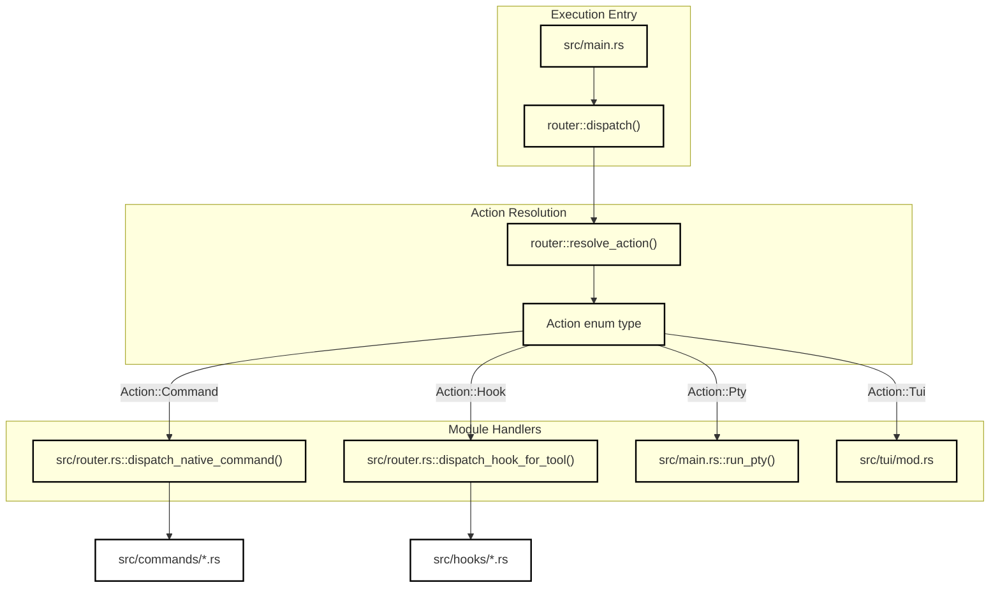
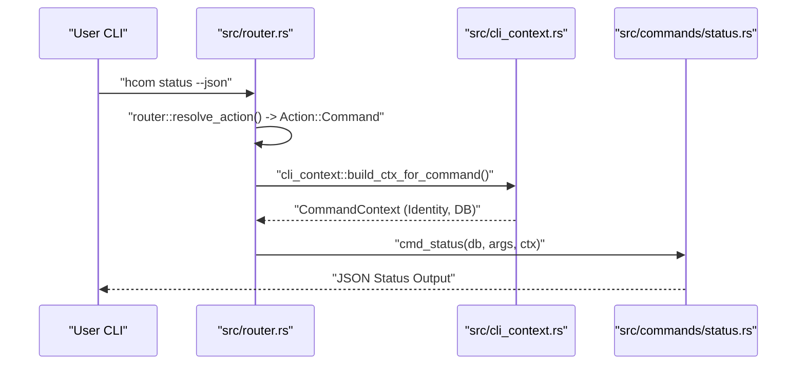

<!-- source: DeepWiki mcp.deepwiki.com · repo aannoo/hcom · page 12 Development Guide · fetched 2026-10-26 -->

# Development Guide

Relevant source files

The following files were used as context for generating this wiki page:

- [justfile](justfile)
- [tests/cli_smoke.rs](tests/cli_smoke.rs)
- [tests/support/mod.rs](tests/support/mod.rs)
- [tests/support/pins.rs](tests/support/pins.rs)

This guide covers contributing to **hcom**, understanding its hybrid Rust/Python architecture, and extending its functionality. It provides a high-level overview of the project structure, command routing, terminal support, testing frameworks, and build systems.

---

## Project Structure

hcom is structured as a high-performance Rust application packaged as a Python wheel for distribution via PyPI, where 100% of the application logic resides in Rust `pyproject.toml` [pyproject.toml:33-36](). The entry point `src/main.rs` initializes execution and delegates to `router::dispatch()` [src/main.rs:67-67](), which resolves command-line arguments into an `Action` enum `src/router.rs` [src/router.rs:141-160]().

**Project Architecture and Routing**

Sources: [pyproject.toml:33-36](), [src/main.rs:67-67](), [src/router.rs:141-160]()

For a detailed breakdown of module responsibilities across `commands/`, `hooks/`, `db/`, `pty/`, `relay/`, `tui/`, `shared/`, and `sys/`, see **[Project Structure](#12.1)**.

---

## Adding New Commands and Tool Integrations

Extending hcom with new CLI commands involves defining command tokens in `router.rs` [src/router.rs:25-45](), dispatching actions via `router::resolve_action()` [src/router.rs:141-160](), and writing command handlers within `src/commands/` using `clap` for argument parsing [Cargo.toml:17-17](). Tool integrations similarly register via the integration specifications and hook handlers.

**Command Dispatch Flow**

Sources: [src/router.rs:25-45](), [src/router.rs:141-160](), [Cargo.toml:17-17]()

For a step-by-step tutorial on implementing commands and registering tools in `integration_spec.rs`, see **[Adding New Commands and Tool Integrations](#12.2)**.

---

## Extending Terminal Support

hcom interfaces with multiple terminal emulators to spawn and manage agent instances. The terminal preset system handles open/close command templates, pane ID extraction from environment variables, and binary path resolution.

For details on adding new terminal presets and pane extraction logic, see **[Extending Terminal Support](#12.3)**.

---

## Testing and CI

The testing suite relies heavily on integration tests in `tests/` (such as `tests/cli_smoke.rs`) and task management via the `Justfile` [Justfile:46-56](). Hermetic test fixtures (`Hcom::new()`) isolate environments and manage process lifecycles [tests/support/mod.rs:1-60](). Pinned real tool versions are tracked via `scripts/mock-tools.pins` and accessed through `tests/support/pins.rs` [tests/support/pins.rs:1-25]().

**Testing and Delivery Validation Pipeline**

```mermaid
graph LR
    TestEntry["tests/cli_smoke.rs"] --> Fixture["tests/support/mod.rs::Hcom::new()"]
    Fixture --> MockPins["tests/support/pins.rs::mock_tools_bin()"]
    MockPins --> JustTask["Justfile::test"]
    JustTask --> CargoTest["cargo test --locked"]
    
    style TestEntry fill:none,stroke:#000,stroke-width:2px
    style Fixture fill:none,stroke:#000,stroke-width:2px
    style MockPins fill:none,stroke:#000,stroke-width:2px
    style JustTask fill:none,stroke:#000,stroke-width:2px
    style CargoTest fill:none,stroke:#000,stroke-width:2px
```

Sources: [Justfile:46-56](), [tests/cli_smoke.rs:1-37](), [tests/support/mod.rs:1-60](), [tests/support/pins.rs:1-25]()

For comprehensive details on test suites, mocks, and CI workflows, see **[Testing and CI](#12.4)**.

---

