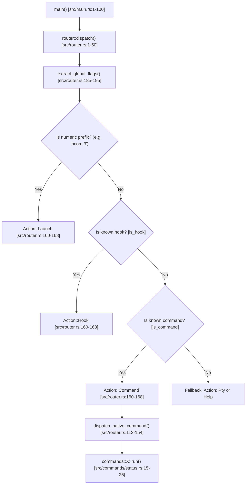
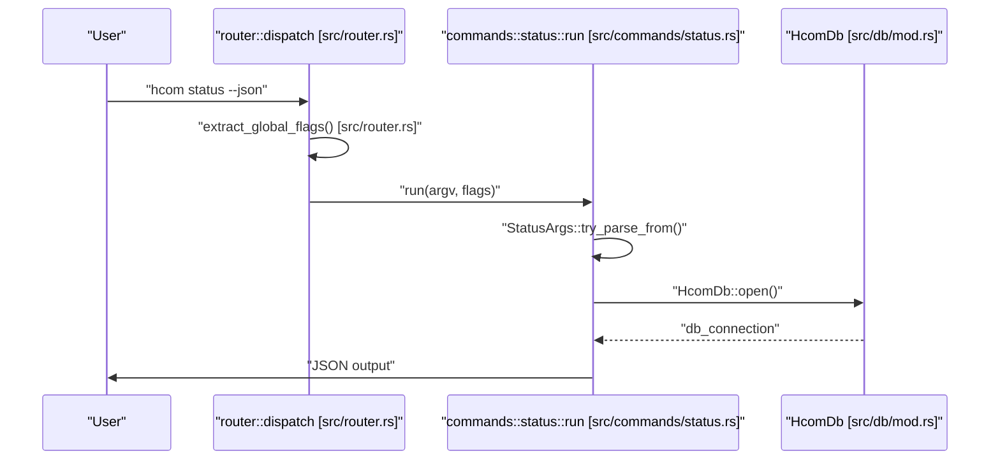
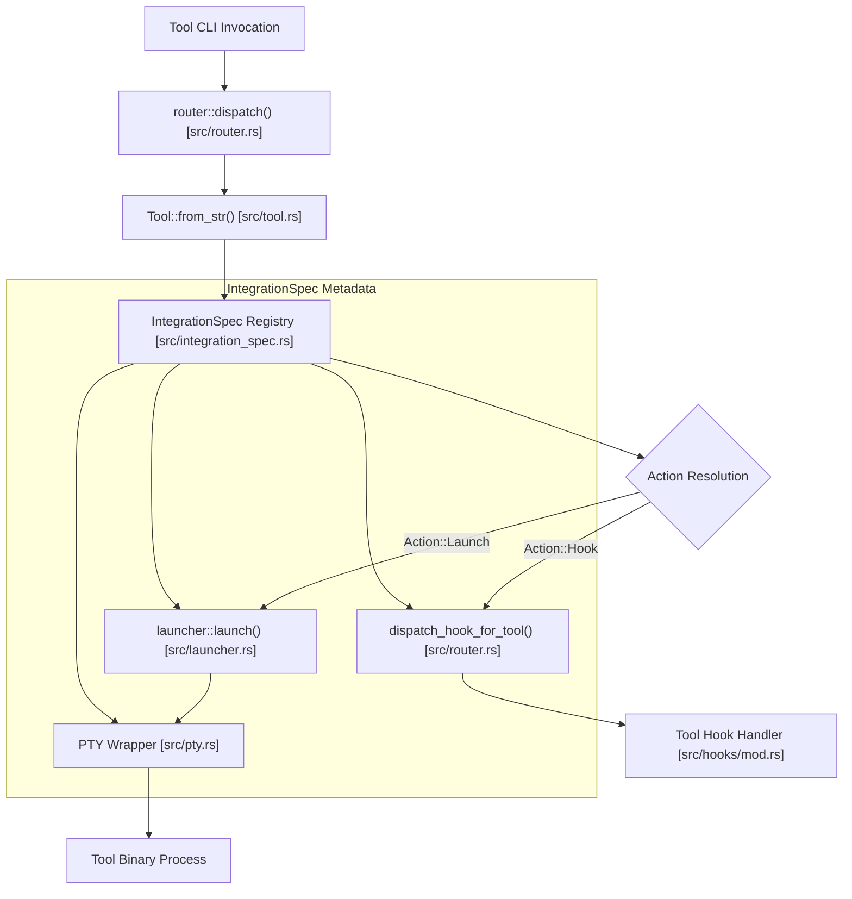

<!-- source: DeepWiki mcp.deepwiki.com · repo aannoo/hcom · page 12.2 Adding New Commands and Tool Integrations · fetched 2026-10-26 -->

# Adding New Commands and Tool Integrations

<details>
<summary>Relevant source files</summary>

The following files were used as context for generating this wiki page:

- [src/commands/hooks.rs](src/commands/hooks.rs)
- [src/commands/status.rs](src/commands/status.rs)
- [src/delivery.rs](src/delivery.rs)
- [src/integration_spec.rs](src/integration_spec.rs)
- [src/router.rs](src/router.rs)
- [src/tools/args_common.rs](src/tools/args_common.rs)

</details>


This page provides a technical tutorial on implementing new CLI commands in `hcom` and integrating new AI tools. The system uses a hybrid approach: manual high-level routing for speed and flexibility, followed by `clap`-based parsing for individual command arguments.

## Command Routing Architecture

The `hcom` binary acts as a multi-purpose entry point. It distinguishes between AI tool hooks, internal management commands, and PTY-wrapped launch sequences.

### Dispatch Logic Flow

The routing process occurs in `src/router.rs` and follows a resolution order to handle the unconventional CLI syntax of `hcom`, such as numeric prefixes for launching multiple agents or bare hook names that map to specific AI tool integrations.

Title: Command Dispatch Flow


Sources: [src/main.rs:1-100](), [src/router.rs:1-50](), [src/router.rs:112-154](), [src/router.rs:160-168](), [src/router.rs:185-195]()

### Action Resolution

The `Action` enum in `src/router.rs` represents the final intent of the CLI call after inspecting `argv`.

| Action Variant | Trigger | Responsibility |
| :--- | :--- | :--- |
| `Command` | `is_command(name)` is true | Execute a native Rust command (e.g., `send`, `list`, `start`). |
| `Hook` | `is_hook(name)` is true | Handle an AI tool lifecycle event (e.g., `sessionstart`, `poll`). |
| `Launch` | Numeric prefix or tool name | Start one or more PTY-wrapped agent instances via `launcher::launch`. |
| `Pty` | `pty` keyword | Run a command inside the `hcom` PTY wrapper logic. |
| `RelayWorker` | `relay-worker` keyword | Start the background MQTT relay daemon. |
| `Tui` | No arguments | Launch the interactive Terminal User Interface. |

Sources: [src/router.rs:17-19](), [src/router.rs:23-46](), [src/router.rs:112-154](), [src/router.rs:160-182]()

---

## Implementing a New Command

To add a new command, follow these steps:

### 1. Define the Command Module
Create a new file in `src/commands/` (e.g., `src/commands/start.rs`) and register it in `src/commands/mod.rs`.

Sources: [src/commands/mod.rs:1-35]()

### 2. Implement Clap Parsing
Use `clap::Parser` to define the command's specific arguments. While the router does high-level dispatch, individual modules use `clap` for internal argument validation and help generation.

```rust
// Example from src/commands/status.rs
#[derive(clap::Parser, Debug)]
#[command(name = "status", about = "System health overview")]
pub struct StatusArgs {
    /// JSON output
    #[arg(long)]
    pub json: bool,
    /// Show recent log entries
    #[arg(long)]
    pub logs: bool,
}
```
Sources: [src/commands/status.rs:14-24]()

### 3. Register in the Router
Add the command string to the `COMMANDS` registry in `src/router.rs` and update the dispatch logic to call your implementation.

Sources: [src/router.rs:23-46](), [src/router.rs:112-154]()

### 4. Provide Help Text
Add the usage and description entries to `src/commands/help.rs` so they appear in `hcom help`.

Sources: [src/commands/help.rs:1-137]()

---

## Data Flow: From CLI to Logic

The command execution context bridges user input (Natural Language Space) to Rust functions and SQLite operations (Code Entity Space).

Title: "Command Execution Diagram"


Sources: [src/router.rs:160-195](), [src/commands/status.rs:14-24](), [src/db/mod.rs:1-50]()

---

## Global Flags vs. Local Flags

The router distinguishes between **Global Flags** (processed by the router to affect application state) and **Local Flags** (processed by the specific command module).

*   **Global Flags:** Defined in `GlobalFlags` (e.g., `--name`, `--go`). These are extracted early to set up routing context.
*   **Local Flags:** Everything else (e.g., `--json` for `status`). These are passed to the command's internal `clap` parser.

Sources: [src/router.rs:185-195]()

---

## Adding New Tool Integrations

Integrating a new AI tool involves defining its characteristics, hooks, and how `hcom` interacts with it. This is primarily managed through the `IntegrationSpec` in `src/integration_spec.rs`.

### 1. Define the Tool Enum Variant
Add a new variant to the `Tool` enum in `src/tool.rs`. This enum serves as the canonical identifier for each integrated tool.

Sources: [src/tool.rs:1-50]()

### 2. Create an `IntegrationSpec`
For each new tool, an `IntegrationSpec` constant must be defined in `src/integration_spec.rs`. This struct centralizes all metadata and behavioral flags for the tool, such as hook names, PTY delivery gates, launch arguments, and resume configurations.

Sources: [src/integration_spec.rs:1-158]()

### 3. Register the `IntegrationSpec`
Add your new `IntegrationSpec` constant to the registry array in `src/integration_spec.rs`.

Sources: [src/integration_spec.rs:1-1935]()

### 4. Implement Hook Handlers
If your tool uses hooks, create a new module in `src/hooks/` and implement the dispatch logic for its defined hooks. Update `router::dispatch_hook_for_tool` in `src/router.rs` to call your new hook dispatcher.

Sources: [src/router.rs:112-154]()

### 5. Update `hcom status` and `hcom hooks`
The `hcom status` command automatically inspects `integration_spec::ALL` to report installation and hook status for all released tools [src/commands/status.rs:95-123](). Similarly, `hcom hooks` uses `hook_tools()` to manage hook installation [src/commands/hooks.rs:26-32]().

Sources: [src/commands/status.rs:95-123](), [src/commands/hooks.rs:26-32]()

Title: "Tool Integration Data Flow"


Sources: [src/router.rs:112-154](), [src/integration_spec.rs:1-158](), [src/tool.rs:1-50]()

---

