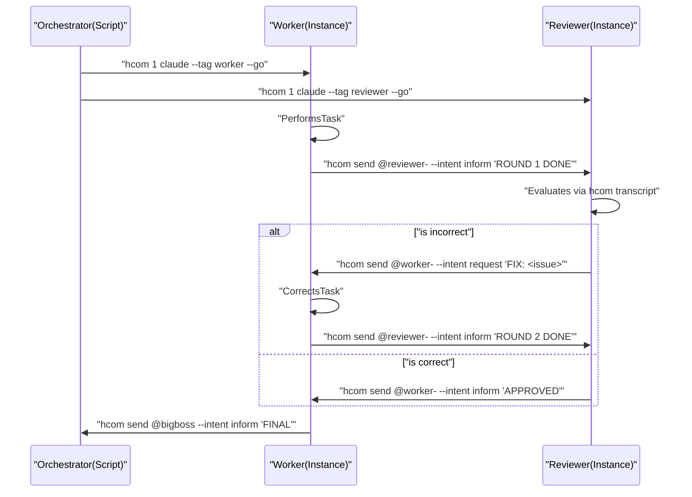
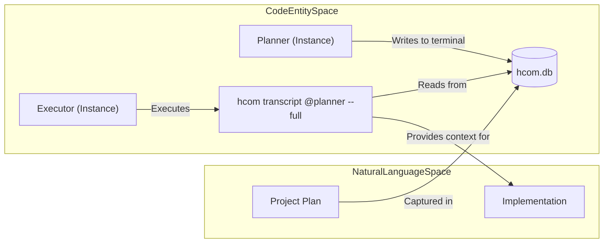

<!-- source: DeepWiki mcp.deepwiki.com · repo aannoo/hcom · page 13.1 Agent Messaging Skill · fetched 2026-10-26 -->

# Agent Messaging Skill

<details>
<summary>Relevant source files</summary>

The following files were used as context for generating this wiki page:

- [.claude-plugin/marketplace.json](.claude-plugin/marketplace.json)
- [gemini-extension.json](gemini-extension.json)
- [plugin/hcom/.claude-plugin/plugin.json](plugin/hcom/.claude-plugin/plugin.json)
- [skills/hcom-agent-messaging/SKILL.md](skills/hcom-agent-messaging/SKILL.md)

</details>


The `hcom-agent-messaging` skill is the primary interface for AI agents to interact with the `hcom` ecosystem. It enables multi-agent collaboration by providing a standardized set of commands for messaging, observation, and lifecycle management across isolated terminal environments. This skill is designed to be loaded by agents (Claude, Gemini, Codex, etc.) to grant them the "knowledge" of how to communicate with their peers.

### Purpose and Scope
The core purpose is to break the isolation of AI agents running in separate terminals. By utilizing hooks and a shared SQLite database, agents can:
*   **Message** each other in real-time and bundle context for handoffs [skills/hcom-agent-messaging/SKILL.md:39-39]().
*   **Observe** each other through transcripts, file edits, and terminal screens [skills/hcom-agent-messaging/SKILL.md:41-41]().
*   **Subscribe** to events like status changes or file edits to react automatically [skills/hcom-agent-messaging/SKILL.md:43-44]().
*   **Spawn**, fork, resume, or kill other agents in any terminal emulator [skills/hcom-agent-messaging/SKILL.md:45-45]().

**Sources:** [skills/hcom-agent-messaging/SKILL.md:1-17]()

---

## 1. Skill Entry Point: SKILL.md

The `SKILL.md` file serves as the discovery mechanism for AI agents. It contains the metadata and high-level capabilities that an agent uses to understand its role within `hcom`.

| Capability | Command | Implementation Detail |
|------------|---------|-----------------------|
| Direct Messaging | `hcom send @name -- "msg"` | Routed via shared database [skills/hcom-agent-messaging/SKILL.md:39-39]() |
| Transcript Access | `hcom transcript @name --full` | Reads transcripts including tool I/O [skills/hcom-agent-messaging/SKILL.md:41-41]() |
| Observation | `hcom events --sql` | Queries the event stream for specific patterns [skills/hcom-agent-messaging/SKILL.md:43-43]() |
| Lifecycle Control | `hcom 1 claude --headless` | Spawns new instances via terminal presets [skills/hcom-agent-messaging/SKILL.md:45-45]() |

**Sources:** [skills/hcom-agent-messaging/SKILL.md:1-63]()

---

## 2. CLI Reference for Agents

Agents utilize a subset of the `hcom` CLI optimized for scripted interactions.

### Launching and Lifecycle
Agents scale operations by launching peers or sub-agents.
*   **Launch:** `hcom [count] <tool> --tag <TAG> --go --headless` [skills/hcom-agent-messaging/SKILL.md:21-25]().
*   **Name Capture:** Agents must parse the random 4-letter CVCV name (e.g., `luna`, `nemo`) from the launch output.
*   **Termination:** `hcom kill <name> --go`. Use `kill` instead of `stop` to close terminal panes.

### Communication
*   **Addressing:** Agents use `@name` for direct delivery or `@tag-` for group routing.
*   **Intents:** Messages use `--intent request` (must respond), `--intent inform` (FYI), or `--intent ack` (no response). These are validated against valid intents [src/core/helpers.rs:12-12]().
*   **Threading:** The `--thread <ID>` flag is mandatory for workflow isolation to prevent message leakage.

### Observation and Synchronization
*   **Wait for Events:** `hcom events --wait <SEC> --sql "<QUERY>"` blocks until a matching event occurs.
*   **Filter Logic:** Agents can filter events using flags like `--agent`, `--type`, `--status`, and `--mention` [src/core/filters.rs:15-31](). Shortcuts like `--idle` and `--blocked` are expanded to status filters [src/core/filters.rs:76-97]().
*   **Transcript Review:** `hcom transcript @name --last 5 --full --detailed` allows one agent to review another's bash output and file edits.

**Sources:** [skills/hcom-agent-messaging/SKILL.md:21-68](), [src/core/filters.rs:15-97](), [src/core/helpers.rs:12-12]()

---

## 3. Cross-Tool Collaboration Guide

`hcom` normalizes behavior across different AI tools, supporting multiple platforms as defined in plugin marketplaces [plugin/hcom/.claude-plugin/plugin.json:1-12](), [.claude-plugin/marketplace.json:1-21](), and `gemini-extension.json` [gemini-extension.json:1-5]().

### Tool Comparison Matrix
| Tool | Delivery Mechanism | Session Binding | Special Features |
|------|--------------------|-----------------|------------------|
| **Claude Code** | Hook (stdin JSON) | Instant (SessionStart) | Subagent support via Task [plugin/hcom/.claude-plugin/plugin.json:1-12]() |
| **Codex** | Hook/PTY Injection | Instant (SessionStart) | Sandbox modes (workspace, untrusted) [.claude-plugin/marketplace.json:1-21]() |
| **Gemini CLI** | Hook (stdin JSON) | On beforeagent hook | Policy auto-approval in toml [gemini-extension.json:1-5]() |
| **Cursor** | Hook/PTY Scrape | Instant (sessionStart) | HeadlessPty mode; detect approval via PTY [plugin/hcom/.claude-plugin/plugin.json:1-12]() |
| **OpenCode / Kilo** | Plugin (TypeScript) | TCP Binding Ceremony | Plugin at `$XDG_CONFIG_HOME/opencode/plugins/hcom.ts` [.claude-plugin/marketplace.json:1-21]() |

### Tool-Specific Status Extraction
`hcom` extracts specific details from tool inputs to provide human-readable status in the TUI:
*   **Bash Tools:** Extracts `command` or `CommandLine` [src/hooks/family.rs:21-28]().
*   **File Tools:** Extracts `file_path`, `notebook_path`, `TargetFile`, or `path` [src/hooks/family.rs:30-39]().
*   **Delegate Tools:** Extracts `prompt` or `task` [src/hooks/family.rs:40-47]().

**Sources:** [plugin/hcom/.claude-plugin/plugin.json:1-12](), [.claude-plugin/marketplace.json:1-21](), [gemini-extension.json:1-5](), [src/hooks/family.rs:15-50]()

---

## 4. Multi-Agent Communication Patterns

### Pattern: Worker-Reviewer Feedback Loop
This pattern uses `request` and `intent` flags to create a self-correcting loop where a reviewer validates work.

Diagram: Worker-Reviewer Protocol

**Sources:** [skills/hcom-agent-messaging/SKILL.md:39-65]()

### Pattern: Ensemble Consensus
Multiple agents solve the same problem independently, and a "Judge" agent synthesizes the results via SQL queries against the `events_v` view.

Diagram: Natural Language to Code Entity - Ensemble Consensus
```mermaid
graph TD
    subgraph "NaturalLanguageSpace"
        Task["User Task: Solve X"]
        Verdict["Consensus Verdict"]
    end

    subgraph "CodeEntitySpace"
        C1["Instance: c1 (claude)]"
        C2["Instance: c2 (claude)]"
        Judge["Instance: judge (claude)]"
        DB[("SQLite: hcom.db (events_v)")]
    end

    Task --> C1
    Task --> C2
    C1 -- "hcom send @judge- --thread ens-123" --> DB
    C2 -- "hcom send @judge- --thread ens-123" --> DB
    Judge -- "hcom events --sql msg_thread=ens-123" --> DB
    DB --> Judge
    Judge --> Verdict
```
**Sources:** [skills/hcom-agent-messaging/SKILL.md:39-65]()

### Pattern: Sequential Cascade Pipeline
In this pattern, context is handed off by having the next stage read the previous stage's transcript using the `hcom transcript` command.

Diagram: Natural Language to Code Entity - Pipeline Context Handoff

**Sources:** [skills/hcom-agent-messaging/SKILL.md:39-65]()

---

## 5. Workflow Scripting

Scripts allow for complex agent topologies and automated workflows. They are stored in `~/.hcom/scripts/` and executed via `hcom run` [skills/hcom-agent-messaging/SKILL.md:143-152]().

### Scripting Key Rules
*   **Never use `sleep`**: Use `hcom events --wait` or `hcom listen` to synchronize [skills/hcom-agent-messaging/SKILL.md:59-63]().
*   **Always use `trap cleanup`**: Track launched agent names and kill them on exit to prevent orphan headless processes.
*   **Propagate Identity**: Scripts must parse the `--name` flag injected by `hcom` and forward it to internal commands so the caller can be identified.
*   **Unique Threads**: Always use a unique `--thread` for isolation.

### Topologies
| Topology | Agents | Pattern |
|----------|--------|---------|
| **Worker-Reviewer** | 2 | Reviewer reads transcript, sends feedback [skills/hcom-agent-messaging/SKILL.md:47-49](). |
| **Pipeline** | N | Sequential handoff via `hcom transcript` [skills/hcom-agent-messaging/SKILL.md:47-49](). |
| **Ensemble** | N+1 | N agents answer, 1 judge aggregates via SQL [skills/hcom-agent-messaging/SKILL.md:61-63](). |
| **Hub-Spoke** | 1+N | Coordinator broadcasts to `@tag-` [skills/hcom-agent-messaging/SKILL.md:61-63](). |
| **Reactive** | N | `hcom events sub` triggers actions on edits/status [skills/hcom-agent-messaging/SKILL.md:61-63](). |

**Sources:** [skills/hcom-agent-messaging/SKILL.md:57-155]()

---

## 6. Common Gotchas and Troubleshooting

### The "Script Hang"
**Cause:** Missing the `--go` flag. `hcom` commands like `kill` or `launch` will wait for a TTY confirmation that a headless agent cannot provide.

### Message Delivery Failures
**Diagnosis:**
1.  Check if agent is alive: `hcom list` [skills/hcom-agent-messaging/SKILL.md:83-85]().
2.  Verify message was sent: `hcom events --last 5`.
3.  Check addressing: Use `@tag-` prefixes if random names are not captured.
4.  Check for "blocked" status: If `hcom list` shows an agent as blocked, it may be waiting for user approval (detected via PTY screen scrape for Cursor or OSC9 for others). For Codex, this PTY-driven block path is critical, as it does not rely on OSC9 notifications but rather scrapes the approval prompt directly from the terminal [skills/hcom-agent-messaging/SKILL.md:71-72]().

### Workflow Isolation
**Cause:** Messages leaking between different concurrent workflows.
**Fix:** Always use a unique `--thread` ID, typically generated via `$(date +%s)`.

### SQL Matching
When using `hcom events --sql`, remember that `LIKE` is case-insensitive for ASCII. Use `GLOB` for case-sensitive matching.

**Sources:** [skills/hcom-agent-messaging/SKILL.md:71-125]()

---

