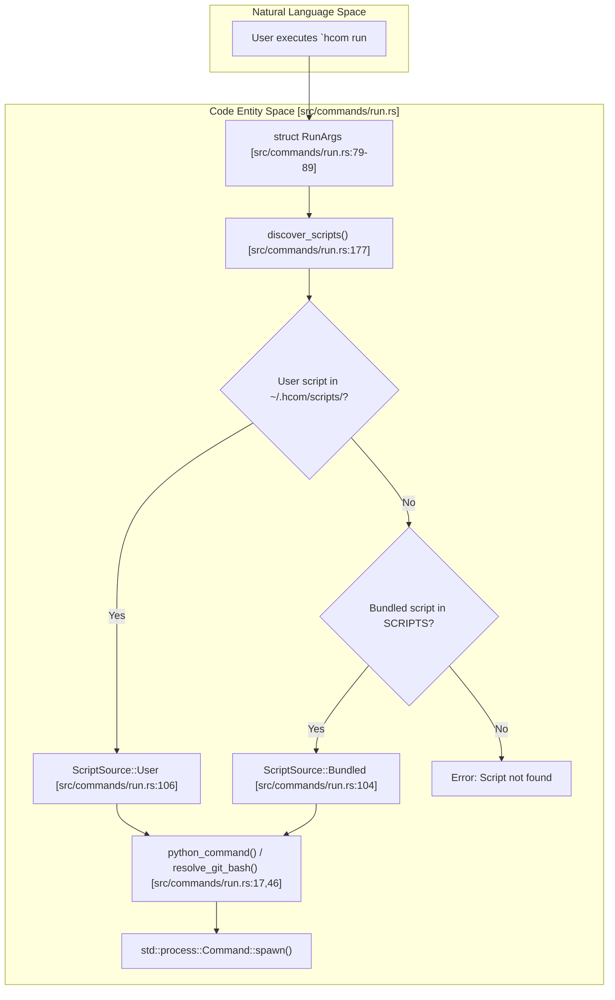
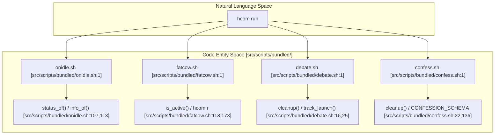

<!-- source: DeepWiki mcp.deepwiki.com · repo aannoo/hcom · page 13.2 Workflow Scripting and hcom run · fetched 2026-10-26 -->

# Workflow Scripting and hcom run

<details>
<summary>Relevant source files</summary>

The following files were used as context for generating this wiki page:

- [src/commands/run.rs](src/commands/run.rs)
- [src/scripts.rs](src/scripts.rs)
- [src/scripts/bundled/confess.sh](src/scripts/bundled/confess.sh)
- [src/scripts/bundled/debate.sh](src/scripts/bundled/debate.sh)
- [src/scripts/bundled/fatcow.sh](src/scripts/bundled/fatcow.sh)
- [src/scripts/bundled/onidle.sh](src/scripts/bundled/onidle.sh)
- [tests/bundled_scripts.rs](tests/bundled_scripts.rs)

</details>


The workflow scripting capabilities within `hcom` enable the creation of complex multi-agent automations. By leveraging the `hcom run` command, users can execute both bundled examples and custom user-defined scripts that coordinate AI agents across terminal sessions [src/commands/run.rs:1-5]().

## Purpose and Scope
This document details the architecture, execution flow, and implementation of `hcom run` and its bundled workflow scripts (`onidle`, `debate`, `fatcow`, and `confess`). It covers script discovery, shadowing mechanics, interpreter resolution, lifecycle management, and topology design patterns.

Sources: [src/commands/run.rs:1-5](), [src/scripts.rs:2-7]()

---

## The hcom run Command

The `hcom run` command serves as the execution engine for workflow scripts [src/commands/run.rs:1-5](). It parses arguments via `RunArgs` [src/commands/run.rs:79-89]() and discovers scripts from two distinct sources: the embedded binary (`scripts::SCRIPTS`) and the local filesystem (`~/.hcom/scripts/`) [src/commands/run.rs:1-5](), [src/scripts.rs:2-7]().

### Script Discovery, Shadowing, and Metadata
- **Bundled Scripts**: Compiled directly into the Rust binary via the `scripts::SCRIPTS` constant (`confess`, `debate`, `fatcow`, `onidle`) [src/scripts.rs:2-7](), [src/commands/run.rs:3-4]().
- **User Scripts**: Discovered from `scripts_dir()` (`~/.hcom/scripts/`) as `.py` or `.sh` files [src/commands/run.rs:13-14](), [src/commands/run.rs:183-198]().
- **Shadowing**: User scripts with matching names override bundled scripts, enabling local workflow customization [src/commands/run.rs:4](), [src/commands/run.rs:176-183]().
- **Metadata Extraction**: Descriptions are parsed automatically from shell comments (`extract_description_from_content`) or Python docstrings (`extract_description`) [src/commands/run.rs:116-174]().

### Interpreter Resolution
`hcom run` handles platform-specific interpreter resolution:
- **Bash**: On Windows, it invokes `resolve_git_bash` / `find_git_bash` to locate `bash.exe`, requiring Git Bash for `.sh` scripts [src/commands/run.rs:17-45]().
- **Python**: Resolves via the `PYTHON` environment variable or by probing `python`/`py` on PATH [src/commands/run.rs:46-77]().

**Diagram: Script Resolution and Execution Flow**

Sources: [src/commands/run.rs:1-198](), [src/scripts.rs:2-7]()

---

## Script Template and Lifecycle

Every `hcom` workflow script follows a standardized lifecycle to ensure reliability and prevent orphan background processes.

### Core Lifecycle Components
1. **Identity Propagation**: Scripts capture the `--name` flag and forward it to sub-commands to maintain caller context [skills/hcom-agent-messaging/references/script-template.md:44-58](), [src/scripts/bundled/fatcow.sh:91-99]().
2. **Agent Tracking**: Agent names are parsed from launch output (`Names: ...`) and stored in arrays (e.g., `LAUNCHED_NAMES`) for cleanup [skills/hcom-agent-messaging/references/script-template.md:29-34](), [src/scripts/bundled/confess.sh:22-39]().
3. **Thread Isolation**: Unique workflow IDs or timestamps isolate messages between concurrent runs [skills/hcom-agent-messaging/references/script-template.md:63-65](), [src/scripts/bundled/confess.sh:156]().
4. **Event Waiting**: Scripts use `hcom events --wait` with SQL filters to block until milestones occur [skills/hcom-agent-messaging/references/script-template.md:74-77](), [src/scripts/bundled/fatcow.sh:139]().
5. **Mandatory Cleanup**: Traps call `hcom kill` or `hcom stop` on all tracked agents if interrupted [skills/hcom-agent-messaging/references/script-template.md:35-42](), [src/scripts/bundled/confess.sh:22-30]().

### Technical Conventions
| Flag | Purpose | Source |
| :--- | :--- | :--- |
| `--go` | Bypasses interactive confirmation prompts during launch or kill. | [skills/hcom-agent-messaging/references/script-template.md:89]() |
| `--headless` | Runs the agent in a background PTY without a visible terminal window. | [skills/hcom-agent-messaging/references/script-template.md:90]() |
| `--tag X` | Enables `@X-` routing for easier addressing of specific roles. | [skills/hcom-agent-messaging/references/script-template.md:91]() |
| `--thread` | Isolates messages per workflow run. | [skills/hcom-agent-messaging/references/script-template.md:92]() |
| `--intent` | Categorizes the message (`request`, `inform`, `ack`). | [skills/hcom-agent-messaging/references/script-template.md:93]() |

Sources: [src/scripts/bundled/debate.sh:13-110](), [src/scripts/bundled/confess.sh:19-162](), [skills/hcom-agent-messaging/references/script-template.md]()

---

## Bundled Scripts and Agent Topologies

The codebase includes several tested topologies in `src/scripts/bundled/`.

### 1. `onidle.sh`: Reactive Trigger
Waits for an agent to become idle (`listening`) and injects text or launches a new agent [src/scripts/bundled/onidle.sh:1-10]().
- **Usage**: `hcom run onidle <watch-agent> <target> <text>` [src/scripts/bundled/onidle.sh:7]()
- **Logic**: Polls `hcom list <agent> status` and inspects tool launch capabilities via `is_launch_keyword` [src/scripts/bundled/onidle.sh:81-107]().

### 2. `fatcow.sh`: Persistent Oracle
Launches a persistent agent that ingests a codebase module and answers questions. Supports Live mode (tracking file changes) and Dead mode (ingests then stops, resumed via `--ask`) [src/scripts/bundled/fatcow.sh:1-18]().
- **Usage**: `hcom run fatcow --path src/tools` or `hcom run fatcow --ask fatcow.tools-luna "question"` [src/scripts/bundled/fatcow.sh:13-15]().

### 3. `debate.sh`: Adversarial (PRO/CON)
Orchestrates a structured debate between PRO and CON agents with a JUDGE moderating [src/scripts/bundled/debate.sh:1-12]().
- **Usage**: `hcom run debate "Topic" --spawn` or `hcom run debate "Topic" -w worker1,worker2` [src/scripts/bundled/debate.sh:9-10]().

### 4. `confess.sh`: Reactive (Self-Evaluation)
Executes self-evaluation based on OpenAI's confessions paper using a ConfessionReport schema, CALIBRATOR, and JUDGE [src/scripts/bundled/confess.sh:1-17]().
- **Usage**: `hcom run confess` or `hcom run confess --fork` [src/scripts/bundled/confess.sh:14-16]().

**Diagram: Bundled Script Execution Topologies**

Sources: [src/scripts/bundled/onidle.sh:1-120](), [src/scripts/bundled/fatcow.sh:1-180](), [src/scripts/bundled/debate.sh:1-170](), [src/scripts/bundled/confess.sh:1-196]()

---

## Cross-Tool Scripting Guide & Debugging

Mixing tools requires capturing agent random names immediately from launch output:
```bash
launch_out=$(hcom 1 tool --tag worker --go 2>&1)
worker_name=$(echo "$launch_out" | grep '^Names: ' | sed 's/^Names: //' | tr -d ' ')
```
- **Orphan Agents**: Prevent by implementing `trap` handlers invoking `hcom kill` [skills/hcom-agent-messaging/references/script-template.md:35-42]().
- **SQL Timeouts**: Adjust `--wait` timeouts in `hcom events` for heavy LLM workloads [src/scripts/bundled/fatcow.sh:69]().
- **Context Loss**: Always forward `--name` flags to preserve `@caller` resolution [skills/hcom-agent-messaging/references/script-template.md:44-58]().

Sources: [src/scripts/bundled/debate.sh:16-30](), [src/commands/run.rs:262-280](), [skills/hcom-agent-messaging/references/script-template.md:35-58]()

---

