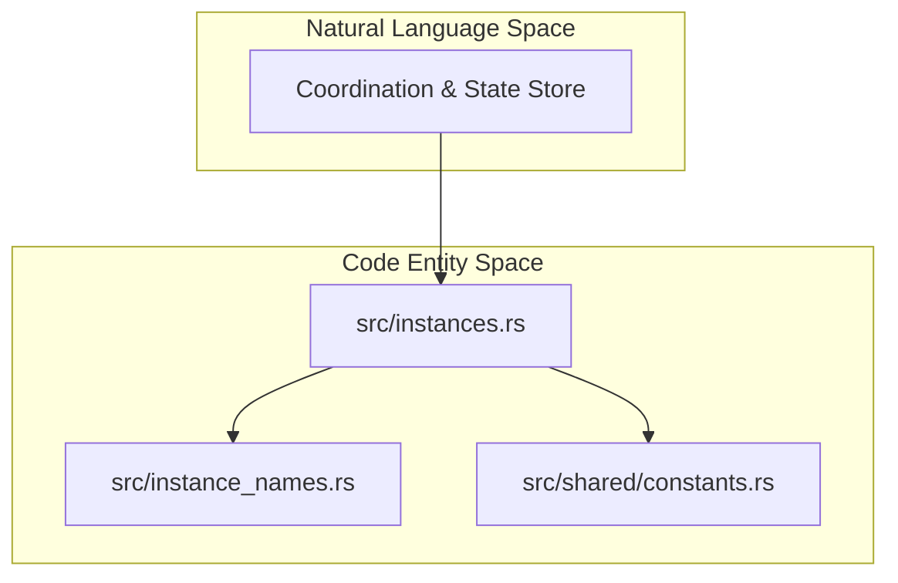
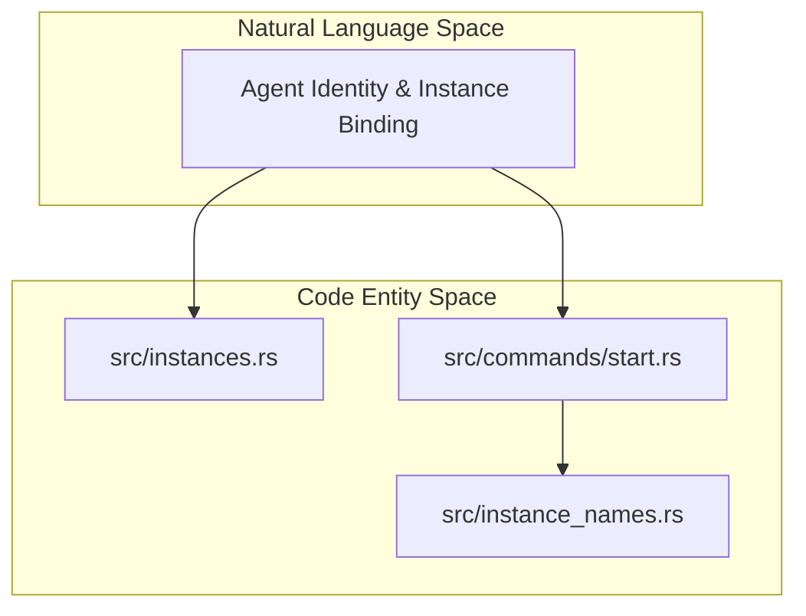
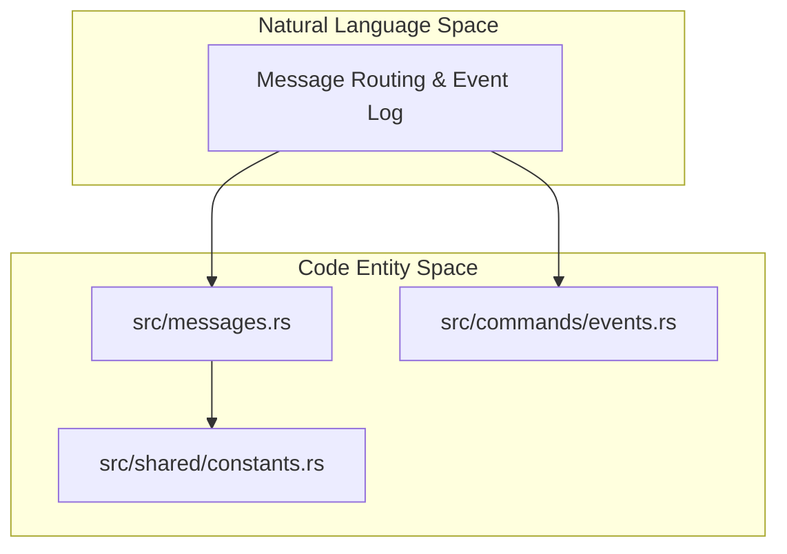

<!-- source: DeepWiki mcp.deepwiki.com · repo aannoo/hcom · page 3 Core Concepts · fetched 2026-10-26 -->

# Core Concepts

Relevant source files

The following files were used as context for generating this wiki page:

- [src/commands/events.rs](src/commands/events.rs)
- [src/commands/start.rs](src/commands/start.rs)
- [src/instance_names.rs](src/instance_names.rs)
- [src/instances.rs](src/instances.rs)
- [src/main.rs](src/main.rs)
- [src/messages.rs](src/messages.rs)
- [src/shared/constants.rs](src/shared/constants.rs)
- [src/shared/mod.rs](src/shared/mod.rs)

This page explains the fundamental concepts underlying `hcom`: instances, sessions, events, messages, status states, and the lifecycle of an agent from launch to termination.

For detailed technical dives into these topics, refer to the child pages:
- [Instances, Names and Identity](#3.1) — Detail instance records, name generation, process/session bindings, identity resolution, and nested-agent scrubbing.
- [Events, Messages and Notifications](#3.2) — Explain event types (message/status/life), message envelopes, cursors/waterlines, and the local notify/wake mechanism.

---

## The Database Hub

`hcom` uses a SQLite database as the single source of truth for all coordination across agents and terminals [src/instances.rs:1-6](). The database stores instance metadata, process bindings, and an append-only event log that allows PTY wrappers, CLI commands, and hooks to synchronize asynchronously.

Diagram: Database and Instance Store Architecture

Sources: [src/instances.rs:1-6](), [src/instance_names.rs:7-12](), [src/shared/constants.rs:1-5]()

---

## Instances and Identity

An **instance** represents a managed participant, such as an AI agent (`Tool` variants like Claude, Gemini, Codex) or an external process [src/main.rs:174-183](). Instances are identified by unique names generated dynamically from curated pools (e.g., CVCV patterns in `instance_names.rs`) while avoiding naming collisions [src/instance_names.rs:8-12](). 

For full details on instance records, name generation, process/session bindings, identity resolution, and nested-agent scrubbing, see [Instances, Names and Identity](#3.1).

Diagram: Instance Management Space

Sources: [src/instances.rs:1-18](), [src/commands/start.rs:1-10](), [src/instance_names.rs:8-12]()

---

## Events, Messages and Notifications

Communication between agents is mediated through messages with specific scopes (`MessageScope::Broadcast`, `MessageScope::Mentions`) and intents (`MessageIntent::Request`, `MessageIntent::Inform`, `MessageIntent::Ack`) [src/messages.rs:14-55](). Events are queried and filtered through command handlers [src/commands/events.rs:1-10]().

For deep dives into event types, message envelopes, waterlines, and local wake/notify mechanisms, see [Events, Messages and Notifications](#3.2).

Diagram: Message Routing & Event Space

Sources: [src/messages.rs:14-79](), [src/commands/events.rs:1-15](), [src/shared/constants.rs:50-61]()

---

## Status States and Lifecycle

Instances progress through explicit status states defined in `src/shared/constants.rs` and managed via lifecycle routines [src/shared/constants.rs:62-67]().

| State | Meaning | Code Symbol / Reference |
|-------|---------|-------------------------|
| `launching` | Process spawned, waiting for tool readiness | `ST_LAUNCHING` [src/shared/constants.rs:66-66]() |
| `listening` | Idle and ready to receive messages via PTY injection | `ST_LISTENING` [src/shared/constants.rs:63-63]() |
| `active` | Actively processing a prompt or tool call | `ST_ACTIVE` [src/shared/constants.rs:62-62]() |
| `blocked` | Waiting for external/human intervention | `ST_BLOCKED` [src/shared/constants.rs:64-64]() |
| `inactive` | Heartbeat timeout exceeded or process exited | `ST_INACTIVE` [src/shared/constants.rs:65-65]() |

For further details on state machines and lifecycle management, see [Instances, Names and Identity](#3.1).

Sources: [src/shared/constants.rs:62-77](), [src/instances.rs:1-25]()

---

