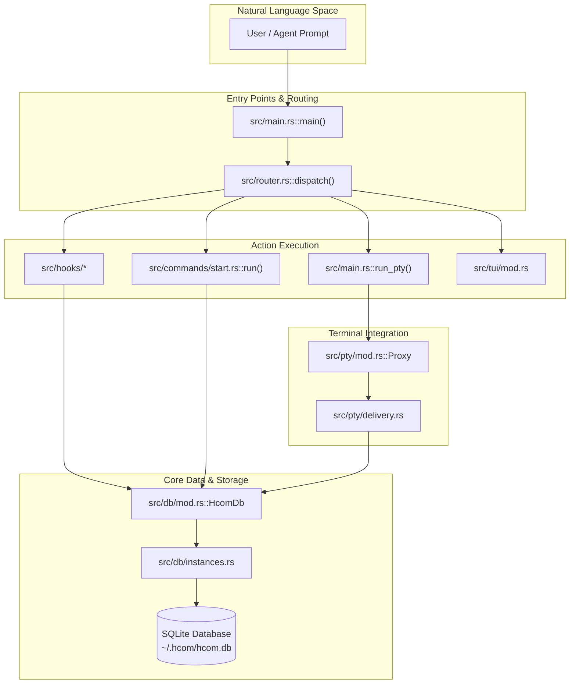
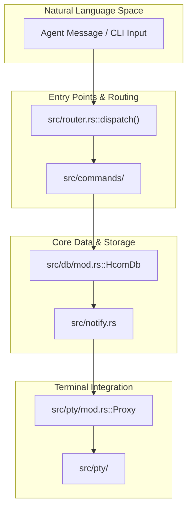

<!-- source: DeepWiki mcp.deepwiki.com · repo aannoo/hcom · page 4 Architecture · fetched 2026-10-26 -->

# Architecture

Relevant source files

The following files were used as context for generating this wiki page:

- [src/commands/hooks.rs](src/commands/hooks.rs)
- [src/commands/start.rs](src/commands/start.rs)
- [src/commands/status.rs](src/commands/status.rs)
- [src/instance_names.rs](src/instance_names.rs)
- [src/instances.rs](src/instances.rs)
- [src/main.rs](src/main.rs)
- [src/router.rs](src/router.rs)

This page provides a high-level overview of `hcom`'s internal architecture, explaining how the major systems fit together to coordinate multi-agent communication, terminal integration, and cross-device sync. 

For deep technical details, see the child pages linked throughout this document:
- [CLI Entry Points and Command Routing](#4.1) — Explain how `main.rs` initializes the application, how `router.rs` dispatches commands to handlers, and the action resolution system
- [Database and Event Storage](#4.2) — Detail the SQLite schema, event types, subscriptions, `kv` table, and the `events_v` view for querying
- [Instance Lifecycle Management](#4.3) — Explain instance states (`pending`→`launching`→`ready`→`active`/`listening`→`stale`→`stopped`), name generation, heartbeat monitoring, `pidtrack` and cleanup logic
- [Message Routing and Delivery](#4.4) — Describe how messages flow from `send` command through database to PTY delivery, including scope resolution and gate evaluation
- [Terminal Integration and PTY Wrapper](#4.5) — Explain terminal preset system, PTY wrapper architecture, screen capture via `vt100` parsing, and injection mechanisms
- [TUI Dashboard](#4.6) — Document the `ratatui`-based interactive dashboard: app/state/input model, render modules, `DbDataSource` polling, RPC to launch/stop agents, and theming

---

## System Overview

`hcom` employs a database-centric, event-driven architecture where all messages, status updates, and lifecycle events flow through a central SQLite store managed by `HcomDb` [src/db/mod.rs:1-80](). The system bridges natural language operator intents and tool interactions with low-level process and terminal controls.

### Architecture Dataflow

Sources: [src/main.rs:43-100](), [src/router.rs:1-182](), [src/db/mod.rs:1-80]()

### Message and Event Pipeline

Sources: [src/router.rs:21-46](), [src/main.rs:101-194](), [src/db/mod.rs:1-80]()

---

## Architecture Subsystems

### 4.1. CLI Entry Points and Command Routing

All execution starts in `src/main.rs`, which initializes configuration and delegates raw `argv` inspection to `src/router.rs`. The command router inspects flags, identifies tool invocations or hook execution targets, and dispatches the execution flow to corresponding command handlers or PTY wrappers.

For details, see [CLI Entry Points and Command Routing](#4.1).

Sources: [src/main.rs:43-100](), [src/router.rs:1-182]()

### 4.2. Database and Event Storage

The SQLite database (`src/db/mod.rs`) is the single source of truth for `hcom`. It stores persistent records for active instances, historical and unread events, session bindings, process mappings, and key-value metadata. Query views like `events_v` simplify querying across tables.

For details, see [Database and Event Storage](#4.2).

Sources: [src/db/mod.rs:1-80]()

### 4.3. Instance Lifecycle Management

`hcom` tracks agent lifecycle stages—transitioning instances through states such as `pending`, `launching`, `ready`, `active`, `listening`, `stale`, and `stopped`. Heartbeat monitors, PID tracking (`pidtrack`), and automated cleanup routines ensure orphaned or dead agent sessions are properly reaped.

For details, see [Instance Lifecycle Management](#4.3).

Sources: [src/instances.rs:1-52](), [src/commands/start.rs:1-100]()

### 4.4. Message Routing and Delivery

Messages submitted via the `send` command are persisted to the database and routed according to target scopes (`broadcast`, direct mentions, or `@instance` identifiers). Gate evaluation mechanisms determine when an agent is ready to receive injected text payloads into its active PTY stream.

For details, see [Message Routing and Delivery](#4.4).

Sources: [src/router.rs:21-46]()

### 4.5. Terminal Integration and PTY Wrapper

The PTY subsystem wraps target agent processes inside terminal multiplexers or custom pseudoterminals. It captures screen buffers via `vt100` parsing, detects prompt readiness patterns, and injects external text or messages securely into the running terminal tool.

For details, see [Terminal Integration and PTY Wrapper](#4.5).

Sources: [src/main.rs:101-194]()

### 4.6. TUI Dashboard

The interactive terminal dashboard is built on `ratatui` and `crossterm`. It polls `DbDataSource` state to render live agent tables, transcripts, and event logs, while providing RPC mechanisms to launch, inspect, or stop agent instances from a centralized keyboard-driven interface.

For details, see [TUI Dashboard](#4.6).

Sources: [src/router.rs:155-182]()

---

