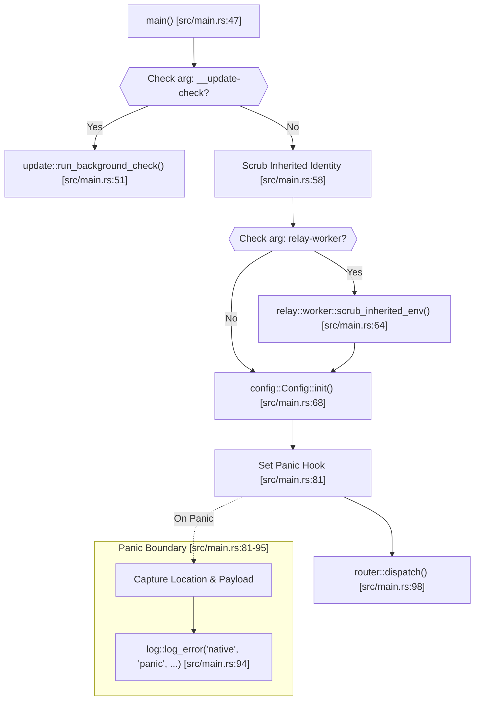
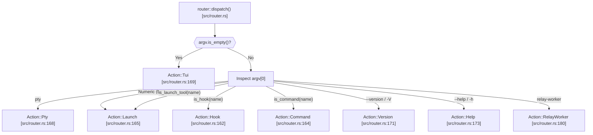
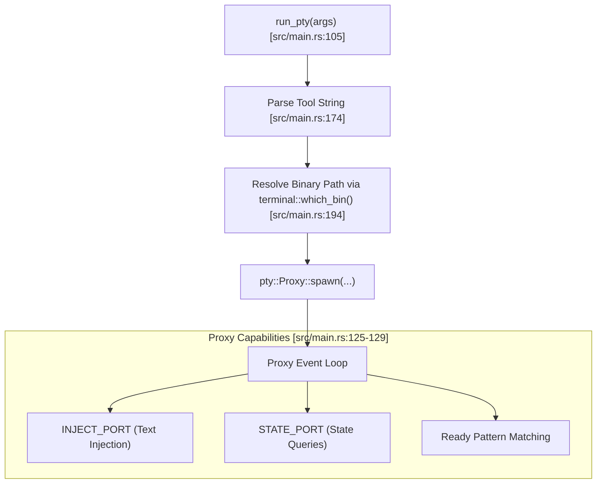

<!-- source: DeepWiki mcp.deepwiki.com · repo aannoo/hcom · page 4.1 CLI Entry Points and Command Routing · fetched 2026-10-26 -->

# CLI Entry Points and Command Routing

Relevant source files

The following files were used as context for generating this wiki page:

- [src/cli_context.rs](src/cli_context.rs)
- [src/commands/hooks.rs](src/commands/hooks.rs)
- [src/commands/listen.rs](src/commands/listen.rs)
- [src/commands/start.rs](src/commands/start.rs)
- [src/commands/status.rs](src/commands/status.rs)
- [src/instance_names.rs](src/instance_names.rs)
- [src/instances.rs](src/instances.rs)
- [src/main.rs](src/main.rs)
- [src/router.rs](src/router.rs)

This wiki page explains how the `hcom` application initializes in `src/main.rs`, how commands and hooks are routed via the action resolution system in `src/router.rs`, and how execution is dispatched to specific command handlers or the PTY wrapper.

---

## Application Initialization

The `hcom` binary begins execution in `main()` located in `src/main.rs`. The initialization sequence handles background update checks, isolates nested agent identities, initializes global configuration, sets up a safe panic hook to protect terminal UI state, and hands control over to the router.

### Startup Flow and Environment Setup

Sources: [src/main.rs:47-99]()

**Key Initialization Phases:**
- **Update Check Interceptor:** If the first argument is `__update-check`, `update::run_background_check` executes immediately in the background runner context [src/main.rs:48-54]().
- **Nested Agent Identity Scrubbing:** Agents nested under an hcom-launched agent must not inherit their parent's identity context. This runs first so downstream environment readers only view the child's identity [src/main.rs:58-61]().
- **Relay Worker Isolation:** When starting a relay worker, `relay::worker::scrub_inherited_env()` strips conflicting transmission variables [src/main.rs:63-65]().
- **Configuration Loading:** Global settings are initialized via `config::Config::init()` from environment variables and configuration files [src/main.rs:67-68]().
- **Safe Panic Handling:** A custom panic hook is registered via `panic::set_hook()` to route panic outputs into the internal logging infrastructure rather than writing to `stderr`. This prevents raw panic traces from corrupting the active terminal UI or TUI [src/main.rs:81-95]().
- **Router Handoff:** Control transfers to `router::dispatch()` to parse arguments and execute commands [src/main.rs:97-99]().

Sources: [src/main.rs:47-99]()

---

## Action Resolution System

Command routing is handled manually in `src/router.rs` rather than relying purely on top-level `clap` parsers. This is required because `hcom` supports mixed syntaxes such as bare hook names (e.g., `hcom sessionstart`), numeric multiplier launch counts (`hcom 3 claude`), and specialized subcommand structures.

### Action Resolution Mapping

Sources: [src/router.rs:1-182]()

### Resolved Action Variants
The `Action` enum classifies every incoming execution path into distinct variants [src/main.rs:47-99](), [src/router.rs:159-182]():
- `Action::Hook`: Dispatches incoming tool hook execution (e.g., Claude, Gemini, Codex, OpenCode hooks) [src/router.rs:162]().
- `Action::Command`: Runs standard CLI commands such as `send`, `list`, `events`, `status`, etc. [src/router.rs:164]().
- `Action::Launch`: Handles tool launching with optional numeric instance counts (e.g., `hcom 2 claude`) [src/router.rs:165]().
- `Action::Pty`: Enters the pseudo-terminal (PTY) wrapper mode [src/router.rs:168]().
- `Action::Tui`: Opens the interactive terminal dashboard when run with no arguments [src/router.rs:169]().
- `Action::Version` / `Action::Help`: Prints version or usage information [src/router.rs:171-174]().
- `Action::RelayWorker`: Spawns the background MQTT relay synchronization daemon [src/router.rs:180]().

Sources: [src/router.rs:1-182]()

---

## Global Flag Extraction

Global modifiers such as `--name <agent-id>` (for agent identity specification) and `--go` (to bypass interactive prompts) are extracted prior to command-specific parsing. 

- **Extraction Functions:** The router uses helper parsers to separate global flags from command arguments [src/router.rs:184-260]().
- **`GlobalFlags` Struct:** Holds parsed global attributes (`name` and `go`) used during context building [src/router.rs:185-189]().

Sources: [src/router.rs:184-260]()

---

## Command Dispatch and PTY Integration

Once an `Action` is resolved, `router::dispatch()` executes the corresponding backend subsystem.

### Native Command Routing Table

The `COMMANDS` constant defines native commands handled by `src/commands/` modules [src/router.rs:23-42]():

| Command Name | Module / File Reference | Purpose |
|--------------|-------------------------|---------|
| `send` | `src/router.rs:24` | Deliver messages to instances or broadcasts |
| `list` | `src/router.rs:25` | Query active and registered instances |
| `events` | `src/router.rs:26` | Query the event stream with filters |
| `start` | `src/commands/start.rs:44` | Initialize participation, rebind identity, or recover orphans |
| `status` | `src/commands/status.rs` | System health overview and tool detector |
| `hooks` | `src/commands/hooks.rs` | Install, verify, or remove tool hooks |
| `listen` | `src/commands/listen.rs:153` | Block and receive messages via TCP notify support |

Sources: [src/router.rs:23-42](), [src/commands/start.rs:44](), [src/commands/listen.rs:153]()

### PTY Wrapper Execution
When `Action::Pty` is resolved, control passes to `run_pty()` in `src/main.rs`. This infrastructure wraps child processes in a Unix pseudo-terminal or Windows ConPTY proxy to intercept text, track readiness patterns, and support runtime injection.

Sources: [src/main.rs:105-194]()

Sources: [src/main.rs:105-194]()

---

## Identity Resolution and Context Building

Before running commands, the CLI builds an execution context (`CommandContext`) to establish who is acting [src/cli_context.rs:28-78]().

- **Context Builder:** `build_ctx_for_command()` checks for active Claude actors or explicit `--name` flags [src/cli_context.rs:28-36]().
- **Identity Gating:** `check_identity_gate()` verifies whether a command requires an active participant registration, returning descriptive remediation instructions and usage hints if identity is missing [src/cli_context.rs:125-165]().

Sources: [src/cli_context.rs:28-165]()

---

