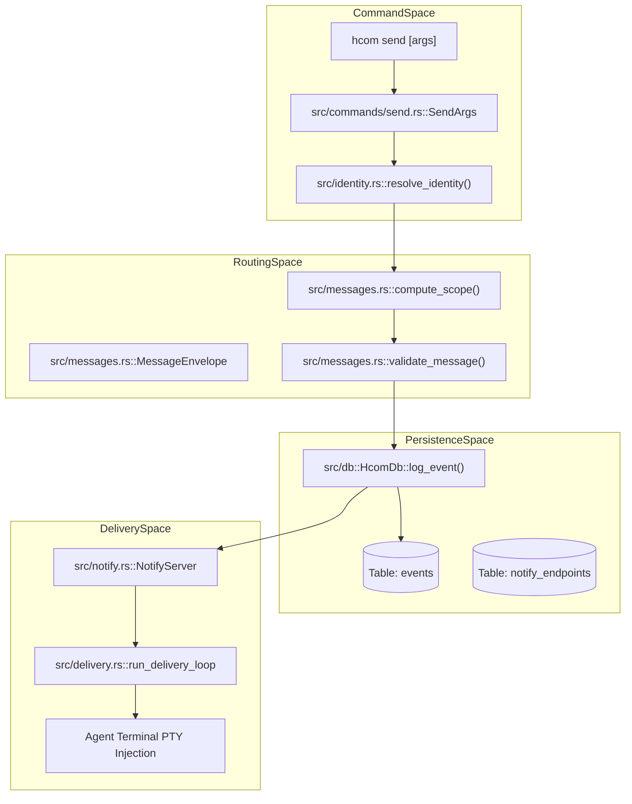
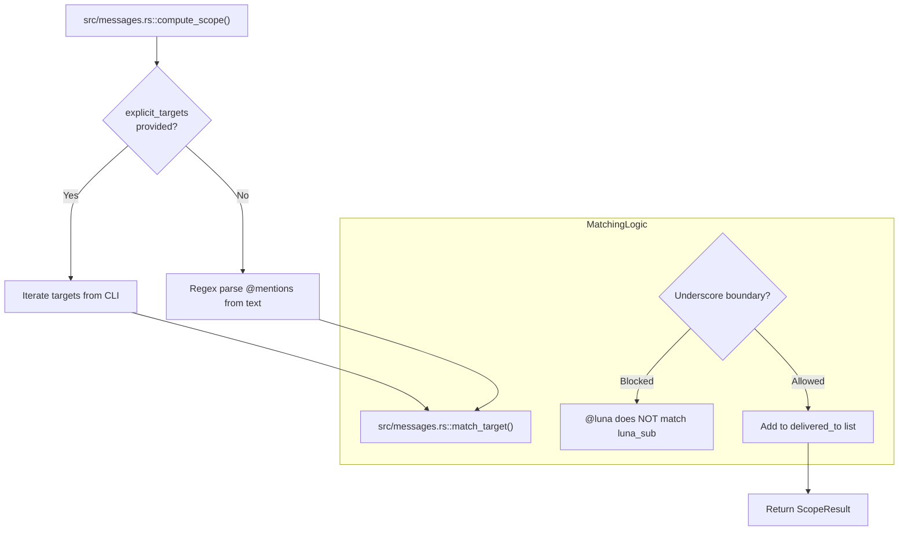

<!-- source: DeepWiki mcp.deepwiki.com · repo aannoo/hcom · page 4.4 Message Routing and Delivery · fetched 2026-10-26 -->

# Message Routing and Delivery

<details>
<summary>Relevant source files</summary>

The following files were used as context for generating this wiki page:

- [src/bootstrap.rs](src/bootstrap.rs)
- [src/commands/send.rs](src/commands/send.rs)
- [src/delivery.rs](src/delivery.rs)
- [src/delivery/antigravity.rs](src/delivery/antigravity.rs)
- [src/integration_spec.rs](src/integration_spec.rs)

</details>


**Purpose**: This page documents the message routing and delivery system, including scope computation, envelope metadata, database storage, gate evaluation, and the mechanisms used to inject messages into agent PTYs.

**Scope**: Covers the lifecycle of a message from the `hcom send` CLI command through database persistence in `HcomDb` to final delivery via TCP notifications, gate evaluation, and PTY injection.

---

## 1. Message Flow Overview

The flow of a message involves several distinct stages: CLI parsing via `SendArgs`, identity resolution, scope computation (`compute_scope`), envelope validation (`validate_message`), database logging, and TCP-driven PTY injection.

**Diagram: Message Lifecycle (CLI to PTY)**



Sources: [src/commands/send.rs:52-141](), [src/messages.rs:1-150](), [src/delivery.rs:1-100](), [src/identity.rs:1-230]()

---

## 2. Scope Computation and Addressing

`hcom` uses an addressing system that supports broadcast, explicit mentions, and prefix-based targeting.

### Scope Types

Messages are categorized into scopes defined by `MessageScope`:
*   `Broadcast`: Delivered to all active instances when no `@` targets are specified.
*   `Mentions`: Delivered only to instances matched by explicit `@name` or prefix patterns.

Sources: [src/messages.rs:14-27](), [src/commands/send.rs:52-68]()

### Target Resolution Logic

Target resolution supports exact base names (`@luna`), full names (`@api-luna`), prefix tags (`@api-`), remote instances (`@luna:BOXE`), and virtual identities (`bigboss`).

**Diagram: Scope Computation and Matching**



Sources: [src/messages.rs:1-150](), [src/commands/send.rs:17-51]()

---

## 3. Sender Identity Resolution

Before a message is logged, the sender identity is resolved via `identity::resolve_identity`.

### Identity Types

Identity is represented by `SenderIdentity` and categorized by `SenderKind`:
*   `Instance`: Sent from within an `hcom`-managed PTY session.
*   `External`: Sent via `--from` or `-b` (`bigboss`).
*   `System`: Generated by internal system events.

Sources: [src/shared/mod.rs:44](), [src/identity.rs:1-250]()

### Resolution Logic

The `SendArgs::sender_name()` method determines the effective sender name from flags or environment variables like `HCOM_PROCESS_ID`.

Sources: [src/commands/send.rs:143-153](), [src/identity.rs:1-250]()

---

## 4. Message Envelope and Bundles

Messages carry metadata (`MessageEnvelope`) and structured context (`Bundles`).

### Envelope Fields

The `MessageEnvelope` struct captures intent (`request`, `inform`, `ack`), reply-to links, and threading identifiers.

```rust
// Logic in SendArgs::build_bundle_data [src/commands/send.rs:160-212]
let mut bundle = serde_json::json!({
    "title": title,
    "description": description,
    "refs": {
        "events": events,
        "files": files,
        "transcript": transcript,
    }
});
```

Sources: [src/messages.rs:42-79](), [src/commands/send.rs:160-212]()

---

## 5. Delivery, Notification, and Gate Evaluation

Once committed to SQLite via `HcomDb::log_event`, messages are pushed to active listeners via registered TCP notify endpoints.

### Gate Evaluation (`GatesSpec`)

Delivery to a PTY is controlled by per-tool configuration guards defined in `GatesSpec` [src/integration_spec.rs:55-69]():
*   `require_idle`: Ensures the agent is not executing a tool turn.
*   `require_ready_prompt`: Verifies prompt readiness on screen.
*   `require_prompt_empty`: Blocks injection if user input is pending.
*   `block_on_user_activity`: Defers injection when human typing is detected.
*   `block_on_approval`: Pauses delivery during permission prompts.

Sources: [src/integration_spec.rs:55-69](), [src/delivery.rs:1-136]()

---

## 6. PTY Delivery, State Refresh, and Cleanup

The delivery loop handles runtime binding updates, status tracking, and teardown cleanup.

### Runtime Binding and Status Refresh

Functions such as `refresh_binding()` [src/delivery.rs:60-102]() and `refresh_status()` [src/delivery.rs:105-135]() run inside the delivery loop to detect name migrations and status modifications.

```rust
// Cleanup for Antigravity sessions when soft-stopped [src/delivery/antigravity.rs:14-58]
pub(crate) fn cleanup_antigravity_pty_exit(
    db: &mut HcomDb,
    current_name: &str,
    process_id: &str,
    owns_instance: bool,
) { ... }
```

Sources: [src/delivery.rs:47-135](), [src/delivery/antigravity.rs:14-58]()

---

## 7. Summary Table: Routing Logic

| Feature | Code Entity | File |
|---------|-------------|------|
| Addressing Logic | `messages::compute_scope` | [src/messages.rs:1-150]() |
| Message Validation | `messages::validate_message` | [src/messages.rs:127-151]() |
| Identity Resolution | `identity::resolve_identity` | [src/identity.rs:1-250]() |
| PTY Delivery Gates | `integration_spec::GatesSpec` | [src/integration_spec.rs:55-69]() |
| PTY Delivery Loop | `delivery::refresh_status` | [src/delivery.rs:105-135]() |
| Process Binding Refresh | `delivery::refresh_binding` | [src/delivery.rs:60-102]() |
| Antigravity PTY Cleanup | `antigravity::cleanup_antigravity_pty_exit` | [src/delivery/antigravity.rs:14-58]() |

Sources: [src/messages.rs:1-150](), [src/delivery.rs:47-135](), [src/identity.rs:1-250](), [src/integration_spec.rs:55-69](), [src/delivery/antigravity.rs:14-58]()

---

