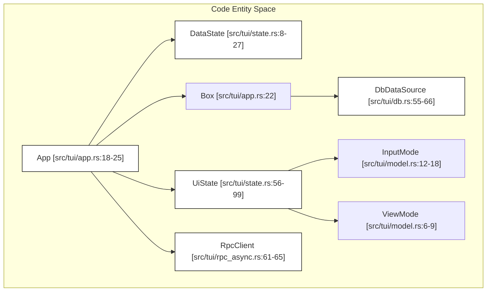
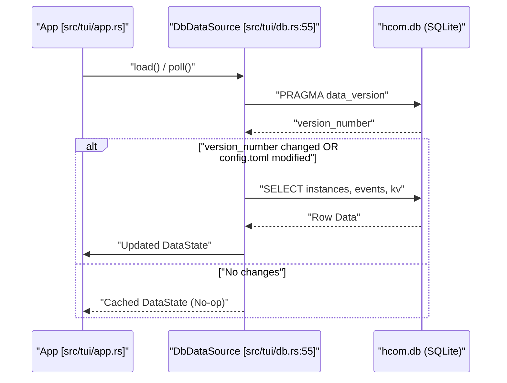
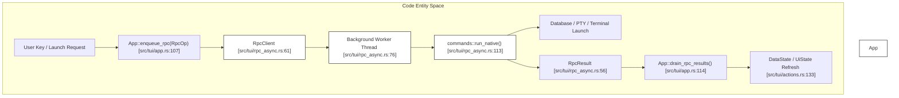

<!-- source: DeepWiki mcp.deepwiki.com · repo aannoo/hcom · page 4.6 TUI Dashboard · fetched 2026-10-26 -->

# TUI Dashboard

Relevant source files

The following files were used as context for generating this wiki page:

- [src/commands/daemon.rs](src/commands/daemon.rs)
- [src/commands/reset.rs](src/commands/reset.rs)
- [src/tui/actions.rs](src/tui/actions.rs)
- [src/tui/app.rs](src/tui/app.rs)
- [src/tui/commands.rs](src/tui/commands.rs)
- [src/tui/db.rs](src/tui/db.rs)
- [src/tui/input.rs](src/tui/input.rs)
- [src/tui/mod.rs](src/tui/mod.rs)
- [src/tui/model.rs](src/tui/model.rs)
- [src/tui/render/agents.rs](src/tui/render/agents.rs)
- [src/tui/render/messages.rs](src/tui/render/messages.rs)
- [src/tui/render/mod.rs](src/tui/render/mod.rs)
- [src/tui/rpc_async.rs](src/tui/rpc_async.rs)
- [src/tui/state.rs](src/tui/state.rs)
- [src/tui/status.rs](src/tui/status.rs)
- [src/tui/theme.rs](src/tui/theme.rs)
- [src/tui/usage.rs](src/tui/usage.rs)

The `hcom` TUI dashboard is an interactive, terminal-based user interface built using the `ratatui` crate and `crossterm`. It provides a centralized control plane for observing agent statuses, managing lifecycles (launching, stopping, forking, resuming), composing messages, and inspecting cross-device synchronization via an SQLite-backed data source without requiring a persistent long-running daemon process.

---

## Application, State, and Input Model

The TUI core is structured around the `App` struct defined in `[src/tui/app.rs:18-25]()`, which coordinates state mutations, background data fetching, asynchronous RPC requests, and screen rendering. 

The application state is cleanly bifurcated into two major components in `[src/tui/state.rs:8-99]()`:
1. `DataState`: Represents the persistent domain model fetched from the database (active agents, stopped agents, remote agents, orphans, unread message counts, and relay status).
2. `UiState`: Manages volatile interaction states such as cursor positions, multi-selections (`BTreeSet`), active input modes (`InputMode`), active overlays, popups, viewport modes (`ViewMode`), and command results.

*Sources: `[src/tui/app.rs:18-25](), `[src/tui/state.rs:1-99](), `[src/tui/model.rs:1-18](), `[src/tui/db.rs:55-66]()`

Input events are processed via `App::handle_key` in `[src/tui/input.rs:11-17]()`, mapping key combinations and modifiers based on the active `InputMode` (`[src/tui/model.rs:12-18]()`):
- `InputMode::Navigate`: Arrow keys and vim shortcuts for traversing agent lists, headers, and timeline history.
- `InputMode::Compose`: Active line buffer editing for outbound messages (`[src/tui/input.rs:83-106]()`).
- `InputMode::Launch`: Form-based parameters specification for launching new tool instances.
- `InputMode::CommandOutput`: Text output inspection view for ran commands.
- `InputMode::Relay`: Popup management for multi-device synchronization tokens and status.

Sources: `[src/tui/app.rs:18-25](), `[src/tui/state.rs:8-99](), `[src/tui/model.rs:1-18](), `[src/tui/input.rs:11-106]()`

---

## Database Polling and SQLite Integration

The TUI implements the `DataSource` trait via `DbDataSource` (`[src/tui/db.rs:55-66]()`). Rather than polling on a fixed timer via brute-force table scans, `DbDataSource` optimizes update cycles by inspecting SQLite's internal `PRAGMA data_version` (`[src/tui/db.rs:183-193]()`).

*Sources: `[src/tui/db.rs:55-193](), `[src/tui/app.rs:34-40]()`

To maintain safety and performance:
- Connections are opened in read-only mode (`PRAGMA query_only=ON`) with Write-Ahead Logging (`PRAGMA journal_mode=WAL`) and a 3-second busy timeout (`PRAGMA busy_timeout=3000`) (`[src/tui/db.rs:110-121]()`).
- File-descriptor identity checks (`db_file_id`) allow `DbDataSource` to transparently detect when `hcom reset` has replaced the underlying database file, triggering an automatic reconnection (`[src/tui/db.rs:21-40]()`).

Sources: `[src/tui/db.rs:1-193]()`

---

## Render Modules

Rendering is coordinated by `render::render` (`[src/tui/render/mod.rs:125-143]()`), which delegates layout and widget construction to specialized submodules:
- `render::agents`: Manages agent list rendering, collapsible sections for remote agents, stopped processes, and orphan processes (`[src/tui/render/agents.rs:97-135]()`).
- `render::messages`: Renders message streams, agent feed timelines, and command outputs with scroll metrics (`[src/tui/render/messages.rs:32-46]()`).
- `render::launch`: Handles form inputs and validation fields for the launch overlay (`[src/tui/render/launch.rs]()`).

Sources: `[src/tui/render/mod.rs:1-143](), `[src/tui/render/agents.rs:1-135](), `[src/tui/render/messages.rs:32-46]()`

---

## Asynchronous RPC and Agent Lifecycle Actions

To prevent UI stuttering during heavy process execution (such as spawning PTY sessions or launching AI tools), actions are queued and executed via `RpcClient` and `RpcOp` (`[src/tui/rpc_async.rs:8-65]()`). 

*Sources: `[src/tui/app.rs:105-124](), `[src/tui/rpc_async.rs:1-120](), `[src/tui/actions.rs:133-176]()`

Commands are translated into argument vectors via `build_launch_argv` (`[src/tui/rpc.rs:1-100]()`), ensuring options like `--no-run-here`, `--headless`, and tool-agnostic prompt forwarding (`--hcom-prompt`) are correctly passed to the core launcher without duplicating integration specifications.

Sources: `[src/tui/rpc_async.rs:1-202](), `[src/tui/actions.rs:133-176]()`

---

## Theming

Visual styling relies on the `Theme` struct (`[src/tui/theme.rs]()`), mapping semantic states to console styles defined in `[src/tui/model.rs:48-75]()`:
- `AgentStatus::Active` (`▶`): Active execution styling (`[src/tui/model.rs:48-75]()`).
- `AgentStatus::Listening` (`◎`): Low-latency polling state (`[src/tui/model.rs:48-75]()`).
- `AgentStatus::Blocked` (`■`): User input or permission gate block (`[src/tui/model.rs:48-75]()`).
- `AgentStatus::Inactive` (`○`): Stopped or dead instance (`[src/tui/model.rs:48-75]()`).

Sources: `[src/tui/theme.rs](), `[src/tui/model.rs:48-76]()`

---

