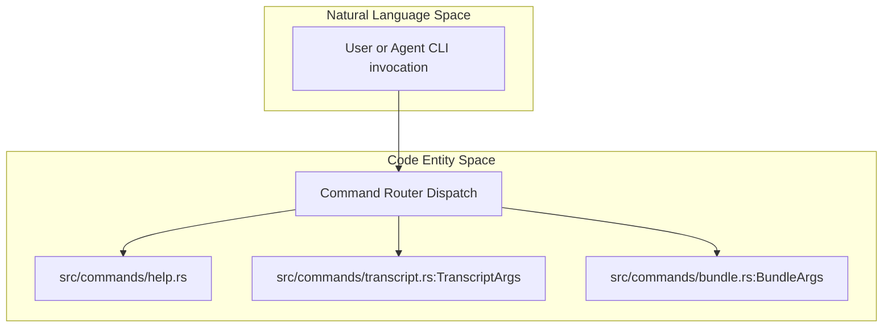

<!-- source: DeepWiki mcp.deepwiki.com · repo aannoo/hcom · page 5 Command Reference · fetched 2026-10-26 -->

# Command Reference

<details>
<summary>Relevant source files</summary>

The following files were used as context for generating this wiki page:

- [src/commands/bundle.rs](src/commands/bundle.rs)
- [src/commands/help.rs](src/commands/help.rs)
- [src/commands/transcript.rs](src/commands/transcript.rs)

</details>


This page provides a comprehensive high-level reference for the `hcom` command-line interface. The CLI is the primary entry point for human operators and AI agents alike to control the multi-agent system, route messages, query historical event streams, and manage PTY-wrapped terminal sessions [src/commands/help.rs:1-4]().

As a parent page, this section outlines the broad categories of commands available in `hcom`. For detailed command-line arguments, syntax variants, and execution flows, please refer to the child pages linked throughout.

## Command Structure and Invocation

The `hcom` binary acts as a command router that dispatches requests to native Rust handlers, hooks, or terminal launchers [src/commands/help.rs:1-5]()]. It supports launching interactive dashboards, starting multiple tool instances, or executing specific administrative commands [src/commands/help.rs:56-65]().

### Argument Syntax
Most commands follow a standard structural pattern where global flags or command-specific parameters precede an optional double-dash (`--`) separator, which denotes the beginning of raw message text or positional content [src/commands/help.rs:12-43]().

```bash
hcom <command> [positional-args] [--flags] [-- message-text]
```

| Component | Description |
|-----------|-------------|
| **Command** | The primary action (e.g., `send`, `list`, `events`) [src/commands/help.rs:56-65](). |
| **Flags** | Modifiers like `--from`, `--intent`, or `--json` [src/commands/help.rs:142](). |
| **Separator** | `--` indicates the end of flag parsing and start of raw payload text. |
| **Message** | Unquoted trailing text passed directly to the command handler. |

Sources: [src/commands/help.rs:1-65]()

## Identity and Context Resolution

When any command executes within an agent environment, `hcom` resolves the caller's identity to correctly attribute messages, track readiness states, and filter event visibility.

### Resolution Flow
The system resolves identity by evaluating environment identifiers, process bindings, and explicit flags via the core command routing system [src/commands/help.rs:1-10]().

**Title: Identity and Command Routing Flow**


Sources: [src/commands/help.rs:1-10](), [src/commands/transcript.rs:43-78](), [src/commands/bundle.rs:33-118]()

## Command Categories and Sub-Topics

The `hcom` CLI is organized into five functional categories. Below is a high-level summary of each category and links to their detailed child documentation.

### 5.1 Launch and Instance Management
Instance lifecycle commands allow operators and agents to spawn new agent processes, resume previous sessions, fork existing execution threads, and clean up inactive resources [src/commands/help.rs:56-94](). Launch commands support parameters for configuring isolated environments, background execution, and custom tag assignments [src/commands/help.rs:83-94]().

For details, see [Launch and Instance Management](#5.1).

Sources: [src/commands/help.rs:56-94]()

### 5.2 Messaging Commands
Messaging commands facilitate inter-agent communication, enabling structured message delivery across broadcast and mention scopes [src/commands/help.rs:140-151](). The `send` command supports intent qualifiers, reply chaining, and context bundles, while `list` provides visibility into active agents and their read receipts [src/commands/help.rs:195-216]().

For details, see [Messaging Commands](#5.2).

Sources: [src/commands/help.rs:140-167](), [src/commands/help.rs:195-216]()

### 5.3 Events and Query Commands
The events subsystem provides deep observability into the system state by querying messages, file system mutations, status transitions, and lifecycle events [src/commands/help.rs:56-60](). Commands like `listen` and `events sub` allow synchronous blocking or asynchronous subscriptions to specific database triggers [src/commands/help.rs:96-124]().

For details, see [Events and Query Commands](#5.3).

Sources: [src/commands/help.rs:12-43](), [src/commands/help.rs:56-124]()

### 5.4 Configuration and Management Commands
Administrative commands manage user settings, tool hooks, and system configurations via the `config` subsystem [src/commands/help.rs:1-10](). This category also covers remote synchronization via relay daemons, bundle management through `src/commands/bundle.rs` [src/commands/bundle.rs:1-5](), and automated update checks.

For details, see [Configuration and Management Commands](#5.4).

Sources: [src/commands/help.rs:1-10](), [src/commands/bundle.rs:1-5]()

### 5.5 Terminal Commands
Terminal commands provide low-level inspection and interaction with PTY-wrapped sessions [src/commands/help.rs:1-10](). Operators can capture screen states in JSON format, inject text input directly into running shells, or debug PTY logging streams.

For details, see [Terminal Commands](#5.5).

Sources: [src/commands/help.rs:1-10]()

---

