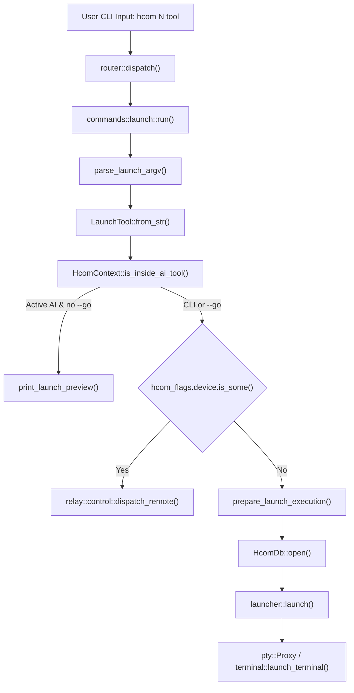
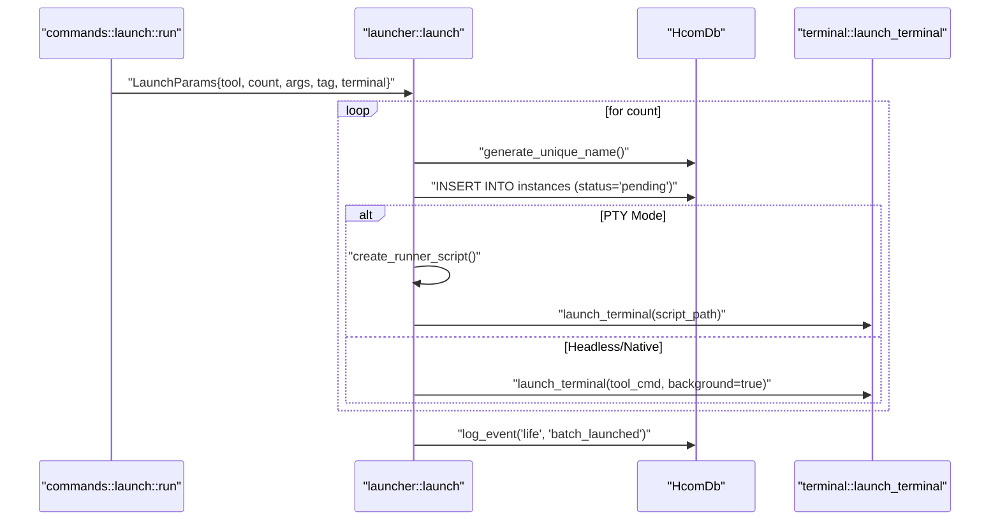
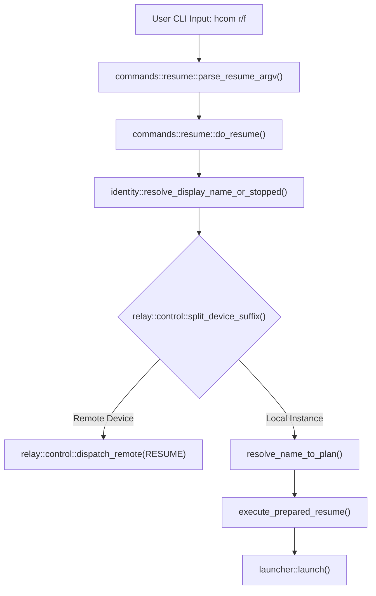

<!-- source: DeepWiki mcp.deepwiki.com · repo aannoo/hcom · page 5.1 Launch and Instance Management · fetched 2026-10-26 -->

# Launch and Instance Management

<details>
<summary>Relevant source files</summary>

The following files were used as context for generating this wiki page:

- [src/commands/kill.rs](src/commands/kill.rs)
- [src/commands/launch.rs](src/commands/launch.rs)
- [src/commands/reset_ops.rs](src/commands/reset_ops.rs)
- [src/commands/resume.rs](src/commands/resume.rs)
- [src/core/tips.rs](src/core/tips.rs)
- [src/launcher.rs](src/launcher.rs)
- [src/shared/identity.rs](src/shared/identity.rs)
- [src/shared/terminal_presets.rs](src/shared/terminal_presets.rs)
- [src/terminal.rs](src/terminal.rs)

</details>


## Purpose and Scope

Section 5.1 documents the implementation, data flow, and code structures governing hcom's command-line interface and internal execution pipeline for launching, resuming, forking, starting, stopping, killing, and resetting agent instances. It connects user-facing CLI syntax directly to internal Rust code entities such as `commands::launch::run` `[src/commands/launch.rs:23-23]()`, `commands::resume::do_resume` `[src/commands/resume.rs:110-115]()`, `launcher::launch` `[src/launcher.rs:1-12]()`, and `commands::kill::kill_tracked_instance` `[src/commands/kill.rs:130-134]()`.

Sources: `[src/commands/launch.rs:23-23]()`, `[src/commands/resume.rs:110-115]()`, `[src/launcher.rs:1-12]`, `[src/commands/kill.rs:130-134]()`

---

## Overview

Instance management commands control the complete lifecycle of AI agents across terminals and devices:
- **Launch**: Spawn new tool instances (`hcom [N] tool [args]`) via `commands::launch::run` `[src/commands/launch.rs:23-25]()`.
- **Resume**: Restore stopped sessions (`hcom r <name>`) via `commands::resume::run` `[src/commands/resume.rs:73-77]()`.
- **Fork**: Branch from existing sessions (`hcom f <name>`) via `commands::resume::do_resume` `[src/commands/resume.rs:110-115]()`.
- **Start**: Register ad-hoc instances or recover processes (`hcom start`, `--orphan`, `--as`) `[src/commands/launch.rs:1-180]()`.
- **Control**: Stop, kill, or reset instances (`hcom stop`, `hcom kill`, `hcom reset`) `[src/commands/kill.rs:19-24]()`, `[src/commands/reset_ops.rs:13-13]()`.

Sources: `[src/commands/launch.rs:23-25]`, `[src/commands/resume.rs:73-77]`, `[src/commands/kill.rs:19-24]`, `[src/commands/reset_ops.rs:13-13]()`

---

## Launch Commands

### Syntax and Count Validation

```bash
# Launch N instances of specified tool
hcom [N] claude|gemini|codex|opencode [tool-args...]

# Examples
hcom                      # Launch 1 Claude instance
hcom 3 gemini             # Launch 3 Gemini instances
hcom codex --search       # Launch 1 Codex with --search flag
```

When `N` is omitted, it defaults to 1. Count validation occurs in `commands::launch::run()`, ensuring the requested count is positive and does not exceed `max_launch_count` specified by the tool's `IntegrationSpec` `[src/commands/launch.rs:27-34]()`.

Sources: `[src/commands/launch.rs:23-34]()`

### Tool Detection, Dispatch, and Code-Entity Mapping

The launch system translates natural language tool aliases (`LaunchTool::from_str`) into canonical tool specs, computes execution backends (`LaunchBackend::resolve`), and coordinates terminal allocation `[src/launcher.rs:57-76]`, `[src/launcher.rs:171-179]()`.

Diagram: Natural Language Launch Space to Code Entity Space


Sources: `[src/commands/launch.rs:23-145]`, `[src/launcher.rs:57-76]`, `[src/launcher.rs:171-179]()`

### Launch Execution Flow

The `launcher::launch()` function coordinates database persistence, unique name generation, script staging, and terminal process creation `[src/launcher.rs:1-12]()`.

Diagram: launcher::launch() Execution Sequence


Sources: `[src/commands/launch.rs:168-185]`, `[src/launcher.rs:1-19]()`

### Launch Flags

| Flag | Purpose | Code Entity / Reference |
|------|---------|-------------------------|
| `--tag <name>` | Assign tag prefix for grouping | `hcom_flags.tag` `[src/commands/launch.rs:36-36]()` |
| `--terminal <preset>` | Select terminal emulator preset | `hcom_flags.terminal` `[src/commands/launch.rs:37-37]()` |
| `--headless` | Run in background without window | `hcom_flags.headless` `[src/commands/launch.rs:38-38]()` |
| `--hcom-prompt` | Set initial automated prompt | `hcom_flags.initial_prompt` `[src/commands/launch.rs:93-93]()` |
| `--dir <path>` | Set working directory override | `hcom_flags.dir` `[src/commands/launch.rs:39-39]()` |
| `--device <id>` | Dispatch launch to remote device | `hcom_flags.device` `[src/commands/launch.rs:39-39]()` |

Sources: `[src/commands/launch.rs:36-40]`, `[src/commands/launch.rs:93-94]()`

---

## Resume and Fork Commands

### Usage and Plan Resolution

- **Resume (`hcom r <name>`)**: Loads a stopped instance snapshot and relaunches with the original session ID `[src/commands/resume.rs:1-5]()`.
- **Fork (`hcom f <name>`)**: Branches from an active or stopped session, generating a new distinct name and derivative session token `[src/commands/resume.rs:60-61]()`.

### Resume Flow and Code-Entity Mapping

Resume/fork execution resolves the target instance name, prepares a resume plan (`prepare_resume_plan`), handles remote RPC dispatch if a device suffix is present, or executes locally via `execute_prepared_resume` `[src/commands/resume.rs:110-201]()`.

Diagram: Resume & Fork Architecture and Data Flow


Sources: `[src/commands/resume.rs:73-198]()`

### Resume vs Fork Matrix

| Aspect | Resume (`hcom r`) | Fork (`hcom f`) |
|--------|-------------------|-----------------|
| **Instance Name** | Reuses original instance name | Generates new random CVCV name |
| **Session ID** | Retains original `session_id` | Branches into derivative session |
| **Working Directory** | Original instance CWD | Current directory (or `--dir`) `[src/commands/resume.rs:125-133]` |
| **Remote Support** | Supported via MQTT RPC | Supported with explicit `--dir` `[src/commands/resume.rs:123-132]()` |

Sources: `[src/commands/resume.rs:111-198]()`

---

## Start Command

The `start` command registers unmanaged processes or recovers orphaned PTY agent instances.

### Start Variants
1. **Bare Start**: Registers the current process into the database and binds session tokens.
2. **`--orphan <name|pid>`**: Adopts and recovers an orphaned PTY process.
3. **`--as <name>`**: Rebinds current session identity to a specified instance name.

### Subagent Detection and Task Blocking
`hcom start` detects subagent execution by evaluating parent instances through `detect_subagent()`. To avoid race conditions and state corruption, a gate blocks starts if active `running_tasks` are present.

Sources: `[src/commands/start.rs:1-198]()`

---

## Stop, Kill, and Reset Commands

### Stop and Kill Implementation

- **`hcom stop`**: Gracefully signals instances (`all`, `tag:X`, or specific names) to terminate and records stopped life events `[src/commands/stop.rs:1-21]()`.
- **`hcom kill`**: Sends `SIGTERM` to process groups via `kill_tracked_instance()` and cleans up associated terminal panes using preset close commands `[src/commands/kill.rs:130-156]()`.

### EPERM Recheck Logic

When `kill(2)` returns `EPERM` due to process ownership boundaries, `normalize_kill_result()` intercepts the error, checks if the terminal pane is already closed or if `pidtrack::is_alive(pid)` returns false, resolving the state to `AlreadyDead` when appropriate `[src/commands/kill.rs:86-128]()`.

### Reset Operations

`hcom reset` archives existing databases to `~/.hcom/archive/session-{timestamp}/`, clears WAL/SHM sidecars, cleans temporary launch scripts and old logs via `archive_and_clear_db()` and `clean_temp_files()`, and resets user configuration backups `[src/commands/reset_ops.rs:13-187]()`.

Sources: `[src/commands/stop.rs:1-21]`, `[src/commands/kill.rs:86-156]`, `[src/commands/reset_ops.rs:13-187]()`

---

## Lifecycle State Transitions

Instances transition through defined states managed via database records and `life` events.

```mermaid
stateDiagram-v2
    [*] --> Pending: "launcher::launch()"
    Pending --> Ready: "PTY/Tool startup (hook)"
    Ready --> Listening: "instance_binding::bind_session_to_process()"
    Listening --> Active: "Tool use (hook)"
    Active --> Listening: "Tool finish (hook)"
    Listening --> Stopped: "hcom stop/kill"
    Stopped --> [*]: "DELETE FROM instances"
```
Sources: `[src/commands/launch.rs:168-205]`, `[src/commands/start.rs:141-143]`, `[src/commands/kill.rs:130-156]()`

---

## Summary Matrix

| Command | Action | Name Generation | Session Scope |
|---------|--------|-----------------|---------------|
| `hcom N tool` | New Launch | Random CVCV | New Session |
| `hcom r` | Resume | Reuse Existing | Original Session |
| `hcom f` | Fork | Random CVCV | Derivative Session |
| `hcom start` | Ad-hoc/Subagent | Random / Structured | New / Parent |
| `hcom stop` | Graceful Exit | N/A | Terminated |
| `hcom kill` | Force Exit | N/A | Terminated |
| `hcom reset` | Full Reset | N/A | Cleared / Archived |

Sources: `[src/commands/launch.rs:1-20]`, `[src/commands/resume.rs:1-5]`, `[src/commands/kill.rs:1-156]`, `[src/commands/reset_ops.rs:13-58]()`

---

