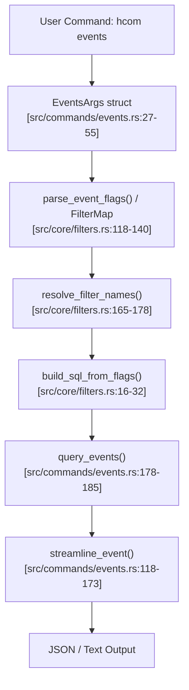
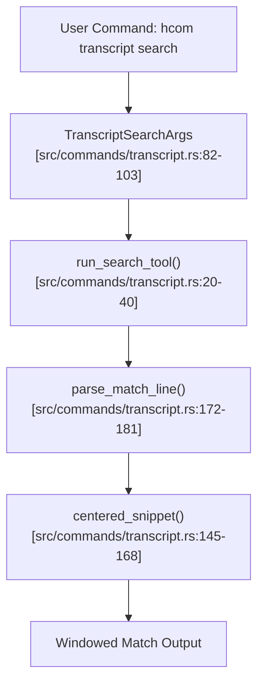

<!-- source: DeepWiki mcp.deepwiki.com · repo aannoo/hcom · page 5.3 Events and Query Commands · fetched 2026-10-26 -->

# Events and Query Commands

Relevant source files

The following files were used as context for generating this wiki page:

- [src/cli_context.rs](src/cli_context.rs)
- [src/commands/archive.rs](src/commands/archive.rs)
- [src/commands/bundle.rs](src/commands/bundle.rs)
- [src/commands/events.rs](src/commands/events.rs)
- [src/commands/help.rs](src/commands/help.rs)
- [src/commands/listen.rs](src/commands/listen.rs)
- [src/commands/transcript.rs](src/commands/transcript.rs)
- [src/messages.rs](src/messages.rs)
- [src/shared/constants.rs](src/shared/constants.rs)
- [src/shared/mod.rs](src/shared/mod.rs)

**Purpose and scope**: This technical reference details the implementation of event-driven query, subscription, listening, transcript inspection, and session archiving facilities in `hcom`. It covers argument parsing structures (`EventsArgs`, `TranscriptArgs`, `ArchiveArgs`), filter compilation (`build_sql_from_flags`), real-time blocking via `hcom listen` with `--wait`, database-backed subscriptions (`hcom events sub`), and historical log analysis (`hcom transcript`, `hcom archive`).

---

## 1. Event Stream Architecture and Types

The event stream is backed by the `events` SQLite table and flattened through the `events_v` view [src/commands/events.rs:178-185](). Events are categorized into three primary types processed by `streamline_event` [src/commands/events.rs:118-173]():

| Event Type | Description | Code Symbol / Mapping |
|------------|-------------|-----------------------|
| `message` | Agent-to-agent text exchanges | `type = 'message'` [src/commands/events.rs:136-138]() |
| `status` | State transitions and tool activities | `type = 'status'` [src/commands/events.rs:139-154]() |
| `life` | Instance lifecycle updates | `type = 'life'` [src/commands/events.rs:155-157]() |

Sources: [src/commands/events.rs:118-173](), [src/commands/events.rs:178-185]()

---

## 2. Querying Events and Filter Logic

Queries against the event stream are executed through the `hcom events` CLI command, driven by `EventsArgs` [src/commands/events.rs:27-55]() and parsed into composable filter structures [src/core/filters.rs:74]().

Title: Event Query Data Flow

Sources: [src/commands/events.rs:27-55](), [src/commands/events.rs:118-185](), [src/core/filters.rs:16-140]()

### Filter Flag Mapping

The filtering system maps CLI flags to database columns using `FLAG_MAP` [src/core/filters.rs:15-32](). Shortcut flags like `--idle` and `--blocked` are expanded dynamically via `expand_shortcuts` [src/core/filters.rs:84-108]() before parsing.

- `--agent` $\rightarrow$ `instance` [src/core/filters.rs:16]()
- `--type` $\rightarrow$ `type` [src/core/filters.rs:17]()
- `--status` $\rightarrow$ `status` [src/core/filters.rs:18]()
- `--file` / `--cmd` $\rightarrow$ tool execution checks [src/core/filters.rs:20-21]()

Sources: [src/core/filters.rs:15-108]()

---

## 3. Blocking and Waiting (`hcom listen`)

The `hcom listen` command (`ListenArgs`) blocks execution until an event matching specified filters occurs [src/commands/listen.rs:23-40](). It supports positional and flag-based timeouts (`--timeout`) [src/commands/listen.rs:26-30](), JSON output formatting (`message_json`) [src/commands/listen.rs:91-101](), and notification wakeups via `NotifyServer` [src/commands/listen.rs:19]().

Title: Listen and Wakeup Sequence

```mermaid
sequenceDiagram
    participant User
    participant Listen as "cmd_listen<br/>[src/commands/listen.rs:153]"
    participant Identity as "identity::resolve_identity<br/>[src/identity/mod.rs]"
    participant DB as "HcomDb<br/>[src/db/mod.rs]"
    participant Notify as "NotifyServer<br/>[src/notify/mod.rs]"

    User->>Listen: hcom listen --timeout 60 --name luna
    Listen->>Identity: Resolve instance context
    Identity-->>Listen: Identity & Instance Name
    Listen->>Notify: Register TCP notification endpoint
    loop Timeout or Match
        Listen->>DB: Execute filtered query on events_v
        alt Event Found
            Listen->>User: Emit JSON / formatted text
        else No Event
            Listen->>Notify: Await socket notification or sleep
            Listen->>DB: update_heartbeat()<br/>[src/commands/listen.rs:51]
        end
    end
```

Sources: [src/commands/listen.rs:23-192](), [src/notify/mod.rs:1-50]()

---

## 4. Event Subscriptions (`hcom events sub`)

Subscriptions allow agents or external actors to register persistent interest in event patterns. Managed via `hcom events sub` (`EventsSubArgs`), subscriptions are inserted into the `kv` table as JSON blobs [src/commands/events.rs:68-94]().

- `--once`: Auto-removes the subscription after its first matching event fires [src/commands/events.rs:71-73]().
- `--for`: Registers the subscription on behalf of another named agent (`for_agent`) [src/commands/events.rs:74-76]().
- `--on-hit`: Attaches an automatic outbound message payload sent whenever the subscription trips [src/commands/events.rs:80-82]().
- `hcom events unsub <id>`: Deletes the subscription record [src/commands/events.rs:96-104]().

Sources: [src/commands/events.rs:68-104](), [src/db/subscriptions.rs:1-179]()

---

## 5. Transcript Viewing and Searching (`hcom transcript`)

The `hcom transcript` command provides direct access to agent execution logs stored on disk, supporting range slices, timeline views, and pattern searches via ripgrep (`rg`) or grep backends [src/commands/transcript.rs:43-120]().

Title: Transcript Search Architecture

Sources: [src/commands/transcript.rs:20-103](), [src/commands/transcript.rs:145-181]()

### Transcript Subcommands and Options

- `hcom transcript @instance [N | N-M]` — Views specific exchange ranges [src/commands/transcript.rs:45-70]().
- `hcom transcript search "pattern"` — Searches conversation transcripts using `rg` with column tracking, falling back to literal matching (`centered_snippet`) [src/commands/transcript.rs:73-103, 145-168]().
- `hcom transcript timeline` — Displays chronological interaction history across all tracked agent instances [src/commands/transcript.rs:76, 105-120]().

Sources: [src/commands/transcript.rs:43-120](), [src/commands/transcript.rs:145-181]()

---

## 6. Archive Queries (`hcom archive`)

Archived session directories located in `~/.hcom/archive/session-{timestamp}/` contain historical `hcom.db` snapshots [src/commands/archive.rs:1-12, 37-114](). The `hcom archive` command (`ArchiveArgs`) queries these historical databases [src/commands/archive.rs:13-34]().

- `list_archives(here_filter)`: Enumerates archive directories, filtering by working directory (`--here`) and compiling event/instance counts via `query_archive_counts` [src/commands/archive.rs:37-156]().
- `query_archive_events`: Connects to an archive database and executes SQL queries against `events_v` or `events` tables [src/commands/archive.rs:183-212]().

Sources: [src/commands/archive.rs:1-212]()

---

## 7. Remote Event Queries and RPC

When executing queries with `--remote-fetch` and `--device <ID>`, `hcom events` delegates execution across network boundaries via MQTT control topics [src/commands/events.rs:49-54]().

- `send_rpc_control_ephemeral`: Packages filter queries into AEAD-encrypted control envelopes published to `{relay_id}/control` [src/relay/control.rs:155-180]().
- `wait_for_rpc_result_with_db`: Polls the local `events` table for a corresponding `type = 'rpc_result'` event, consuming and purging the rendezvous record via `delete_rpc_result` [src/relay/control.rs:208-238]().

Sources: [src/commands/events.rs:49-54](), [src/relay/control.rs:155-238]()

---

