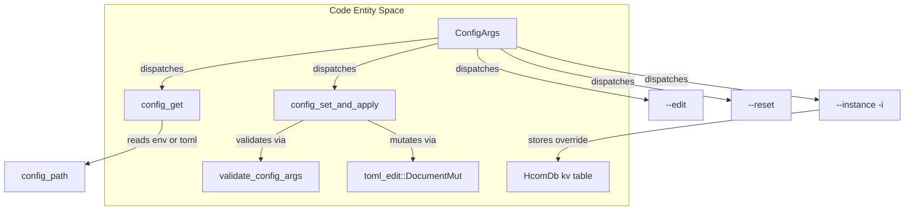
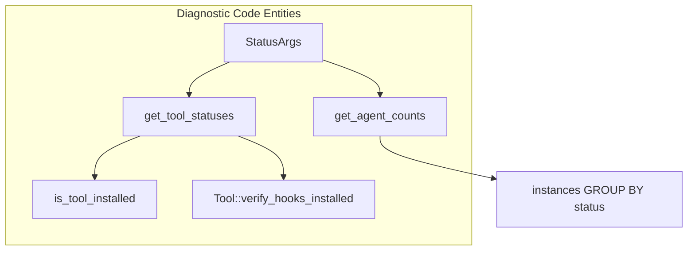

<!-- source: DeepWiki mcp.deepwiki.com · repo aannoo/hcom · page 5.4 Configuration and Management Commands · fetched 2026-10-26 -->

# Configuration and Management Commands

<details>
<summary>Relevant source files</summary>

The following files were used as context for generating this wiki page:

- [src/commands/config.rs](src/commands/config.rs)
- [src/commands/hooks.rs](src/commands/hooks.rs)
- [src/commands/mod.rs](src/commands/mod.rs)
- [src/commands/status.rs](src/commands/status.rs)
- [src/commands/update.rs](src/commands/update.rs)
- [src/config.rs](src/config.rs)
- [src/router.rs](src/router.rs)
- [src/update.rs](src/update.rs)

</details>


This page documents commands for configuring `hcom` behavior, managing system status and tool hooks, packaging context bundles, controlling cross-device relay synchronization, and performing system updates or resets. These commands provide administrative and utility functions for the `hcom` system, implemented primarily in Rust within the command handlers and runtime modules.

**Scope:** Commands covered are `config`, `status`, `hooks`, `bundle`, `relay`, `update`, and `reset`.

---

## Configuration Management (`hcom config`)

The `config` command manages global and per-instance configuration settings via `ConfigArgs` [src/commands/config.rs:24-52](). Configuration in `hcom` follows a strict precedence hierarchy where CLI flags override environment variables, which override `config.toml` settings, which override hardcoded defaults [src/commands/config.rs:1-5]().

### Configuration Key Registry

The system maintains a centralized registry of known configuration fields (`FIELDS`) in `src/config.rs`, which defines their TOML paths, environment variable bindings, data types (`FieldKind`), and descriptions [src/config.rs:143-188]().

| Key | Scope | Type | Description |
|-----|-------|------|-------------|
| `terminal` | Global | string | Terminal preset for spawning agent panes [src/config.rs:183]() |
| `title_mode` | Global | string | Terminal title mode (`combined` \| `label` \| `off`) [src/config.rs:184]() |
| `tag` | Global/Launch | string | Group tag for launched instances [src/config.rs:185]() |
| `hints` | Global/Inst | string | Text injected with all messages [src/config.rs:186]() |
| `notes` | Global/Launch | string | One-time notes appended at bootstrap [src/config.rs:187]() |
| `subagent_timeout` | Global/Inst | integer | Timeout for Claude subagents in seconds [src/config.rs:188]() |

### Config Command Operations and Data Flow

The `config` command handles setting, getting, unsetting, resetting, and editing configuration values through functions like `config_set`, `config_get`, and `config_set_and_apply` [src/commands/config.rs:73-190]().


**Config Command Architecture and Data Flow**

Sources: [src/commands/config.rs:24-52](), [src/commands/config.rs:73-190]()

### Implementation Details
- **TOML Mutation**: Global settings are read and written using `toml_edit::DocumentMut` to preserve user comments and formatting [src/commands/config.rs:143-150]().
- **Argument Validation**: Configuration updates for tool arguments (such as `claude_args`) are validated using `validate_config_args` and `validate_tool_args` prior to writing [src/commands/config.rs:98-117]().
- **Per-Instance Overrides**: Instance-level keys defined in `INSTANCE_KEYS` (`tag`, `timeout`, `hints`, `subagent_timeout`) allow localized overrides stored in the SQLite database [src/commands/config.rs:54-63]().

Sources: [src/commands/config.rs:1-2615](), [src/config.rs:143-188]()

---

## System Health and Tool Hooks (`hcom status` and `hcom hooks`)

The `status` and `hooks` commands provide diagnostics on system health, tool installation states, and shell hook integration across supported AI tools [src/commands/status.rs:14-24](), [src/commands/hooks.rs:13-20]().

### Status Overview and Tool Detection

`hcom status` collects information about active/listening agents, background relays, terminal presets, and integration statuses using `get_tool_statuses` and `get_agent_counts` [src/commands/status.rs:72-123](), [src/commands/status.rs:179-203]().


**Status Collection Data Flow**

Sources: [src/commands/status.rs:14-123](), [src/commands/status.rs:179-203]()

### Hook Management (`hcom hooks`)

The `hooks` command manages shell hook registration and permissions through subcommands mapped via `HooksArgs` [src/commands/hooks.rs:13-20]().
- **`status` (`cmd_hooks_status`)**: Reports whether hooks are installed, outdated, unverified, or disabled for persistent tools like Claude, Gemini, and Codex [src/commands/hooks.rs:98-149]().
- **`add` / `remove`**: Installs or uninstalls hook configurations in tool settings directories while syncing permission states (`refresh_installed_hook_permissions`) [src/commands/hooks.rs:57-76]().

Sources: [src/commands/status.rs:1-760](), [src/commands/hooks.rs:1-442]()

---

## Context Bundles (`hcom bundle`)

Bundles package structured context—including event history, file references, and transcript excerpts—to share context between agents [src/commands/bundle.rs:1-220]().

### Bundle Structure and Storage
Bundles are stored as events with `type = 'bundle'`, holding a JSON payload containing metadata and references [src/commands/bundle.rs:180-220]().

```mermaid
classDiagram
    class "BundleEvent" {
        +i64 id
        +string timestamp
        +string type
        +string data
    }
    class "BundleData" {
        +string bundle_id
        +string title
        +string description
        +BundleRefs refs
    }
    class "BundleRefs" {
        +string[] events
        +string[] files
        +string[] transcript
    }
    "BundleEvent" *-- "BundleData"
    "BundleData" *-- "BundleRefs"
```
**Bundle Data Model**

Sources: [src/commands/bundle.rs:180-220]()

### Bundle Subcommands
- **`list` / `show` / `cat`**: Inspect existing bundles, metadata, and expanded file/transcript contents [src/commands/bundle.rs:98-117]().
- **`prepare` / `create`**: Automatically construct context bundles by analyzing recent transcript exchanges and file write operations [src/commands/bundle.rs:128-174]().
- **`chain`**: Trace the lineage of extended bundles [src/commands/bundle.rs:120-125]().

Sources: [src/commands/bundle.rs:1-220]()

---

## Cross-Device Relay System (`hcom relay`)

The `relay` system enables cross-device synchronization via MQTT. The `relay` command manages local device identity, broker connection settings, and daemon control [src/commands/relay.rs:1-176](), [src/relay/mod.rs:1-157]().

- **Identity Persistence**: The device UUID is stored in `~/.hcom/.tmp/device_id` [src/relay/mod.rs:155-157]().
- **Health Monitoring**: `relay::relay_health` checks heartbeat keys and process files to determine if the background worker is `Connected`, `Starting`, `Stale`, or in an `Error` state [src/commands/relay.rs:150-176]().
- **Worker Daemon**: The background relay worker manages MQTT subscriptions and local SQLite synchronization [src/relay/worker.rs:77-179]().

Sources: [src/commands/relay.rs:1-176](), [src/relay/mod.rs:1-157](), [src/relay/worker.rs:77-179]()

---

## System Updates and Resets (`hcom update` and `hcom reset`)

### System Update (`hcom update`)
The `update` command checks for and applies binary releases using shared utilities in `src/update.rs` [src/commands/update.rs:1-15](), [src/update.rs:1-211]().
- **Version Verification**: Evaluates current versus latest available versions via `fetch_update_info()` and stages updates through official package managers or platform installers [src/commands/update.rs:31-78](), [src/update.rs:144-211]().
- **Binary Validation**: After updating, `verify_updated_binary` runs the new executable with `--version` and `HCOM_UPDATE_VERIFY` to guarantee correctness before replacing the active binary [src/commands/update.rs:93-114]().

### System Reset (`hcom reset`)
The `reset` command cleans up local state depending on the specified scope [src/commands/reset.rs:1-86]().
- **Default Scope**: Archives and clears the SQLite database while stopping running instances [src/commands/reset.rs:43-59]().
- **Hooks Scope**: Removes installed tool hooks [src/commands/reset.rs:38-40]().
- **All Scope**: Stops all agents/daemons, clears the database, removes hooks, resets `config.toml`, and clears device identity [src/commands/reset.rs:62-83]().

Sources: [src/commands/update.rs:1-114](), [src/update.rs:1-211](), [src/commands/reset.rs:1-86]()

---

