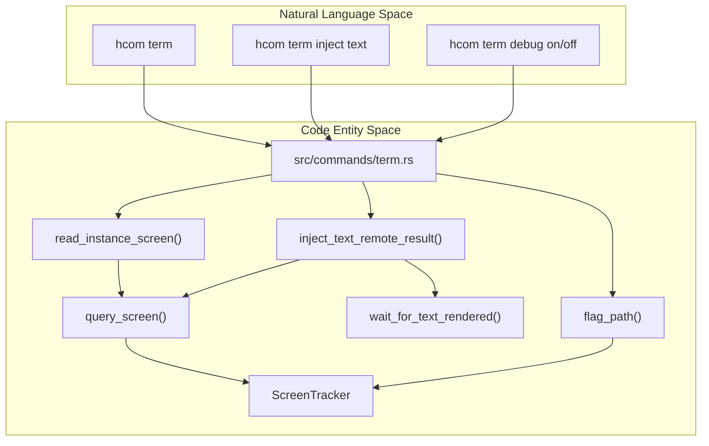
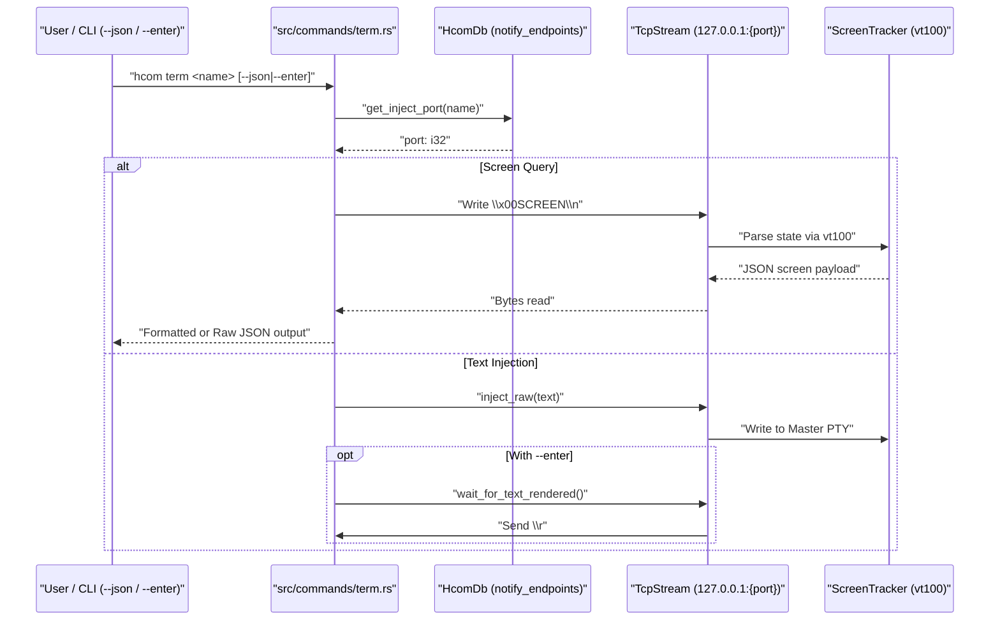

<!-- source: DeepWiki mcp.deepwiki.com · repo aannoo/hcom · page 5.5 Terminal Commands · fetched 2026-10-26 -->

# Terminal Commands

<details>
<summary>Relevant source files</summary>

The following files were used as context for generating this wiki page:

- [src/commands/term.rs](src/commands/term.rs)
- [src/pty/conpty.rs](src/pty/conpty.rs)
- [src/pty/console_input.rs](src/pty/console_input.rs)
- [src/pty/trace.rs](src/pty/trace.rs)

</details>


## Purpose and Scope

The `hcom term` command provides direct access to agent terminal screens via PTY (pseudoterminal) inspection, text injection, and diagnostic logging. This subsystem bridges external user interactions and automated message delivery systems with running terminal emulators (`vt100`).

- **Screen inspection**: View terminal state via `vt100` screen parsing, supported by `ScreenTracker` and formatted through `read_instance_screen` [src/commands/term.rs:170-184]().
- **Text injection**: Programmatically feed keystrokes into agent input boxes via TCP inject ports using `inject_text_remote_result`, complete with text-rendering synchronization (`wait_for_text_rendered`) [src/commands/term.rs:94-118](), [src/commands/term.rs:128-138]().
- **Debug logging**: Trace PTY operations and screen snapshots through a flag-file mechanism (`flag_path`) monitored by `ScreenTracker` [src/commands/term.rs:28-31](), [src/pty/screen.rs:142-167]().

These operations target PTY-managed instances registered in the `notify_endpoints` SQLite table with an `inject` endpoint [src/commands/term.rs:38-46]().

Sources: [src/commands/term.rs:1-12](), [src/commands/term.rs:38-46](), [src/pty/screen.rs:142-167]()

## Command Overview

The following diagram maps high-level terminal administration operations (Natural Language Space) to their corresponding implementation modules and functions (Code Entity Space).

Title: "Terminal Command Routing and Execution Architecture"


Sources: [src/commands/term.rs:13-23](), [src/commands/term.rs:28-31](), [src/commands/term.rs:94-118](), [src/commands/term.rs:170-184](), [src/pty/screen.rs:142-167]()

## Screen Inspection

### Basic Usage

```bash
hcom term <name>         # Show formatted text for a specific agent
hcom term <name> --json  # Get structured screen state for programmatic use
```

The `read_instance_screen` function resolves the inject port via `get_inject_port`, queries the target PTY server using `query_screen`, and outputs either human-readable formatted text or raw JSON (`raw_json: bool`) [src/commands/term.rs:38-46](), [src/commands/term.rs:170-184]().

### JSON Output Structure

When `--json` is specified, `query_screen` returns serialized JSON from the vt100 parser state [src/commands/term.rs:155-168]().

| Field | Description | Code Entity |
|-------|-------------|-------------|
| `lines` | Array of strings representing screen rows | `format_screen` lines [src/commands/term.rs:188-188]() |
| `size` | Terminal dimensions `[rows, cols]` | `format_screen` size [src/commands/term.rs:190-190]() |
| `cursor` | Current cursor coordinates `[row, col]` | `format_screen` cursor [src/commands/term.rs:189-189]() |
| `ready` | Boolean indicating if tool is ready for input | `ScreenTracker::is_ready()` [src/pty/screen.rs:149-151]() |
| `input_text` | Current content inside the input prompt box | `ScreenTracker::get_input_box_text()` [src/pty/screen.rs:8-8]() |

Sources: [src/commands/term.rs:38-46](), [src/commands/term.rs:155-184](), [src/pty/screen.rs:1-9]()

## Text Injection

### Command Syntax

```bash
hcom term inject <name> "git status"  # Type text without pressing Enter
hcom term inject <name> --enter       # Press Enter (\r) only
hcom term inject <name> "ls" --enter  # Type text and press Enter
```

### Injection Execution Flow

Text injection bypasses message broker queues to write directly into the PTY input stream via a TCP socket connected to the instance's injection server [src/commands/term.rs:86-92]().

1. **Port Resolution**: `get_inject_port` queries `notify_endpoints` for the port bound to `instance` with `kind = 'inject'` [src/commands/term.rs:38-46]().
2. **Text Transmission**: `inject_raw` connects to `127.0.0.1:{port}` and transmits the byte slice [src/commands/term.rs:86-92]().
3. **Render Synchronization**: If `--enter` accompanies text, `wait_for_text_rendered` polls `query_screen` until `input_text` matches the injected string, verifying that the TUI has rendered the keystrokes before dispatching the carriage return (`\r`) [src/commands/term.rs:105-110](), [src/commands/term.rs:128-138]().

Sources: [src/commands/term.rs:38-46](), [src/commands/term.rs:86-118](), [src/commands/term.rs:128-138]()

## PTY Delivery Integration

The following sequence diagram bridges external automation triggers (Natural Language Space) to the low-level TCP and PTY operations (Code Entity Space) executed during text and screen manipulation.

Title: "PTY Inspection and Injection Data Flow"


Sources: [src/commands/term.rs:38-46](), [src/commands/term.rs:86-92](), [src/commands/term.rs:155-168](), [src/pty/screen.rs:142-148]()

## Debug Logging

PTY debugging captures complex escape sequence interactions and screen updates. 

### Control Commands
- **`hcom term debug on`**: Creates the PTY debug trigger flag file at `hcom_dir().join(".tmp").join("pty_debug_on")` [src/commands/term.rs:28-31]().
- **`hcom term debug off`**: Deletes the flag file to halt logging [src/commands/term.rs:28-31]().

### Implementation Mechanics
`ScreenTracker` checks the existence of `debug_flag_path` during updates [src/pty/screen.rs:160-165](). When active, output chunks, terminal dimensions, and state evaluations are flushed to `{name}_{pid}.log` files located under `.tmp/logs/pty_debug/` [src/pty/screen.rs:159-167](). This assists in diagnosing prompt detection failures, missing ready patterns, and runaway ANSI escape codes.

Sources: [src/commands/term.rs:28-31](), [src/pty/screen.rs:142-167]()

---

