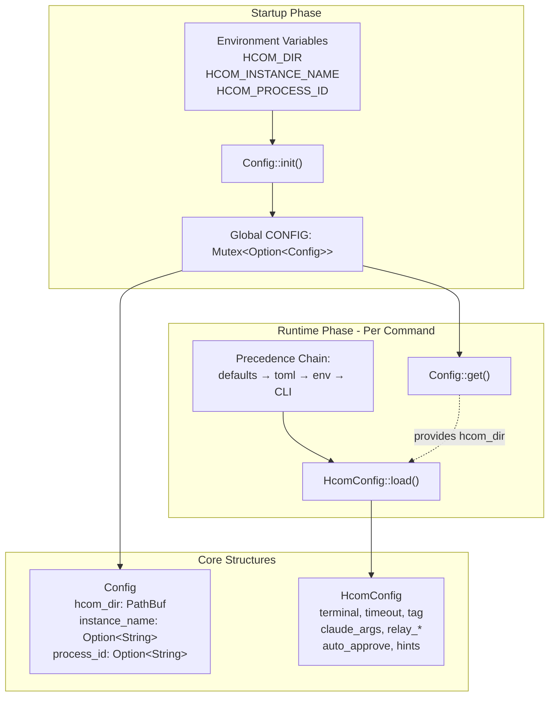
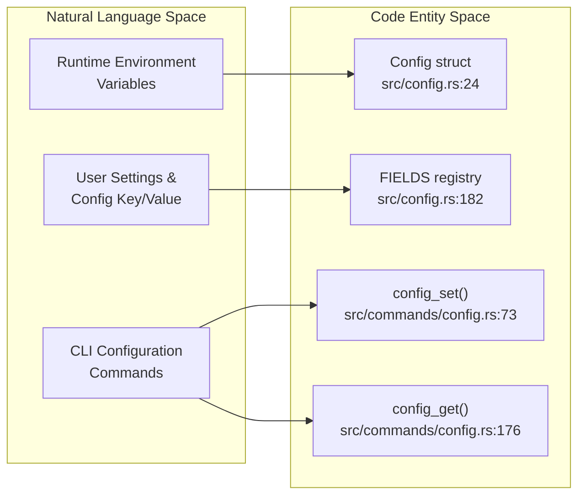

<!-- source: DeepWiki mcp.deepwiki.com · repo aannoo/hcom · page 6 Configuration System · fetched 2026-10-26 -->

# Configuration System

<details>
<summary>Relevant source files</summary>

The following files were used as context for generating this wiki page:

- [src/commands/config.rs](src/commands/config.rs)
- [src/config.rs](src/config.rs)

</details>


The configuration system manages hcom's runtime environment and user preferences through a two-layer architecture. The runtime layer (`Config`) handles startup-time environment variables [src/config.rs:24-33](), while the user-facing settings layer (`HcomConfig`) manages persistent preferences with dynamic loading, type coercion, and validation [src/commands/config.rs:57-182]().

This page provides a high-level overview of the configuration architecture. For specific configuration file structures, precedence orders, and shell environment capture, see [Configuration Files and Precedence](#6.1). For terminal preset customization and command templates, see [Terminal Presets](#6.2). For a comprehensive reference of all available settings, see [Settings Reference](#6.3).

Sources: [src/config.rs:1-6](), [src/commands/config.rs:57-182]()

---

## Two-Layer Architecture

The configuration system maintains a strict separation between process-lifetime runtime identity and per-command user preferences.

### Configuration Architecture



Sources: [src/config.rs:17-79]()

### Config: Runtime Environment Layer

The `Config` struct is a global singleton initialized via `Config::init()` [src/config.rs:35-39]() that provides constant runtime identity and directory paths for the process lifetime.

| Field | Type | Source | Purpose |
|-------|------|--------|---------|
| `hcom_dir` | `PathBuf` | `HCOM_DIR` or `~/.hcom` [src/config.rs:26-27]() | Database and config file root location |
| `instance_name` | `Option<String>` | `HCOM_INSTANCE_NAME` [src/config.rs:28-29]() | Active agent identity binding |
| `process_id` | `Option<String>` | `HCOM_PROCESS_ID` [src/config.rs:30-31]() | PTY wrapper process binding |

Sources: [src/config.rs:24-78]()

---

## Natural Language to Code Entity Space

To bridge user-facing configuration concepts to the underlying Rust codebase, the mapping between user commands/settings and internal code structures is structured around centralized descriptors:

### Conceptual Code Mapping



Sources: [src/config.rs:24-33](), [src/config.rs:182-188](), [src/commands/config.rs:73-79](), [src/commands/config.rs:176-190]()

---

## Configuration Files and Precedence

Settings are loaded via a defined precedence hierarchy where higher-precedence inputs override lower ones:

```
Built-in Defaults < config.toml < Environment Variables < CLI Flags
```

Special isolation rules apply to relay fields (`relay`, `relay_id`, `relay_token`, `relay_psk`, `relay_enabled`), which bypass environment variable overrides and must be configured via `config.toml` or control commands [src/config.rs:143-148](), [src/config.rs:179-188]().

For details on TOML syntax, legacy environment files, and shell environment capture, see [Configuration Files and Precedence](#6.1).

Sources: [src/config.rs:143-188](), [src/config.rs:470-577]()

---

## Terminal Presets

Terminal presets define how agent windows and panes are spawned and closed. The codebase includes built-in presets for popular terminal emulators and multiplexers (e.g., `kitty`, `wezterm`, `tmux`, `ghostty`, `cmux`) alongside support for user-defined custom presets [src/shared/terminal_presets.rs:98-212]().

For details on custom preset creation, open/close command templates, and pane ID environment variable extraction (`pane_id_env`), see [Terminal Presets](#6.2).

Sources: [src/shared/terminal_presets.rs:37-53](), [src/shared/terminal_presets.rs:98-212]()

---

## Settings Reference

The user configuration registry defines validation rules, types, and defaults for all settings. These include:
- **Timeouts & Limits**: `timeout`, `subagent_timeout` [src/commands/config.rs:66-74]()
- **Agent Launch Options**: `tag`, `hints`, tool arguments (`claude_args`, `codex_args`, etc.), and sandbox modes (`codex_sandbox_mode`) [src/commands/config.rs:58-121]()
- **Preferences**: `terminal`, `auto_approve`, `auto_subscribe`, `title_mode` [src/commands/config.rs:133-161]()
- **Relay Configuration**: `relay`, `relay_id`, `relay_token`, `relay_psk`, `relay_enabled` [src/commands/config.rs:163-181]()

For a comprehensive reference of all available fields and validation constraints, see [Settings Reference](#6.3).

Sources: [src/commands/config.rs:57-182]()

---

