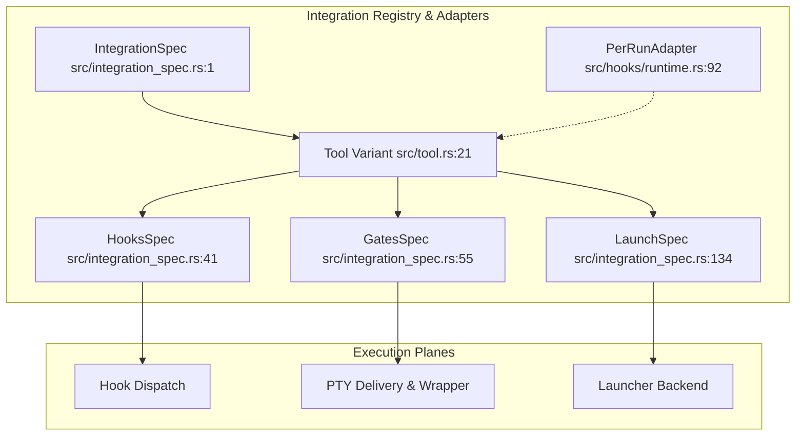
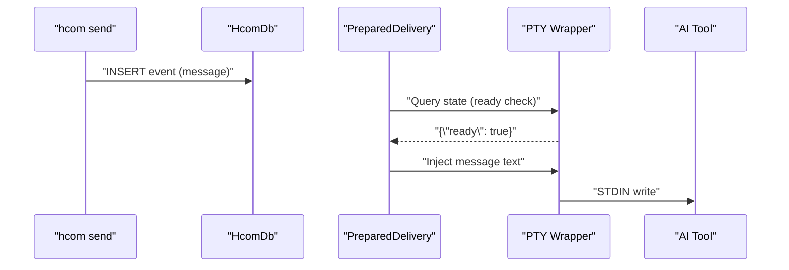

<!-- source: DeepWiki mcp.deepwiki.com · repo aannoo/hcom · page 7 Tool Integration · fetched 2026-10-26 -->

# Tool Integration

Relevant source files

The following files were used as context for generating this wiki page:

- [src/delivery.rs](src/delivery.rs)
- [src/integration_spec.rs](src/integration_spec.rs)

This page explains how `hcom` integrates with AI tools (Claude Code, Gemini CLI, Codex, OpenCode, Kilo, Pi, Omp, and others) through the unified `IntegrationSpec` registry [src/integration_spec.rs:1-10](), tool hooks, and PTY wrapping. It covers the integration mechanisms and how they enable multi-agent communication without requiring native plugin APIs.

For detailed information on specific topics, see the child pages:
- Hook types, payload formats, and shared infrastructure, see [Hook System Overview](#7.1)
- Process and session identity management, see [Identity and Session Binding](#7.2)
- Claude plugin architecture and transcript lineage, see [Claude Code Integration](#7.3)
- Per-tool adapters for Codex, Gemini, OpenCode, Pi, Omp, etc., see [Codex, Gemini and Other Tool Adapters](#7.4)
- PTY delivery test suite and screen state detection, see [PTY Delivery Testing and Validation](#7.5)
- Resume/fork pipelines and foreign session adoption, see [Session Resume, Fork and Adoption](#7.6)

## Integration Registry and Architecture

`hcom` organizes per-tool metadata using a unified `IntegrationSpec` registry defined in `src/integration_spec.rs` [src/integration_spec.rs:1-7](). Each supported AI tool has an associated spec containing its CLI binary name, invocation flags, background capabilities (`BackgroundMode`) [src/integration_spec.rs:90-95](), initial prompt shape (`InitialPromptShape`) [src/integration_spec.rs:98-108](), and PTY delivery gates (`GatesSpec`) [src/integration_spec.rs:55-69]().

Sources: [src/integration_spec.rs:1-158](), [src/hooks/runtime.rs:92-131]()

## Hook-Based Integration and Hook Modes

`hcom` supports two distinct hook operating modes managed via `HookMode` [src/hooks/runtime.rs:138-142]():
1. **Per-Run**: Tools like Claude, Codex, Copilot, Pi, Omp, OpenCode, and Kilo inject hcom's hooks or configuration content dynamically on every launch via a `PerRunAdapter` [src/hooks/runtime.rs:92-131](). No global state or permanent install directories are left behind in the tool's config root.
2. **Persistent**: Tools like Cursor, Gemini, Kimi, and Antigravity install hooks globally inside their respective config directories via `hcom hooks add` [src/commands/hooks.rs:113-191]().

For deep dives into payload formats (stdin JSON vs argv), shared hook helpers in `src/hooks/common.rs`, and installation verification, see [Hook System Overview](#7.1).

Sources: [src/commands/hooks.rs:113-191](), [src/hooks/runtime.rs:92-167]()

## PTY Wrapper and Delivery Gates

When an agent is launched using `hcom N <tool>`, `hcom` wraps the process in a pseudo-terminal (PTY) managed by `delivery.rs`. The PTY wrapper captures terminal output via `vt100` parsing, detects ready states and prompt markers, and injects incoming messages safely. Process bindings and status refreshes are continuously tracked (`refresh_binding`, `refresh_status`) [src/delivery.rs:60-135]().

Delivery behavior is guarded by `GatesSpec` parameters [src/integration_spec.rs:55-69](), which evaluate whether an agent is idle, ready for input, or blocked by user activity or approval prompts before transmitting messages.

Sources: [src/delivery.rs:60-135](), [src/integration_spec.rs:55-69]()

## Summary of Tool Integrations

The codebase maintains adapters and specs for a wide variety of tools:

- **Claude Code**: Full support for per-run injection, subagent lifecycle tracking (`HOOK_SUBAGENT_START` / `HOOK_SUBAGENT_STOP`), transcript lineage, and native print streaming. For details, see [Claude Code Integration](#7.3).
- **Codex, Gemini, OpenCode, Kilo, Pi, Omp, Kimi, Cursor, Copilot**: Tool-specific argument preprocessing, hook invocation modes, and session management. For details, see [Codex, Gemini and Other Tool Adapters](#7.4).

Sources: [src/integration_spec.rs:1-158](), [src/hooks/runtime.rs:92-131]()

## Child Pages Reference

- [Hook System Overview](#7.1) — Document hook types, payload formats, shared hook infrastructure, and installation/verification flows.
- [Identity and Session Binding](#7.2) — Explain process, session, and instance relationships, process-to-session binding flows, and actor tokens.
- [Claude Code Integration](#7.3) — Detail Claude plugin architecture, subagent lifecycle, and transcript lineage resolution.
- [Codex, Gemini and Other Tool Adapters](#7.4) — Document per-tool adapters, Codex arg preprocessing, OpenCode/Kilo TS plugins, Pi, Omp, Cursor, and Copilot.
- [PTY Delivery Testing and Validation](#7.5) — Explain the PTY delivery test suite, screen state detection, and gate blocking validation.
- [Session Resume, Fork and Adoption](#7.6) — Document resume/fork pipelines, thread-name resolution, and adoption of foreign on-disk sessions.

Sources: [src/integration_spec.rs:1-10](), [src/hooks/runtime.rs:1-16](), [src/commands/hooks.rs:1-10]()

---

