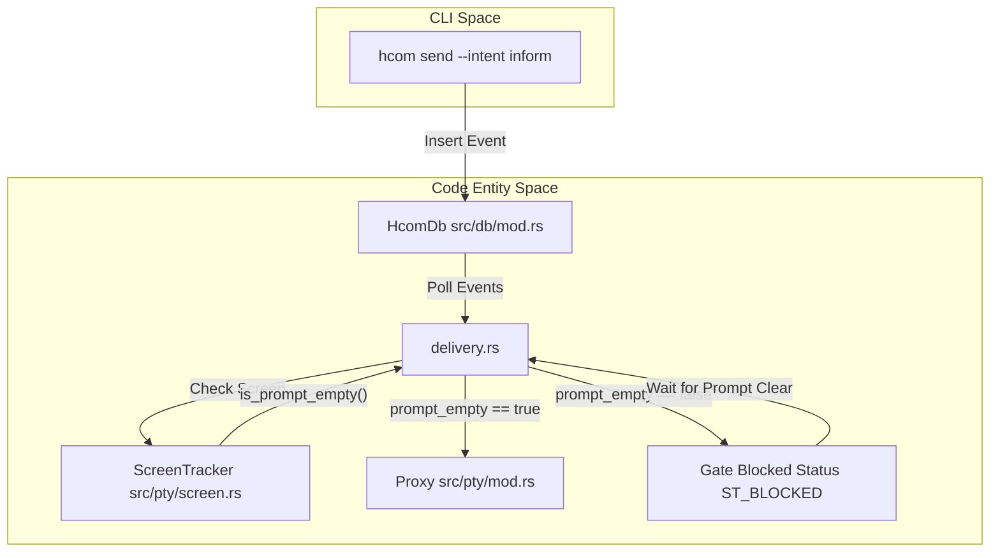
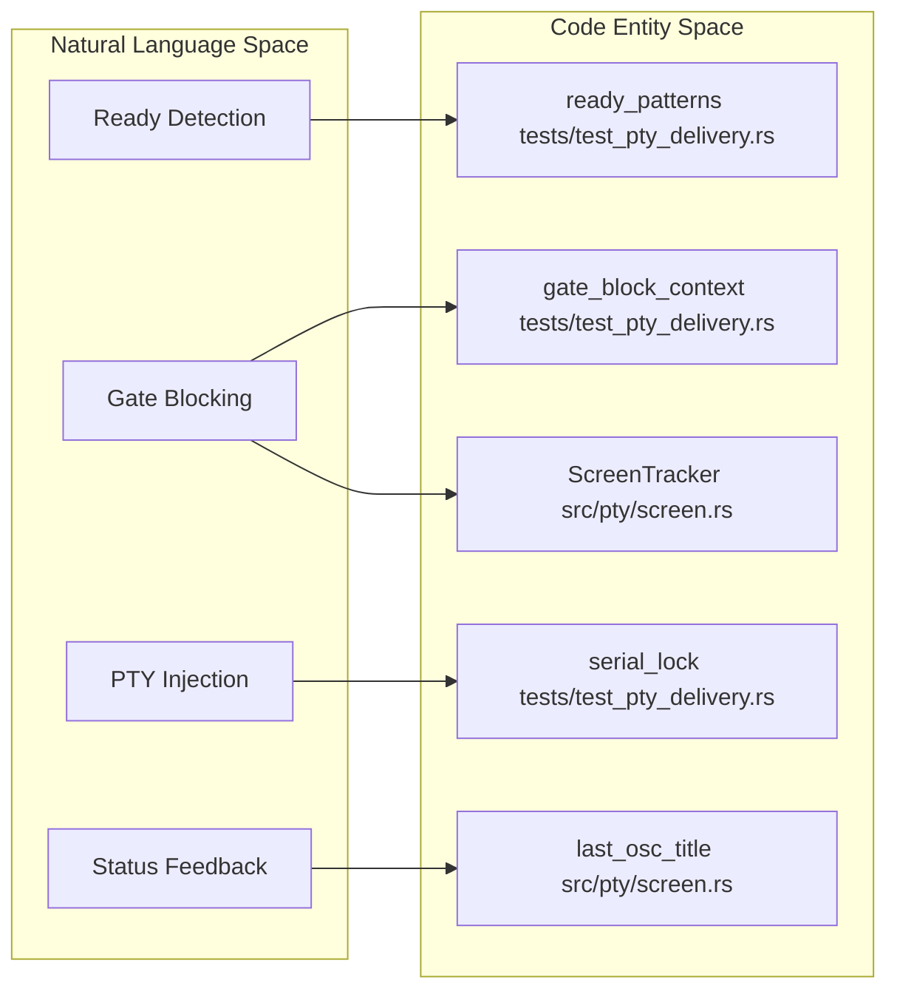

<!-- source: DeepWiki mcp.deepwiki.com · repo aannoo/hcom · page 7.5 PTY Delivery Testing and Validation · fetched 2026-10-26 -->

# PTY Delivery Testing and Validation

<details>
<summary>Relevant source files</summary>

The following files were used as context for generating this wiki page:

- [src/pty/screen.rs](src/pty/screen.rs)
- [src/pty/vt_compat.rs](src/pty/vt_compat.rs)
- [src/tool.rs](src/tool.rs)
- [src/tui/rpc.rs](src/tui/rpc.rs)
- [tests/send_delivery.rs](tests/send_delivery.rs)
- [tests/test_pty_delivery.rs](tests/test_pty_delivery.rs)

</details>


This page documents the comprehensive testing infrastructure used to validate PTY-based message delivery, screen state detection, and gate blocking. The test suite ensures that `hcom` can reliably inject text into real AI tool terminals across different states (ready, busy, or blocked).

---

## Overview

The PTY delivery test suite, primarily located in `tests/test_pty_delivery.rs`, performs end-to-end validation by launching real AI tool instances in a terminal session [tests/test_pty_delivery.rs:3-9](). It verifies the entire lifecycle of a message from the `send` command through the database to final PTY injection.

### Test Phases
1.  **Launch:** Spawns the tool via `hcom 1 <tool>` with `HCOM_TERMINAL` set (defaults to `tmux`) [tests/test_pty_delivery.rs:11-11]().
2.  **Ready Detection:** Polls the PTY screen for a `ready_pattern` (e.g., "? for shortcuts" for Claude) [tests/test_pty_delivery.rs:12-12]().
3.  **Delivery:** Sends a message via `send_msg` and verifies it appears in the PTY buffer and generates a delivery event [tests/test_pty_delivery.rs:13-13]().
4.  **Gate Validation:** Injects uncommitted text into the prompt and verifies that `hcom` blocks subsequent message delivery to prevent context corruption [tests/test_pty_delivery.rs:14-14]().
5.  **Recovery:** Submits the manual text and verifies that the previously blocked message is automatically delivered [tests/test_pty_delivery.rs:15-15]().

Sources: [tests/test_pty_delivery.rs:1-25](), [tests/test_pty_delivery.rs:68-81]()

---

## Screen State Detection

The validation logic relies on parsing the terminal screen to identify the prompt, the cursor position, and whether the tool is "ready" for input. This is implemented via screen tracking utilities that use a `vt100` parser [src/pty/screen.rs:1-8]() and `VtCompat` sequence rewriting [src/pty/vt_compat.rs:1-16]().

### Ready Patterns and Prompt Markers
Each supported tool has specific markers defined in the test suite to identify its state:

| Tool | Ready Pattern | Prompt Marker | Frame Marker |
| :--- | :--- | :--- | :--- |
| **Claude** | `? for shortcuts` | `❯` | `─` |
| **Codex** | `\u{203a} ` | `›` | (None) |
| **Gemini** | `Type your message` | ` > ` | (None) |
| **Antigravity** | `? for shortcuts` | `>` | `─` |
| **Cursor** | (Empty) | `→` | (None) |
| **Copilot** | `/ commands` | `❯` | (None) |

[tests/test_pty_delivery.rs:72-109]()

### Screen JSON Schema
The `hcom term <instance> --json` command exports the parsed screen state, which the test suite validates against expected fields [tests/test_pty_delivery.rs:165-166]():
*   `lines`: The raw text lines of the terminal.
*   `size`: Terminal dimensions.
*   `cursor`: Current (x, y) position.
*   `ready`: Boolean indicating if the `ready_pattern` was found [src/pty/screen.rs:4-4]().
*   `prompt_empty`: Boolean indicating if the detected prompt area contains text [src/pty/screen.rs:7-7]().
*   `input_text`: The actual text currently sitting in the prompt [src/pty/screen.rs:8-8]().

Sources: [tests/test_pty_delivery.rs:72-109](), [tests/test_pty_delivery.rs:165-166](), [src/pty/screen.rs:1-8]()

---

## Gate Blocking and Validation

A critical feature of `hcom` is the "Gate," which prevents delivering messages when the user (or another process) has already typed text into the prompt but hasn't pressed Enter.

### Blocking Logic
When a message is sent to an instance, the delivery thread checks the screen state [src/pty/screen.rs:3-9](). The test suite validates this by:
1.  Injecting text into the PTY without a newline [tests/test_pty_delivery.rs:14-14]().
2.  Checking for a `tui:prompt-has-text` (Claude/Codex/Antigravity/Cursor/Copilot) or `tui:not-ready` (Gemini) status [tests/test_pty_delivery.rs:125-138]().

### OSC Title Detection
Screen parsing tracks `OSC 0/2` terminal titles via `last_osc_title` to detect tool-specific states like `Action Required` in Codex [src/pty/screen.rs:78-120](). This sets internal waiting states, providing immediate status feedback [src/pty/screen.rs:5-5]().

### Data Flow Diagram: CLI to PTY

Title: "Message Delivery Data Flow"


Sources: [tests/test_pty_delivery.rs:125-138](), [src/pty/screen.rs:7-8](), [src/pty/screen.rs:78-120]()

---

## PTY Bootstrap Injection

For tools like `opencode`, `kilo`, and `pi` that require PTY bootstrap injection, the test suite validates the flow where an initial injection triggers plugin binding [tests/test_pty_delivery.rs:18-22]().

Sources: [tests/test_pty_delivery.rs:18-22]()

---

## Test Execution and Environment

Because these tests interact with real terminal devices and environment variables, they must be run serially.

### Serial Execution Guard
The test suite uses a `OnceLock<Mutex<()>>` named `TEST_SERIAL` and a `serial_lock()` helper to ensure that parallel cargo test threads do not interfere with the `tmux` sessions or environment variables of other tests [tests/test_pty_delivery.rs:45-55]().

### Execution Command
```bash
cargo test -p hcom --test test_pty_delivery -- --ignored --nocapture --test-threads=1
```
[tests/test_pty_delivery.rs:25-27]()

Sources: [tests/test_pty_delivery.rs:25-27](), [tests/test_pty_delivery.rs:45-55]()

---

## Testing Entity Mapping

Title: "Natural Language to Code Mapping"


Sources: [tests/test_pty_delivery.rs:45-114](), [src/pty/screen.rs:78-120](), [src/pty/screen.rs:1-8]()

---

