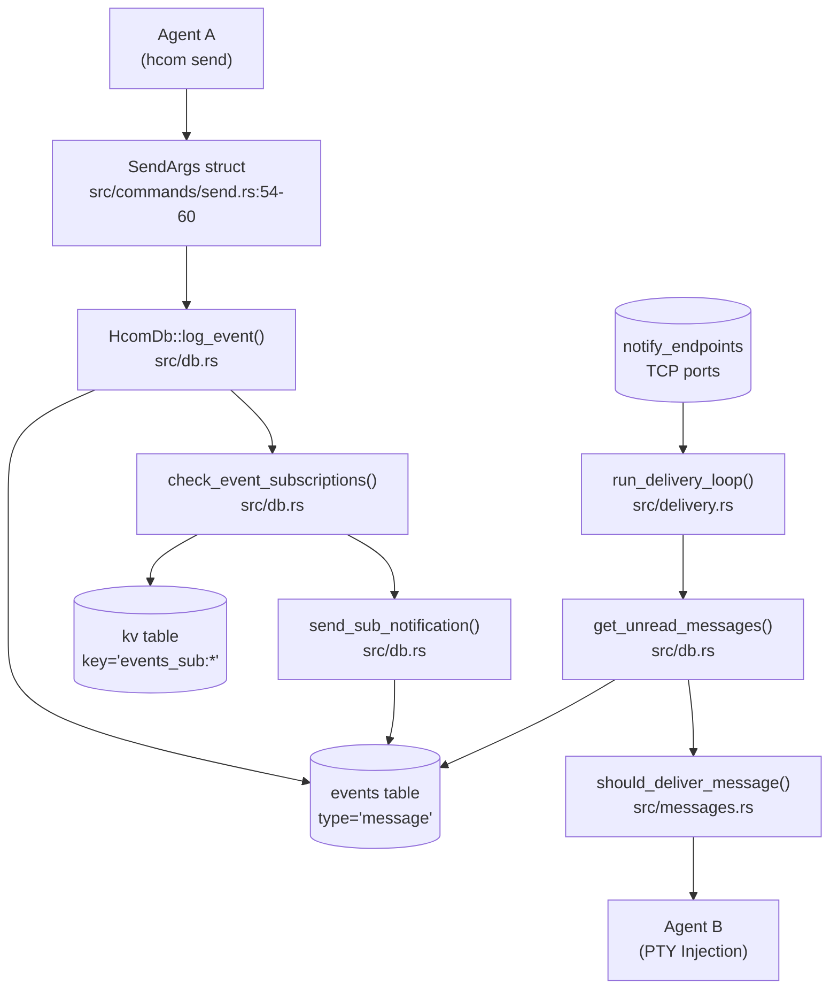
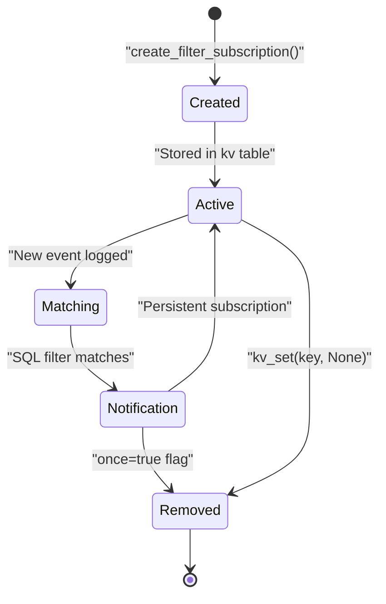
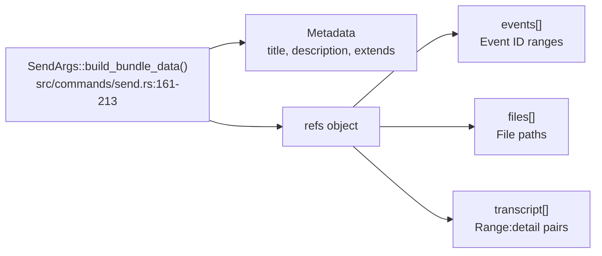
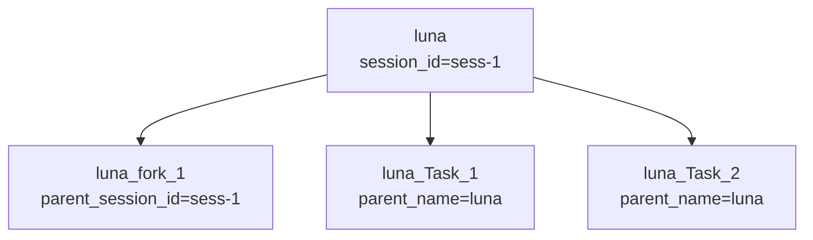

<!-- source: DeepWiki mcp.deepwiki.com · repo aannoo/hcom · page 8 Multi-Agent Communication · fetched 2026-10-26 -->

# Multi-Agent Communication

Relevant source files

The following files were used as context for generating this wiki page:

- [src/bootstrap.rs](src/bootstrap.rs)
- [src/commands/send.rs](src/commands/send.rs)

This page provides a high-level overview of the multi-agent communication system in `hcom`, covering message routing, event subscriptions, context sharing via bundles, and instance forking. For detailed technical mechanics, implementation details, and edge cases, refer to the respective child pages.

## Message Flow Architecture

Messages flow through the SQLite `events` table, which serves as the central append-only log coordinating all agent communication [src/db.rs:5-11](). The `hcom send` command, managed via `SendArgs` [src/commands/send.rs:54-60](), facilitates this by logging a message event that is subsequently picked up by delivery threads.

For details on broadcast vs mentions scope, `@instance` addressing, cross-device routing, and `delivered_to` tracking, see [Message Scopes and Delivery Logic](#8.1).

Title: "Message Flow Pipeline: Natural Language to Code Entity Space"

Sources: [src/db.rs:5-11](), [src/commands/send.rs:54-60](), [src/messages.rs:9-12](), [src/delivery.rs:1-12]()

## Event Subscriptions

Event subscriptions enable reactive patterns where agents automatically receive notifications when specific events occur. Subscriptions are stored in the `kv` table with keys prefixed `events_sub:` [src/db/subscriptions.rs:3-6]().

For details on subscription SQL filters, `--once` vs persistent subscriptions, request-watch policy, cancellation, and collision detection, see [Event Subscriptions](#8.2).

Title: "Subscription Lifecycle: Event State to Code Entities"

Sources: [src/db/subscriptions.rs:1-23](), [src/db.rs:1855-1900]()

## Context Transfer via Bundles

Bundles are structured context packages for inter-agent handoffs. They aggregate files, transcript ranges, and event references into a single JSON object attached to messages [src/db.rs:70]().

For details on bundle structure (`title`, `description`, `refs`), bundle prepare workflow, inline vs explicit bundles, and detail levels, see [Bundles and Context Sharing](#8.3).

Title: "Bundle Structure: CLI Flags to JSON Code Entities"

Sources: [src/commands/send.rs:161-213](), [src/db.rs:70]()

## Instance Forking and Subagents

Forking creates derivative instances that inherit session state from a parent. Subagents are task executors spawned by tools (e.g., Claude Code's Task tool).

For details on the `fork` command, subagent detection and registration, `parent_type_N` naming, and `running_tasks` tracking, see [Instance Forking and Subagents](#8.4).

Title: "Instance Hierarchy and Subagent Tracking"

Sources: [src/db.rs:94-126](), [src/db.rs:1576-1595](), [src/instances.rs:22-44]()

---

