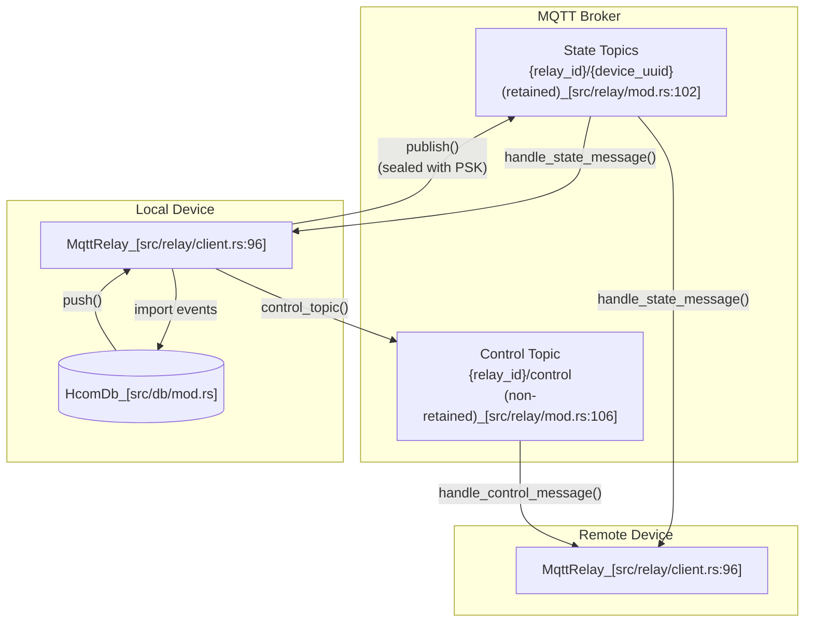
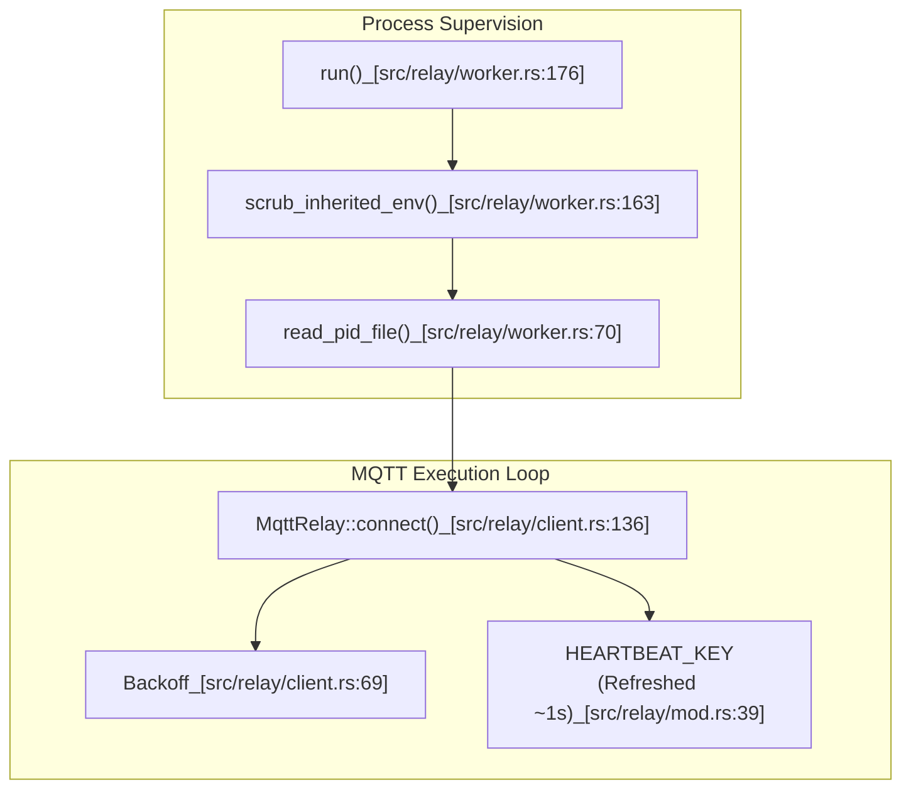

<!-- source: DeepWiki mcp.deepwiki.com · repo aannoo/hcom · page 9.1 Relay Architecture · fetched 2026-10-26 -->

# Relay Architecture

Relevant source files

The following files were used as context for generating this wiki page:

- [CONTRIBUTING.md](CONTRIBUTING.md)
- [scripts/msrv.sh](scripts/msrv.sh)
- [src/commands/relay.rs](src/commands/relay.rs)
- [src/notify/mod.rs](src/notify/mod.rs)
- [src/notify/wake.rs](src/notify/wake.rs)
- [src/relay/backfill.rs](src/relay/backfill.rs)
- [src/relay/broker.rs](src/relay/broker.rs)
- [src/relay/client.rs](src/relay/client.rs)
- [src/relay/crypto.rs](src/relay/crypto.rs)
- [src/relay/mod.rs](src/relay/mod.rs)
- [src/relay/pull.rs](src/relay/pull.rs)
- [src/relay/push.rs](src/relay/push.rs)
- [src/relay/replay.rs](src/relay/replay.rs)
- [src/relay/token.rs](src/relay/token.rs)
- [src/relay/worker.rs](src/relay/worker.rs)

This page details the MQTT-based relay system that synchronizes `hcom` state across multiple devices. It covers the topic layout, broker selection mechanics, cryptographic envelope and token handling, push/pull/replay code paths, and the worker daemon lifecycle.

For relay CLI commands and user-facing operations, see **9.2 Relay Setup and Operations**.

---

## Purpose and Scope

The relay system extends `hcom`'s local architecture across network boundaries via MQTT pub/sub. Each participating machine maintains a local SQLite database (`HcomDb`) and runs a standalone relay daemon (`relay-worker`) [src/relay/worker.rs:1-8]() that:
1. **Publishes state snapshots**: Batches local instances and recent event tails to a retained MQTT topic [src/relay/push.rs:1-5]().
2. **Subscribes to remote state**: Consumes remote snapshots and imports peer events into local tables [src/relay/pull.rs:1-7]().
3. **Routes control commands**: Dispatches stop/kill RPCs via a shared control topic [src/relay/control.rs:1-5]().
4. **Ensures security**: Encrypts all payloads end-to-end using an authenticated symmetric key with XChaCha20-Poly1305 [src/relay/crypto.rs:1-13]().
5. **Enforces replay protection**: Combines clock-skew validation, sequence watermarks, and an LRU nonce cache [src/relay/replay.rs:1-15]().

Sources: [src/relay/worker.rs:1-8](), [src/relay/pull.rs:1-7](), [src/relay/crypto.rs:1-13](), [src/relay/replay.rs:1-15]()

---

## MQTT Topic Structure and Broker Selection

The relay system organizes communication around three primary topic patterns prefixed by a unique `relay_id` [src/relay/mod.rs:5-8]().

### Topic Layout and Component Mapping

Title: MQTT Data Flow and Component Mapping

**Topic Definitions:**
* `{relay_id}/{device_uuid}`: Retained per-device state snapshot topic (QoS 1) [src/relay/client.rs:159-177](), [src/relay/mod.rs:101-104]().
* `{relay_id}/control`: Non-retained shared control and RPC topic (QoS 1) [src/relay/mod.rs:106-109]().
* `{relay_id}/+`: Wildcard subscription pattern used by `MqttRelay` to receive all peer states and control signals [src/relay/mod.rs:111-114]().

### Broker Discovery and Probing
When initializing a relay via `hcom relay new`, `src/relay/broker.rs` tests public endpoints in parallel to pick the fastest reachable broker [src/relay/broker.rs:1-4](). The built-in defaults `DEFAULT_BROKERS` list high-availability public brokers [src/relay/mod.rs:29-33](). `test_brokers_parallel` spawns concurrent threads running `ping_mqtt_broker` to verify TCP, TLS handshakes (`relay_tls_config`), and MQTT `ConnAck` responses [src/relay/broker.rs:75-120](), [src/relay/broker.rs:122-130]().

Sources: [src/relay/mod.rs:29-114](), [src/relay/client.rs:159-177](), [src/relay/broker.rs:1-130]()

---

## Crypto and Token Handling

All application payloads are symmetrically encrypted before entering the wire.

### Key Management and Tokens
* **PSKs**: A 32-byte Pre-Shared Key (PSK) is loaded via `load_psk` after decoding base64url strings from `config.toml` (`relay_psk`) [src/relay/mod.rs:69-92]().
* **Join Tokens**: The CLI packs `relay_id`, broker address, and the PSK into a signed join token handled by `src/relay/token.rs` and parsed in `src/commands/relay.rs` [src/commands/relay.rs:48-52]().

### AEAD Envelopes
Every published packet is processed by `crypto::seal` and verified by `crypto::open` [src/relay/crypto.rs:1-13](). The envelope includes:
1. **Suite identifier** (1 byte).
2. **Extended Nonce** (24 bytes).
3. **Timestamp** (8 bytes big-endian).
4. **Ciphertext & Tag**: XChaCha20-Poly1305 payload encrypted with Associated Data (AAD) bound to the `relay_id`, topic, and message timestamp.

Sources: [src/relay/mod.rs:69-92](), [src/commands/relay.rs:48-52](), [src/relay/crypto.rs:1-13]()

---

## Push, Pull, and Replay Paths

The state synchronization cycle consists of outbound pushes and inbound pulls managed inside the `relay` worker thread.

### Push Path and Payload Shrinking
The push loop (`src/relay/push.rs`) collects local instances (excluding foreign remote origins) and unpushed events, tracking progress via the `relay_last_push_id` cursor [src/relay/push.rs:1-5](). If a serialized state exceeds the 112 KiB MQTT safety ceiling (`MAX_SEALED_PAYLOAD_BYTES`), `seal_bounded_payload` iteratively invokes `shrink_event` to truncate oversized text or drop non-essential fields up to `SHRINK_LAST_LEVEL` [src/relay/push.rs:21-70](), [src/relay/push.rs:84-106]().

### Pull Path and Inbound Processing
Incoming packets are parsed by `src/relay/pull.rs`. 
* **State Messages**: Processed by `handle_state_message`, which validates state watermarks against KV (`state_ts_watermark`), opens the cryptographic envelope via `open_envelope_for_handler`, upserts remote instances, and imports remote event streams tagged with `_relay` metadata [src/relay/pull.rs:184-211]().
* **Last Will and Testament (LWT)**: When a peer disconnects unexpectedly, an authenticated null state triggers `handle_device_gone`, purging its records from the local `instances` table and firing device leave notifications [src/relay/pull.rs:109-139]().

### Replay Guard and Backfill Gaps
`src/relay/replay.rs` implements three independent defenses:
1. **Control Freshness**: Drops control messages whose timestamps deviate beyond `MAX_SKEW_SECS` (60s) [src/relay/replay.rs:1-6](), [src/relay/replay.rs:21]().
2. **State Ordering**: Rejects incoming snapshots older than the recorded `min_accepted_ts` watermark [src/relay/replay.rs:7-8](), [src/relay/replay.rs:90-106]().
3. **Nonce LRU**: Tracks up to 8,192 recent `(sender, nonce)` tuples to block duplicate replays [src/relay/replay.rs:9-11](), [src/relay/replay.rs:22-23]().

If event gaps occur due to dropped messages or cursor jumps, `src/relay/backfill.rs` logs missing ranges (`Gap`) and coordinates catch-up RPC requests back to the peer [src/relay/backfill.rs:1-18](), [src/relay/backfill.rs:98-143]().

Sources: [src/relay/push.rs:1-106](), [src/relay/pull.rs:1-211](), [src/relay/replay.rs:1-124](), [src/relay/backfill.rs:1-143]()

---

## Worker Daemon Lifecycle and Sync Protocol

The background worker daemon (`relay-worker`) maintains continuous pub/sub connectivity [src/relay/worker.rs:1-8]().

### Daemon Architecture and Liveness

Title: Relay Worker Lifecycle and Process Supervision

* **PID File Management**: The worker records its PID in `~/.hcom/.tmp/relay.pid` [src/relay/worker.rs:46-48](). `read_pid_file` checks process liveness using `crate::pidtrack::is_alive` [src/relay/worker.rs:70-83]().
* **Heartbeat Watchdog**: The worker writes a monotonically increasing timestamp to `HEARTBEAT_KEY` in the SQLite KV store on every event-loop tick (~1s) [src/relay/mod.rs:39-44](). Readers consider heartbeats older than `HEARTBEAT_STALE_SECS` (10s) stale, allowing robust detection of wedged or crashed workers even across PID reuse [src/relay/mod.rs:46-48]().
* **Environment Scrubbing**: `scrub_inherited_env` purges spawner environment tokens (such as parent tool identities or terminal socket paths) before initialization to prevent contamination of remote agent launches [src/relay/worker.rs:134-171]().
* **Auto-Restart / Handoff**: When a new software version is installed, the exiting worker triggers an upgrade hand-off to ensure devices with no active shell sessions still maintain a live background relay daemon [src/relay/worker.rs:21-42]().

Sources: [src/relay/worker.rs:1-171](), [src/relay/mod.rs:39-48](), [src/relay/client.rs:69-145]()

---

