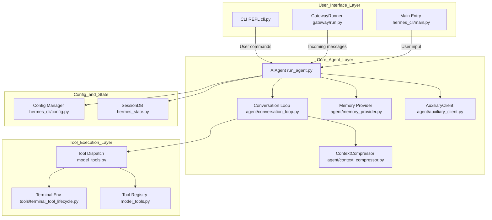
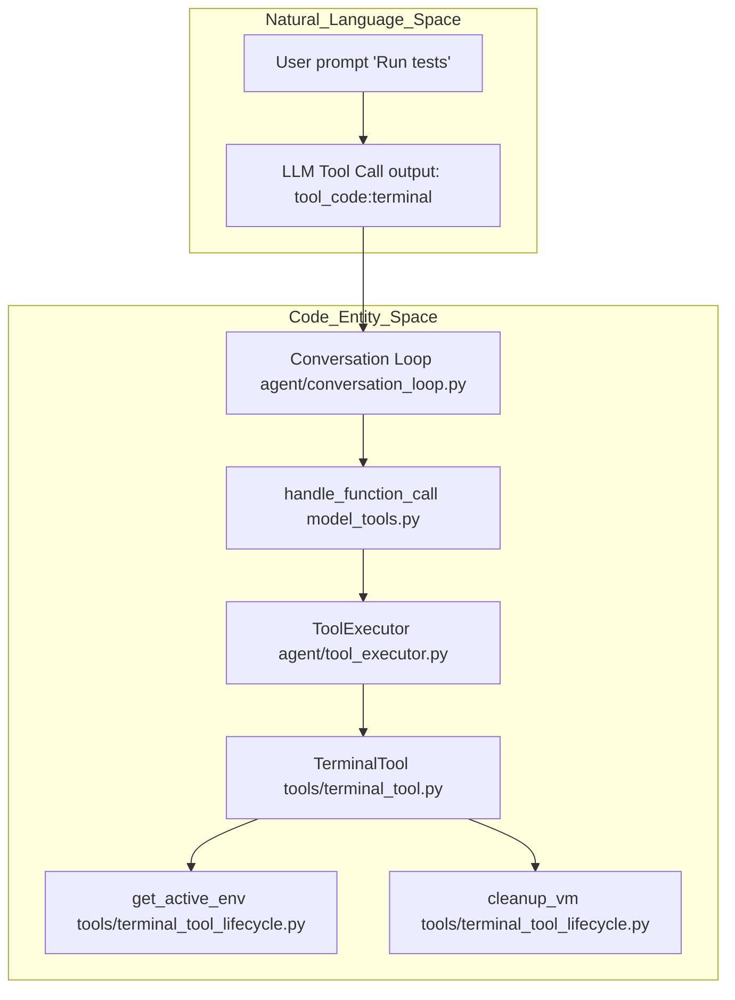

<!-- source: DeepWiki mcp.deepwiki.com · repo nousresearch/hermes-agent · page 1.1 Architecture Overview · fetched 2026-10-26 -->

# Architecture Overview

Relevant source files

The following files were used as context for generating this wiki page:

- [agent/agent_init.py](agent/agent_init.py)
- [agent/agent_runtime_helpers.py](agent/agent_runtime_helpers.py)
- [agent/auxiliary_client.py](agent/auxiliary_client.py)
- [agent/chat_completion_helpers.py](agent/chat_completion_helpers.py)
- [agent/compaction_display.py](agent/compaction_display.py)
- [agent/compression_facade.py](agent/compression_facade.py)
- [agent/context_compressor.py](agent/context_compressor.py)
- [agent/conversation_compression.py](agent/conversation_compression.py)
- [agent/conversation_compression_archive.py](agent/conversation_compression_archive.py)
- [agent/conversation_compression_manual.py](agent/conversation_compression_manual.py)
- [agent/conversation_loop.py](agent/conversation_loop.py)
- [agent/inline_tool_executors.py](agent/inline_tool_executors.py)
- [agent/micro_compaction.py](agent/micro_compaction.py)
- [agent/tool_dispatch_helpers.py](agent/tool_dispatch_helpers.py)
- [agent/tool_executor.py](agent/tool_executor.py)
- [agent/turn_context.py](agent/turn_context.py)
- [agent/turn_finalizer.py](agent/turn_finalizer.py)
- [apps/desktop/e2e/core/reply-painted-once.spec.ts](apps/desktop/e2e/core/reply-painted-once.spec.ts)
- [apps/desktop/src/app/session/hooks/use-message-stream/reused-final-after-tool.test.tsx](apps/desktop/src/app/session/hooks/use-message-stream/reused-final-after-tool.test.tsx)
- [apps/desktop/src/app/session/hooks/use-message-stream/test-harness.tsx](apps/desktop/src/app/session/hooks/use-message-stream/test-harness.tsx)
- [cli-config.yaml.example](cli-config.yaml.example)
- [cli.py](cli.py)
- [gateway/run.py](gateway/run.py)
- [gateway/session.py](gateway/session.py)
- [gateway/slash_commands.py](gateway/slash_commands.py)
- [hermes_cli/cli_commands_mixin.py](hermes_cli/cli_commands_mixin.py)
- [hermes_cli/commands.py](hermes_cli/commands.py)
- [hermes_cli/config.py](hermes_cli/config.py)
- [hermes_cli/config_defaults.py](hermes_cli/config_defaults.py)
- [hermes_cli/config_migrations.py](hermes_cli/config_migrations.py)
- [hermes_cli/config_version_stamp.py](hermes_cli/config_version_stamp.py)
- [hermes_cli/main.py](hermes_cli/main.py)
- [hermes_cli/setup.py](hermes_cli/setup.py)
- [hermes_state.py](hermes_state.py)
- [run_agent.py](run_agent.py)
- [scripts/docker_config_migrate.py](scripts/docker_config_migrate.py)
- [scripts/micro_compaction_report.py](scripts/micro_compaction_report.py)
- [tests/agent/test_auxiliary_client.py](tests/agent/test_auxiliary_client.py)
- [tests/agent/test_compression_commit_fence_race.py](tests/agent/test_compression_commit_fence_race.py)
- [tests/agent/test_compression_concurrent_fork.py](tests/agent/test_compression_concurrent_fork.py)
- [tests/agent/test_compression_stall_fallback.py](tests/agent/test_compression_stall_fallback.py)
- [tests/agent/test_compressor_truncated_summary_guard.py](tests/agent/test_compressor_truncated_summary_guard.py)
- [tests/agent/test_context_compressor.py](tests/agent/test_context_compressor.py)
- [tests/agent/test_conversation_compression_manual.py](tests/agent/test_conversation_compression_manual.py)
- [tests/agent/test_empty_response_recovery_persistence.py](tests/agent/test_empty_response_recovery_persistence.py)
- [tests/agent/test_in_place_merged_user_rows.py](tests/agent/test_in_place_merged_user_rows.py)
- [tests/agent/test_message_sequence_repair.py](tests/agent/test_message_sequence_repair.py)
- [tests/agent/test_micro_compaction.py](tests/agent/test_micro_compaction.py)
- [tests/agent/test_proactive_prune_rearm_threshold.py](tests/agent/test_proactive_prune_rearm_threshold.py)
- [tests/agent/test_proactive_prune_restart_safety.py](tests/agent/test_proactive_prune_restart_safety.py)
- [tests/agent/test_proactive_tool_result_pruning.py](tests/agent/test_proactive_tool_result_pruning.py)
- [tests/agent/test_setup_beat_card_round.py](tests/agent/test_setup_beat_card_round.py)
- [tests/agent/test_tool_call_args_sanitizer.py](tests/agent/test_tool_call_args_sanitizer.py)
- [tests/agent/test_tool_dispatch_helpers.py](tests/agent/test_tool_dispatch_helpers.py)
- [tests/agent/test_turn_finalizer_final_response_persistence.py](tests/agent/test_turn_finalizer_final_response_persistence.py)
- [tests/agent/test_turn_finalizer_iteration_limit_exit.py](tests/agent/test_turn_finalizer_iteration_limit_exit.py)
- [tests/agent/test_unicode_ascii_codec.py](tests/agent/test_unicode_ascii_codec.py)
- [tests/gateway/test_api_server_compaction_projection.py](tests/gateway/test_api_server_compaction_projection.py)
- [tests/gateway/test_session.py](tests/gateway/test_session.py)
- [tests/hermes_cli/test_commands.py](tests/hermes_cli/test_commands.py)
- [tests/hermes_cli/test_config.py](tests/hermes_cli/test_config.py)
- [tests/hermes_cli/test_config_migration_nested_guards.py](tests/hermes_cli/test_config_migration_nested_guards.py)
- [tests/hermes_cli/test_config_unversioned_migration.py](tests/hermes_cli/test_config_unversioned_migration.py)
- [tests/hermes_cli/test_kanban_comment_queries.py](tests/hermes_cli/test_kanban_comment_queries.py)
- [tests/tools/test_docker_config_migrate.py](tests/tools/test_docker_config_migrate.py)
- [tests/tools/test_kanban_comment_injection.py](tests/tools/test_kanban_comment_injection.py)
- [tests/tools/test_kanban_persisted_identity.py](tests/tools/test_kanban_persisted_identity.py)
- [tests/tui_gateway/test_manual_compress_history_fence.py](tests/tui_gateway/test_manual_compress_history_fence.py)
- [tests/tui_gateway/test_turn_payload_reused_final.py](tests/tui_gateway/test_turn_payload_reused_final.py)
- [ui-tui/src/__tests__/details.test.ts](ui-tui/src/__tests__/details.test.ts)
- [ui-tui/src/domain/details.ts](ui-tui/src/domain/details.ts)
- [website/docs/developer-guide/context-compression-and-caching.md](website/docs/developer-guide/context-compression-and-caching.md)
- [website/docs/getting-started/quickstart.md](website/docs/getting-started/quickstart.md)
- [website/docs/integrations/providers.md](website/docs/integrations/providers.md)
- [website/docs/reference/cli-commands.md](website/docs/reference/cli-commands.md)
- [website/docs/reference/environment-variables.md](website/docs/reference/environment-variables.md)
- [website/docs/reference/slash-commands.md](website/docs/reference/slash-commands.md)
- [website/docs/user-guide/cli.md](website/docs/user-guide/cli.md)
- [website/docs/user-guide/configuration.md](website/docs/user-guide/configuration.md)
- [website/docs/user-guide/features/fallback-providers.md](website/docs/user-guide/features/fallback-providers.md)
- [website/docs/user-guide/messaging/index.md](website/docs/user-guide/messaging/index.md)
- [website/docs/user-guide/tui.md](website/docs/user-guide/tui.md)

## Purpose and Scope

This document presents a detailed technical overview of Hermes Agent’s architecture. Hermes Agent is an AI agent framework featuring autonomous reasoning, tool usage, conversational memory, and self-improvement capabilities. The system is architected as a three-tier platform, integrating interactive user interfaces, a core agent orchestration layer, and a diverse tool and execution backend. This page explains these tiers, the major subsystems comprising them, and the technical flow of data and control between components.

The architecture supports multiple frontend interfaces—including CLI [cli.py:1-3](), the Messaging Gateway [gateway/run.py:1-5](), terminal TUI, and the web dashboard—all converging on the central core agent [run_agent.py:2-7](). The core agent manages conversational loops, memory persistence, tool orchestration, and auxiliary LLM clients. The tool layer abstracts a wide range of capabilities: terminal commands [tools/terminal_tool_lifecycle.py:104-104](), browser automation [tools/browser_tool_lifecycle.py:1-1](), vision tools, and more, executed within isolated runtime environments.

Sources: [run_agent.py:1-7](), [cli.py:1-13](), [gateway/run.py:1-5]()

---

## Three-Tier Architecture

The system is organized into three distinct tiers:

1.  **User Interface Tier**: Consists of multiple frontends including the interactive CLI (`cli.py`), the Messaging Gateway (`gateway/run.py`), terminal TUI (`hermes_cli/main.py`), and the web dashboard server.
2.  **Core Agent Tier**: Built around the `AIAgent` class (`run_agent.py`), handling conversation loops (`agent/conversation_loop.py`), auxiliary LLM client tasks, context compression (`agent/conversation_compression.py`), and memory management (`agent/memory_provider.py`).
3.  **Tool and Execution Tier**: Manages tool registration, discovery (`model_tools.py`), and execution across local, Docker, SSH, or sandboxed environments (`tools/terminal_tool_lifecycle.py`), backed by a persistent SQLite session state store (`hermes_state.py`).

Sources: [run_agent.py:2-7](), [cli.py:1-3](), [gateway/run.py:1-5](), [hermes_state.py:1-10]()

---

## Core Architecture Components

### System Overview Diagram

This diagram bridges user-facing concepts to concrete code entities across the system layers.

This diagram illustrates the layered organization:
-   **User Interface Layer** connects users to Hermes via CLI (`cli.py`), Gateway (`gateway/run.py`), and terminal interfaces (`hermes_cli/main.py`).
-   **Core Agent Layer** centers on the `AIAgent` class (`run_agent.py`), managing conversation state, memory, context compression, and tool integration. It also includes the `AuxiliaryClient` (`agent/auxiliary_client.py`) for side tasks.
-   **Tool & Execution Layer** manages tool definitions, discovery, and execution within isolated environments (`tools/terminal_tool_lifecycle.py`).
-   **Config & State** components handle persistent user configuration (`hermes_cli/config.py`) and session message storage in SQLite (`hermes_state.py`).

Sources: [run_agent.py:102-136](), [cli.py:35-47](), [gateway/run.py:1-10](), [hermes_cli/config.py:1-25](), [hermes_state.py:1-25](), [agent/auxiliary_client.py:1-10]()

---

## AIAgent: The Central Orchestrator

The core of Hermes Agent is the `AIAgent` class defined in `run_agent.py`. This class encapsulates primary conversation orchestration, including iterative reasoning, tool dispatch, session management, and integration with memory and compression subsystems.

### Conversation Orchestration

-   Conversations are managed as iterative loops in `agent/conversation_loop.py`.
-   The `run_conversation()` method on `AIAgent` drives:
    -   Building system prompts, injecting personality and behavioral cues (`SOUL.md`).
    -   Calling the configured LLM provider, supporting streaming and non-streaming modes via `perform_api_call` [agent/turn_api_call.py:1-5]().
    -   Parsing model outputs for function calls representing tool invocations.
    -   Invoking `handle_function_call()` (from `model_tools.py`) to dispatch tool calls.
    -   Handling retries, fallbacks, and error conditions with detailed error classification via `handle_api_error` [agent/turn_api_error.py:1-5]().
    -   Managing iteration budgets (`IterationBudget`) to prevent runaway loops [run_agent.py:91-91]().
-   Conversation turns involve sanitizing messages and tool call IDs to ensure consistency using functions like `_sanitize_uniquify_tool_call_ids` [run_agent.py:130-130]().

### Memory, Sessions, and Persistence

-   Persistent session data and message history are stored in the SQLite-backed session database (`hermes_state.py`). The `SessionDB` class manages interactions with `state.db` [hermes_state.py:1-6]().
-   The state store supports WAL mode (`apply_wal_with_fallback`) for concurrent readers and single-writer safety [hermes_state_wal.py:1-5]().
-   Memory providers (`agent/memory_provider.py`) load persona and user memories from structured files (`MEMORY.md`, `USER.md`).
-   The context compression subsystem (`agent/context_compressor.py`) summarizes message history with auxiliary LLM calls to keep context within model token budgets. This involves the `ContextCompressor` class [agent/context_compressor.py:1-5]().

### Auxiliary Client System

-   The `agent/auxiliary_client.py` module provides a shared client router for side tasks such as compression, search, and vision.
-   It handles provider resolution fallbacks for auxiliary tasks, including routing through OpenRouter, Nous Portal, custom endpoints, and direct API-key providers [agent/auxiliary_client.py:1-8]().
-   The `call_llm` function [agent/auxiliary_client.py:30-30]() is used to make LLM calls for these auxiliary tasks.
-   The system includes mechanisms for health checks and quarantining unhealthy providers [agent/auxiliary_health.py:1-5]().

Sources: [run_agent.py:90-136](), [agent/conversation_loop.py:1-50](), [hermes_state.py:1-50](), [agent/auxiliary_client.py:1-10](), [agent/context_compressor.py:1-5](), [agent/turn_api_call.py:1-5](), [agent/turn_api_error.py:1-5]()

---

## Tool System and Execution Flow

Hermes Agent implements a modular tool system that translates LLM-instructed tool calls into command invocations executed in controlled environments.

### Tool Execution Flow Diagram

This diagram maps natural language space intents to specific code entities in the tool execution layer.

-   Tools are registered and discovered through `model_tools.py`. The `get_toolset_for_tool` function is used to retrieve tool definitions [run_agent.py:103-103]().
-   The conversation loop in `agent/conversation_loop.py` detects function calls embedded in LLM responses and routes them to `handle_function_call()` in `model_tools.py`.
-   Tool execution is managed by `ToolExecutor` in `agent/tool_executor.py`.
-   Terminal tools execute commands inside managed environments (`tools/terminal_tool_lifecycle.py`), including environment acquisition via `get_active_env()`, command execution, and cleanup routines via `cleanup_vm()` [run_agent.py:104-104]().
-   The tool execution layer abstracts runtime isolation and lifecycle, allowing reproducible tool runs within ephemeral or persistent sandboxes.

Sources: [run_agent.py:102-105](), [agent/conversation_loop.py:1-50](), [tools/terminal_tool_lifecycle.py:1-80](), [agent/tool_executor.py:1-5]()

---

## Configuration, Precedence, and State Storage

Hermes Agent’s configuration is centralized in `hermes_cli/config.py` and layered across multiple sources for flexibility and security.

| Configuration Level | Description | Example Files / Components |
|:--------------------|:------------|:---------------------------|
| 1. CLI Arguments | Per-invocation overrides with highest precedence | CLI flags parsed in `cli.py` |
| 2. `config.yaml` | Main config for non-secret settings, including model/toolsets | `~/.hermes/config.yaml` |
| 3. `.env` file | Secrets storage for API keys, tokens, and passwords | `~/.hermes/.env` |
| 4. Built-in Defaults | Fallback hardcoded safe defaults | `hermes_cli/config_defaults.py` |

-   CLI arguments take highest priority, allowing dynamic overrides per run.
-   `config.yaml` contains structured settings such as model selection, toolsets enabled, compression parameters, and runtime limits (`runtime.nofile_soft_limit`) [website/docs/user-guide/configuration.md:76-85](). The `load_cli_config` function in `hermes_cli/cli_config_load.py` handles loading this configuration [hermes_cli/cli_config_load.py:156-156]().
-   `.env` stores sensitive credentials securely and is loaded at startup by `hermes_cli/config.py`. The `load_hermes_dotenv` function in `hermes_cli.env_loader` is responsible for this [run_agent.py:92-92]().
-   Database storage is governed by `database:` settings in `config.yaml` specifying WAL journal mode, synchronization levels, and autocheckpoint limits [website/docs/user-guide/configuration.md:94-123]().

Sources: [hermes_cli/config.py:1-145](), [hermes_cli/config_defaults.py:33-120](), [website/docs/user-guide/configuration.md:6-68](), [hermes_cli/cli_config_load.py:156-156](), [run_agent.py:92-92]()

---

## Summary

Hermes Agent is structured as a robust, modular three-tier system:
-   **User Interface Tier**: Multiple interactive frontends including CLI REPL (`cli.py`), terminal TUI, and messaging Gateway (`gateway/run.py`).
-   **Core Agent Tier**: The `AIAgent` class (`run_agent.py`) orchestrates autonomous reasoning, conversation loops, session management, context compression (`agent/context_compressor.py`), and auxiliary LLM delegation (`agent/auxiliary_client.py`).
-   **Tool & Execution Tier**: A dynamic tool registry supports execution of terminal commands (`tools/terminal_tool_lifecycle.py`), browser automation, and multi-agent delegation within isolated environments.
-   **Configuration and State**: Centralized configuration management with layered precedence and secure secret handling, alongside a SQLite-based session database (`hermes_state.py`) providing persistent state, FTS5 search, and concurrency support.

Sources: [run_agent.py:1-7](), [cli.py:1-13](), [gateway/run.py:1-5](), [hermes_cli/config.py:1-145](), [agent/conversation_loop.py:1-50](), [hermes_state.py:1-50](), [agent/context_compressor.py:1-5](), [agent/auxiliary_client.py:1-10]()

---

