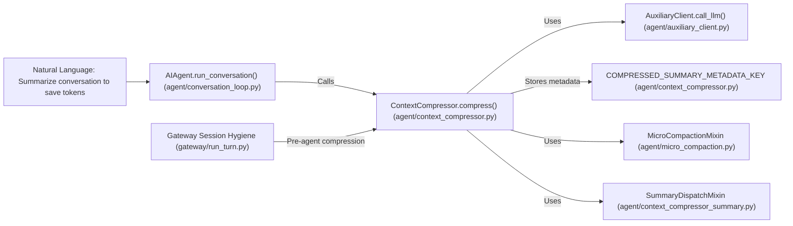
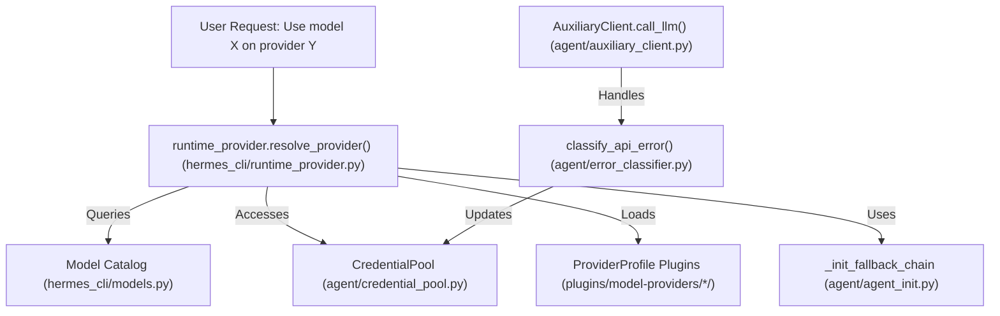
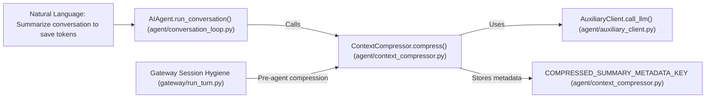
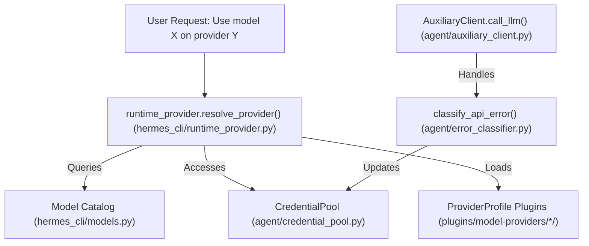
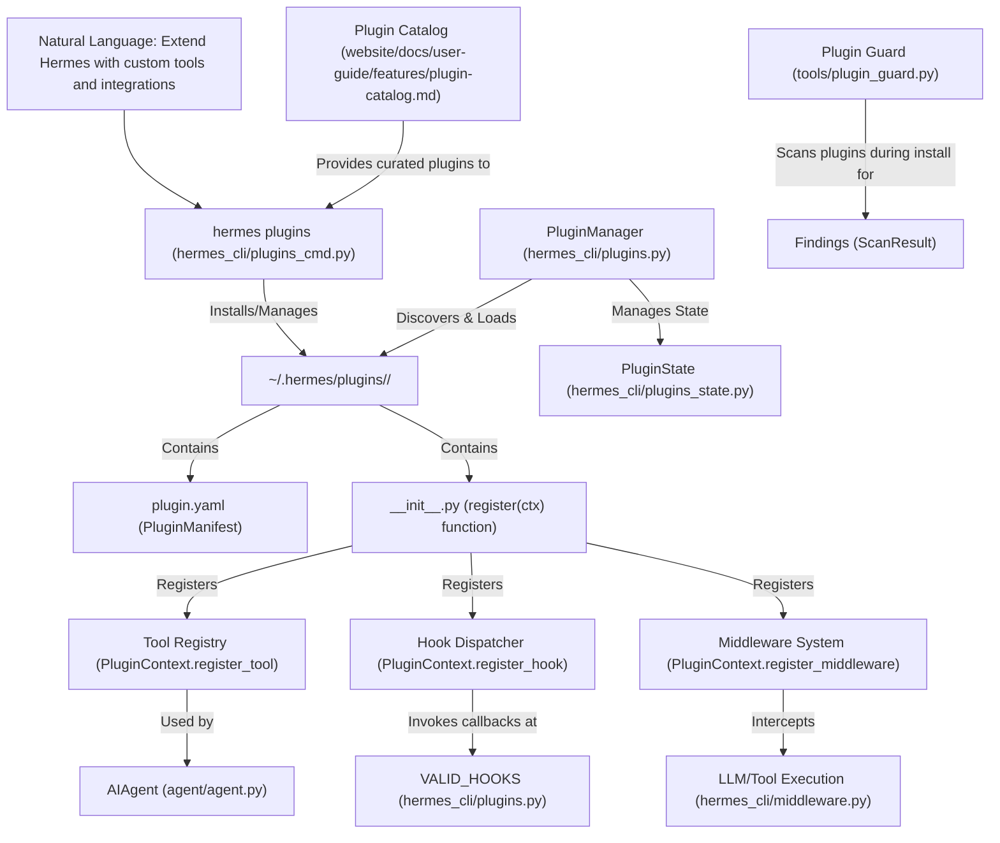

<!-- source: DeepWiki mcp.deepwiki.com · repo nousresearch/hermes-agent · page 10 Advanced Topics · fetched 2026-10-26 -->

# Advanced Topics

<details>
<summary>Relevant source files</summary>

The following files were used as context for generating this wiki page:

- [agent/agent_init.py](agent/agent_init.py)
- [agent/agent_runtime_helpers.py](agent/agent_runtime_helpers.py)
- [agent/chat_completion_helpers.py](agent/chat_completion_helpers.py)
- [agent/compaction_display.py](agent/compaction_display.py)
- [agent/compression_facade.py](agent/compression_facade.py)
- [agent/context_compressor.py](agent/context_compressor.py)
- [agent/conversation_compression.py](agent/conversation_compression.py)
- [agent/conversation_compression_archive.py](agent/conversation_compression_archive.py)
- [agent/conversation_compression_manual.py](agent/conversation_compression_manual.py)
- [agent/conversation_loop.py](agent/conversation_loop.py)
- [agent/inline_tool_executors.py](agent/inline_tool_executors.py)
- [agent/micro_compaction.py](agent/micro_compaction.py)
- [agent/replay_cleanup.py](agent/replay_cleanup.py)
- [agent/shell_hooks.py](agent/shell_hooks.py)
- [agent/title_generator.py](agent/title_generator.py)
- [agent/tool_dispatch_helpers.py](agent/tool_dispatch_helpers.py)
- [agent/tool_executor.py](agent/tool_executor.py)
- [agent/trace_upload.py](agent/trace_upload.py)
- [agent/trajectory.py](agent/trajectory.py)
- [agent/turn_context.py](agent/turn_context.py)
- [agent/turn_finalizer.py](agent/turn_finalizer.py)
- [apps/desktop/e2e/core/reply-painted-once.spec.ts](apps/desktop/e2e/core/reply-painted-once.spec.ts)
- [apps/desktop/src/app/session/hooks/use-message-stream/reused-final-after-tool.test.tsx](apps/desktop/src/app/session/hooks/use-message-stream/reused-final-after-tool.test.tsx)
- [apps/desktop/src/app/session/hooks/use-message-stream/test-harness.tsx](apps/desktop/src/app/session/hooks/use-message-stream/test-harness.tsx)
- [hermes_cli/hooks.py](hermes_cli/hooks.py)
- [hermes_cli/mcp_picker.py](hermes_cli/mcp_picker.py)
- [hermes_cli/mcp_security.py](hermes_cli/mcp_security.py)
- [hermes_cli/memory_oauth.py](hermes_cli/memory_oauth.py)
- [hermes_cli/middleware.py](hermes_cli/middleware.py)
- [hermes_cli/plugins.py](hermes_cli/plugins.py)
- [hermes_cli/plugins_discovery.py](hermes_cli/plugins_discovery.py)
- [hermes_cli/plugins_dispatch.py](hermes_cli/plugins_dispatch.py)
- [hermes_cli/plugins_ledger.py](hermes_cli/plugins_ledger.py)
- [hermes_cli/plugins_loader.py](hermes_cli/plugins_loader.py)
- [hermes_cli/plugins_manifest.py](hermes_cli/plugins_manifest.py)
- [hermes_cli/plugins_state.py](hermes_cli/plugins_state.py)
- [scripts/micro_compaction_report.py](scripts/micro_compaction_report.py)
- [tests/agent/test_compression_commit_fence_race.py](tests/agent/test_compression_commit_fence_race.py)
- [tests/agent/test_compression_concurrent_fork.py](tests/agent/test_compression_concurrent_fork.py)
- [tests/agent/test_compression_stall_fallback.py](tests/agent/test_compression_stall_fallback.py)
- [tests/agent/test_compressor_truncated_summary_guard.py](tests/agent/test_compressor_truncated_summary_guard.py)
- [tests/agent/test_context_compressor.py](tests/agent/test_context_compressor.py)
- [tests/agent/test_conversation_compression_manual.py](tests/agent/test_conversation_compression_manual.py)
- [tests/agent/test_empty_response_recovery_persistence.py](tests/agent/test_empty_response_recovery_persistence.py)
- [tests/agent/test_in_place_merged_user_rows.py](tests/agent/test_in_place_merged_user_rows.py)
- [tests/agent/test_message_sequence_repair.py](tests/agent/test_message_sequence_repair.py)
- [tests/agent/test_micro_compaction.py](tests/agent/test_micro_compaction.py)
- [tests/agent/test_proactive_prune_rearm_threshold.py](tests/agent/test_proactive_prune_rearm_threshold.py)
- [tests/agent/test_proactive_prune_restart_safety.py](tests/agent/test_proactive_prune_restart_safety.py)
- [tests/agent/test_proactive_tool_result_pruning.py](tests/agent/test_proactive_tool_result_pruning.py)
- [tests/agent/test_replay_cleanup.py](tests/agent/test_replay_cleanup.py)
- [tests/agent/test_setup_beat_card_round.py](tests/agent/test_setup_beat_card_round.py)
- [tests/agent/test_shell_hooks.py](tests/agent/test_shell_hooks.py)
- [tests/agent/test_title_generator.py](tests/agent/test_title_generator.py)
- [tests/agent/test_tool_call_args_sanitizer.py](tests/agent/test_tool_call_args_sanitizer.py)
- [tests/agent/test_tool_dispatch_helpers.py](tests/agent/test_tool_dispatch_helpers.py)
- [tests/agent/test_trajectory_file_locking.py](tests/agent/test_trajectory_file_locking.py)
- [tests/agent/test_turn_finalizer_final_response_persistence.py](tests/agent/test_turn_finalizer_final_response_persistence.py)
- [tests/agent/test_turn_finalizer_iteration_limit_exit.py](tests/agent/test_turn_finalizer_iteration_limit_exit.py)
- [tests/agent/test_unicode_ascii_codec.py](tests/agent/test_unicode_ascii_codec.py)
- [tests/gateway/test_api_server_compaction_projection.py](tests/gateway/test_api_server_compaction_projection.py)
- [tests/gateway/test_stale_confirmation_expiry.py](tests/gateway/test_stale_confirmation_expiry.py)
- [tests/gateway/test_weak_credential_guard.py](tests/gateway/test_weak_credential_guard.py)
- [tests/hermes_cli/test_hooks_cli.py](tests/hermes_cli/test_hooks_cli.py)
- [tests/hermes_cli/test_kanban_comment_queries.py](tests/hermes_cli/test_kanban_comment_queries.py)
- [tests/hermes_cli/test_mcp_security.py](tests/hermes_cli/test_mcp_security.py)
- [tests/hermes_cli/test_plugin_hook_failure_reporting.py](tests/hermes_cli/test_plugin_hook_failure_reporting.py)
- [tests/hermes_cli/test_plugin_scan_dunder_dirs.py](tests/hermes_cli/test_plugin_scan_dunder_dirs.py)
- [tests/hermes_cli/test_plugins.py](tests/hermes_cli/test_plugins.py)
- [tests/hermes_cli/test_plugins_loader.py](tests/hermes_cli/test_plugins_loader.py)
- [tests/hermes_cli/test_web_memory_user_dir_provider.py](tests/hermes_cli/test_web_memory_user_dir_provider.py)
- [tests/plugins/test_memory_hook_registration.py](tests/plugins/test_memory_hook_registration.py)
- [tests/tools/test_kanban_comment_injection.py](tests/tools/test_kanban_comment_injection.py)
- [tests/tools/test_kanban_persisted_identity.py](tests/tools/test_kanban_persisted_identity.py)
- [tests/tui_gateway/test_manual_compress_history_fence.py](tests/tui_gateway/test_manual_compress_history_fence.py)
- [tests/tui_gateway/test_turn_payload_reused_final.py](tests/tui_gateway/test_turn_payload_reused_final.py)
- [website/docs/developer-guide/context-compression-and-caching.md](website/docs/developer-guide/context-compression-and-caching.md)
- [website/docs/developer-guide/middleware.md](website/docs/developer-guide/middleware.md)
- [website/docs/user-guide/features/hooks.md](website/docs/user-guide/features/hooks.md)
- [website/docs/user-guide/features/plugins.md](website/docs/user-guide/features/plugins.md)

</details>


This section covers advanced features and internal systems that extend Hermes Agent's capabilities beyond the basic conversation loop. These topics are important for power users, system administrators, and developers seeking a deeper understanding or customization of the system.

These advanced features relate to core agent processes, provider integration, scheduling, diagnostics, tooling, and extensibility. Each subsection links to detailed child pages describing implementation and usage.

For foundational agent internals, see [Core Agent](#4) and [Tool System](#5). For memory management details, see [Memory and Sessions](#4.3) and [Honcho Integration](#4.4).

---

## Context Compression

Hermes manages long conversation histories through an automated context compression system designed to summarize the middle portion of the conversation transcript when approaching model token limits. This approach preserves the critical early and recent conversation turns intact, balancing token budgets and maintaining coherence.

- The primary orchestrator is the `ContextCompressor` class located in `agent/context_compressor.py` [agent/context_compressor.py:41](), which performs summarization calls through an auxiliary LLM client defined in `agent/auxiliary_client.py` [agent/auxiliary_client.py:31]().
- The system performs *micro compactions* via `MicroCompactionMixin` [agent/context_compressor.py:39]() for small gains and a *native* token-aware compaction to optimize token usage dynamically.
- Compression is staged:
  - **Gateway Session Hygiene:** A pre-agent compression that triggers automatically in gateway sessions near ~85% context window usage, implemented in `gateway/run_turn.py`.
  - **Agent Loop Compression:** The principal compression invoked within the conversation loop when thresholds are exceeded.
- Summarization strategies and thresholds are configurable. The `SummaryDispatchMixin` [agent/context_compressor.py:35]() handles the summarization logic.
- A plugin-based context engine architecture (`plugins/context_engine/`) supports multiple memory backends and compression engines.

This system prevents abrupt model truncations and token budget overruns by summarizing context intelligently in live conversations.

For detailed design, configurations, and extending compression engines, see [Context Compression](#10.1).



**Sources:** [agent/context_compressor.py](), [agent/auxiliary_client.py](), [agent/conversation_loop.py](), [gateway/run_turn.py](), [agent/micro_compaction.py](), [agent/context_compressor_summary.py]()

---

## Provider Runtime Resolution

Hermes includes a sophisticated provider runtime resolution mechanism responsible for:

- Selecting the concrete LLM provider for conversation and auxiliary tasks based on model requests.
- Managing runtime credentials, including OAuth tokens and API key pools (`agent/credential_pool.py`).
- Detecting API modes dynamically (OpenAI chat completions, Codex completions, Anthropic messages, etc.).
- Handling fallback models and fallback strategies if primary providers fail, managed by `_init_fallback_chain` [agent/agent_init.py:30]() and `_fallback_entries` [agent/agent_init.py:30]().
- Defining unified logic for provider profiles implemented as plugins under `plugins/model-providers/` using the `ProviderProfile` architecture.
- Supporting CLI/runtime config overrides, environment variable fallbacks, and dynamic plugin discovery and loading.

Error classification (`agent/error_classifier.py`) integrates tightly with credential pool management and failover decisions during API calls made through `AuxiliaryClient.call_llm()` [agent/auxiliary_client.py:31]().

For a full explanation of provider selection, credential sourcing, API mode detection, and fallback semantics, refer to [Provider Runtime Resolution](#10.2).



**Sources:** [hermes_cli/runtime_provider.py](), [hermes_cli/models.py](), [agent/credential_pool.py](), [agent/error_classifier.py](), [plugins/model-providers/](), [agent/agent_init.py:30](), [agent/auxiliary_client.py:31]()

---

## Cron and Scheduled Tasks

Hermes supports a cron subsystem for managing scheduled jobs with features including:

- Cron job declarations using standard cron syntax, ISO timestamps, or interval schedules.
- Persisted job state in `~/.hermes/cron/jobs.json`.
- A scheduler loop running in a dedicated process claims jobs for execution one at a time.
- Jobs execute in isolated AIAgent sessions to isolate scheduled workloads.
- Result delivery either posts to messaging gateways or saves output locally.
- Execution ledger tracks job runs and incidents to maintain reliability and audit trails.
- The `Chronos` plugin enables scalable NAS-based scheduling suitable for cloud or hosted deployments.

This subsystem integrates tightly with the gateway and agent runtime for end-to-end automation.

Detailed architecture and usage are documented at [Cron and Scheduled Tasks](#10.3).

**Sources:** [cron/jobs.py](), [cron/scheduler.py](), [tools/cronjob_tools.py](), [gateway/run.py](), [hermes_cli/cron.py]()

---

## Diagnostic Tools

Hermes provides extensive diagnostic tooling to inspect system health, configuration, and runtime state:

- The `hermes doctor` command and submodules perform environment checks, dependency analysis, and runtime verification.
- `hermes status` reports on subsystem and plugin states.
- Utilities exist for session dumps, backups, and restores to facilitate troubleshooting.
- The `agent/verify` subsystem validates internal data integrity and agent invariants.
- Debugging helpers support root cause analysis and performance tuning.

These tools are essential for maintaining system stability and diagnosing complex issues.

Usage guidance and workflows are available at [Diagnostic Tools](#10.4).

**Sources:** [hermes_cli/main.py](), [agent/verify/](), [hermes_cli/commands.py]()

---

## LSP and Computer Use

Hermes integrates Language Server Protocol (LSP) to enhance agent capabilities for code editing and file management:

- The `agent/lsp/` directory implements LSP client and server wiring for semantic diagnostics.
- File-related tools (`write_file`, `patch`) use LSP to provide real-time error diagnostics.
- The `computer_use` tool (`tools/computer_use_tool.py`) leverages an always-running background client (`cua-driver`) on macOS for GUI automation and desktop control without shell scripting.
- This extension enables the agent to interact with desktop applications programmatically beyond CLI tool execution.

Details on LSP integration and computer use drivers are in [LSP and Computer Use](#10.5).

**Sources:** [agent/lsp/](), [tools/computer_use_tool.py]()

---

## ACP Server and IDE Integration

Hermes includes the Agent Client Protocol (ACP) server for IDE integration:

- Located under `acp_adapter/`, the ACP server manages editor session lifecycles, edit approvals, and permission handling.
- The `HermesACPAgent` class orchestrates communication with IDE clients and manages session state.
- Supports interactive, IDE-driven workflows for approving agent-generated code changes.
- Provides the foundation for native VS Code, Zed, and other IDE integrations.

Comprehensive details are available at [ACP Server and IDE Integration](#10.6).

**Sources:** [acp_adapter/](), [acp_adapter/hermes_acp_agent.py]()

---

## Plugins and Memory Providers

Hermes has a modular, extensible plugin architecture:

- The plugin system is implemented primarily in `hermes_cli/plugins.py` [hermes_cli/plugins.py:1-2237](). It discovers, loads, and manages plugins from bundled directories, user directories (`~/.hermes/plugins/`), project directories (`./.hermes/plugins/`), and pip packages [hermes_cli/plugins.py:3-6]().
- Plugins register callbacks for various hooks defined in `VALID_HOOKS` [hermes_cli/plugins.py:109-134]() and tools via `PluginContext.register_tool()` [hermes_cli/plugins.py:8]().
- Memory providers define the memory backend API via the abstract base class `MemoryProvider` (`agent/memory_provider.py`).
- Multiple bundled memory plugins support various persistence and retrieval strategies: `holographic`, `honcho`, `mem0`, `byterover`, `hindsight`, `openviking`, `retaindb`, and `supermemory`.
- Plugins are discovered through configured directories and pip entry points [website/docs/user-guide/features/plugins.md:123-130]().
- Hooks allow intercepting agent lifecycle events, tool calls, and LLM requests [website/docs/user-guide/features/plugins.md:101]().
- Specialized plugin categories include `dashboard_auth` providers, plugin catalogs, and specialty integrations such as Google Meet, Kanban task boards, achievement tracking, and observability plugins (e.g., Langfuse).
- The plugin system supports tool registration, lifecycle hooks, slash commands, CLI subcommands, and custom capabilities [website/docs/user-guide/features/plugins.md:99-121]().
- The `hermes plugins` CLI subcommand provides functionality to install, update, remove, and list plugins [hermes_cli/plugins_cmd.py:1-5]().
- A Plugin Catalog provides a curated, human-reviewed directory of plugins installable by name [website/docs/user-guide/features/plugin-catalog.md:10-13](). Each catalog entry is a YAML file in the `plugin-catalog/` directory, specifying details like `name`, `repo`, `sha`, `tier`, and `capabilities` [website/docs/user-guide/features/plugin-catalog.md:40-65]().
- Plugins are subject to security scanning via `tools/plugin_guard.py` during installation and updates [tools/plugin_guard.py:1-9]().

This ecosystem enables deep customization of the agent’s behavior and integrations.

See [Plugins and Memory Providers](#10.7) for detailed documentation.

```mermaid
graph TD
    A[Plugin System] --> B{Plugin Sources};
    B --> B1["Bundled Plugins (<repo>/plugins/)"];
    B --> B2["User Plugins (~/.hermes/plugins/)"];
    B --> B3["Project Plugins (./.hermes/plugins/)"];
    B --> B4["Pip Entry Points (hermes_agent.plugins)"];

    A --> C{Plugin Capabilities};
    C --> C1["Register Tools (ctx.register_tool)"];
    C --> C2["Register Hooks (ctx.register_hook)"];
    C --> C3["Register Slash Commands (ctx.register_command)"];
    C --> C4["Register CLI Commands (ctx.register_cli_command)"];
    C --> C5["Register Memory Providers"];
    C --> C6["Register Model Providers"];
    C --> C7["Register Context Engines"];
    C --> C8["Register Middleware"];

    A --> D[PluginManager (hermes_cli/plugins.py)];
    D --> D1["Plugin Discovery"];
    D1 --> D1a["collect_directory_manifests() (hermes_cli/plugins_discovery.py)"];
    D1 --> D1b["discover_entrypoint_manifests() (hermes_cli/plugins_discovery.py)"];
    D --> D2["Plugin Loading (hermes_cli/plugins_loader.py)"];
    D --> D3["Plugin Dispatch (Hooks, Events) (hermes_cli/plugins_dispatch.py)"];

    A --> E[Plugin Catalog];
    E --> E1["Curated Entries (plugin-catalog/)"];
    E --> E2["hermes plugins install <name>"];
    E --> E3["Security Review & SHA Pins"];

    A --> F[Security Guard (tools/plugin_guard.py)];
    F --> F1["Static Analysis"];
    F --> F2["Trust-aware Install Policy"];
```

**Sources:** [hermes_cli/plugins.py:1-2237](), [hermes_cli/plugins.py:3-6](), [hermes_cli/plugins.py:109-134](), [hermes_cli/plugins.py:8](), [website/docs/user-guide/features/plugins.md:123-130](), [website/docs/user-guide/features/plugins.md:101](), [website/docs/user-guide/features/plugins.md:99-121](), [hermes_cli/plugins_cmd.py:1-5](), [website/docs/user-guide/features/plugin-catalog.md:10-13](), [website/docs/user-guide/features/plugin-catalog.md:40-65](), [tools/plugin_guard.py:1-9](), [hermes_cli/plugins_discovery.py](), [hermes_cli/plugins_loader.py](), [hermes_cli/plugins_dispatch.py]()

---

## Internationalization (i18n)

Hermes supports static message catalogs organized in the `locales/` directory to provide multilingual support across:

- CLI prompts,
- Gateway slash-command replies,
- Web frontend,
- Desktop React application UI,
- Terminal UI (TUI) components.

Supported languages include English, Arabic, Simplified and Traditional Chinese, Japanese, German, Spanish, French, Turkish, Ukrainian, Afrikaans, Irish Gaelic, Hungarian, Italian, Korean, Portuguese, Russian, and more.

Separate dictionaries exist for web, desktop, and CLI clients to tailor translations per platform.

This framework eases the addition of new locale keys and community translations.

Details on message catalogs and localizing keys can be found at [Internationalization (i18n)](#10.8).

**Sources:** [locales/](), [apps/desktop/src/i18n/types.ts]()

---

## Observability and Monitoring

Hermes implements extensive telemetry and monitoring features including:

- OTLP/OpenTelemetry (OTLP) instrumentation in gateways and agents.
- The NeMo Relay shared-metrics integration for efficient metric aggregation.
- The Langfuse plugin for distributed tracing and event telemetry.
- Instrumentation hooks in relay_llm, relay_tools, and the cron subsystem to track health and usage.
- A telemetry export contract to integrate with external observability platforms while maintaining privacy.

These systems offer insight into performance, reliability, and usage for operators.

See [Observability and Monitoring](#10.9) for more details.

**Sources:** [agent/monitoring/](), [plugins/observability/langfuse.py]()

---

## A2A Agent-to-Agent Protocol

The A2A protocol plugin under `plugins/platforms/a2a/` enables:

- Direct peer-to-peer agent communication.
- Inbound task handling with `a2a_call` and orchestrated outbound calls via `a2a_orchestrate`.
- Agent Card serving for identification and metadata exchange.
- A security model controlling trust and access between agents.
- Conversation persistence within the `a2a_conversations/` directory.

This protocol enables multi-agent collaboration and delegation use cases.

Comprehensive protocol and tooling documentation is in [A2A Agent-to-Agent Protocol](#10.10).

**Sources:** [plugins/platforms/a2a/](), [tools/a2a_tools.py]()

---

## Middleware System

Hermes includes a plugin-based middleware system that allows interception and modification of:

- LLM request payloads,
- Tool argument serialization,
- Execution callbacks for both LLMs and tools.

Middleware kinds:

- `llm_request` and `llm_execution`,
- `tool_request` and `tool_execution`.

Middleware callbacks run in a defined execution order with timeout and failure handling guarantees to avoid blocking the agent. The `VALID_MIDDLEWARE` constant [hermes_cli/middleware.py:1-5]() defines the available middleware types.

This system enables logging, request transformation, authorization enforcement, and feature injection transparently.

For authoring middleware and details on execution order, see [Middleware System](#10.11).

**Sources:** [hermes_cli/middleware.py](), [hermes_cli/plugins_dispatch.py]()

---

## Local Model Runtime

Hermes features a managed local runtime for llama.cpp models:

- Binary executable resolution and cryptographic verification ensure authenticity.
- `LlamaServerSupervisor` manages server lifecycle, restarts, and health checks.
- Hardware budget probing determines feasible context window sizes automatically.
- GGUF model header parsing extracts model metadata.
- A context-window ladder enables selecting presets balancing model size and memory footprint.
- Endpoint resolution supports auto-detection of running llama servers and fallback local endpoints.

This allows deploying LLM inference locally without relying on external APIs.

Refer to [Local Model Runtime](#10.12) for full technical details.

**Sources:** [hermes_cli/local_runtime/](), [hermes_cli/local_runtime/supervisor.py]()

---

# Diagrams Bridging Natural Language Space to Code Entities

## Diagram 1: Context Compression System Entities



This diagram traces how natural language context compression integrates into the agent's conversation loop via the `ContextCompressor`, which invokes the auxiliary LLM client for summaries and stores metadata indicating compressed summaries. The `Gateway Session Hygiene` also triggers compression before the agent processes a message.

**Sources:** [agent/context_compressor.py](), [agent/auxiliary_client.py](), [agent/conversation_loop.py](), [gateway/run_turn.py]()

---

## Diagram 2: Provider Runtime Resolution Flow



This diagram describes the flow from a user's model request through the provider resolver, model catalog, and credential pool. Provider plugins define specific provider behaviors. API calls made via `call_llm` interact with error classification, which can trigger credential pool adjustments.

**Sources:** [hermes_cli/runtime_provider.py](), [hermes_cli/models.py](), [agent/credential_pool.py](), [agent/error_classifier.py](), [plugins/model-providers/]()

---

## Diagram 3: Plugin System Overview



This diagram illustrates the lifecycle and components of the Hermes plugin system. From natural language intent to the `hermes plugins` CLI, it shows how plugins are structured, registered, and integrated into the agent's core functionalities. Key components like `PluginManager`, `PluginContext`, and security mechanisms are highlighted.

**Sources:** [hermes_cli/plugins_cmd.py](), [hermes_cli/plugins.py](), [hermes_cli/plugins.py:109-134](), [hermes_cli/plugins_state.py](), [website/docs/user-guide/features/plugins.md](), [website/docs/user-guide/features/plugin-catalog.md](), [tools/plugin_guard.py]()

---

This page serves as a high-level overview and entry point to Hermes Agent's complex, feature-rich advanced systems. Each section links directly to a dedicated child page with full technical detail.

Please consult the linked child pages to understand the implementation specifics and configurations that power these advanced capabilities.

---

