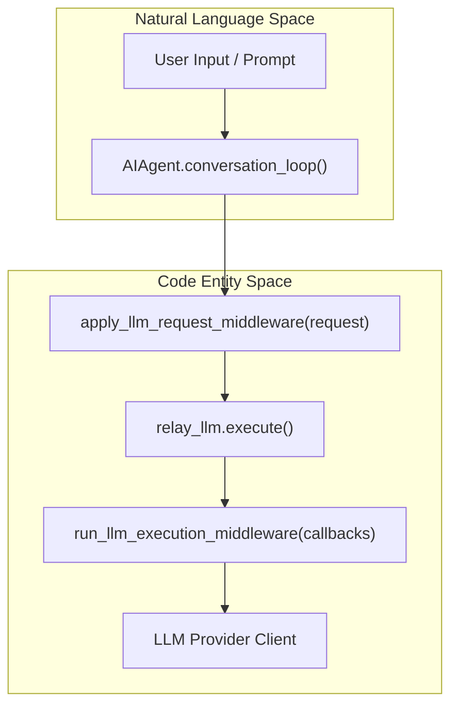
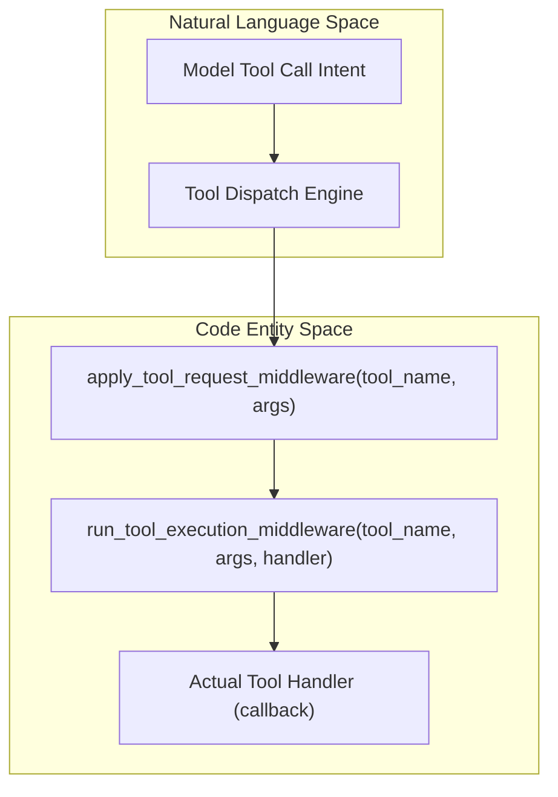

<!-- source: DeepWiki mcp.deepwiki.com · repo nousresearch/hermes-agent · page 10.11 Middleware System · fetched 2026-10-26 -->

# Middleware System

<details>
<summary>Relevant source files</summary>

The following files were used as context for generating this wiki page:

- [agent/replay_cleanup.py](agent/replay_cleanup.py)
- [agent/shell_hooks.py](agent/shell_hooks.py)
- [agent/title_generator.py](agent/title_generator.py)
- [agent/trace_upload.py](agent/trace_upload.py)
- [agent/trajectory.py](agent/trajectory.py)
- [hermes_cli/hooks.py](hermes_cli/hooks.py)
- [hermes_cli/mcp_picker.py](hermes_cli/mcp_picker.py)
- [hermes_cli/mcp_security.py](hermes_cli/mcp_security.py)
- [hermes_cli/memory_oauth.py](hermes_cli/memory_oauth.py)
- [hermes_cli/middleware.py](hermes_cli/middleware.py)
- [hermes_cli/plugins.py](hermes_cli/plugins.py)
- [hermes_cli/plugins_discovery.py](hermes_cli/plugins_discovery.py)
- [hermes_cli/plugins_dispatch.py](hermes_cli/plugins_dispatch.py)
- [hermes_cli/plugins_ledger.py](hermes_cli/plugins_ledger.py)
- [hermes_cli/plugins_loader.py](hermes_cli/plugins_loader.py)
- [hermes_cli/plugins_manifest.py](hermes_cli/plugins_manifest.py)
- [hermes_cli/plugins_state.py](hermes_cli/plugins_state.py)
- [tests/agent/test_replay_cleanup.py](tests/agent/test_replay_cleanup.py)
- [tests/agent/test_shell_hooks.py](tests/agent/test_shell_hooks.py)
- [tests/agent/test_title_generator.py](tests/agent/test_title_generator.py)
- [tests/agent/test_trajectory_file_locking.py](tests/agent/test_trajectory_file_locking.py)
- [tests/gateway/test_stale_confirmation_expiry.py](tests/gateway/test_stale_confirmation_expiry.py)
- [tests/gateway/test_weak_credential_guard.py](tests/gateway/test_weak_credential_guard.py)
- [tests/hermes_cli/test_hooks_cli.py](tests/hermes_cli/test_hooks_cli.py)
- [tests/hermes_cli/test_mcp_security.py](tests/hermes_cli/test_mcp_security.py)
- [tests/hermes_cli/test_plugin_hook_failure_reporting.py](tests/hermes_cli/test_plugin_hook_failure_reporting.py)
- [tests/hermes_cli/test_plugin_scan_dunder_dirs.py](tests/hermes_cli/test_plugin_scan_dunder_dirs.py)
- [tests/hermes_cli/test_plugins.py](tests/hermes_cli/test_plugins.py)
- [tests/hermes_cli/test_plugins_loader.py](tests/hermes_cli/test_plugins_loader.py)
- [tests/hermes_cli/test_web_memory_user_dir_provider.py](tests/hermes_cli/test_web_memory_user_dir_provider.py)
- [tests/plugins/test_memory_hook_registration.py](tests/plugins/test_memory_hook_registration.py)
- [website/docs/developer-guide/middleware.md](website/docs/developer-guide/middleware.md)
- [website/docs/user-guide/features/hooks.md](website/docs/user-guide/features/hooks.md)
- [website/docs/user-guide/features/plugins.md](website/docs/user-guide/features/plugins.md)

</details>


The Hermes Middleware System is a core plugin-driven interception layer designed for rewriting and transforming requests and arguments, as well as wrapping execution callbacks related to LLM and tool invocations. This system provides a flexible pipeline architecture enabling the injection of cross-cutting concerns such as guardrails, prompt/context injection, argument validation, logging, telemetry, and security. These capabilities can be added without modifying core agent logic or tool implementation code.

Middleware is tightly integrated with the plugin infrastructure, allowing plugin authors to register callbacks hooked into key execution points and lifecycle events of the agent [hermes_cli/plugins.py:1-132](), [hermes_cli/middleware.py:7-93]().

## Middleware Kinds

Hermes defines **four distinct kinds** of middleware, each corresponding to a specific stage in the lifecycle of a user-agent interaction or tool call:

| Middleware Kind | Target Stage | Description |
|---|---|---|
| `llm_request` | LLM Input Request | Intercept and transform the LLM request dictionary (messages, parameters, tools) before sending to the provider. |
| `llm_execution` | LLM Execution Callback | Wrap the actual execution that sends the request to the LLM provider and processes the response, enabling interception of network calls or streaming behavior. |
| `tool_request` | Tool Input Arguments | Transform or validate the arguments passed to a tool before the tool handler runs. |
| `tool_execution` | Tool Handler Execution | Wrap the entire execution of a tool handler, allowing pre/post processing, instrumentation, or error handling. |

This separation enables fine-grained interception and control over different points in the AI agent’s runtime pipeline. Middleware callbacks are registered and managed uniformly but invoked at the relevant middleware kind's execution point [tests/hermes_cli/test_plugins.py:27-32](), [hermes_cli/middleware.py:7-150]().

Sources:
- [hermes_cli/middleware.py:7-150]()
- [tests/hermes_cli/test_plugins.py:27-32]()

## Architecture and Data Flow

Middleware chains consist of sequences of callbacks that may transform data or wrap function execution. The core agent and tool dispatch logic integrate these chains at well-defined call sites.

### LLM Middleware Flow



**Diagram: LLM Middleware Flow**

In this flow, the user’s input progresses through the agent’s conversation loop. The raw LLM request dict is transformed via `apply_llm_request_middleware()` [hermes_cli/middleware.py:88-99](). The execution of the request is wrapped by `run_llm_execution_middleware()`, which invokes registered middleware callbacks before finally calling the LLM provider [hermes_cli/middleware.py:135-141](). This architecture enables prompt injection, request rewriting, or streaming interception at the LLM call level [hermes_cli/middleware.py:88-141](), [tests/hermes_cli/test_plugins.py:28-32]().

Sources:
- [hermes_cli/middleware.py:88-141]()
- [tests/hermes_cli/test_plugins.py:28-32]()

### Tool Middleware Flow



**Diagram: Tool Middleware Flow**

Here, a tool call intent from the model enters the tool dispatch system. The tool arguments (`args`) may be transformed by `apply_tool_request_middleware()` [hermes_cli/middleware.py:102-132](). The actual execution handler of the tool is then wrapped by `run_tool_execution_middleware()`, allowing middleware callbacks to insert logic around tool invocation, such as argument modifications, logging, rate limiting, or authorization checks [hermes_cli/middleware.py:144-150](), [tests/hermes_cli/test_plugins.py:29-31]().

Sources:
- [hermes_cli/middleware.py:102-132]()
- [hermes_cli/middleware.py:144-150]()
- [tests/hermes_cli/test_plugins.py:29-31]()

## Implementation Details and Plugin Authoring

Middleware callbacks are registered by plugins primarily during their setup via the `PluginContext.register_middleware()` API, which takes the middleware kind and a callback function. Plugin authors use this mechanism to add custom logic at the four defined interception points.

### Registering Middleware in a Plugin

Example `register(ctx)` function inside a plugin:

```python
def register(ctx):
    # Example middleware that adds a system prompt message to all LLM requests
    def add_system_prompt(request):
        request.setdefault("messages", []).insert(0, {"role": "system", "content": "Enforce strict safety."})
        return request

    ctx.register_middleware("llm_request", add_system_prompt)
```

This middleware callback receives and returns the LLM request dictionary, rewriting it to prepend a system message. Plugins can similarly register callbacks for the other middleware kinds (`tool_request`, `llm_execution`, `tool_execution`) according to their purposes.

Middleware handlers can either:

- Return a transformed payload (for request middleware), or
- Wrap a next-callable function to decorate execution (for execution middleware).

Middleware execution respects the plugin load order, preserving deterministic behavior for resolving overrides and chained modifications. Later-registered middleware runs later, meaning it can override or augment earlier middleware. Execution middleware forms nested layers around the core execution callback, creating a stack of wrappers [hermes_cli/plugins.py:1-132](), [tests/hermes_cli/test_plugins.py:30-35]().

Sources:
- [hermes_cli/plugins.py:1-132]()
- [tests/hermes_cli/test_plugins.py:30-35]()
- [website/docs/user-guide/features/plugins.md:95-122]()

### Execution Order & Fault Isolation

- Middleware callbacks run **sequentially in registration order**.
- Exceptions in middleware are **caught and logged internally** to avoid crashing core agent loops.
- User-installed and project-level plugins can override bundled middleware by registering later, thanks to load order.
- Middleware may implement **fail-closed** behavior (blocking actions on errors) or **fail-open** (allowing requests to pass through if middleware fails).
- Execution middleware supports asynchronous or streaming scenarios for LLMs and tools.
- Legacy shell hook scripts integrated via the shell hooks subsystem also act as middleware bridges through configured stdin/stdout JSON contracts [agent/shell_hooks.py:1-161]().

Sources:
- [agent/shell_hooks.py:1-161]()
- [hermes_cli/plugins_dispatch.py:27-52]()
- [hermes_cli/middleware.py:152-176]()

## Shell Hook Integration

Hermes supports legacy and complementary middleware hooks implemented as external shell scripts managed through the profile’s configuration. These shell hooks receive a structured JSON payload representing the tool call or LLM call context via their standard input and respond with JSON on standard output to block, modify, or approve actions.

Shell hooks sit integrated with the plugin middleware system, providing an out-of-process interception point for guardrails, compliance, or auditing workflows that execute in separate environments for security isolation. Their role is primarily to enforce blocking or rewrite logic on tool calls, serving as a bridge to external policy enforcement tooling [agent/shell_hooks.py:1-161]().

Sources:
- [agent/shell_hooks.py:1-161]()
- [website/docs/user-guide/features/hooks.md:15]()

## Key Classes and Functions

| Entity | Location | Description |
|---|---|---|
| `PluginManager` | `hermes_cli/plugins.py` | Central manager for plugin discovery, loading, middleware registration, and dispatch ordering. |
| `PluginContext` | `hermes_cli/plugins.py` | Context API provided to plugins for registering middleware, tools, commands, and hooks. |
| `apply_llm_request_middleware()` | `hermes_cli/middleware.py` | Transform the LLM request dictionary via registered `llm_request` middleware callbacks. |
| `apply_tool_request_middleware()` | `hermes_cli/middleware.py` | Transform tool call arguments via `tool_request` middleware callbacks. |
| `run_llm_execution_middleware()` | `hermes_cli/middleware.py` | Wrap the LLM request execution call with `llm_execution` middleware callbacks. |
| `run_tool_execution_middleware()` | `hermes_cli/middleware.py` | Wrap the tool handler execution with `tool_execution` middleware callbacks. |
| `ShellHookSpec` | `agent/shell_hooks.py` | Parses and manages configuration and invocation of shell-script middleware hooks. |

Sources:
- [hermes_cli/plugins.py]()
- [hermes_cli/middleware.py]()
- [agent/shell_hooks.py]()

# Summary

Hermes's Middleware System implements a comprehensive and extensible plugin-driven architecture to intercept and transform:

- LLM requests before transmission to providers,
- The entire LLM execution lifecycle,
- Arguments passed to tools before execution,
- The full execution of tool handlers.

By structuring middleware into four clearly defined kinds and integrating with the plugin system's load order and fault isolation mechanisms, Hermes enables expressive customization and robust cross-cutting concerns such as safety guardrails, telemetry, argument validation, and logging without core source changes.

Sources:
- [hermes_cli/plugins.py:1-132]()
- [hermes_cli/middleware.py:7-176]()
- [tests/hermes_cli/test_plugins.py:27-32]()
- [agent/shell_hooks.py:1-161]()
- [website/docs/user-guide/features/hooks.md:18-19]()

---

