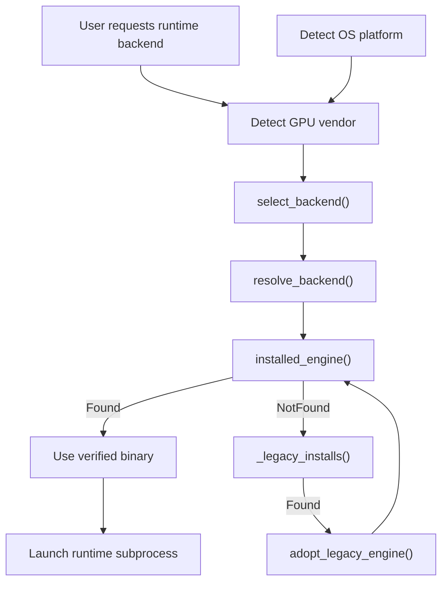
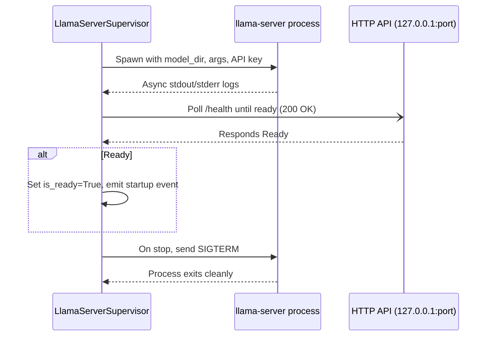
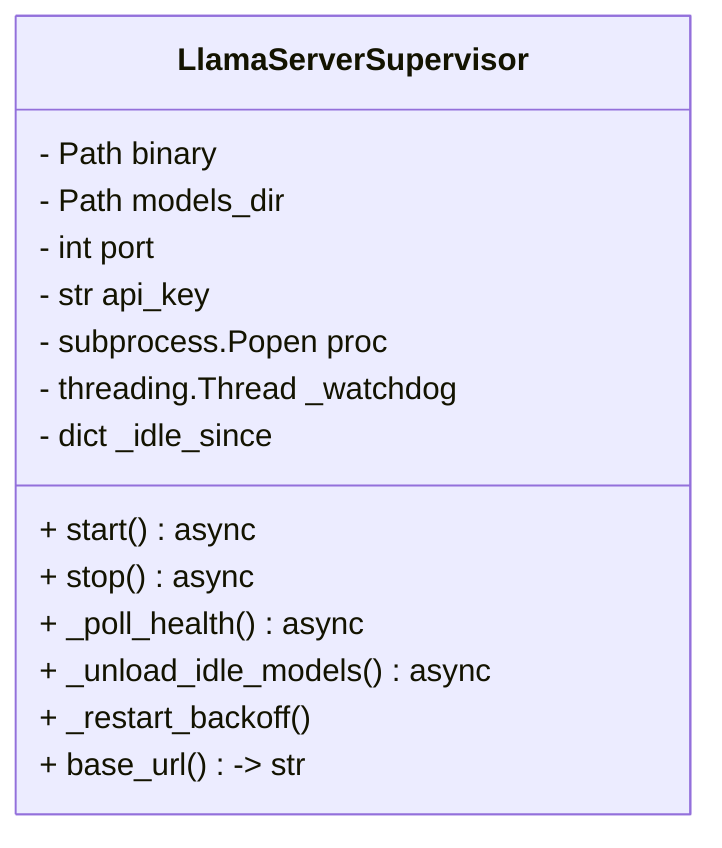
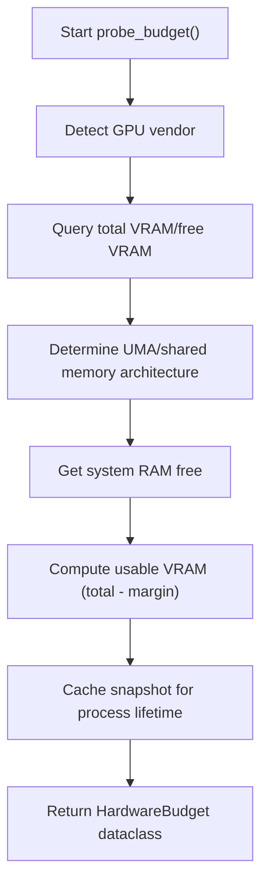
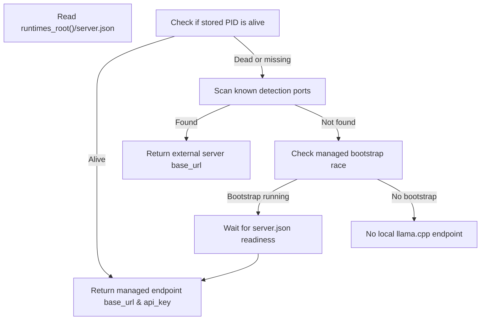
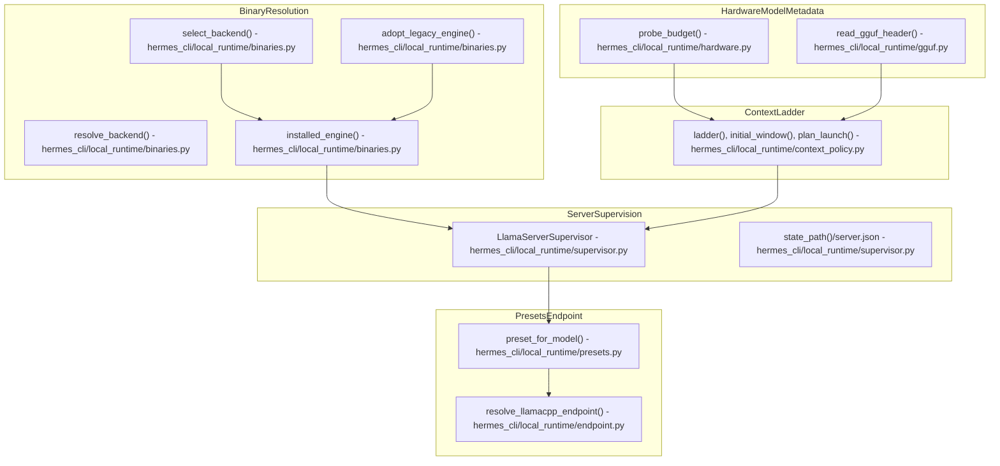

<!-- source: DeepWiki mcp.deepwiki.com · repo nousresearch/hermes-agent · page 10.12 Local Model Runtime · fetched 2026-10-26 -->

# Local Model Runtime

<details>
<summary>Relevant source files</summary>

The following files were used as context for generating this wiki page:

- [agent/insights.py](agent/insights.py)
- [agent/model_metadata.py](agent/model_metadata.py)
- [agent/models_dev.py](agent/models_dev.py)
- [agent/reasoning_effort.py](agent/reasoning_effort.py)
- [agent/reasoning_timeouts.py](agent/reasoning_timeouts.py)
- [agent/usage_pricing.py](agent/usage_pricing.py)
- [contributors/emails/elisam@nvidia.com](contributors/emails/elisam@nvidia.com)
- [hermes_cli/codex_models.py](hermes_cli/codex_models.py)
- [hermes_cli/debug_redaction.py](hermes_cli/debug_redaction.py)
- [hermes_cli/models.py](hermes_cli/models.py)
- [hermes_cli/models_catalog_static.py](hermes_cli/models_catalog_static.py)
- [hermes_cli/profile_model_seed.py](hermes_cli/profile_model_seed.py)
- [hermes_cli/provider_catalog.py](hermes_cli/provider_catalog.py)
- [hermes_cli/providers.py](hermes_cli/providers.py)
- [hermes_cli/route_identity.py](hermes_cli/route_identity.py)
- [hermes_cli/runtime_provider.py](hermes_cli/runtime_provider.py)
- [hermes_cli/runtime_provider_backends.py](hermes_cli/runtime_provider_backends.py)
- [hermes_cli/runtime_provider_custom.py](hermes_cli/runtime_provider_custom.py)
- [tests/agent/test_astra_baseline_runtime.py](tests/agent/test_astra_baseline_runtime.py)
- [tests/agent/test_insights.py](tests/agent/test_insights.py)
- [tests/agent/test_model_metadata.py](tests/agent/test_model_metadata.py)
- [tests/agent/test_model_metadata_local_ctx.py](tests/agent/test_model_metadata_local_ctx.py)
- [tests/agent/test_models_dev.py](tests/agent/test_models_dev.py)
- [tests/agent/test_probe_cache_followups.py](tests/agent/test_probe_cache_followups.py)
- [tests/agent/test_reasoning_effort_module.py](tests/agent/test_reasoning_effort_module.py)
- [tests/agent/test_reasoning_stale_timeout_floor.py](tests/agent/test_reasoning_stale_timeout_floor.py)
- [tests/agent/test_usage_pricing.py](tests/agent/test_usage_pricing.py)
- [tests/hermes_cli/test_codex_cli_model_picker.py](tests/hermes_cli/test_codex_cli_model_picker.py)
- [tests/hermes_cli/test_codex_models.py](tests/hermes_cli/test_codex_models.py)
- [tests/hermes_cli/test_models.py](tests/hermes_cli/test_models.py)
- [tests/hermes_cli/test_profile_model_seed.py](tests/hermes_cli/test_profile_model_seed.py)
- [tests/hermes_cli/test_provider_catalog.py](tests/hermes_cli/test_provider_catalog.py)
- [tests/hermes_cli/test_provider_parity.py](tests/hermes_cli/test_provider_parity.py)
- [tests/hermes_cli/test_runtime_provider_resolution.py](tests/hermes_cli/test_runtime_provider_resolution.py)
- [tests/tui_gateway/test_canonical_voice_events.py](tests/tui_gateway/test_canonical_voice_events.py)
- [tests/tui_gateway/test_diagnostics_share_nous.py](tests/tui_gateway/test_diagnostics_share_nous.py)
- [tests/tui_gateway/test_profiles_create_env_refs.py](tests/tui_gateway/test_profiles_create_env_refs.py)
- [tests/tui_gateway/test_profiles_inherit_launch_model.py](tests/tui_gateway/test_profiles_inherit_launch_model.py)
- [tests/tui_gateway/test_profiles_list_canonical_session.py](tests/tui_gateway/test_profiles_list_canonical_session.py)
- [tests/tui_gateway/test_readiness_singleflight.py](tests/tui_gateway/test_readiness_singleflight.py)
- [tui_gateway/methods_config.py](tui_gateway/methods_config.py)
- [tui_gateway/methods_config_set.py](tui_gateway/methods_config_set.py)
- [tui_gateway/methods_images.py](tui_gateway/methods_images.py)
- [tui_gateway/methods_profiles.py](tui_gateway/methods_profiles.py)
- [tui_gateway/methods_voice.py](tui_gateway/methods_voice.py)
- [website/static/api/model-catalog.json](website/static/api/model-catalog.json)

</details>


## Purpose and Scope

The Local Model Runtime subsystem is responsible for the management and orchestration of the `llama.cpp` local runtime integration in Hermes Agent. This includes:

- Resolving and verifying the appropriate `llama.cpp` backend binary per platform and GPU vendor.
- Supervising a managed `llama-server` subprocess lifecycle, including launch, shutdown, health checks, and model unloading.
- Probing local hardware (GPU VRAM and CPU RAM) to budget model memory usage appropriately.
- Parsing GGUF model headers to extract native context windows and tensor data types.
- Managing an adaptive context window ladder calibrated to hardware resources and model capabilities.
- Generating launch presets that encapsulate runtime configurations.
- Resolving local runtime endpoints, including detecting external or managed `llama-server` instances.
- Supporting legacy installs adoption for seamless upgrades.

This document details the technical implementation, data flows, key classes, and functions forming this subsystem.

---

## Binary Resolution and Verification

### Overview

Hermes dynamically selects the most suitable `llama.cpp` backend binary for the host environment. Selection is driven by GPU vendor detection (NVIDIA, AMD, Intel, Apple), OS platform (Windows, macOS, Linux), and runtime preferences. The subsystem supports backends such as `"cuda"`, `"vulkan"`, `"metal"` (macOS), `"hip"` (AMD on Windows), and `"cpu"`.

The binary resolution process involves:

- Querying the GPU vendor and OS to identify the best backend target.
- Checking pinned package manager (pm) repositories for installed engines with verified SHA256 hashes.
- Falling back to `"cpu"` if no specialized backend is available.
- Searching legacy install locations for existing binaries and optionally adopting them into the pm repo.

Proper verification ensures reproducible and secure binary supply.

### Key Code Entities

- `select_backend(gpu_vendor: str | None, os_name: str | None) -> str`: Chooses the best backend name from vendor/OS.
- `resolve_backend(requested: str = "auto", gpu_vendor: str | None = None, target: str | None = None) -> Engine`: Resolves the installed engine binary based on requested backend or `"auto"`.
- `installed_engine(backend: str = "auto", allow_outdated: bool = True) -> Engine | None`: Retrieves the highest-priority installed engine or `None`.
- `_legacy_installs() -> list[Engine]`: Lists legacy installs found in standard old install paths.
- `adopt_legacy_engine(engine: Engine) -> bool`: Moves a legacy install into pm-managed area.

### Data Flow



Sources: `hermes_cli/local_runtime/binaries.py:1-176`(), `hermes_cli/local_runtime/bootstrap.py:1-161`(), `hermes_cli/local_runtime/hardware.py:1-159`()

---

## LlamaServerSupervisor

### Overview

`LlamaServerSupervisor` manages a single instance of the `llama-server` subprocess running in router mode. It ensures:

- Launch on a specified or free port, with cryptographically generated API key persisted in state.
- Graceful shutdown and restart on crashes, with exponential backoff in restart attempts.
- Health checking of the HTTP server's `/health` and `/props` endpoints to detect readiness.
- Automatic unloading of idle models (idle > 15 minutes) from RAM to free VRAM.
- Asynchronous reading of subprocess logs and emitting events to consumers.
- Thread-safe lifecycle control with start/stop coroutines and a dedicated watchdog thread.

### Attributes and Methods

| Attribute / Method | Description |
|------------------------------------------|-------------|
| `binary: Path` | Path to the `llama-server` executable binary. |
| `models_dir: Path` | Directory containing GGUF model files available to the server. |
| `port: int` | TCP port the server listens on (default 18434). |
| `api_key: str` | Persistent API key for client requests. |
| `proc: subprocess.Popen` | Running server process handle. |
| `_watchdog: threading.Thread` | Thread polling server health and managing lifecycle. |
| `_idle_since: dict[str, float]` | Maps model names to last unloadable timestamp. |
| `start() / stop()` | Async methods to launch or stop the server process. |
| `_poll_health() / _unload_idle_models()` | Internal async loops managing server health and VRAM cleanup. |
| `base_url() -> str` | Returns server API base URL with hostname and port. |

### Lifecycle Sequence Diagram



### Watchdog Behavior

- Polls `/health` every ~1 second until ready.
- Queries `/props` regularly to track loaded models.
- Auto-unloads models idle over configured duration (~900 s).
- Manages restart backoff (1, 5, 15, 60 seconds).
- Persists state info to `server.json` including PID and API key.

### Class Diagram Snippet



Sources: `hermes_cli/local_runtime/supervisor.py:1-168`()

---

## Hardware Budget Probing

### Overview

The Local Model Runtime probes system resources to budget the available VRAM/RAM for launching models efficiently. Key considerations:

- Discrete GPUs have dedicated VRAM measured by vendor tools (e.g., `nvidia-smi`).
- UMA (Unified Memory Architecture) systems share GPU texture memory with system RAM, requiring adjusted budgeting.
- Usable VRAM accounts for reserved margins:
  - A floor margin of 2 GiB.
  - A fraction margin (~9%) of total VRAM.
  - Additional headroom (~1 GiB) for OS/compositor overhead.
- System RAM free is also queried for fallback and UMA support.

### Key Constants

- `_MARGIN_FLOOR` = 2 GiB
- `_MARGIN_FRACTION` = 0.09 (9%)
- UMA reserves ~20% headroom on system RAM aside from VRAM.

### Function

- `probe_budget(planning: bool = True) -> HardwareBudget`: Returns a snapshot including:
  - Total VRAM, free VRAM, usable VRAM (after margin).
  - UMA and RAM free flags for launch planning.
  - Vendor identification and other environment info.

### Probing Flow



Sources: `hermes_cli/local_runtime/hardware.py:1-159`()

---

## GGUF Header Parsing

### Purpose

To properly profile and launch local models, Hermes parses GGUF model file headers, the standard metadata format for `llama.cpp` models. GGUF headers provide:

- Native context window sizes.
- Data type of model tensors (`model.tfm.dtype`).
- Sampling defaults and parameters.
- Layer counts and dimensions for resource estimation.

This metadata enables:

- Precise adaptation of context window ladders.
- Selection of efficient launch configurations.
- Accurate VRAM and memory profiling.

### Usage

- Parsing occurs during local model staging, verification, and preset formation.
- The `preset_for_model()` function calls GGUF parsing to extract these parameters.
- Enables high-fidelity client-side launch plans integrating hardware budget and model fidelity.

Sources:
`hermes_cli/local_runtime/gguf.py` (core parser),
`hermes_cli/local_runtime/presets.py:79-143`(),
`agent/model_metadata.py:89-130`()

---

## Context-Window Ladder and Growth Policy

### Overview

The context window ladder is a structured set of increasing context window sizes ("rungs") tailored to the model’s native maximum and hardware constraints, optimized for stable long-context usage.

- A **floor** size (e.g. 64K tokens) is guaranteed.
- Growth between rungs is roughly 1.5× to balance VRAM with context size.
- The ladder ends at the native max supported by the model or the largest supported size under VRAM constraints.
- The ladder supports adaptive growth during execution enabling gradual context increases.

### Constants

| Constant | Value | Purpose |
|---|---:|:---|
| `FLOOR` | 65536 (64K tokens) | Minimum guaranteed window size|
| `TARGET_WINDOW`| 144 * 1024 (approx 147,456) | Target rung for balanced compression |

### Functions and Logic

- `ladder(native: int) -> list[int]`: Computes the discrete rungs from floor to native max.
- `initial_window(budget, profile) -> int`: Picks the best initial context size given the hardware budget and model profile.
- `plan_launch(...)`: Produces a launch plan selecting context window, MTP mode, and overhead accounting.

### Sample Ladder Table (excerpt)

| Step | Window Size (tokens) | Notes |
|:-----|---------------------:|:---|
| 0 | 65536 | Floor rung (minimum) |
| 1 | ~98304 | ~1.5× multiplier |
| 2 | ~131072 | |
| ... | ... | |
| N | Native max | Maximum context supported|

The ladder guides the runtime to:

- Use largest zero-spill rung fitting in usable VRAM, if weights fully fit.
- Otherwise, use floor rung with strict spill limits.
- Enable efficient growth by stepping up the ladder when more resources free up.

Sources: `hermes_cli/local_runtime/context_policy.py:1-157`(), `hermes_cli/local_runtime/presets.py:79-143`(), `agent/model_metadata.py:105-126`()

---

## Presets and Endpoint Resolution

### Preset Generation

Local runtime presets encapsulate detailed launch configurations derived from GGUF metadata and runtime parameters for:

- Executables selection and path.
- Model GGUF file path and associated vision or companion files.
- Sampling parameters (temperature, top-p, etc.), derived from GGUF defaults or overrides.
- Context window sizes mapped to the adaptive ladder.
- Launch arguments converted into dictionaries with normalized keys.

Presets are used internally to launch managed `llama-server` instances and exposed to the user tooling for model selection and diagnostics.

### Endpoint Resolution Logic

Hermes supports discovering and selecting a local llama.cpp runtime endpoint via `llamacpp-alias` provider with the following priority:

1. **Managed runtimes**: Check the Hermes-managed runtime state file (`server.json`) which records the process PID, base API URL, and API key for the currently managed subprocess.
2. **Detected external runtimes**: Scan common detection ports (e.g., 18434) for running `llama-server` instances without authorization, if no managed runtime found.
3. **Wait for bootstrap races**: Detect ongoing managed bootstraps and wait for readiness signals.
4. **Fallback**: None found indicates no local runtime available.

This endpoint resolution abstracts client calls allowing seamless integration with either Hermes-managed runtimes or externally-run servers.

### Resolution Flow Diagram



Sources: `hermes_cli/local_runtime/endpoint.py:1-150`(), `hermes_cli/local_runtime/bootstrap.py:1-161`(), `hermes_cli/local_runtime/presets.py:79-143`()

---

## Overall System Architecture

```mermaid
flowchart TD
  subgraph User/System
    U["User requests local LLM runtime or model"]
  end

  subgraph RuntimeManagement
    B[Binary Resolution (binaries.py)]
    H[Hardware Probing (hardware.py)]
    P[GGUF Header Parsing (gguf.py)]
    C[Context Window Ladder & Policy (context_policy.py)]
    S["LlamaServerSupervisor (supervisor.py)"]
    E[Endpoint Preset Generation & Resolution (endpoint.py, presets.py)]
    L[Legacy Engine Adoption (binaries.py)]
  end

  U --> B
  B --> L
  L --> S
  B --> H
  H --> P
  P --> C
  C --> S
  S --> E
  E -->|API URL + Key| U
```

---

## Mapping Terms to Code Entities



---

## Summary

The Local Model Runtime subsystem delivers a robust, hardware-aware embedding of `llama.cpp` local LLM runtimes in Hermes Agent. From secure, dynamic binary resolution and verified installs, through advanced hardware probing and adaptive context window management, to resilient supervision of runtime servers and seamless integration with endpoint discovery, this system ensures local model execution is performant, reliable, and transparently accessible by all Hermes components. GGUF parsing enables fine-grained launch plans tailored to model capabilities and device constraints, supporting sustained context scaling and efficient VRAM usage.

---

## References Table

| Feature | Files and Functions |
|---|---|
| Binary resolution & verification | `hermes_cli/local_runtime/binaries.py:1-176` |
| Legacy engine adoption | `hermes_cli/local_runtime/binaries.py:130-176` |
| Runtime supervision | `hermes_cli/local_runtime/supervisor.py:1-168` |
| Hardware budget probe | `hermes_cli/local_runtime/hardware.py:1-159` |
| GGUF header parsing | `hermes_cli/local_runtime/gguf.py` (core), `hermes_cli/local_runtime/presets.py:79-143` |
| Context ladder and launch plan | `hermes_cli/local_runtime/context_policy.py:1-157` |
| Endpoint resolution | `hermes_cli/local_runtime/endpoint.py:1-150` |
| Preset generation | `hermes_cli/local_runtime/presets.py:79-143` |
| Bootstrap & integration | `hermes_cli/local_runtime/bootstrap.py:1-161` |

Sources:
`hermes_cli/local_runtime/binaries.py:1-176`(),
`hermes_cli/local_runtime/bootstrap.py:1-161`(),
`hermes_cli/local_runtime/hardware.py:1-159`(),
`hermes_cli/local_runtime/supervisor.py:1-168`(),
`hermes_cli/local_runtime/gguf.py` (core parser),
`hermes_cli/local_runtime/presets.py:79-143`(),
`agent/model_metadata.py:89-130`(),
`hermes_cli/local_runtime/context_policy.py:1-157`(),
`hermes_cli/local_runtime/endpoint.py:1-150`()

---

