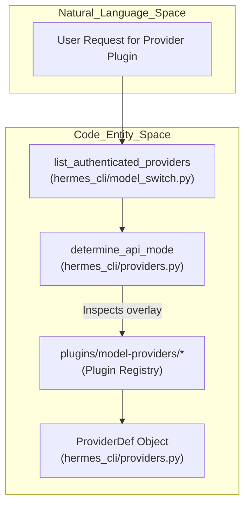
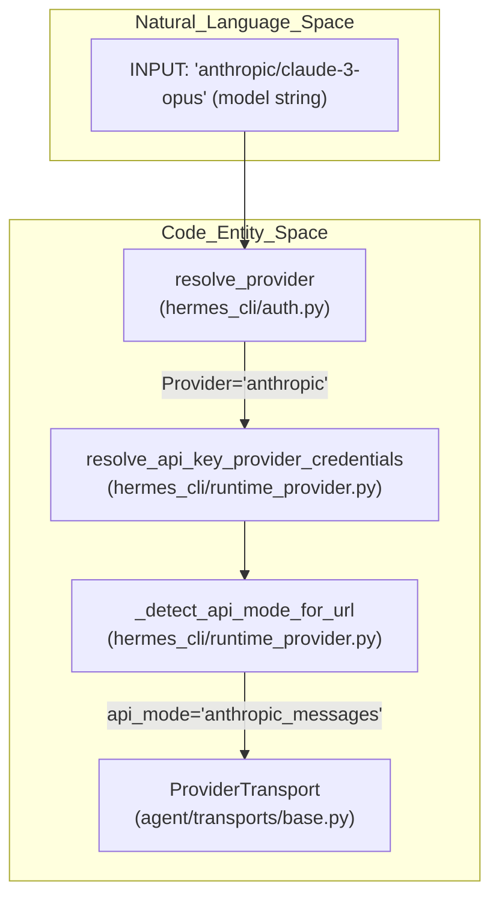
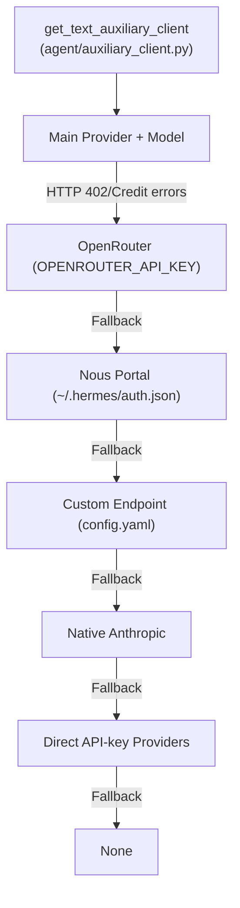
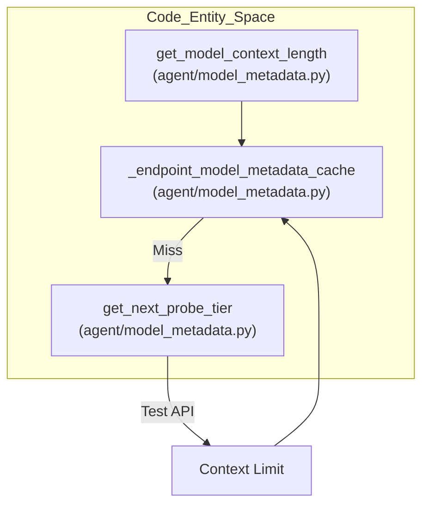

<!-- source: DeepWiki mcp.deepwiki.com · repo nousresearch/hermes-agent · page 10.2 Provider Runtime Resolution · fetched 2026-10-26 -->

# Provider Runtime Resolution

Relevant source files

The following files were used as context for generating this wiki page:

- [agent/auxiliary_async_rebuild.py](agent/auxiliary_async_rebuild.py)
- [agent/codex_runtime.py](agent/codex_runtime.py)
- [agent/opencode_affinity.py](agent/opencode_affinity.py)
- [agent/portal_tags.py](agent/portal_tags.py)
- [agent/prompt_cache_scope.py](agent/prompt_cache_scope.py)
- [agent/transports/__init__.py](agent/transports/__init__.py)
- [agent/transports/base.py](agent/transports/base.py)
- [agent/transports/bedrock.py](agent/transports/bedrock.py)
- [agent/transports/chat_completions.py](agent/transports/chat_completions.py)
- [agent/transports/codex_app_server.py](agent/transports/codex_app_server.py)
- [agent/transports/codex_app_server_session.py](agent/transports/codex_app_server_session.py)
- [agent/transports/codex_event_projector.py](agent/transports/codex_event_projector.py)
- [agent/transports/hermes_tools_mcp_server.py](agent/transports/hermes_tools_mcp_server.py)
- [agent/transports/types.py](agent/transports/types.py)
- [agent/vertex_adapter.py](agent/vertex_adapter.py)
- [contributors/emails/sahabatheri@gmail.com](contributors/emails/sahabatheri@gmail.com)
- [contributors/emails/wjsrjsdn12@gmail.com](contributors/emails/wjsrjsdn12@gmail.com)
- [hermes_cli/codex_runtime_plugin_migration.py](hermes_cli/codex_runtime_plugin_migration.py)
- [hermes_cli/codex_runtime_switch.py](hermes_cli/codex_runtime_switch.py)
- [hermes_cli/config_providers.py](hermes_cli/config_providers.py)
- [hermes_cli/credential_lifecycle.py](hermes_cli/credential_lifecycle.py)
- [hermes_cli/debug_redaction.py](hermes_cli/debug_redaction.py)
- [hermes_cli/profile_model_seed.py](hermes_cli/profile_model_seed.py)
- [hermes_cli/provider_catalog.py](hermes_cli/provider_catalog.py)
- [hermes_cli/providers.py](hermes_cli/providers.py)
- [hermes_cli/route_identity.py](hermes_cli/route_identity.py)
- [hermes_cli/runtime_provider.py](hermes_cli/runtime_provider.py)
- [hermes_cli/runtime_provider_backends.py](hermes_cli/runtime_provider_backends.py)
- [hermes_cli/runtime_provider_custom.py](hermes_cli/runtime_provider_custom.py)
- [hermes_cli/subcommands/codex_runtime.py](hermes_cli/subcommands/codex_runtime.py)
- [plugins/model-providers/actual/__init__.py](plugins/model-providers/actual/__init__.py)
- [plugins/model-providers/bedrock/__init__.py](plugins/model-providers/bedrock/__init__.py)
- [plugins/model-providers/commandcode/__init__.py](plugins/model-providers/commandcode/__init__.py)
- [plugins/model-providers/commandcode/plugin.yaml](plugins/model-providers/commandcode/plugin.yaml)
- [plugins/model-providers/copilot-acp/__init__.py](plugins/model-providers/copilot-acp/__init__.py)
- [plugins/model-providers/custom/__init__.py](plugins/model-providers/custom/__init__.py)
- [plugins/model-providers/nous/__init__.py](plugins/model-providers/nous/__init__.py)
- [plugins/model-providers/openrouter/__init__.py](plugins/model-providers/openrouter/__init__.py)
- [plugins/model-providers/router/__init__.py](plugins/model-providers/router/__init__.py)
- [plugins/model-providers/router/plugin.yaml](plugins/model-providers/router/plugin.yaml)
- [providers/README.md](providers/README.md)
- [tests/agent/test_auxiliary_named_custom_providers.py](tests/agent/test_auxiliary_named_custom_providers.py)
- [tests/agent/test_auxiliary_opencode_routing.py](tests/agent/test_auxiliary_opencode_routing.py)
- [tests/agent/test_background_review_cache_parity.py](tests/agent/test_background_review_cache_parity.py)
- [tests/agent/test_codex_app_server_event_bridge.py](tests/agent/test_codex_app_server_event_bridge.py)
- [tests/agent/test_codex_app_server_integration.py](tests/agent/test_codex_app_server_integration.py)
- [tests/agent/test_codex_app_server_persist.py](tests/agent/test_codex_app_server_persist.py)
- [tests/agent/test_codex_app_server_thread_resume.py](tests/agent/test_codex_app_server_thread_resume.py)
- [tests/agent/test_codex_runtime_prompt_handoff.py](tests/agent/test_codex_runtime_prompt_handoff.py)
- [tests/agent/test_compression_feasibility.py](tests/agent/test_compression_feasibility.py)
- [tests/agent/test_credential_pool_provider_boundary.py](tests/agent/test_credential_pool_provider_boundary.py)
- [tests/agent/test_declared_conversation_scope.py](tests/agent/test_declared_conversation_scope.py)
- [tests/agent/test_opencode_session_affinity.py](tests/agent/test_opencode_session_affinity.py)
- [tests/agent/test_portal_tags.py](tests/agent/test_portal_tags.py)
- [tests/agent/test_primary_runtime_restore.py](tests/agent/test_primary_runtime_restore.py)
- [tests/agent/test_prompt_cache_scope.py](tests/agent/test_prompt_cache_scope.py)
- [tests/agent/test_review_fork_cache_scope.py](tests/agent/test_review_fork_cache_scope.py)
- [tests/agent/test_session_affinity_header.py](tests/agent/test_session_affinity_header.py)
- [tests/agent/test_vertex_adapter.py](tests/agent/test_vertex_adapter.py)
- [tests/agent/transports/test_chat_completions.py](tests/agent/transports/test_chat_completions.py)
- [tests/agent/transports/test_codex_app_server.py](tests/agent/transports/test_codex_app_server.py)
- [tests/agent/transports/test_codex_app_server_runtime.py](tests/agent/transports/test_codex_app_server_runtime.py)
- [tests/agent/transports/test_codex_app_server_session.py](tests/agent/transports/test_codex_app_server_session.py)
- [tests/agent/transports/test_codex_event_projector.py](tests/agent/transports/test_codex_event_projector.py)
- [tests/agent/transports/test_hermes_tools_mcp_server.py](tests/agent/transports/test_hermes_tools_mcp_server.py)
- [tests/agent/transports/test_plugin_transport_api_mode.py](tests/agent/transports/test_plugin_transport_api_mode.py)
- [tests/agent/transports/test_router_codex_efforts.py](tests/agent/transports/test_router_codex_efforts.py)
- [tests/agent/transports/test_types.py](tests/agent/transports/test_types.py)
- [tests/gateway/test_api_server_declared_conversation.py](tests/gateway/test_api_server_declared_conversation.py)
- [tests/hermes_cli/test_actual_provider.py](tests/hermes_cli/test_actual_provider.py)
- [tests/hermes_cli/test_ai_gateway_models.py](tests/hermes_cli/test_ai_gateway_models.py)
- [tests/hermes_cli/test_auth_provider_gate.py](tests/hermes_cli/test_auth_provider_gate.py)
- [tests/hermes_cli/test_bedrock_mantle_key_env.py](tests/hermes_cli/test_bedrock_mantle_key_env.py)
- [tests/hermes_cli/test_bedrock_region_scoped_picker.py](tests/hermes_cli/test_bedrock_region_scoped_picker.py)
- [tests/hermes_cli/test_codex_runtime_plugin_migration.py](tests/hermes_cli/test_codex_runtime_plugin_migration.py)
- [tests/hermes_cli/test_codex_runtime_switch.py](tests/hermes_cli/test_codex_runtime_switch.py)
- [tests/hermes_cli/test_copilot_in_model_list.py](tests/hermes_cli/test_copilot_in_model_list.py)
- [tests/hermes_cli/test_credential_lifecycle.py](tests/hermes_cli/test_credential_lifecycle.py)
- [tests/hermes_cli/test_env_export_line_lifecycle.py](tests/hermes_cli/test_env_export_line_lifecycle.py)
- [tests/hermes_cli/test_inventory_reasoning_caps.py](tests/hermes_cli/test_inventory_reasoning_caps.py)
- [tests/hermes_cli/test_keyed_provider_credential_pool.py](tests/hermes_cli/test_keyed_provider_credential_pool.py)
- [tests/hermes_cli/test_model_flow_pooled_credentials.py](tests/hermes_cli/test_model_flow_pooled_credentials.py)
- [tests/hermes_cli/test_profile_model_seed.py](tests/hermes_cli/test_profile_model_seed.py)
- [tests/hermes_cli/test_prompt_api_key.py](tests/hermes_cli/test_prompt_api_key.py)
- [tests/hermes_cli/test_provider_catalog.py](tests/hermes_cli/test_provider_catalog.py)
- [tests/hermes_cli/test_provider_parity.py](tests/hermes_cli/test_provider_parity.py)
- [tests/hermes_cli/test_router_provider.py](tests/hermes_cli/test_router_provider.py)
- [tests/hermes_cli/test_runtime_provider_resolution.py](tests/hermes_cli/test_runtime_provider_resolution.py)
- [tests/hermes_cli/test_vertex_provider.py](tests/hermes_cli/test_vertex_provider.py)
- [tests/hermes_state/test_conversation_root.py](tests/hermes_state/test_conversation_root.py)
- [tests/plugins/model_providers/test_commandcode_profile.py](tests/plugins/model_providers/test_commandcode_profile.py)
- [tests/plugins/model_providers/test_custom_profile.py](tests/plugins/model_providers/test_custom_profile.py)
- [tests/plugins/model_providers/test_nous_profile.py](tests/plugins/model_providers/test_nous_profile.py)
- [tests/providers/test_fetch_models_base_url.py](tests/providers/test_fetch_models_base_url.py)
- [tests/providers/test_profile_wiring.py](tests/providers/test_profile_wiring.py)
- [tests/providers/test_provider_profiles.py](tests/providers/test_provider_profiles.py)
- [tests/providers/test_transport_parity.py](tests/providers/test_transport_parity.py)
- [tests/tui_gateway/test_canonical_voice_events.py](tests/tui_gateway/test_canonical_voice_events.py)
- [tests/tui_gateway/test_diagnostics_share_nous.py](tests/tui_gateway/test_diagnostics_share_nous.py)
- [tests/tui_gateway/test_profiles_create_env_refs.py](tests/tui_gateway/test_profiles_create_env_refs.py)
- [tests/tui_gateway/test_profiles_inherit_launch_model.py](tests/tui_gateway/test_profiles_inherit_launch_model.py)
- [tests/tui_gateway/test_profiles_list_canonical_session.py](tests/tui_gateway/test_profiles_list_canonical_session.py)
- [tests/tui_gateway/test_readiness_singleflight.py](tests/tui_gateway/test_readiness_singleflight.py)
- [tui_gateway/methods_config.py](tui_gateway/methods_config.py)
- [tui_gateway/methods_config_set.py](tui_gateway/methods_config_set.py)
- [tui_gateway/methods_images.py](tui_gateway/methods_images.py)
- [tui_gateway/methods_profiles.py](tui_gateway/methods_profiles.py)
- [tui_gateway/methods_voice.py](tui_gateway/methods_voice.py)
- [website/docs/developer-guide/adding-providers.md](website/docs/developer-guide/adding-providers.md)
- [website/docs/user-guide/features/codex-app-server-runtime.md](website/docs/user-guide/features/codex-app-server-runtime.md)

Provider runtime resolution is the system that determines which LLM provider to use for a request and obtains the necessary credentials, base URLs, and model configurations at execution time. This mechanism enables dynamic provider switching, multi-credential failover, automatic protocol adaptation (OpenAI, Anthropic, or Codex), and fallback handling without hardcoded dependencies, incorporating a modular plugin architecture via `hermes_cli/providers.py` and `plugins/model-providers/`.

---

## Overview

The provider runtime resolution system handles dynamic selection and configuration of LLM providers and their credentials at runtime. It enables seamless switching between providers, transparent failover on credential exhaustion or error, and layered overrides from environment variables, configuration, and credential stores.

The primary functionality includes:

-   **Provider Identification**: Parsing model or provider descriptors to determine which provider backend to use [hermes_cli/runtime_provider.py:1-6]().

-   **ProviderProfile Plugin Architecture**: Discovering and loading provider definitions dynamically from `hermes_cli/providers.py` and provider registry overlays [hermes_cli/providers.py:16-94]().

-   **Credential Resolution**: Resolving runtime credentials from environment variables, credential pools, or token caches, including OAuth and API key resolutions [hermes_cli/runtime_provider.py:17-31]().

-   **API Endpoint Discovery**: Determining base URLs with overrides and custom endpoint support, with trust rules for loopback addresses [hermes_cli/runtime_provider.py:53-86]().

-   **API Mode Detection**: Selecting transport protocol modes such as `chat_completions`, `anthropic_messages`, and `codex_responses` via auto-detection from endpoint URL and configuration [hermes_cli/runtime_provider.py:99-124]().

-   **Transport Construction**: Instantiating protocol-specific transport clients for request/response normalization [agent/transports/chat_completions.py:1-135]().

-   **Auxiliary Client Fallback**: Providing secondary resolution chains for auxiliary tasks (compression, vision, web extraction) with fallback providers and payment exhaustion handling [agent/auxiliary_client.py:1-9]().

-   **Credential Pooling**: Supporting multiple credentials per provider with automatic failover and cooldown on failure [agent/credential_pool.py:1-135]().

-   **Model Metadata Resolution**: Discovering model capabilities and context lengths for runtime use [agent/model_metadata.py:105-160]().

-   **API Error Classification**: Classifying API failures to trigger credential rotation, compression, or fallback [agent/auxiliary_client.py:8-9]().

Sources:
- [hermes_cli/runtime_provider.py:1-6]()
- [hermes_cli/providers.py:16-94]()
- [hermes_cli/runtime_provider.py:17-31]()
- [hermes_cli/runtime_provider.py:53-86]()
- [hermes_cli/runtime_provider.py:99-124]()
- [agent/transports/chat_completions.py:1-135]()
- [agent/auxiliary_client.py:1-9]()
- [agent/credential_pool.py:1-135]()
- [agent/model_metadata.py:105-160]()

---

## Provider Normalization and Prefixes

Models can specify explicit providers using prefixes in the form `provider:model_id`. Hermes allows flexible prefixing while respecting provider conventions that use colons or other delimiters internally (e.g., Ollama or Qwen versions). This is handled via prefix stripping functions that correctly extract provider and model portions without false splits.

The `_strip_provider_prefix` function in the model metadata module strips a known provider prefix from a model name, unless the suffix matches a special tag pattern (e.g., Ollama tags). This avoids wrongly stripping provider-like strings from model IDs that embed colons internally [agent/model_metadata.py:89-102]().

Known provider categories include:

| Prefix Category | Examples |
|:----------------|:------------------------------------------------------------------------------------------|
| **Global Gateways** | `openrouter`, `nous`, `ollama-cloud` |
| **Native Providers** | `anthropic`, `deepseek`, `gemini`, `xai`, `nvidia` |
| **Specialized / OAuth**| `minimax-oauth`, `qwen-oauth`, `copilot-acp` |
| **Aggregators / MoA** | `opencode-zen`, `kilo`, `novita`, `deepinfra` |

This normalization ensures consistent routing and correct model identification, avoiding confusion with embedded tags.

Sources:
- [agent/model_metadata.py:89-102]()
- [hermes_cli/providers.py:31-32]()
- [hermes_cli/providers.py:85]()
- [hermes_cli/providers.py:46]()
- [hermes_cli/providers.py:56]()
- [hermes_cli/providers.py:66-67]()
- [hermes_cli/providers.py:39]()
- [hermes_cli/providers.py:43]()
- [hermes_cli/providers.py:53]()
- [hermes_cli/providers.py:59-65]()

---

## ProviderProfile Plugin Architecture

The provider ecosystem is structured around a plugin architecture defined under `hermes_cli/providers.py` and the `plugins/model-providers/` directory. Each provider is represented by a `ProviderDef` dataclass containing canonical identity, aliases, transport mode, auth type, base URL info, environment variable names, and aggregate flags.

-   `hermes_cli/providers.py` manages core provider identity, featuring the `HERMES_OVERLAYS` mapping that carries Hermes-specific metadata layered over the base models.dev provider data. This overlay adds additional fields such as transport modes (`openai_chat`, `anthropic_messages`, `codex_responses`), auth type (API key, OAuth, external process), and base URL overrides or environment variable keys [hermes_cli/providers.py:16-94]().

-   Provider plugins under `plugins/model-providers/` implement specific logic for authentication, header injection, endpoint paths, and specialized behavior for OAuth, external processes, or custom endpoint handling. Notable plugin examples include:
    -   `plugins/model-providers/openrouter/__init__.py`
    -   `plugins/model-providers/custom/__init__.py`
    -   `plugins/model-providers/nous/__init__.py`

This modular plugin design allows adding new providers or overlays without modifying the core, enabling a clean separation of concerns.

### Provider Plugin Resolution Sequence Diagram

Sources:
- [hermes_cli/providers.py:16-94]()
- `plugins/model-providers/openrouter/__init__.py`
- `plugins/model-providers/custom/__init__.py`
- `plugins/model-providers/nous/__init__.py`

---

## Transport and API Modes

Hermes supports multiple API transport modes determined by the API endpoint's hostname/path or provider overlay metadata. The main API modes handled are:

-   **chat_completions**: Default for most OpenAI-compatible providers such as OpenRouter, Nous, NVIDIA, Qwen, Ollama, and Kimi. This mode uses the OpenAI Chat Completions schema, implemented by the `ChatCompletionsTransport` class [agent/transports/chat_completions.py:1-135]().

-   **anthropic_messages**: Used by native Anthropic Claude models and compatible gateways (including third-party Anthropic-like endpoints under a `/anthropic` suffix or Kimi Code coding endpoints). This mode serves the native Anthropic Messages protocol with adaptive thinking effort budgeting [hermes_cli/runtime_provider.py:99-124]().

-   **codex_responses**: For OpenAI Codex, xAI `/v1/responses` endpoints, and others identified by specific hostnames. The `CodexAuxiliaryClient` handles this mode, offering specialized behavior [agent/auxiliary_client.py:20](), [agent/auxiliary_client.py:37]().

-   **codex_app_server**: This is an opt-in mode where Hermes delegates the entire turn to a `codex app-server` subprocess. This allows using Codex's own tool runtime, sandboxing, and native plugins. Hermes acts as a shell, managing sessions, slash commands, gateway, memory, and skill review. This mode is enabled when `model.openai_runtime == "codex_app_server"` and the provider is `openai` or `openai-codex` [hermes_cli/runtime_provider.py:96](), [website/docs/user-guide/features/codex-app-server-runtime.md:1-8](). The `CodexAppServerSession` class manages the interaction with the app-server [agent/transports/codex_app_server_session.py:1-18]().

The `_detect_api_mode_for_url` function enforces precise host and path matches to avoid spoofing impersonations and correctly determine the API mode based on the base URL. It also prioritizes known official hosts and overrides [hermes_cli/runtime_provider.py:99-124]().

Sources:
- [agent/transports/chat_completions.py:1-135]()
- [hermes_cli/runtime_provider.py:99-124]()
- [agent/auxiliary_client.py:20]()
- [agent/auxiliary_client.py:37]()
- [hermes_cli/runtime_provider.py:96]()
- [website/docs/user-guide/features/codex-app-server-runtime.md:1-8]()
- [agent/transports/codex_app_server_session.py:1-18]()

---

## Runtime Provider Resolution Flow

At runtime, the system resolves a user input string (model or provider) into a full provider configuration object containing credentials, base URLs, API mode, and transport client. The primary code involved is in `hermes_cli/runtime_provider.py`.

The resolution process includes these key steps:

1.  **Input Parsing**: The requested model or provider is normalized and split to identify explicit provider prefixes if present.

2.  **Provider Resolution**: Via `resolve_provider()`, the system canonicalizes provider names, with special cases for aliases and custom providers.

3.  **Credential Resolution**: Credentials are resolved from multiple sources, including:
    -   Environment variables.
    -   The configured credential pool for the provider.
    -   OAuth device code or external process token fetchers.
    Resolvers such as `resolve_api_key_provider_credentials`, `resolve_nous_runtime_credentials`, etc. are used for specific providers [hermes_cli/runtime_provider.py:17-31]().

4.  **Base URL Computation**: The base URL for the API is computed with precedence rules over explicit parameters, config.yaml, and environment variables. Trust rules prevent external untrusted URLs from masquerading as local custom endpoints [hermes_cli/runtime_provider.py:53-86]().

5.  **API Mode Detection**: Using `_detect_api_mode_for_url()`, the runtime determines the transport mode (`chat_completions`, `codex_responses`, `anthropic_messages`, etc.) from base URLs or configuration.

6.  **Transport Instantiation**: The determined mode directs which `ProviderTransport` subclass is used to communicate with the provider.

### Runtime Resolution Logic Diagram

Sources:
- [hermes_cli/auth.py:26]()
- [hermes_cli/runtime_provider.py:17-31]()
- [hermes_cli/runtime_provider.py:53-86]()

---

## Runtime Credentials and Credential Pools

Credential resolution supports multiple runtime schemes including:

-   **Static API Key**: Read from environment or config, passed directly.

-   **OAuth Device Code / External Process**: For providers like Nous (`oauth_device_code`), OpenAI Codex (`oauth_external`), and others, tokens are resolved via dedicated flows [hermes_cli/runtime_provider.py:23-30]().

-   **Credential Pools**: Multiple credentials per provider are managed in a pool (`agent/credential_pool`), enabling automatic key rotation and failover. Pools track availability and usage, selecting suitable credentials and falling back on failure [agent/credential_pool.py:85-135](), [hermes_cli/runtime_provider.py:91-136]().

This ensures fault-tolerance and robust handling of ephemeral keys or subscription quotas.

Sources:
- [hermes_cli/runtime_provider.py:17-31]()
- [agent/credential_pool.py:85-135]()

---

## Auxiliary Client Resolution and Fallback Models

Auxiliary tasks such as context compression, vision analysis, web extraction, and browser vision require dedicated LLM client chains that may differ from the main conversation provider.

The auxiliary client resolution system creates a fallback chain trying providers in order to handle credit exhaustion or unavailable keys. The order for **text auxiliary client** resolution (auto-mode) is:

1.  User's main provider + model.
2.  OpenRouter gateway, using `OPENROUTER_API_KEY` if set.
3.  Nous Portal client, resolving auth from `~/.hermes/auth.json`.
4.  Custom endpoint fallback from configuration with `OPENAI_API_KEY`.
5.  Native Anthropic client.
6.  Direct API key providers such as z.ai/GLM, Kimi/Moonshot, MiniMax.

When a provider returns an HTTP 402 or exhausts credit, the system transparently tries the next provider in the chain [agent/auxiliary_client.py:1-9]().

### Auxiliary Fallback Sequence Diagram

Sources:
- [agent/auxiliary_client.py:1-9]()

---

## Metadata and Context Length Management

To optimize runtime use of models, Hermes probes and caches metadata such as context length, model capabilities, and token estimates:

-   **Context Length Probing**: Using tiered probing to identify the maximal allowed token context length without breaching API limits [agent/model_metadata.py:108-125]().
-   **Caching and TTL**: Metadata caches store results keyed by endpoint and API key fingerprints, with TTLs to handle server state changes and persistence [agent/model_metadata.py:108-125]().
-   **Error Parsing**: Parse provider error messages on failures to dynamically learn context length limits or classify failure types for failover.

### Model Metadata Resolution Diagram

Sources:
- [agent/model_metadata.py:108-125]()

---

## Summary

Provider runtime resolution in Hermes Agent is a modular, extensible system that dynamically manages which LLM provider client to use, how to authenticate with it, what endpoint and API mode to use, and how to transparently fallback on provider exhaustion or error. Key components include:

-   Provider normalization and metadata overlays [hermes_cli/providers.py:16-94]().
-   Plugin architecture via `hermes_cli/providers.py` and `plugins/model-providers/`.
-   OAuth and API key credential resolution with credential pools and failover [hermes_cli/runtime_provider.py:17-31](), [agent/credential_pool.py:1-135]().
-   API mode auto-detection for transport protocol compliance [hermes_cli/runtime_provider.py:99-124]().
-   Auxiliary client resolution with fallback chains for vision and compression tasks [agent/auxiliary_client.py:1-9]().
-   Model metadata caching and context length probing [agent/model_metadata.py:105-160]().

This system ensures Hermes Agent can flexibly support a broad ecosystem of LLM providers with differing protocols, credentials, and capabilities, while maintaining runtime reliability and extensibility.

---

# References / Sources

- [hermes_cli/runtime_provider.py:1-126]()
- [hermes_cli/providers.py:16-94]()
- [agent/model_metadata.py:89-125]()
- [agent/credential_pool.py:1-135]()
- [agent/auxiliary_client.py:1-9]()
- [agent/transports/chat_completions.py:1-135]()
- [agent/auxiliary_client.py:20]()
- [agent/auxiliary_client.py:37]()
- [hermes_cli/auth.py:1-31]()
- [hermes_cli/runtime_provider.py:96]()
- [website/docs/user-guide/features/codex-app-server-runtime.md:1-8]()
- [agent/transports/codex_app_server_session.py:1-18]()

---

