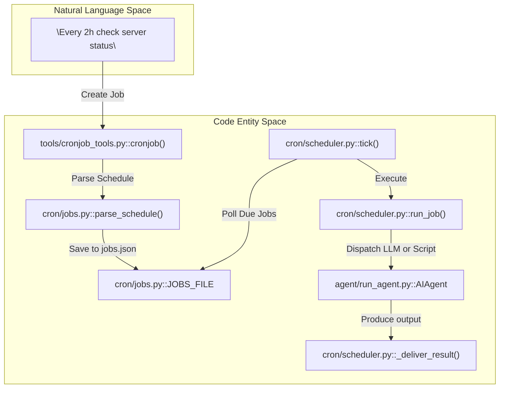
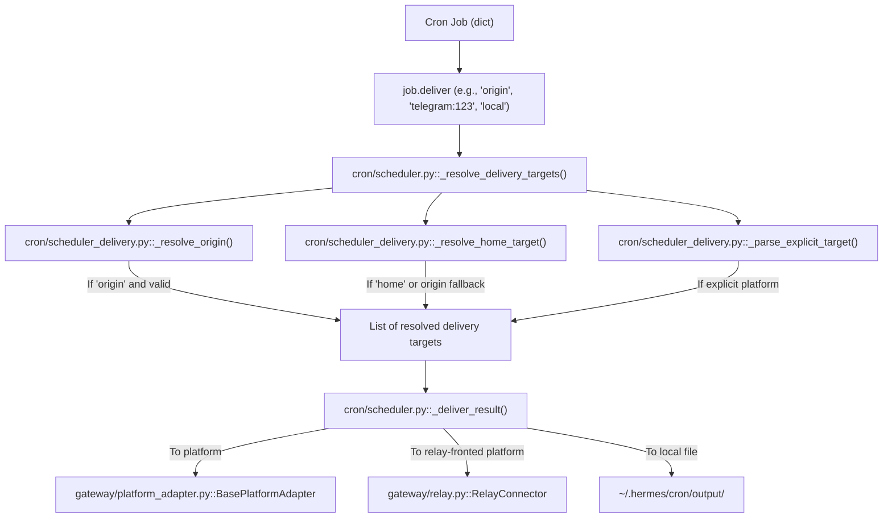
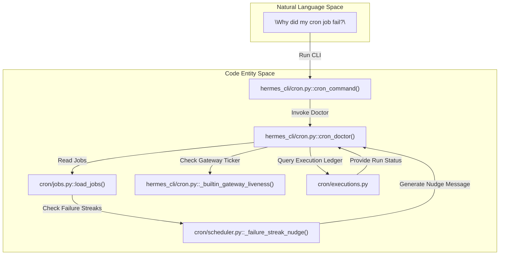
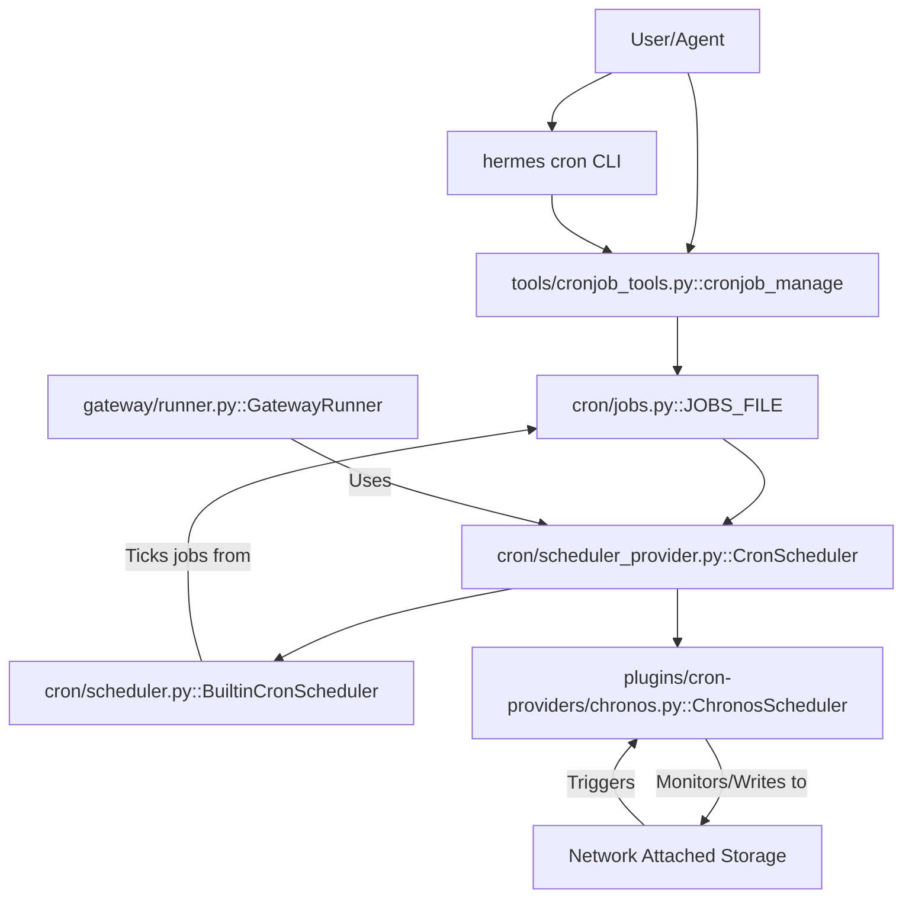

<!-- source: DeepWiki mcp.deepwiki.com · repo nousresearch/hermes-agent · page 10.3 Cron and Scheduled Tasks · fetched 2026-10-26 -->

# Cron and Scheduled Tasks

Relevant source files

The following files were used as context for generating this wiki page:

- [cron/bot_chat_legacy.py](cron/bot_chat_legacy.py)
- [cron/execution_identity.py](cron/execution_identity.py)
- [cron/jobs.py](cron/jobs.py)
- [cron/quota_hold.py](cron/quota_hold.py)
- [cron/scheduler.py](cron/scheduler.py)
- [cron/scheduler_delivery.py](cron/scheduler_delivery.py)
- [cron/scheduler_ownership.py](cron/scheduler_ownership.py)
- [cron/scheduler_preflight.py](cron/scheduler_preflight.py)
- [cron/scheduler_prompt.py](cron/scheduler_prompt.py)
- [cron/scheduler_tick.py](cron/scheduler_tick.py)
- [cron/scheduler_worker_failure.py](cron/scheduler_worker_failure.py)
- [cron/store_health.py](cron/store_health.py)
- [cron/unreachable_retry.py](cron/unreachable_retry.py)
- [gateway/cron_store_notices.py](gateway/cron_store_notices.py)
- [gateway/host_topology.py](gateway/host_topology.py)
- [hermes_cli/_startup_fast.py](hermes_cli/_startup_fast.py)
- [hermes_cli/cron.py](hermes_cli/cron.py)
- [tests/agent/test_auxiliary_client_base_url_host_validation.py](tests/agent/test_auxiliary_client_base_url_host_validation.py)
- [tests/agent/test_background_review_usage.py](tests/agent/test_background_review_usage.py)
- [tests/agent/test_cron_inline_api_call.py](tests/agent/test_cron_inline_api_call.py)
- [tests/cron/conftest.py](tests/cron/conftest.py)
- [tests/cron/test_bot_chat_delivery_no_owner.py](tests/cron/test_bot_chat_delivery_no_owner.py)
- [tests/cron/test_bot_chat_legacy_isolation.py](tests/cron/test_bot_chat_legacy_isolation.py)
- [tests/cron/test_context_from_response_extraction.py](tests/cron/test_context_from_response_extraction.py)
- [tests/cron/test_cron_bot_chat_delivery.py](tests/cron/test_cron_bot_chat_delivery.py)
- [tests/cron/test_cron_context_from.py](tests/cron/test_cron_context_from.py)
- [tests/cron/test_cron_delivery_redaction.py](tests/cron/test_cron_delivery_redaction.py)
- [tests/cron/test_cron_direct_api_call.py](tests/cron/test_cron_direct_api_call.py)
- [tests/cron/test_cron_direct_api_call_watchdog.py](tests/cron/test_cron_direct_api_call_watchdog.py)
- [tests/cron/test_cron_empty_payload.py](tests/cron/test_cron_empty_payload.py)
- [tests/cron/test_cron_execution_identity.py](tests/cron/test_cron_execution_identity.py)
- [tests/cron/test_cron_failure_deliver.py](tests/cron/test_cron_failure_deliver.py)
- [tests/cron/test_cron_incidents.py](tests/cron/test_cron_incidents.py)
- [tests/cron/test_cron_mcp_toolset_empty_block.py](tests/cron/test_cron_mcp_toolset_empty_block.py)
- [tests/cron/test_cron_multiplex_inflight_release.py](tests/cron/test_cron_multiplex_inflight_release.py)
- [tests/cron/test_cron_multiplex_liveness_and_pools.py](tests/cron/test_cron_multiplex_liveness_and_pools.py)
- [tests/cron/test_cron_multiplex_shared_route_delivery.py](tests/cron/test_cron_multiplex_shared_route_delivery.py)
- [tests/cron/test_cron_multiplex_tick_ownership.py](tests/cron/test_cron_multiplex_tick_ownership.py)
- [tests/cron/test_cron_origin_synthetic_thread.py](tests/cron/test_cron_origin_synthetic_thread.py)
- [tests/cron/test_cron_pinned_job_fallback.py](tests/cron/test_cron_pinned_job_fallback.py)
- [tests/cron/test_cron_prompt_injection_skill.py](tests/cron/test_cron_prompt_injection_skill.py)
- [tests/cron/test_cron_relay_delivery_guards.py](tests/cron/test_cron_relay_delivery_guards.py)
- [tests/cron/test_cronjob_gateway_liveness.py](tests/cron/test_cronjob_gateway_liveness.py)
- [tests/cron/test_due_scan_save_failure.py](tests/cron/test_due_scan_save_failure.py)
- [tests/cron/test_jobs.py](tests/cron/test_jobs.py)
- [tests/cron/test_monitor_kind.py](tests/cron/test_monitor_kind.py)
- [tests/cron/test_preflight_config.py](tests/cron/test_preflight_config.py)
- [tests/cron/test_preflight_managed_routes.py](tests/cron/test_preflight_managed_routes.py)
- [tests/cron/test_quota_hold.py](tests/cron/test_quota_hold.py)
- [tests/cron/test_restart_safe_worker_death_evidence.py](tests/cron/test_restart_safe_worker_death_evidence.py)
- [tests/cron/test_scheduler.py](tests/cron/test_scheduler.py)
- [tests/cron/test_scheduler_cron_session_isolation.py](tests/cron/test_scheduler_cron_session_isolation.py)
- [tests/cron/test_unreachable_retry.py](tests/cron/test_unreachable_retry.py)
- [tests/gateway/test_adapter_connect_classification.py](tests/gateway/test_adapter_connect_classification.py)
- [tests/gateway/test_cron_profile_gate.py](tests/gateway/test_cron_profile_gate.py)
- [tests/gateway/test_host_topology.py](tests/gateway/test_host_topology.py)
- [tests/gateway/test_launch_profile_scope_fallback.py](tests/gateway/test_launch_profile_scope_fallback.py)
- [tests/gateway/test_mcp_shutdown_profile_passes.py](tests/gateway/test_mcp_shutdown_profile_passes.py)
- [tests/gateway/test_reconnect_attention_profile_scope.py](tests/gateway/test_reconnect_attention_profile_scope.py)
- [tests/hermes_cli/test_cron.py](tests/hermes_cli/test_cron.py)
- [tests/hermes_cli/test_cron_satellite_diagnostics.py](tests/hermes_cli/test_cron_satellite_diagnostics.py)
- [tests/hermes_cli/test_startup_fast_guards.py](tests/hermes_cli/test_startup_fast_guards.py)
- [tests/hermes_cli/test_web_server_launch_env_freeze.py](tests/hermes_cli/test_web_server_launch_env_freeze.py)
- [tests/tools/test_bot_mode_dm_entry.py](tests/tools/test_bot_mode_dm_entry.py)
- [tests/tools/test_browser_console_ssrf.py](tests/tools/test_browser_console_ssrf.py)
- [tests/tools/test_browser_eval_shim_args.py](tests/tools/test_browser_eval_shim_args.py)
- [tests/tools/test_browser_get_images_ssrf.py](tests/tools/test_browser_get_images_ssrf.py)
- [tests/tools/test_cronjob_run_background.py](tests/tools/test_cronjob_run_background.py)
- [tests/tools/test_cronjob_run_delivery_notice.py](tests/tools/test_cronjob_run_delivery_notice.py)
- [tests/tools/test_cronjob_run_immediate.py](tests/tools/test_cronjob_run_immediate.py)
- [tests/tools/test_cronjob_run_primary_routed.py](tests/tools/test_cronjob_run_primary_routed.py)
- [tests/tools/test_cronjob_tools.py](tests/tools/test_cronjob_tools.py)
- [tests/tools/test_mcp_server_reconnecting_predicate.py](tests/tools/test_mcp_server_reconnecting_predicate.py)
- [tests/tui_gateway/test_eager_multiplex_activation.py](tests/tui_gateway/test_eager_multiplex_activation.py)
- [tools/cronjob_job_args.py](tools/cronjob_job_args.py)
- [tools/cronjob_prompt_scan.py](tools/cronjob_prompt_scan.py)
- [tools/cronjob_tools.py](tools/cronjob_tools.py)
- [website/docs/guides/automate-with-cron.md](website/docs/guides/automate-with-cron.md)
- [website/docs/guides/cron-script-only.md](website/docs/guides/cron-script-only.md)
- [website/docs/user-guide/features/cron.md](website/docs/user-guide/features/cron.md)
- [website/i18n/zh-Hans/docusaurus-plugin-content-docs/current/guides/cron-script-only.md](website/i18n/zh-Hans/docusaurus-plugin-content-docs/current/guides/cron-script-only.md)
- [website/i18n/zh-Hans/docusaurus-plugin-content-docs/current/user-guide/features/cron.md](website/i18n/zh-Hans/docusaurus-plugin-content-docs/current/user-guide/features/cron.md)

The Hermes Agent cron and scheduled tasks subsystem automates the execution of AI agent workflows and scripts on recurring or one-shot schedules. It enables natural-language job definitions that can trigger complex agent tasks unattended, with outputs delivered to messaging platforms, local files, or directly executed via script-only no-agent modes.

This page covers job data structures, schedule parsing, gateway integration, execution mechanics, delivery modes, diagnostics, security guardrails, and the Chronos NAS-mediated cron provider plugin for scale-to-zero hosted agents.

---

## 1. Job Data Structures and Storage

Cron jobs are represented as JSON dictionaries and persisted on disk to ensure durable scheduling across restarts and concurrent access.

### Storage Location and Isolation

-   Jobs are stored in `jobs.json` under the cron directory of the active Hermes profile, typically at `~/.hermes/cron/jobs.json` [cron/jobs.py:89-90]().
-   Each job run's output is saved as a markdown file in `~/.hermes/cron/output/{job_id}/{timestamp}.md` [cron/jobs.py:2-3]().
-   Cron storage is strictly per-profile. Each profile owns its isolated `HERMES_HOME` directory, preventing credential and config leakage across profiles [cron/jobs.py:77-85]().
-   Job store paths are dynamically resolved via a context variable (`_cron_store_override`), enabling satellite processes and multiplexers to transparently access the correct store per profile [cron/jobs.py:128-131]().

### Locking and Concurrency

-   Cross-process advisory locks on `jobs.json` use `fcntl` (Unix) or `msvcrt` (Windows) to enforce single-writer access. If both are absent, it degrades to in-process locking [cron/jobs.py:18-28]().
-   An in-process recursive lock (`_jobs_file_lock`) safeguards load-modify-save critical sections [cron/jobs.py:103]().
-   Locks have a 30-second timeout (`_JOBS_LOCK_TIMEOUT_SECONDS`) to avoid indefinite blocking in ticker ticks or concurrent modifications [cron/jobs.py:112-113]().

### Job Dictionary Fields

Each cron job is a dictionary with key fields, including but not limited to:

| Field | Type | Description |
| :------------ | :--------------------- | :----------------------------------------------------------------------------------------------------------------------------------------------------------------------------------------------------------------------------------------------------------------------------------------------------------------------------------------------------------------------------------------------------------------------------------------------------------------------------------------------------------------------------------------------------------------------------------------------------------------------------------------------------------------------------------------------------------------------------------------------------------------------------------------------------------------------------------------------------------------------------------------------------------------------------------------------------------------------------------------------------------------------------------------------------------------------------------------------------------------------------------------------------------------------------------------------------------------------------------------------------------------------------------------------------------------------------------------------------------------------------------------------------------------------------------------------------------------------------------------------------------------------------------------------------------------------------------------------------------------------------------------------------------------------------------------------------------------------------------------------------------------------------------------------------------------------------------------------------------------------------------------------------------------------------------------------------------------------------------------------------------------------------------------------------------------------------------------------------------------------------------------------------------------------------------------------------------------------------------------------------------------------------------------------------------------------------------------------------------------------------------------------------------------------------------------------------------------------------------------------------------------------------------------------------------------------------------------------------------------------------------------------------------------------------------------------------------------------------------------------------------------------------------------------------------------------------------------------------------------------------------------------------------------------------------------------------------------------------------------------------------------------------------------------------------------------------------------------------------------------------------------------------------------------------------------------------------------------------------------------------------------------------------------------------------------------------------------------------------------------------------------------------------------------------------------------------------------------------------------------------------------------------------------------------------------------------------------------------------------------------------------------------------------------------------------------------------------------------------------------------------------------------------------------------------------------------------------------------------------------------------------------------------------------------------------------------------------------------------------------------------------------------------------------------------------------------------------------------------------------------------------------------------------------------------------------------------------------------------------------------------------------------------------------------------------------------------------------------------------------------------------------------------------------------------------------------------------------------------------------------------------------------------------------------------------------------------------------------------------------------------------------------------------------------------------------------------------------------------------------------------------------------------------------------------------------------------------------------------------------------------------------------------------------------------------------------------------------------------------------------------------------------------------------------------------------------------------------------------------------------------------------------------------------------------------------------------------------------------------------------------------------------------------------------------------------------------------------------------------------------------------------------------------------------------------------------------------------------------------------------------------------------------------------------------------------------------------------------------------------------------------------------------------------------------------------------------------------------------------------------------------------------------------------------------------------------------------------------------------------------------------------------------------------------------------------------------------------------------------------------------------------------------------------------------------------------------------------------------------------------------------------------------------------------------------------------------------------------------------------------------------------------------------------------------------------------------------------------------------------------------------------------------------------------------------------------------------------------------------------------------------------------------------------------------------------------------------------------------------------------------------------------------------------------------------------------------------------------------------------------------------------------------------------------------------------------------------------------------------------------------------------------------------------------------------------------------------------------------------------------------------------------------------------------------------------------------------------------------------------------------------------------------------------------------------------------------------------------------------------------------------------------------------------------------------------------------------------------------------------------------------------------------------------------------------------------------------------------------------------------------------------------------------------------------------------------------------------------------------------------------------------------------------------------------------------------------------------------------------------------------------------------------------------------------------------------------------------------------------------------------------------------------------------------------------------------------------------------------------------------------------------------------------------------------------------------------------------------------------------------------------------------------------------------------------------------------------------------------------------------------------------------------------------------------------------------------------------------------------------------------------------------------------------------------------------------------------------------------------------------------------------------------------------------------------------------------------------------------------------------------------------------------------------------------------------------------------------------------------------------------------------------------------------------------------------------------------------------------------------------------------------------------------------------------------------------------------------------------------------------------------------------------------------------------------------------------------------------------------------------------------------------------------------------------------------------------------------------------------------------------------------------------------------------------------------------------------------------------------------------------------------------------------------------------------------------------------------------------------------------------------------------------------------------------------------------------------------------------------------------------------------------------------------------------------------------------------------------------------------------------------------------------------------------------------------------------------------------------------------------------------------------------------------------------------------------------------------------------------------------------------------------------------------------------------------------------------------------------------------------------------------------------------------------------------------------------------------------------------------------------------------------------------------------------------------------------------------------------------------------------------------------------------------------------------------------------------------------------------------------------------------------------------------------------------------------------------------------------------------------------------------------------------------------------------------------------------------------------------------------------------------------------------------------------------------------------------------------------------------------------------------------------------------------------------------------------------------------------------------------------------------------------------------------------------------------------------------------------------------------------------------------------------------------------------------------------------------------------------------------------------------------------------------------------------------------------------------------------------------------------------------------------------------------------------------------------------------------------------------------------------------------------------------------------------------------------------------------------------------------------------------------------------------------------------------------------------------------------------------------------------------------------------------------------------------------------------------------------------------------------------------------------------------------------------------------------------------------------------------------------------------------------------------------------------------------------------------------------------------------------------------------------------------------------------------------------------------------------------------------------------------------------------------------------------------------------------------------------------------------------------------------------------------------------------------------------------------------------------------------------------------------------------------------------------------------------------------------------------------------------------------------------------------------------------------------------------------------------------------------------------------------------------------------------------------------------------------------------------------------------------------------------------------------------------------------------------------------------------------------------------------------------------------------------------------------------------------------------------------------------------------------------------------------------------------------------------------------------------------------------------------------------------------------------------------------------------------------------------------------------------------------------------------------------------------------------------------------------------------------------------------------------------------------------------------------------------------------------------------------------------------------------------------------------------------------------------------------------------------------------------------------------------------------------------------------------------------------------------------------------------------------------------------------------------------------------------------------------------------------------------------------------------------------------------------------------------------------------------------------------------------------------------------------------------------------------------------------------------------------------------------------------------------------------------------------------------------------------------------------------------------------------------------------------------------------------------------------------------------------------------------------------------------------------------------------------------------------------------------------------------------------------------------------------------------------------------------------------------------------------------------------------------------------------------------------------------------------------------------------------------------------------------------------------------------------------------------------------------------------------------------------------------------------------------------------------------------------------------------------------------------------------------------------------------------------------------------------------------------------------------------------------------------------------------------------------------------------------------------------------------------------------------------------------------------------------------------------------------------------------------------------------------------------------------------------------------------------------------------------------------------------------------------------------------------------------------------------------------------------------------------------------------------------------------------------------------------------------------------------------------------------------------------------------------------------------------------------------------------------------------------------------------------------------------------------------------------------------------------------------------------------------------------------------------------------------------------------------------------------------------------------------------------------------------------------------------------------------------------------------------------------------------------------------------------------------------------------------------------------------------------------------------------------------------------------------------------------------------------------------------------------------------------------------------------------------------------------------------------------------------------------------------------------------------------------------------------------------------------------------------------------------------------------------------------------------------------------------------------------------------------------------------------------------------------------------------------------------------------------------------------------------------------------------------------------------------------------------------------------------------------------------------------------------------------------------------------------------------------------------------------------------------------------------------------------------------------------------------------------------------------------------------------------------------------------------------------------------------------------------------------------------------------------------------------------------------------------------------------------------------------------------------------------------------------------------------------------------------------------------------------------------------------------------------------------------------------------------------------------------------------------------------------------------------------------------------------------------------------------------------------------------------------------------------------------------------------------------------------------------------------------------------------------------------------------------------------------------------------------------------------------------------------------------------------------------------------------------------------------------------------------------------------------------------------------------------------------------------------------------------------------------------------------------------------------------------------------------------------------------------------------------------------------------------------------------------------------------------------------------------------------------------------------------------------------------------------------------------------------------------------------------------------------------------------------------------------------------------------------------------------------------------------------------------------------------------------------------------------------------------------------------------------------------------------------------------------------------------------------------------------------------------------------------------------------------------------------------------------------------------------------------------------------------------------------------------------------------------------------------------------------------------------------------------------------------------------------------------------------------------------------------------------------------------------------------------------------------------------------------------------------------------------------------------------------------------------------------------------------------------------------------------------------------------------------------------------------------------------------------------------------------------------------------------------------------------------------------------------------------------------------------------------------------------------------------------------------------------------------------------------------------------------------------------------------------------------------------------------------------------------------------------------------------------------------------------------------------------------------------------------------------------------------------------------------------------------------------------------------------------------------------------------------------------------------------------------------------------------------------------------------------------------------------------------------------------------------------------------------------------------------------------------------------------------------------------------------------------------------------------------------------------------------------------------------------------------------------------------------------------------------------------------------------------------------------------------------------------------------------------------------------------------------------------------------------------------------------------------------------------------------------------------------------------------------------------------------------------------------------------------------------------------------------------------------------------------------------------------------------------------------------------------------------------------------------------------------------------------------------------------------------------------------------------------------------------------------------------------------------------------------------------------------------------------------------------------------------------------------------------------------------------------------------------------------------------------------------------------------------------------------------------------------------------------------------------------------------------------------------------------------------------------------------------------------------------------------------------------------------------------------------------------------------------------------------------------------------------------------------------------------------------------------------------------------------------------------------------------------------------------------------------------------------------------------------------------------------------------------------------------------------------------------------------------------------------------------------------------------------------------------------------------------------------------------------------------------------------------------------------------------------------------------------------------------------------------------------------------------------------------------------------------------------------------------------------------------------------------------------------------------------------------------------------------------------------------------------------------------------------------------------------------------------------------------------------------------------------------------------------------------------------------------------------------------------------------------------------------------------------------------------------------------------------------------------------------------------------------------------------------------------------------------------------------------------------------------------------------------------------------------------------------------------------------------------------------------------------------------------------------------------------------------------------------------------------------------------------------------------------------------------------------------------------------------------------------------------------------------------------------------------------------------------------------------------------------------------------------------------------------------------------------------------------------------------------------------------------------------------------------------------------------------------------------------------------------------------------------------------------------------------------------------------------------------------------------------------------------------------------------------------------------------------------------------------------------------------------------------------------------------------------------------------------------------------------------------------------------------------------------------------------------------------------------------------------------------------------------------------------------------------------------------------------------------------------------------------------------------------------------------------------------------------------------------------------------------------------------------------------------------------------------------------------------------------------------------------------------------------------------------------------------------------------------------------------------------------------------------------------------------------------------------------------------------------------------------------------------------------------------------------------------------------------------------------------------------------------------------------------------------------------------------------------------------------------------------------------------------------------------------------------------------------------------------------------------------------------------------------------------------------------------------------------------------------------------------------------------------------------------------------------------------------------------------------------------------------------------------------------------------------------------------------------------------------------------------------------------------------------------------------------------------------------------------------------------------------------------------------------------------------------------------------------------------------------------------------------------------------------------------------------------------------------------------------------------------------------------------------------------------------------------------------------------------------------------------------------------------------------------------------------------------------------------------------------------------------------------------------------------------------------------------------------------------------------------------------------------------------------------------------------------------------------------------------------------------------------------------------------------------------------------------------------------------------------------------------------------------------------------------------------------------------------------------------------------------------------------------------------------------------------------------------------------------------------------------------------------------------------------------------------------------------------------------------------------------------------------------------------------------------------------------------------------------------------------------------------------------------------------------------------------------------------------------------------------------------------------------------------------------------------------------------------------------------------------------------------------------------------------------------------------------------------------------------------------------------------------------------------------------------------------------------------------------------------------------------------------------------------------------------------------------------------------------------------------------------------------------------------------------------------------------------------------------------------------------------------------------------------------------------------------------------------------------------------------------------------------------------------------------------------------------------------------------------------------------------------------------------------------------------------------------------------------------------------------------------------------------------------------------------------------------------------------------------------------------------------------------------------------------------------------------------------------------------------------------------------------------------------------------------------------------------------------------------------------------------------------------------------------------------------------------------------------------------------------------------------------------------------------------------------------------------------------------------------------------------------------------------------------------------------------------------------------------------------------------------------------------------------------------------------------------------------------------------------------------------------------------------------------------------------------------------------------------------------------------------------------------------------------------------------------------------------------------------------------------------------------------------------------------------------------------------------------------------------------------------------------------------------------------------------------------------------------------------------------------------------------------------------------------------------------------------------------------------------------------------------------------------------------------------------------------------------------------------------------------------------------------------------------------------------------------------------------------------------------------------------------------------------------------------------------------------------------------------------------------------------------------------------------------------------------------------------------------------------------------------------------------------------------------------------------------------------------------------------------------------------------------------------------------------------------------------------------------------------------------------------------------------------------------------------------------------------------------------------------------------------------------------------------------------------------------------------------------------------------------------------------------------------------------------------------------------------------------------------------------------------------------------------------------------------------------------------------------------------------------------------------------------------------------------------------------------------------------------------------------------------------------------------------------------------------------------------------------------------------------------------------------------------------------------------------------------------------------------------------------------------------------------------------------------------------------------------------------------------------------------------------------------------------------------------------------------------------------------------------------------------------------------------------------------------------------------------------------------------------------------------------------------------------------------------------------------------------------------------------------------------------------------------------------------------------------------------------------------------------------------------------------------------------------------------------------------------------------------------------------------------------------------------------------------------------------------------------------------------------------------------------------------------------------------------------------------------------------------------------------------------------------------------------------------------------------------------------------------------------------------------------------------------------------------------------------------------------------------------------------------------------------------------------------------------------------------------------------------------------------------------------------------------------------------------------------------------------------------------------------------------------------------------------------------------------------------------------------------------------------------------------------------------------------------------------------------------------------------------------------------------------------------------------------------------------------------------------------------------------------------------------------------------------------------------------------------------------------------------------------------------------------------------------------------------------------------------------------------------------------------------------------------------------------------------------------------------------------------------------------------------------------------------------------------------------------------------------------------------------------------------------------------------------------------------------------------------------------------------------------------------------------------------------------------------------------------------------------------------------------------------------------------------------------------------------------------------------------------------------------------------------------------------------------------------------------------------------------------------------------------------------------------------------------------------------------------------|
| `id` | `str` (UUID) | Unique job identifier assigned at creation |
| `name` | `str` | Human-readable job title |
| `prompt` | `str` | Natural language instructions for the AI agent |
| `schedule` | `dict` | Execution metadata specifying kind (`once`, `interval`, `cron`), timing expression, and display |
| `enabled` | `bool` | Whether the job is active |
| `next_run_at` | `str` (ISO 8601) | Next scheduled execution timestamp |
| `last_run_at` | `str` (ISO 8601) | Timestamp of the last run |
| `deliver` | `str` or `list[str]` | Delivery target specifiers such as `"local"`, `"origin"`, or platform channels |
| `skills` | `list[str]` | Attached agent skills loaded during job execution |
| `script` | `str` | Optional script path for no-agent (script-only) execution |
| `no_agent` | `bool` | If `true`, execute script without LLM or agent involvement |
| `failure_streak` | `int` | Count of consecutive failures (used for diagnostics and nudges) |
| `origin` | `dict` | Metadata about the chat session that created the job, used for `deliver: origin` [cron/scheduler_delivery.py:84-101]() |
| `attach_to_session` | `bool` | Whether cron delivery is mirrored into the target chat's session transcript [cron/scheduler_delivery.py:104-120]() |
| `model` | `str` | Specific model to use for this job, overriding global settings [cron/scheduler.py:91-94]() |
| `provider` | `str` | Specific provider to use for this job, overriding global settings [cron/scheduler.py:91-94]() |
| `base_url` | `str` | Specific base URL for the provider, overriding global settings [cron/scheduler.py:91-94]() |
| `reasoning_effort` | `str` | Pin the thinking level for this job (e.g., `high`, `minimal`), overriding global `agent.reasoning_effort` [website/docs/user-guide/features/cron.md:37-39]() |

The structure supports complete lifecycle operations: creation, listing, editing, enabling/disabling, validation, and run output persistence [cron/jobs.py:1-155](), [website/docs/user-guide/features/cron.md:7-32]().

Sources: [cron/jobs.py:1-155](), [website/docs/user-guide/features/cron.md:7-32](), [cron/scheduler_delivery.py:84-120](), [cron/scheduler.py:91-94](), [website/docs/user-guide/features/cron.md:37-39]()

---

## 2. Schedule Parsing and Formats

Hermes supports flexible, human-readable schedule specifications that are parsed into standardized internal representations.

### Schedule Types Supported

The primary function `parse_schedule()` in `cron/jobs.py` handles all supported schedule formats:

1.  **Interval Schedules**
    -   Natural language like `"every 30m"`, `"every 2h"` convert to recurring intervals with fields `"kind": "interval"` and `"minutes"`.
    -   Bare durations (`"30m"`) default to recurring intervals rather than one-shots, fixing earlier silent failures [tests/cron/test_jobs.py:88-92]().
    -   These provide minute-resolution periodic scheduling [tests/cron/test_jobs.py:35-92, 75-200]().

2.  **Cron Expressions**
    -   Full cron expressions like `"0 9 * * *"` allow precise timing.
    -   Natural-language weekday expressions like `"every monday 9am"`, `"weekdays at 9am"`, and `"every weekend at 10am"` parse to cron format using the `croniter` library [tests/cron/test_jobs.py:114-145]().
    -   Handles weekday names, abbreviations, and lists (e.g. `"monday, wednesday"`) [tests/cron/test_jobs.py:128-132, 153-158]().
    -   Supports time keywords like `"noon"` and `"midnight"` mapped appropriately [tests/cron/test_jobs.py:170-175]().

3.  **One-Shot Schedules**
    -   Expressed as `"in 30m"`, these run a job once at the specified delay [tests/cron/test_jobs.py:94-103]().
    -   ISO 8601 timestamps accepted for exact one-time runs.
    -   After firing, the job is automatically disabled or its repeat count decremented.

Each schedule is encoded as a dict with `"kind"` indicating dispatch mode: `interval`, `cron`, or `once`. The `_ensure_croniter()` function lazily imports the `croniter` library to avoid slow startup times if cron expressions are not used [cron/jobs.py:54-72]().

Sources: [cron/jobs.py:43-72](), [tests/cron/test_jobs.py:35-200]()

---

## 3. Execution Architecture and Data Flow

### Builtin Scheduler and Tick Loop

-   The builtin cron scheduler runs inside the Hermes gateway process as a background ticker thread.
-   The main function `tick()` operates every `TICKER_INTERVAL_SECONDS` (default 60s) and acquires a cross-process advisory lock (`.tick.lock`) to enforce single-tick concurrency [cron/scheduler.py:1-43]().
-   Only one ticker instance runs jobs for the profile store at a time, avoiding race conditions.

### Job Claiming and Validation

-   Due jobs are detected, repaired for minor inconsistencies, and tentatively claimed using heartbeat semantics to enforce single ownership despite process concurrency [cron/jobs.py:20-60]().
-   The claim lifecycle includes heartbeat refresh threads to maintain ownership during long executions [cron/jobs.py:20-60]().

### Job Execution (`run_job()`)

-   Each job run is wrapped with initialization of a dedicated `SessionDB` SQLite connection with a bounded timeout (default 10s) to avoid thread stalls due to SQLite locking.
-   The system sets a unique, persistent session title for each run prior to session closure to ensure auditability and traceability [cron/scheduler.py:58-88]().

### Model and Provider Resolution

-   Jobs can pin to a specific provider/model combination at creation time, preventing drift. This is checked by `_job_route_pinned()` [cron/scheduler.py:91-94]().
-   Unpinned jobs inherit global cron defaults or use the current main model at fire time.
-   The scheduler detects drift (e.g., global config changes) and fails pinned jobs early without wasting tokens, alerting the user.
-   Credential fallback chains are respected for unpinned jobs, allowing failover among providers [website/docs/user-guide/features/cron.md:25-34](), [cron/scheduler.py:90-125]().

### Job Types

-   **Agent Jobs:** Execute LLM-driven prompts with selected skills through the core agent pipeline (`AIAgent`).
-   **No-Agent Jobs:** Run standalone user scripts via `_run_job_script()`, capturing stdout directly without LLM use. This enables arbitrary code execution as cron jobs [cron/scheduler.py:300-345]().

### Data Flow Diagram for Job Lifecycle

Sources: [cron/scheduler.py:1-169](), [tools/cronjob_tools.py:1-80](), [cron/jobs.py:40-160](), [website/docs/user-guide/features/cron.md:7-32]()

---

## 4. Delivery Modes and Routing

Hermes supports flexible delivery of cron job outputs to multiple targets.

### Delivery Targets

-   **Local File Delivery (`"local"`):**
    -   Saves the cron job output as a markdown file in `~/.hermes/cron/output/{job_id}/{timestamp}.md`.
    -   No external messaging or network access involved, suitable for archival or manual inspection [cron/jobs.py:1-2]().

-   **Origin Thread Delivery (`"origin"`):**
    -   Sends the output back to the originating chat thread and platform via the gateway adapters.
    -   The `_resolve_origin()` function extracts origin information from the job, ensuring non-dict origins (e.g., from hand-edited `jobs.json`) are treated as missing to prevent crashes [cron/scheduler_delivery.py:84-101]().
    -   Preserves contextual provenance and allows immediate user visibility [tests/cron/test_scheduler.py:140-172]().

-   **Explicit Platform Delivery:**
    -   Targets can specify platform/channel combinations like `"telegram:12345"`, `"matrix:!roomid"`.
    -   Delivery is routed using the gateway platform adapter infrastructure and credential pools.
    -   Supports multisession, multiplexed gateways handling multi-profile routing [tests/cron/test_scheduler.py:140-160]().
    -   `_KNOWN_DELIVERY_PLATFORMS` defines the allowed platforms, preventing enumeration via crafted names [cron/scheduler_delivery.py:30-34]().
    -   `_HOME_TARGET_ENV_VARS` maps platforms to environment variables for home channel targets [cron/scheduler_delivery.py:42-58]().

-   **Relay-Fronted Platforms:**
    -   Some delivery targets are "relay-fronted," meaning delivery occurs exclusively through the gateway's live relay adapter.
    -   In these cases, the cron process forwards the run execution via HTTP POST to the running gateway (`/api/jobs/{id}/run`), which performs the actual delivery. This is handled by `_forward_relay_fronted_run()` [tools/cronjob_tools.py:126-158]().
    -   This pattern supports scaling Hermes across containers and separating job execution from delivery.

### Delivery Validation and Notifications

-   Delivery targets are checked for known platforms and credential availability during preflight validation.
-   Some adapters may omit message ID assignments on delivery; warnings appear in logs.
-   Optional mirroring of delivery results back into the session transcript is supported via the `attach_to_session` job field or the global `cron.mirror_delivery` config, managed by `_cron_mirror_delivery_enabled()` [cron/scheduler_delivery.py:104-120]().
-   The `_resolve_cron_surface_mode()` function determines if a platform delivers `in_channel` or `thread` messages [cron/scheduler_delivery.py:64-82]().

### Delivery Flow Diagram

Sources: [cron/jobs.py:1-2](), [tests/cron/test_scheduler.py:140-172](), [tools/cronjob_tools.py:126-158](), [cron/scheduler_delivery.py:30-120]()

---

## 5. Execution Ledger, Diagnostics, and Incidents

Hermes cron includes comprehensive tools for monitoring and diagnostics.

### CLI Interaction

-   **`hermes cron list`** outputs all configured jobs, showing status indicators such as enabled, paused, or completed, and next scheduled times.
-   Overdue jobs are flagged and rendered with warning colors to indicate scheduler or gateway disruption, using `_next_run_overdue_seconds()` and `_format_lateness()` [hermes_cli/cron.py:125-155]().

### Cron Doctor

-   The `hermes cron doctor` command runs automated health checks across all jobs to identify:
    -   Configuration validation failures (missing or invalid credentials, skills, delivery targets).
    -   Script validation issues for no-agent jobs.
    -   Delivery failures and skipped dispatches.
    -   Failure streaks prompting user review to avoid alert fatigue.
-   The ticker heartbeat file (`TICKER_HEARTBEAT_FILE`) is used to verify scheduler liveness [cron/jobs.py:95](), [hermes_cli/cron.py:40-80]().

### Failure Streak Nudges

-   The scheduler counts consecutive failures per job.
-   When the count reaches a configurable threshold (default 3, `cron.failure_nudge_threshold`), a nudging alert is issued to encourage user investigation, handled by `_failure_streak_nudge()` [cron/scheduler.py:133-157]().
-   This prevents silent failure and promotes system reliability.

### Execution Ledger

-   The `cron/executions.py` module manages an SQLite-backed execution ledger, recording details of each job run.
-   This ledger tracks the status of executions (e.g., `claimed`, `running`, `completed`, `failed`, `unknown`), process IDs, and timestamps.
-   It supports restart-safe worker handoff, allowing external workers to adopt claimed executions and ensuring that crashes are recoverable [tests/cron/test_restart_safe_worker_death_evidence.py:29-44]().
-   `mark_execution_handoff_pending()` and `adopt_claimed_execution()` are key functions for managing worker ownership [tests/cron/test_restart_safe_worker_death_evidence.py:32, 37]().

### Diagnostic Flow Diagram

Sources: [hermes_cli/cron.py:40-160](), [cron/jobs.py:50-110](), [cron/scheduler.py:133-157](), [cron/executions.py](), [tests/cron/test_restart_safe_worker_death_evidence.py:29-44]()

---

## 6. Chronos NAS-Mediated Cron Provider Plugin

The Hermes cron subsystem supports optional external cron scheduler plugins for cloud-scale deployments.

### Provider Abstraction

-   Scheduled tasks are managed by `CronScheduler` implementations that handle job scheduling, ticking, and dispatch.
-   The `CronScheduler` is an abstract base class defining the interface for cron providers [cron/scheduler_provider.py:136-144]().
-   The `chronos` provider plugin integrates with a Network Attached Storage (NAS) shared filesystem to coordinate job schedules and wake events.

### Chronos Plugin Behavior

-   Job creation, update, or removal triggers `_notify_provider_jobs_changed()`, signaling the Chronos scheduler to reconfigure timing or wake [tools/cronjob_tools.py:74-81]().
-   Jobs can be fired externally via HTTP POST to dedicated webhook endpoints (`/api/cron/fire`) handled by the Hermes agent container using `run_job()`.
-   This design allows a Hermes agent running in Kubernetes or serverless environments to scale down to zero and only activate on scheduled or event-triggered runs.
-   The scheduler provider interface hides scheduling details from the core Hermes scheduler while maintaining unified job data and delivery semantics [cron/scheduler_provider.py:90-103]().

### Cron Provider Architecture

Sources: [tools/cronjob_tools.py:74-81](), [cron/scheduler_provider.py:90-103, 136-144]()

---

## 7. Security, Guardrails, and Prompt Injection Protections

Given the unattended nature of cron jobs, strict security measures are applied.

### Prompt Injection and Exfiltration Detection

-   The `_scan_cron_prompt()` function rejects prompts with suspicious or malicious content patterns:
    -   Directives like `"ignore previous instructions"`, `"disregard your rules"`.
    -   Attempts to exfiltrate secrets using `curl`, `wget` with authorization headers targeting untrusted hosts.
    -   Reads of sensitive files like `.env`, `.netrc`, `/etc/sudoers`.
    -   Use of zero-width or invisible Unicode characters intended to bypass detection.
-   This validation halts potentially dangerous cron jobs before execution [tests/tools/test_cronjob_tools.py:20-90]().

### Skill-Assembled Prompt Scanning

-   When skill content contributes prompt fragments, a looser scanner `_scan_cron_skill_assembled()` permits safe invisible Unicode but continues to block explicit prompt injection attempts.
-   This balances strict security with the flexibility required for complex multi-skill prompts [tests/tools/test_cronjob_tools.py:110-150]().

### Lifecycle Command Guard

-   Attempts by cron jobs to execute lifecycle commands (e.g., gateway restart, shutdown) are blocked.
-   This prevents runaway recursive scheduling loops and inadvertent service disruption [cron/lifecycle_guard.py:50-82]().

### Pre-Execution Validation

-   The scheduler validates job readiness before firing, controlled by the `cron.preflight` configuration setting [website/docs/user-guide/features/cron.md:113-117]():
    -   Provider credential availability (checking pins or fallback chains).
    -   Attached skills have all required environment variables, commands, and credentials.
    -   Delivery platform targets are known and have proper credentials.
    -   MCP servers specified in the job's enabled toolsets are connected and available, handled by `_merge_mcp_into_per_job_toolsets()` and `_resolve_cron_enabled_toolsets()` [tests/cron/test_scheduler.py:99-143]().
-   Jobs with invalid config transition to a `blocked_config` state and issue a one-time alert without consuming tokens.
-   Validation messages include profile and `HERMES_HOME` paths for troubleshooting [website/docs/user-guide/features/cron.md:70-95]().

These guardrails protect against unauthorized data access, runaway executions, and wasted expenses in unattended automation.

Sources: [tests/tools/test_cronjob_tools.py:20-150](), [cron/lifecycle_guard.py:50-82](), [website/docs/user-guide/features/cron.md:70-117](), [tests/cron/test_scheduler.py:99-143]()

---

# Summary

The Hermes Agent cron subsystem provides a robust, extensible framework for scheduling, automating, and securely executing AI-driven tasks. Key capabilities:

-   Natural language and cron expression scheduling parsed into unified job definitions.
-   Profile-isolated persistent storage and concurrency-safe locking.
-   Embedded scheduler with atomic job claiming and session-scoped execution.
-   Pluggable delivery to local files, origin chat threads, and multi-platform gateway channels.
-   A flexible `no_agent` script mode for raw shell execution.
-   Diagnostic CLI commands with failure streak nudging and ticker health.
-   Security layers preventing prompt injection and lifecycle abuse.
-   Chronos plugin support for event-driven scale-to-zero operation in hosted environments.

This system integrates tightly with Hermes gateway multiplexer, skill manager, and core agent workflow layers for reliable unattended AI task automation.

---

# References

-   `cron/jobs.py` — job data, schedule parsing, locking, and storage
-   `cron/scheduler.py` — builtin cron scheduler, tick logic, execution, and delivery
-   `cron/scheduler_delivery.py` — delivery target resolution and gateway integration
-   `tools/cronjob_tools.py` — manual job management API and gateway forwarding
-   `hermes_cli/cron.py` — CLI commands for cron job management and diagnostics
-   `cron/scheduler_provider.py` — cron scheduler provider abstraction with Chronos plugin
-   `tools/cronjob_prompt_scan.py` — prompt injection and exfiltration protections
-   `cron/lifecycle_guard.py` — lifecycle command guard preventing cyclical restarts
-   `cron/executions.py` — SQLite-backed execution ledger for restart-safe workers
-   [website/docs/user-guide/features/cron.md]() — user-facing cron feature guide and best practices

Sources: [cron/jobs.py](), [cron/scheduler.py](), [cron/scheduler_delivery.py](), [tools/cronjob_tools.py](), [hermes_cli/cron.py](), [cron/scheduler_provider.py](), [cron/lifecycle_guard.py](), [cron/executions.py](), [website/docs/user-guide/features/cron.md](), [tests/cron/test_scheduler.py](), [tests/cron/test_jobs.py](), [tests/tools/test_cronjob_tools.py](), [tests/hermes_cli/test_cron.py]()

---

