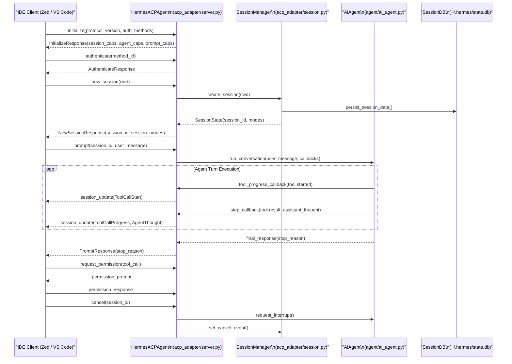

<!-- source: DeepWiki mcp.deepwiki.com · repo nousresearch/hermes-agent · page 10.6 ACP Server and IDE Integration · fetched 2026-10-26 -->

# ACP Server and IDE Integration

Relevant source files

The following files were used as context for generating this wiki page:

- [acp_adapter/auth.py](acp_adapter/auth.py)
- [acp_adapter/commands.py](acp_adapter/commands.py)
- [acp_adapter/edit_approval.py](acp_adapter/edit_approval.py)
- [acp_adapter/entry.py](acp_adapter/entry.py)
- [acp_adapter/events.py](acp_adapter/events.py)
- [acp_adapter/permissions.py](acp_adapter/permissions.py)
- [acp_adapter/provenance.py](acp_adapter/provenance.py)
- [acp_adapter/server.py](acp_adapter/server.py)
- [acp_adapter/session.py](acp_adapter/session.py)
- [acp_adapter/tools.py](acp_adapter/tools.py)
- [contributors/emails/contact@nytemode.com](contributors/emails/contact@nytemode.com)
- [tests/acp_adapter/test_acp_commands.py](tests/acp_adapter/test_acp_commands.py)
- [tests/acp_adapter/test_acp_dashboard_model_switch_validation.py](tests/acp_adapter/test_acp_dashboard_model_switch_validation.py)
- [tests/acp_adapter/test_events.py](tests/acp_adapter/test_events.py)
- [tests/acp_adapter/test_permissions.py](tests/acp_adapter/test_permissions.py)
- [tests/acp_adapter/test_server.py](tests/acp_adapter/test_server.py)
- [tests/acp_adapter/test_session.py](tests/acp_adapter/test_session.py)
- [tests/agent/test_concurrent_interrupt.py](tests/agent/test_concurrent_interrupt.py)
- [tests/agent/test_memory_user_id.py](tests/agent/test_memory_user_id.py)
- [tests/hermes_cli/test_ensure_acp_launcher.py](tests/hermes_cli/test_ensure_acp_launcher.py)
- [tests/tools/test_find_shell.py](tests/tools/test_find_shell.py)
- [website/docs/developer-guide/acp-internals.md](website/docs/developer-guide/acp-internals.md)
- [website/docs/user-guide/features/acp.md](website/docs/user-guide/features/acp.md)
- [website/i18n/zh-Hans/docusaurus-plugin-content-docs/current/user-guide/features/acp.md](website/i18n/zh-Hans/docusaurus-plugin-content-docs/current/user-guide/features/acp.md)

Hermes Agent implements the **Agent Client Protocol (ACP)** to expose its capabilities as a backend AI agent for IDEs and AI-native editors such as VS Code and Zed. This integration allows IDEs to manage sessions, send prompts, observe reasoning and tool execution progress, handle pre-execution file edits, and leverage the full Hermes toolset with persistent conversation memory [acp_adapter/server.py:1-350](), [acp_adapter/session.py:131-167]().

---

## Overview and Architecture

The core ACP server functionality is implemented in the `HermesACPAgent` class, serving as the ACP protocol server endpoint conforming to the `acp.Agent` interface. This class manages active sessions and client requests over an asyncio JSON-RPC protocol, communicating over stdio. It bridges the async ACP protocol calls to synchronous `AIAgent` instances running in a background thread pool, providing:

- Client initialization and authentication
- Session lifecycle operations: create, fork, list, load, resume, update config or model
- Prompt dispatching using thread-safe queuing and cancellation
- Slash command handling supporting operations like `/help`, `/model`, `/compress`
- Permissions and edit approval request gating integrated with ACP's permission APIs

Sessions are tracked in-memory by session ID using `SessionState` instances managed by a `SessionManager` which handles concurrency and persistence to SQLite-backed `SessionDB` [acp_adapter/server.py:18-350](), [acp_adapter/session.py:131-220]().

---

## System Component Mapping (Natural Language to Code Entities)

This diagram maps conceptual ACP subsystems to core Python classes and modules in the codebase:

```mermaid
graph TD
    subgraph "Natural Language Space"
        ProtocolServer["ACP Protocol Server"]
        SessionStore["Session and State Manager"]
        EventBridges["Streaming Event Callbacks"]
        EditGating["Edit Approval & Permissions"]
        SlashCommands["Slash Commands"]
    end

    subgraph "Code Entity Space"
        HermesACPAgent["HermesACPAgent\n(acp_adapter/server.py)"]
        SessionManager["SessionManager\n(acp_adapter/session.py)"]
        SessionState["SessionState\n(acp_adapter/session.py)"]
        ToolProgress["make_tool_progress_cb()\n(acp_adapter/events.py)"]
        ThinkingCB["make_thinking_cb()\n(acp_adapter/events.py)"]
        EditProposal["EditProposal\n(acp_adapter/edit_approval.py)"]
        ApprovalRequester["_EDIT_APPROVAL_REQUESTER\n(acp_adapter/edit_approval.py)"]
        MakeApprovalCB["make_approval_callback()\n(acp_adapter/permissions.py)"]
        SlashCommandsMixin["SlashCommandsMixin\n(acp_adapter/commands.py)"]
    end

    ProtocolServer --> HermesACPAgent
    SessionStore --> SessionManager
    SessionStore --> SessionState
    EventBridges --> ToolProgress
    EventBridges --> ThinkingCB
    EditGating --> EditProposal
    EditGating --> ApprovalRequester
    EditGating --> MakeApprovalCB
    SlashCommands --> SlashCommandsMixin
```

Sources: [acp_adapter/server.py:15-350](), [acp_adapter/session.py:131-220](), [acp_adapter/events.py:18-140](), [acp_adapter/edit_approval.py:25-156](), [acp_adapter/permissions.py:17-140](), [acp_adapter/commands.py:43-146]()

---

## Session Management and Persistence

ACP sessions represent user conversations tied to a workspace directory (`cwd`) with a unique identifier `session_id`. State is held in `SessionState` dataclasses keyed in a `SessionManager`.

### `SessionState` Structure

| Field            | Description                                                                                             |
|------------------|---------------------------------------------------------------------------------------------------------|
| `session_id`     | Unique session identifier string                                                                        |
| `agent`          | Reference to synchronous `AIAgent` instance managing conversation                                       |
| `cwd`            | Normalized current working directory for tool invocations                                               |
| `model`          | The model currently configured for the session [acp_adapter/session.py:137]()                           |
| `history`        | List of message dicts preserving conversation transcript [acp_adapter/session.py:138]()                 |
| `cancel_event`   | `threading.Event` for signaling cancellation or interrupt requests [acp_adapter/session.py:139]()       |
| `is_running`     | Boolean indicating if a turn is currently active [acp_adapter/session.py:140]()                         |
| `command_op`     | Boolean flag indicating a mutating command in progress, blocking parallel operations [acp_adapter/session.py:141-145]() |
| `queued_prompts` | Pending prompt strings queued while session is busy [acp_adapter/session.py:146]()                      |
| `runtime_lock`   | `threading.Lock` to serialize prompt dispatches [acp_adapter/session.py:147]()                          |
| `current_prompt_text` | The text of the prompt currently being processed [acp_adapter/session.py:148]()                    |
| `interrupted_prompt_text` | The text of a prompt that was interrupted [acp_adapter/session.py:149]()                      |
| `message_ids`    | Allocator for streaming assistant message chunk identifiers [acp_adapter/session.py:150-153]()          |

This structure enables persistence, concurrency control, and session resumption [acp_adapter/session.py:131-153]().

### Working Directory Translation for WSL

Hermes translates Windows-style `cwd` paths into POSIX-style WSL mount paths to provide consistent tooling semantics when running Hermes inside WSL but the editor/client runs on Windows. The translation handles:

- Windows drives like `E:\Projects` → `/mnt/e/Projects` [acp_adapter/session.py:28-30]()
- UNC-style paths such as `\\wsl.localhost\` correctly normalized [acp_adapter/session.py:28-30]()
- Resolves macOS symlink aliases to avoid losing session history matches [acp_adapter/session.py:46-54]()

This translation ensures that tools and persisted sessions see consistent paths across host OS layers [acp_adapter/session.py:27-55]().

### SessionManager Features

- Thread-safe creation, retrieval, and management of `SessionState` objects per session ID [acp_adapter/session.py:156-164]()
- Lazy building of `AIAgent` instances pinned to session `cwd` and toolsets [acp_adapter/session.py:162-164]()
- Session history persisted in durable `SessionDB` for crash recovery and session search [acp_adapter/session.py:158-160]()
- Forking support to clone sessions with duplicate histories and distinct session IDs [acp_adapter/server.py:500-520]()
- Runtime synchronization prevents simultaneous prompt execution inside the same session [acp_adapter/session.py:141-145]()
- Cancellation tokens injected into long-running prompts enable abort functionality [acp_adapter/session.py:139]()

Sources: [acp_adapter/session.py:27-220](), [acp_adapter/server.py:500-520]()

---

## Edit Approval, Permissions, and Gating

Hermes integrates ACP edit approval and permission gating workflows tightly to enforce user consent for file mutations and dangerous commands in ACP sessions.

### Edit Approval Workflow

- ACP edit tools like `write_file` and `patch` produce `EditProposal` dataclasses summarizing the mutation intent [acp_adapter/edit_approval.py:25-37]():
  - Tool name invoking the edit [acp_adapter/edit_approval.py:28]()
  - File paths affected (flat or multi-file V4A patches) [acp_adapter/edit_approval.py:29-36]()
  - Original file content for "old_text" where readable [acp_adapter/edit_approval.py:30]()
  - Proposed new content [acp_adapter/edit_approval.py:31]()
  - Arguments dictionary and authoritative paths for multi-file patches [acp_adapter/edit_approval.py:32-36]()
- A context-local `EditApprovalRequester` callable is bound during the ACP agent's conversation runs within a context variable, so edits trigger a prompt for explicit client approval [acp_adapter/edit_approval.py:41]().
- Auto-approve policies exist:
  - `"ask"`: Always prompt [acp_adapter/edit_approval.py:45]()
  - `"workspace_session"`: Automatically approve edits within the active workspace or temp directories [acp_adapter/edit_approval.py:46]()
  - `"session"`: Approve all edits within the session scope [acp_adapter/edit_approval.py:47]()
  - Sensitive files (e.g., `.env`, `.ssh`, `.git`) always require explicit approval [acp_adapter/edit_approval.py:44-45](), [acp_adapter/edit_approval.py:144-145]()
- Denied or timed-out approval requests cause edit execution to fail, preventing unintended file changes [acp_adapter/permissions.py:97-102]().

### Dangerous command permission requests

- Certain tools, especially terminal execution and other dangerous commands, require explicit user permission before execution [acp_adapter/permissions.py:1-3]().
- `make_approval_callback()` creates a Hermes command approval callback that bridges to ACP's permission request RPC [acp_adapter/permissions.py:128-131]():
  - Sends a permission bubble to the client displaying command details [acp_adapter/permissions.py:54-63]()
  - Offers options mapped to Hermes semantics (`allow_once`, `allow_session`, `allow_always`, `deny`, `deny_always`) [acp_adapter/permissions.py:17-19](), [acp_adapter/permissions.py:33-50]()
  - Blocks synchronously on the agent thread awaiting the user's decision or a timeout [acp_adapter/permissions.py:90-96]()
  - Updates the bubble status to `completed` or `failed` accordingly [acp_adapter/permissions.py:103-113]()
  - Returns a Hermes approval string used by command approval guards [acp_adapter/permissions.py:67-74]()
- This design provides seamless interactive gating embedded in IDE workflows aligned with Hermes' command safety model [acp_adapter/permissions.py:1-3]().

Sources: [acp_adapter/edit_approval.py:25-156](), [acp_adapter/permissions.py:17-140]()

---

## Tool Mapping and Streaming Events

Hermes maps tool names to ACP `ToolKind` enums, enabling rich client rendering and interaction semantics:

| Hermes Tool Names                                                                                  | ACP ToolKind |
|--------------------------------------------------------------------------------------------------|--------------|
| `read_file`, `skill_view`, `skills_list`, `browser_snapshot`, `browser_vision`, `vision_analyze` | `read`       |
| `write_file`, `patch`, `skill_manage`                                                            | `edit`       |
| `search_files`                                                                                    | `search`     |
| `terminal`, `process`, `execute_code`, `browser_click`, `browser_type`, `delegate_task`           | `execute`    |
| `web_search`, `web_extract`, `browser_navigate`                                                  | `fetch`      |
| `todo`                                                                                          | `other`      |
| `_thinking`                                                                                     | `think`      |

Turn execution involves:

- `make_tool_progress_cb()` emits `ToolCallStart` updates for tool start events, tracking multiple same-name tool calls in FIFO queues to close properly [acp_adapter/events.py:120-159]().
- `make_step_cb()` emits `ToolCallComplete` and `AgentPlanUpdate` (for the `todo` tool) on turn steps. It closes tool call IDs and tracks plan/task progress [acp_adapter/events.py:200-220]().
- `make_thinking_cb()` streams assistant intermediate thoughts asynchronously to the client [acp_adapter/events.py:223-239]().
- Any tool calls left open at turn end (due to blocking or awaiting approval) are forcibly flushed and marked abandoned to maintain client-view consistency [acp_adapter/events.py:97-116]().

All events are scheduled asynchronously on the ACP asyncio loop, bridging synchronous Hermes agent threads to async protocol I/O robustly [acp_adapter/events.py:55-68]().

Sources: [acp_adapter/tools.py:15-66](), [acp_adapter/events.py:18-140]()

---

## IDE Integration Flow

This sequence diagram illustrates the ACP interaction flow between an IDE client (e.g., Zed or VS Code) and the Hermes ACP server (`HermesACPAgent`):

Highlights:

- IDE clients initiate and authenticate via the ACP server [acp_adapter/server.py:352-367]()
- Sessions are created, and each session's working directory and model state are configured [acp_adapter/server.py:400-418]()
- Prompts are forwarded synchronously to `AIAgent` instances running in background threads [acp_adapter/server.py:522-540]()
- Tool progress, reasonings, and step updates are streamed asynchronously back as ACP session updates [acp_adapter/events.py:120-239]()
- Edit approvals and command permissions produce interactive ACP bubbles for user confirmation in the IDE [acp_adapter/permissions.py:128-141]()
- Cancellation requests interrupt running agent executions cleanly through event signaling [acp_adapter/server.py:590-600]()

Sources: [acp_adapter/server.py:15-350](), [acp_adapter/session.py:131-220](), [acp_adapter/events.py:18-140]()

---

## Entry Point and Stdio Transport

The ACP adapter provides a CLI entrypoint at `acp_adapter/entry.py` that:

- Loads environment variables from the Hermes home (default `~/.hermes/.env`) [acp_adapter/entry.py:81-92]()
- Routes all logging to stderr to keep stdout clean for ACP JSON-RPC protocol streams [acp_adapter/entry.py:65-79]()
- Parses command-line flags for version info, dependency checks, and interactive setup wizards (including browser tooling) [acp_adapter/entry.py:94-104]()
- Instantiates and runs a `HermesACPAgent` server process that listens on stdio, using the `acp` package's JSON-RPC transport [acp_adapter/entry.py:174-176]()
- Silences noisy background error logs caused by benign liveness probes (`ping`, `health`) [acp_adapter/entry.py:44-63]()

This entrypoint enables Hermes to run as a standalone ACP subprocess integrated within editor workflows and transport systems [acp_adapter/entry.py:1-173]().

Sources: [acp_adapter/entry.py:1-173]()

---

# Summary

The ACP server and IDE integration in Hermes Agent provides a comprehensive, robust backend architecture exposing Hermes' AI agent and extensive tooling functionality through the Agent Client Protocol. It manages persistent conversational sessions with concurrency-safe synchronous agent execution bridged to async JSON-RPC, integrates user gating for potentially destructive edits and commands with fine-grained policies, and streams rich event/status updates enabling native AI experiences within editors like Zed and VS Code.

This infrastructure balances power, safety, and extensibility to enable deep IDE integrations that preserve Hermes' identity, memory, tools, and security model while providing interactive, asynchronous workflows tailored to human-in-the-loop usage.

---

# References

- `acp_adapter/server.py` — main ACP server and `HermesACPAgent` implementation
- `acp_adapter/session.py` — `SessionManager` and `SessionState` lifecycle management
- `acp_adapter/events.py` — callback factories bridging Hermes events to ACP notifications
- `acp_adapter/tools.py` — tool to ACP tool kind mapping and content helpers
- `acp_adapter/edit_approval.py` — edit proposal creation and approval request management
- `acp_adapter/permissions.py` — dangerous command permission bridge to ACP protocol
- `acp_adapter/entry.py` — CLI entry point for starting the ACP stdio server

Sources: All above files as cited throughout the page

---

