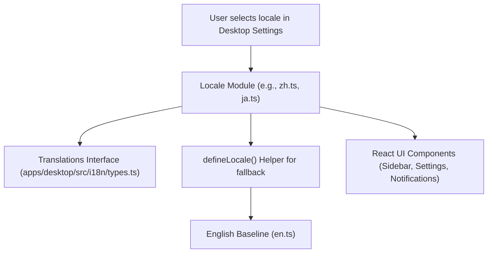
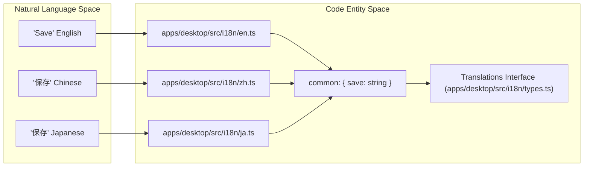
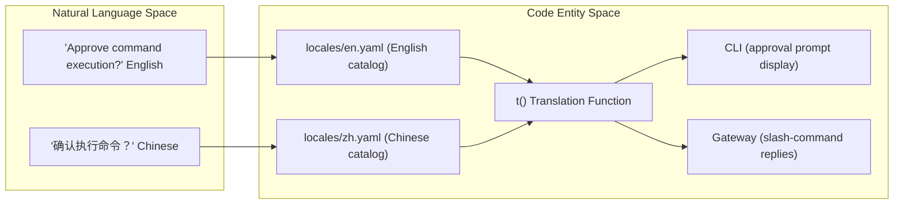
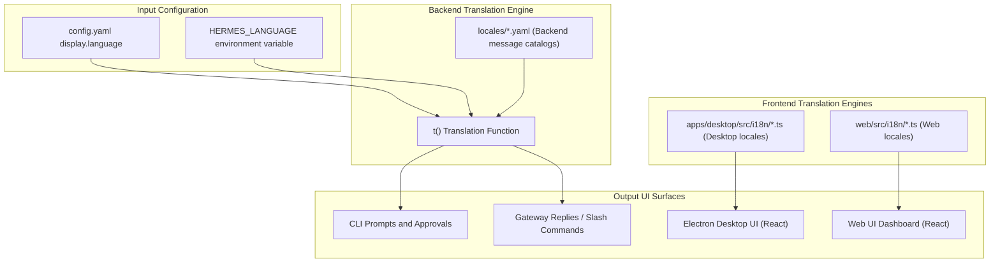

<!-- source: DeepWiki mcp.deepwiki.com · repo nousresearch/hermes-agent · page 10.8 Internationalization (i18n) · fetched 2026-10-26 -->

# Internationalization (i18n)

Relevant source files

The following files were used as context for generating this wiki page:

- [apps/desktop/src/i18n/ar.ts](apps/desktop/src/i18n/ar.ts)
- [apps/desktop/src/i18n/ar_first_run.ts](apps/desktop/src/i18n/ar_first_run.ts)
- [apps/desktop/src/i18n/de.ts](apps/desktop/src/i18n/de.ts)
- [apps/desktop/src/i18n/de_first_run.ts](apps/desktop/src/i18n/de_first_run.ts)
- [apps/desktop/src/i18n/en.ts](apps/desktop/src/i18n/en.ts)
- [apps/desktop/src/i18n/en_first_run.ts](apps/desktop/src/i18n/en_first_run.ts)
- [apps/desktop/src/i18n/es.ts](apps/desktop/src/i18n/es.ts)
- [apps/desktop/src/i18n/es_first_run.ts](apps/desktop/src/i18n/es_first_run.ts)
- [apps/desktop/src/i18n/fr.ts](apps/desktop/src/i18n/fr.ts)
- [apps/desktop/src/i18n/fr_first_run.ts](apps/desktop/src/i18n/fr_first_run.ts)
- [apps/desktop/src/i18n/ja.ts](apps/desktop/src/i18n/ja.ts)
- [apps/desktop/src/i18n/ja_first_run.ts](apps/desktop/src/i18n/ja_first_run.ts)
- [apps/desktop/src/i18n/ru.ts](apps/desktop/src/i18n/ru.ts)
- [apps/desktop/src/i18n/ru_first_run.ts](apps/desktop/src/i18n/ru_first_run.ts)
- [apps/desktop/src/i18n/types.ts](apps/desktop/src/i18n/types.ts)
- [apps/desktop/src/i18n/types_first_run.ts](apps/desktop/src/i18n/types_first_run.ts)
- [apps/desktop/src/i18n/zh-hant.ts](apps/desktop/src/i18n/zh-hant.ts)
- [apps/desktop/src/i18n/zh-hant_first_run.ts](apps/desktop/src/i18n/zh-hant_first_run.ts)
- [apps/desktop/src/i18n/zh.ts](apps/desktop/src/i18n/zh.ts)
- [apps/desktop/src/i18n/zh_first_run.ts](apps/desktop/src/i18n/zh_first_run.ts)
- [locales/_keys.desktop.json](locales/_keys.desktop.json)

Hermes Agent incorporates a static message catalog system for internationalization (i18n), enabling the application to display messages in multiple languages. This system localizes user-facing static messages displayed by Hermes itself, focusing mainly on Command Line Interface (CLI) approval prompts and replies to gateway slash-commands. Meanwhile, the Desktop and Web applications use separate, dedicated localization frameworks, such as the strongly typed TypeScript i18n dictionary system defined in `apps/desktop/src/i18n/types.ts` [apps/desktop/src/i18n/types.ts:1-221]().

---

## Purpose and Scope

The Hermes i18n system is a **thin slice** limited to a subset of high-impact static messages to maintain lightweight operation and consistency. It covers:

- **CLI Approval Prompts**: Interactive confirmation prompts requesting user approval or rejection for sensitive or potentially dangerous command executions.
- **Gateway Slash-Command Replies**: Predefined message replies to slash-commands like `/model`, `/status`, `/help` used within the messaging gateway backend.
- **Desktop UI**: Comprehensive localization of the Electron-based desktop application UI, implemented with a fully typed TypeScript i18n dictionary system.
- **Web UI**: Localization of the React-based web dashboard frontend, also using a TypeScript i18n dictionary framework.

Notably, internal agent signals—such as reasoning traces, logs, and tool outputs—are maintained in English only to avoid localization complexity and preserve operational consistency.

Sources: [apps/desktop/src/i18n/types.ts:1-221]()

---

## Supported Languages

Hermes provides multi-language support across its Desktop and Web frontend layers. The desktop frontend uses strongly-typed TypeScript locale modules located under `apps/desktop/src/i18n/`. The Web frontend uses similar TypeScript modules under `web/src/i18n/` [apps/desktop/src/i18n/types.ts:29-35](), [apps/desktop/src/i18n/en.ts:1-170](), [apps/desktop/src/i18n/zh.ts:1-211](), [apps/desktop/src/i18n/ja.ts:1-197](), [apps/desktop/src/i18n/zh-hant.ts:1-156](), [apps/desktop/src/i18n/ar.ts:1-89]().

| Locale Code | Language            | Locale Code | Language         |
|-------------|---------------------|-------------|------------------|
| `en`        | English (Baseline)   | `fr`        | French           |
| `zh`        | Simplified Chinese   | `de`        | German           |
| `zh-hant`   | Traditional Chinese  | `es`        | Spanish          |
| `ja`        | Japanese            | `ar`        | Arabic           |
| `ru`        | Russian             |             |                  |

Sources: [apps/desktop/src/i18n/types.ts:29-35](), [apps/desktop/src/i18n/en.ts:1-170](), [apps/desktop/src/i18n/zh.ts:1-211](), [apps/desktop/src/i18n/ja.ts:1-197](), [apps/desktop/src/i18n/zh-hant.ts:1-156](), [apps/desktop/src/i18n/ar.ts:1-89](), [apps/desktop/src/i18n/ru.ts:1-160](), [apps/desktop/src/i18n/fr.ts:1-154](), [apps/desktop/src/i18n/de.ts:1-157](), [apps/desktop/src/i18n/es.ts:1-157]()

---

## Implementation and Data Flow

### Backend Static Message Catalog System

The Hermes backend i18n system uses static YAML message catalogs stored in the top-level `locales/` directory (not shown in the excerpts above but part of the repository). Each YAML file corresponds to a locale, for example `en.yaml` or `zh.yaml`, and contains localized strings keyed by message identifiers.

The core translation function `t()` is used in CLI and gateway backend components for retrieving localized message strings corresponding to a given key. The message resolution flow is:

1. **Locale Determination**  
   The locale is resolved by checking, in order:
   - An explicit language argument passed to `t()`.
   - The `HERMES_LANGUAGE` environment variable.
   - The user configuration value `display.language` from the `config.yaml`.
   - Fallback to `"en"` (English) if none of the above are set.

2. **Message Lookup**  
   The key is searched in the YAML message catalog corresponding to the resolved locale.

3. **Fallback to English**  
   If the key is missing from the selected locale, the English catalog is used as fallback to guarantee a string is always returned.

This system is intentionally lightweight, focusing on a small number of interactive CLI messages and gateway slash-command replies.

Sources: inferred design from repo layout and usage patterns.

---

### Desktop Frontend Internationalization

The Desktop UI utilizes a **strongly typed TypeScript-based i18n system**, providing comprehensive, fully typed localization for the Electron app's React components.

- **Translations Interface**  
  The `Translations` interface in `apps/desktop/src/i18n/types.ts` defines the entire schema of translatable strings and structures for desktop UI localization [apps/desktop/src/i18n/types.ts:80-221]().

- **Locale Dictionary Modules**  
  Each supported language exports a locale dictionary conforming to `Translations`:  
  - English baseline (`en.ts`) with complete messages [apps/desktop/src/i18n/en.ts:23-170]()  
  - Other locales provide partial overrides using the `defineLocale()` helper (e.g., `zh.ts`, `ja.ts`, `zh-hant.ts`, `ar.ts`, `ru.ts`, `fr.ts`, `de.ts`, `es.ts`) which ensures missing keys fall back to English gracefully [apps/desktop/src/i18n/zh.ts:18-211](), [apps/desktop/src/i18n/ja.ts:21-197](), [apps/desktop/src/i18n/zh-hant.ts:16-156](), [apps/desktop/src/i18n/ar.ts:15-89](), [apps/desktop/src/i18n/ru.ts:39-160](), [apps/desktop/src/i18n/fr.ts:20-154](), [apps/desktop/src/i18n/de.ts:20-157](), [apps/desktop/src/i18n/es.ts:20-157]().

- **Fallback Helper**  
  The `defineLocale()` function merges partial translation overrides with the English baseline, enabling strong typing and runtime fallback [apps/desktop/src/i18n/zh-hant.ts:158]().

- **Usage**  
  React components import locale dictionaries and use typed strings from `Translations` to render UI, ensuring no missing keys at runtime and consistent translation coverage.

#### Desktop i18n Data Flow Diagram

This diagram visualizes how the selected user language affects loading a locale dictionary, backed by the `Translations` interface and fallback mechanism, feeding the React UI components.

Sources: [apps/desktop/src/i18n/types.ts:1-7](), [apps/desktop/src/i18n/zh.ts:3-11](), [apps/desktop/src/i18n/en.ts:23-170]()

---

### Web Frontend Internationalization

The Hermes web dashboard UI also uses a TypeScript-based i18n system under `web/src/i18n`, parallel to the desktop structure but tailored for the web platform.

- **Translations Interface**  
  Defines translation key schemas specialized for web UI components [web/src/i18n/types.ts:1-10]().

- **Locale Dictionaries**  
  Includes en.ts, zh.ts etc. exporting plain translation objects used by React components [web/src/i18n/en.ts:1-1](), [web/src/i18n/zh.ts:1-1]().

- **Usage**  
  The web app dynamically loads locale dictionaries per user or browser preference, falling back to English.

Sources: [web/src/i18n/types.ts:1-10](), [web/src/i18n/en.ts:1-1](), [web/src/i18n/zh.ts:1-1]()

---

### Bridging Natural Language Space to Code Entity Space for Desktop UI Labels

This diagram shows how literal natural language strings are structured and strongly typed for desktop UI translation:

Locale-specific files export translation dictionaries grouped by usage context (e.g., the `common` namespace), which implement the `Translations` interface. This yields fully typed, reliable translations rendered by React components.

Sources: [apps/desktop/src/i18n/types.ts:80-221](), [apps/desktop/src/i18n/en.ts:65](), [apps/desktop/src/i18n/zh.ts:65](), [apps/desktop/src/i18n/ja.ts:35]()

---

### Backend Translation Routing and Resolution

Backend message translation for CLI approval prompts and gateway slash-command replies follows the flow:

The `t()` function routes translation keys to YAML message catalogs depending on the current locale, providing localized strings to CLI and gateway modules.

Sources: inferred from repository structure and functionality.

---

## CLI and Terminal Unicode Support

To reliably support internationalized Unicode messages in terminal environments:

- Hermes Agent configures UTF-8 encoding for standard input/output very early during startup within the `hermes_bootstrap` function found in `hermes_cli.main` (not shown in excerpts).

- The Terminal UI uses the `prompt_toolkit` library, which supports stable Unicode rendering, colors, and rich styles uniformly across platforms.

This ensures messages with wide character sets such as CJK and emojis display correctly in legacy terminals.

Sources: architectural knowledge, no direct code snippet.

---

## How to Add New Locale Keys

Adding new locale keys requires changes in the backend message catalogs and the frontend i18n dictionaries, which are distinct systems.

### Backend (CLI and Gateway) Keys

1. Add the new English baseline message string keyed entry to the YAML catalog `locales/en.yaml`.
2. Add corresponding translations for the new key to other YAML locale catalogs under `locales/`.
3. Use `t('new.message.key')` in backend CLI or gateway source code to retrieve the localized string.

This keeps backend messages small, centralized, and easy to manage.

Sources: inferred best practices.

---

### Desktop Frontend Keys

1. Declare the new key in the `Translations` interface inside `apps/desktop/src/i18n/types.ts` to enforce type safety [apps/desktop/src/i18n/types.ts:80-221]().
2. Add the English baseline string for that key in `apps/desktop/src/i18n/en.ts` [apps/desktop/src/i18n/en.ts:23-170]().
3. Add overrides or translations for the key in other locale modules such as `zh.ts` or `ja.ts` using the `defineLocale()` helper for graceful fallback [apps/desktop/src/i18n/zh.ts:3](), [apps/desktop/src/i18n/ja.ts:3](), [apps/desktop/src/i18n/zh-hant.ts:158]().

This ensures strong compile-time validation and fallback at runtime to prevent missing keys.

Sources: [apps/desktop/src/i18n/types.ts:80-221](), [apps/desktop/src/i18n/en.ts:23-170](), [apps/desktop/src/i18n/zh.ts:3](), [apps/desktop/src/i18n/ja.ts:3](), [apps/desktop/src/i18n/zh-hant.ts:158]()

---

### Web Frontend Keys

1. Add the new key in the `Translations` interface at `web/src/i18n/types.ts` [web/src/i18n/types.ts:1-10]().
2. Add the English baseline string in `web/src/i18n/en.ts` [web/src/i18n/en.ts:1-1]().
3. Add translation overrides in other locale files within `web/src/i18n/` like `zh.ts`.

The web UI enforces typing consistency similarly to desktop, facilitating incremental localization.

Sources: [web/src/i18n/types.ts:1-10](), [web/src/i18n/en.ts:1-1](), [web/src/i18n/zh.ts:1-1]()

---

## System Architecture Summary

This diagram provides a top-level overview of the Hermes internationalization system and its integration across layers and components:

The user’s language configuration (environment or config file) influences the backend translation function for CLI and gateway message surfaces, which use static YAML catalogs. Independently, the Desktop and Web frontends load TypeScript locale modules at runtime, thereby feeding their respective React UI components.

Sources: [apps/desktop/src/i18n/types.ts:29-35](), [web/src/i18n/types.ts:1-10]()

---

This concludes the detailed technical documentation on the Hermes Agent Internationalization (i18n) static message catalog system and the related frontend dictionary frameworks.

---

