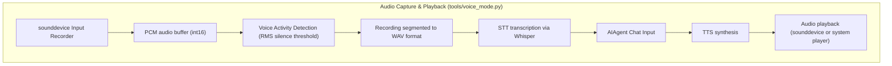
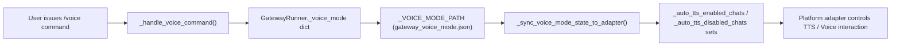
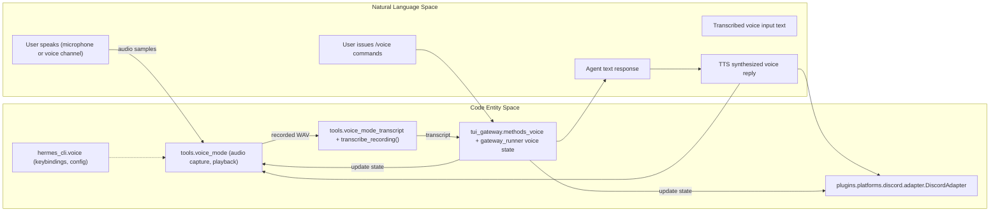

<!-- source: DeepWiki mcp.deepwiki.com · repo nousresearch/hermes-agent · page 11.1 Voice Mode · fetched 2026-10-26 -->

# Voice Mode

<details>
<summary>Relevant source files</summary>

The following files were used as context for generating this wiki page:

- [hermes_cli/profile_identity.py](hermes_cli/profile_identity.py)
- [hermes_cli/voice.py](hermes_cli/voice.py)
- [plugins/platforms/discord/adapter.py](plugins/platforms/discord/adapter.py)
- [plugins/platforms/discord/ffmpeg_utils.py](plugins/platforms/discord/ffmpeg_utils.py)
- [plugins/platforms/discord/onboarding.py](plugins/platforms/discord/onboarding.py)
- [plugins/platforms/discord/recovery.py](plugins/platforms/discord/recovery.py)
- [plugins/platforms/discord/voice_mixer.py](plugins/platforms/discord/voice_mixer.py)
- [scripts/ci/list_os_marked_tests.py](scripts/ci/list_os_marked_tests.py)
- [tests/_fixtures/__init__.py](tests/_fixtures/__init__.py)
- [tests/_fixtures/env_filter.py](tests/_fixtures/env_filter.py)
- [tests/_fixtures/platform_gating.py](tests/_fixtures/platform_gating.py)
- [tests/ci/test_list_os_marked_tests.py](tests/ci/test_list_os_marked_tests.py)
- [tests/gateway/test_active_session_text_merge.py](tests/gateway/test_active_session_text_merge.py)
- [tests/gateway/test_base_topic_sessions.py](tests/gateway/test_base_topic_sessions.py)
- [tests/gateway/test_command_bypass_active_session.py](tests/gateway/test_command_bypass_active_session.py)
- [tests/gateway/test_discord_channel_controls.py](tests/gateway/test_discord_channel_controls.py)
- [tests/gateway/test_discord_channel_obfuscation.py](tests/gateway/test_discord_channel_obfuscation.py)
- [tests/gateway/test_discord_connect.py](tests/gateway/test_discord_connect.py)
- [tests/gateway/test_discord_event_silence.py](tests/gateway/test_discord_event_silence.py)
- [tests/gateway/test_discord_free_response.py](tests/gateway/test_discord_free_response.py)
- [tests/gateway/test_discord_liveness.py](tests/gateway/test_discord_liveness.py)
- [tests/gateway/test_discord_missed_message_backfill.py](tests/gateway/test_discord_missed_message_backfill.py)
- [tests/gateway/test_discord_plugin_setup.py](tests/gateway/test_discord_plugin_setup.py)
- [tests/gateway/test_discord_reactions.py](tests/gateway/test_discord_reactions.py)
- [tests/gateway/test_discord_slash_commands.py](tests/gateway/test_discord_slash_commands.py)
- [tests/gateway/test_discord_username_allowlist_env_reload.py](tests/gateway/test_discord_username_allowlist_env_reload.py)
- [tests/gateway/test_discord_voice_mixer.py](tests/gateway/test_discord_voice_mixer.py)
- [tests/gateway/test_matrix_recovery_key_scope.py](tests/gateway/test_matrix_recovery_key_scope.py)
- [tests/gateway/test_pm_activation.py](tests/gateway/test_pm_activation.py)
- [tests/gateway/test_reload_skills_discord_resync.py](tests/gateway/test_reload_skills_discord_resync.py)
- [tests/gateway/test_telegram_reactions.py](tests/gateway/test_telegram_reactions.py)
- [tests/git_safety.py](tests/git_safety.py)
- [tests/hermes_cli/test_graphical_browser_detection.py](tests/hermes_cli/test_graphical_browser_detection.py)
- [tests/hermes_cli/test_plugins_update_sync.py](tests/hermes_cli/test_plugins_update_sync.py)
- [tests/hermes_cli/test_profile_rename_checkpoints.py](tests/hermes_cli/test_profile_rename_checkpoints.py)
- [tests/hermes_cli/test_update_fleet_incomplete_warning.py](tests/hermes_cli/test_update_fleet_incomplete_warning.py)
- [tests/hermes_cli/test_update_launchd_fleet_restart.py](tests/hermes_cli/test_update_launchd_fleet_restart.py)
- [tests/hermes_cli/test_update_launchd_restart_verification.py](tests/hermes_cli/test_update_launchd_restart_verification.py)
- [tests/hermes_cli/test_update_launchd_unloaded_gateway.py](tests/hermes_cli/test_update_launchd_unloaded_gateway.py)
- [tests/hermes_cli/test_voice_wrapper.py](tests/hermes_cli/test_voice_wrapper.py)
- [tests/plugins/platforms/test_interactive_setup_reconfigure_gate.py](tests/plugins/platforms/test_interactive_setup_reconfigure_gate.py)
- [tests/test_git_safety_boundary.py](tests/test_git_safety_boundary.py)
- [tests/test_live_system_guard.py](tests/test_live_system_guard.py)
- [tests/test_os_marker_gating.py](tests/test_os_marker_gating.py)
- [tests/test_platforms_marker.py](tests/test_platforms_marker.py)
- [tests/tools/test_pre_transcription_hook.py](tests/tools/test_pre_transcription_hook.py)
- [tests/tools/test_strict_provider_selection.py](tests/tools/test_strict_provider_selection.py)
- [tests/tools/test_stt_cloud_trim.py](tests/tools/test_stt_cloud_trim.py)
- [tests/tools/test_stt_silence_hallucinations.py](tests/tools/test_stt_silence_hallucinations.py)
- [tests/tools/test_tts_macos_output.py](tests/tools/test_tts_macos_output.py)
- [tests/tools/test_voice_cli_integration.py](tests/tools/test_voice_cli_integration.py)
- [tests/tools/test_voice_mode.py](tests/tools/test_voice_mode.py)
- [tests/tools/test_voice_stop_phrase.py](tests/tools/test_voice_stop_phrase.py)
- [tests/tools/test_voice_tts_echo_guard.py](tests/tools/test_voice_tts_echo_guard.py)
- [tools/checkpoint_manager_profile_rename.py](tools/checkpoint_manager_profile_rename.py)
- [tools/voice_mode.py](tools/voice_mode.py)
- [website/docs/user-guide/messaging/discord.md](website/docs/user-guide/messaging/discord.md)
- [website/i18n/zh-Hans/docusaurus-plugin-content-docs/current/user-guide/messaging/discord.md](website/i18n/zh-Hans/docusaurus-plugin-content-docs/current/user-guide/messaging/discord.md)

</details>


Voice Mode provides real-time audio interaction capabilities in Hermes Agent, enabling users to interact via voice input and receive speech responses across multiple frontends including the CLI, TUI, messaging gateways, and Discord voice channels. This page details the activation, pipeline processing, platform integration, and configuration surrounding voice mode.

---

## Overview and Purpose

Voice Mode implements push-to-talk and continuous speech capture, integrates speech-to-text (STT) transcription pipelines, supports wakeword detection, and routes transcribed text into the AI Agent prompting cycle. It also orchestrates text-to-speech (TTS) capabilities for spoken responses.

Distinct implementations for CLI audio capture, gateway message handling, and deep platform integration (especially Discord) coexist to provide rich voice interaction.

This page covers:

- Voice mode activation and toggling mechanisms
- Wakeword and silence detection for audio capture control
- Discord voice channel integration and session multiplexing
- STT pipeline components and voice recording/playback implementation
- Per-chat persistent voice mode configuration state

---

## Voice Mode Activation and Audio Capture

Voice mode can be enabled in the CLI or gateway by user commands such as `/voice on`, `/voice off`, `/voice tts` controlling the interaction style:

- **Voice Input Only (`voice_only`)**: Voice input with voice replies but no TTS
- **Voice + TTS (`all`)**: Voice input and spoken replies enabled
- **Voice Off (`off`)**: Disable voice features

The core CLI audio capture is implemented primarily using the `sounddevice` module, which provides cross-platform access to microphone and speaker. It captures audio at parameters ideal for Whisper ASR models:

- **Sample Rate:** 16000 Hz (native Whisper rate) [tools/voice_mode.py:32]()
- **Channels:** mono (1 channel) [tools/voice_mode.py:33]()
- **Sample Width:** 16-bit (`int16`) [tools/voice_mode.py:34]()

The recording mechanism includes:

- Monitoring Root Mean Square (RMS) values of audio frames to determine voice activity vs silence [tools/voice_mode.py:124]()
- Auto-stopping the recording after several seconds of silence (`SILENCE_DURATION_SECONDS = 3.0`) [tools/voice_mode.py:37]()
- Producing temporary WAV audio files for transcription [tools/voice_mode.py:76-87]()

For audio playback:

- On macOS, playback is done by writing a temporary WAV file and playing it with the native `afplay` utility to avoid permission dialogs related to PortAudio output [tools/voice_mode.py:72-78]()
- On other platforms, direct output through `sounddevice` is used if allowed [tools/voice_mode.py:72-78]()

The audio imports (`sounddevice` and `numpy`) are lazily loaded to avoid crashes in headless or unsupported environments such as SSH sessions, Docker containers, or WSL [tools/voice_mode.py:45-62]().



Key functions/classes involved:

- `_import_audio()`: Lazy imports `sounddevice` and `numpy` after ensuring the appropriate extras are installed [tools/voice_mode.py:45-62]()
- `_rms(np, data)`: Calculates RMS of audio frames, used for silence detection [tools/voice_mode.py:124]()
- `_write_wav_frames()`: Writes raw PCM frames to a WAV file [tools/voice_mode.py:90-97]()
- `_play_int16_via_tempfile()`: Plays audio via temporary WAV files on platforms like macOS [tools/voice_mode.py:72-88]()
- Recording parameters are set as constants, such as `SILENCE_RMS_THRESHOLD` and `SILENCE_DURATION_SECONDS` [tools/voice_mode.py:36-37]()

Sources: [tools/voice_mode.py:1-96](), [tools/voice_mode.py:72-88](), [tests/tools/test_voice_mode.py:111-174](), [tools/voice_mode.py:32-37](), [tools/voice_mode.py:45-62](), [tools/voice_mode.py:124](), [tools/voice_mode.py:90-97]().

---

## Wakeword and Speech Pause Detection

Voice mode supports natural interaction by incorporating:

- **Wakeword detection / stop phrase detection**: Detect user utterances that should terminate speech capture early to avoid overly long or irrelevant recordings.
- **Hallucination filtering**: Discards transcript fragments that appear as speech-to-text hallucinations (transcription errors) to improve accuracy.

These behaviors are implemented through utility functions in `tools.voice_mode_transcript`:

- `is_voice_stop_phrase(transcript_segment: str) -> bool`: Returns True if a transcript segment matches configured stop phrases. [tools/voice_mode_transcript.py:20]()
- `is_whisper_hallucination(segment: str) -> bool`: Identifies dubious transcript content likely to be transcription errors. [tools/voice_mode_transcript.py:29]()

These detection functions are invoked after transcription to determine if the recording should be stopped or discarded.

Sources: [tools/voice_mode_transcript.py:20-40](), [tools/voice_mode.py:29]().

---

## Gateway Voice Mode Management

The gateway manages voice mode state on a per-chat basis, recording voice preferences like input/output activation per user session or chat room.

### Voice Mode State

A core data structure in `GatewayRunner` is:

- `_voice_mode: Dict[str, str]` — maps chat keys of the form `"platform:chat_id"` to a voice mode string from `"off"`, `"voice_only"`, or `"all"`.

Voice mode settings are persisted to disk in a JSON file at `_VOICE_MODE_PATH = "gateway_voice_mode.json"`, ensuring voice mode survives process restarts.

### Voice Command Handling Flow

1. User issues a voice-related slash command like `/voice on`, `/voice tts`, `/voice off`, or `/voice status`. [plugins/platforms/discord/adapter.py:142-145]()
2. The gateway’s `_handle_voice_command()` dispatch updates `_voice_mode`. [tests/hermes_cli/test_voice_cli_integration.py:100-101]()
3. The updated state is saved to disk via `_persist_voice_mode()`.
4. The gateway syncs the voice mode state to platform adapters with `_sync_voice_mode_state_to_adapter()`.
5. Platform adapters adjust their TTS and voice capture capabilities accordingly.



Voice modes and their meanings:

| Voice Mode    | Behavior                                                        |
|---------------|-----------------------------------------------------------------|
| `"off"`       | Voice input and TTS synthesis disabled                         |
| `"voice_only"`| Voice input and voice reply enabled, but TTS is disabled      |
| `"all"`       | Full voice input and TTS output enabled (voice + synthesized speech) |

Sources: [tests/gateway/test_voice_command.py:100-149](), [tui_gateway/methods_voice.py:1-180](), [tui_gateway/gateway_runner.py](), [plugins/platforms/discord/adapter.py:142-145](), [tests/hermes_cli/test_voice_cli_integration.py:100-101]().

---

## Discord Voice Channel Integration

Hermes Agent uses deep integration to support voice interactions inside Discord voice channels, allowing users to speak to the bot and hear spoken replies.

### Architecture and Implementation

The `DiscordAdapter` class (in `plugins/platforms/discord/adapter.py`) manages Discord voice functionality using the `discord.py` library:

- It joins/leaves voice channels via `join_voice_channel(channel_id: int)` and `leave_voice_channel(channel_id: int)` methods.
- Speech input is captured by `discord.VoiceReceiver` subclasses that stream audio from users directly into the STT pipeline.
- Speech output is encoded with Discord's `opus` codec and played back via `discord.FFmpegPCMAudio`.
- Native slash commands defined in `_NATIVE_SLASH_COMMAND_SPECS` [plugins/platforms/discord/adapter.py:100-145]() include voice-related commands such as `/voice`, `/voice join`, and `/voice leave`.
- The adapter enforces user authorization via allowed usernames or `"*"` wildcard flags controlled by environment variables (e.g., `DISCORD_ALLOWED_USERS`). [tests/gateway/test_discord_connect.py:143-163]()
- Sessions are isolated per user within group channels by default, controlled by the `group_sessions_per_user` configuration option. [website/docs/user-guide/messaging/discord.md:43-56]()
- Mention gating logic ensures the bot only responds vocally when explicitly mentioned or in configured free-response channels, preventing spurious voice replies. [website/docs/user-guide/messaging/discord.md:18-22]()

```mermaid
graph TD
    subgraph Discord Voice Interaction (plugins/platforms/discord/adapter.py)
    UserVoice["User Speaking in Voice Channel"] --> VoiceReceiver["discord.VoiceReceiver (audio capture)"]
    VoiceReceiver --> STT_Pipeline["STT Transcription Pipeline"]
    BotResponses["Agent generates speech response"] --> OpusEncoder["discord.opus encoder"]
    OpusEncoder --> FFmpegPlayer["discord.FFmpegPCMAudio playback"]
    DiscordVoiceAdapter["DiscordAdapter"] ---|Slash commands| SlashCmds["_NATIVE_SLASH_COMMAND_SPECS"]
    DiscordVoiceAdapter --> UserAuth["Username Authorization"]
    DiscordVoiceAdapter --> MentionGate["Mention Gating"]
    DiscordVoiceAdapter --> SessionMgmt["Per-user Session Isolation"]
    end
```

Significant code entities and features:

- `DiscordAdapter` manages voice client connections and audio streaming. [plugins/platforms/discord/adapter.py:1-10]()
- Native slash commands (`/voice`, `/voice join`, `/voice leave`) allow users to control voice participation. [plugins/platforms/discord/adapter.py:142-145]()
- The environment variable `DISCORD_ALLOWED_USERS` authorizes users. [tests/gateway/test_discord_connect.py:143-163]()
- Config setting `group_sessions_per_user` controls session granularity in shared channels. [website/docs/user-guide/messaging/discord.md:43-56]()

This enables a collaborative multi-user voice experience in Discord with strict authorization and intelligent session management.

Sources: [plugins/platforms/discord/adapter.py:1-146, 130-146](), [tests/gateway/test_discord_slash_commands.py:123-142](), [website/docs/user-guide/messaging/discord.md:43-68](), [tests/gateway/test_discord_connect.py:151-185](), [plugins/platforms/discord/adapter.py:100-145](), [tests/gateway/test_discord_connect.py:143-163](), [website/docs/user-guide/messaging/discord.md:18-22]().

---

## Speech-to-Text (STT) Pipeline

Voice mode uses a modular speech-to-text pipeline to convert recorded audio into text for the AI conversation:

- Audio is captured from microphones in CLI or from Discord voice channels as audio streams or WAV files.
- The `transcribe_recording()` function in `tools.voice_mode` invokes configured STT backends such as OpenAI Whisper (local or cloud). [hermes_cli/voice.py:113]()
- After transcription, output segments are filtered by `is_voice_stop_phrase()` and `is_whisper_hallucination()` to discard undesired or erroneous transcriptions. [hermes_cli/voice.py:112]()
- Valid text results are fed into the ongoing conversation as user input.

This pipeline is flexible and supports different STT providers configured per deployment.

Sources: [tools/voice_mode.py:29-30](), [tools/voice_mode_transcript.py:20-40](), [tools/voice_mode.py:90-96](), [hermes_cli/voice.py:113](), [hermes_cli/voice.py:112]().

---

## Per-Chat Voice Settings

Voice mode supports independent configuration on a per-chat or per-channel basis for flexible user experience:

| Command         | Effect                                     |
|-----------------|--------------------------------------------|
| `/voice on`     | Enables voice input + voice reply only     |
| `/voice tts`    | Enables voice input + TTS (spoken reply)   |
| `/voice off`    | Disables voice input and output             |
| `/voice status` | Reports current voice mode state             |

State is persisted in the gateway's JSON file `_VOICE_MODE_PATH` for consistency across sessions and platforms. The gateway synchronizes the settings with platform adapters that handle actual TTS and microphone access.

Sources: [tests/gateway/test_voice_command.py:100-149]().

---

## Summary of Key Classes and Functions

| Name                                   | Location                               | Role                                                                            |
|----------------------------------------|--------------------------------------|---------------------------------------------------------------------------------|
| `create_audio_recorder`                 | `tools.voice_mode`                   | Creates and manages audio recording with push-to-talk and silence auto-stop     |
| `transcribe_recording`                  | `tools.voice_mode`                   | Sends captured audio recordings to STT backends (Whisper etc.) for transcription |
| `DiscordAdapter`                       | `plugins/platforms/discord/adapter.py` | Integrates Discord voice channels, manages voice clients, slash commands, and audio streaming  |
| `_handle_voice_command`                 | `tui_gateway/methods_voice.py`      | Handles `/voice` commands on the gateway                                        |
| `_sync_voice_mode_state_to_adapter`    | `tui_gateway/gateway_runner.py`     | Synchronizes persistent voice mode state with platform adapters                  |
| `normalize_voice_record_key_for_prompt_toolkit` | `hermes_cli/voice.py`                | Normalizes user-configured keybindings for voice recording in CLI               |
| `is_voice_stop_phrase`                  | `tools.voice_mode_transcript.py`    | Detects phrases signaling end of voice input for auto-stop                      |

---

## Full Diagram: Voice Mode System Overview



---

# Summary

Voice Mode in Hermes Agent is a comprehensive subsystem enabling:

- Push-to-talk and continuous speech capture with silence detection
- A speech-to-text pipeline feeding accurate transcriptions into AI conversations
- Integration with messaging platforms and Discord voice channels for real-time voice conversations
- Per-chat persistent voice mode settings for flexibility
- Keybinding normalization and environment detection for reliable cross-platform support
- Streaming TTS synthesis with barge-in and playback management

This integration empowers natural spoken interaction across device types and messaging platforms within the Hermes Agent framework.

---

# Sources

- `tools/voice_mode.py:1-183`
- `hermes_cli/voice.py:1-110`
- `tools/voice_mode_transcript.py:20-40`
- `plugins/platforms/discord/adapter.py:1-146, 130-146`
- `tests/gateway/test_voice_command.py:100-149`
- `tests/gateway/test_discord_slash_commands.py:123-142`
- `website/docs/user-guide/messaging/discord.md:43-68`
- `tests/gateway/test_discord_connect.py:151-185`
- `tests/tools/test_voice_mode.py:111-174`
- `tools/voice_mode.py:32-37`
- `tools/voice_mode.py:45-62`
- `tools/voice_mode.py:124`
- `tools/voice_mode.py:90-97`
- `hermes_cli/voice.py:113`
- `hermes_cli/voice.py:112`
- `plugins/platforms/discord/adapter.py:100-145`
- `tests/gateway/test_discord_connect.py:143-163`
- `website/docs/user-guide/messaging/discord.md:18-22`

---

