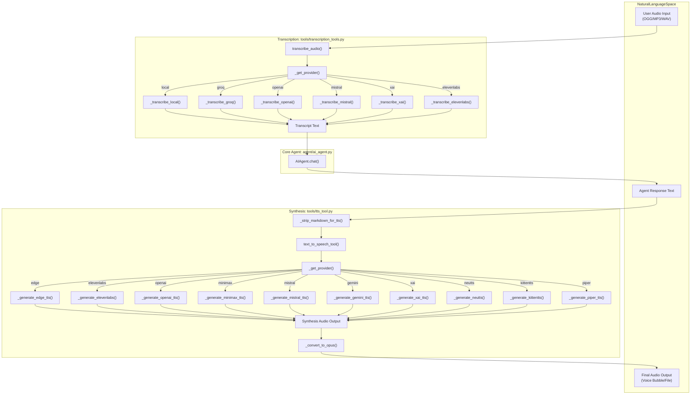
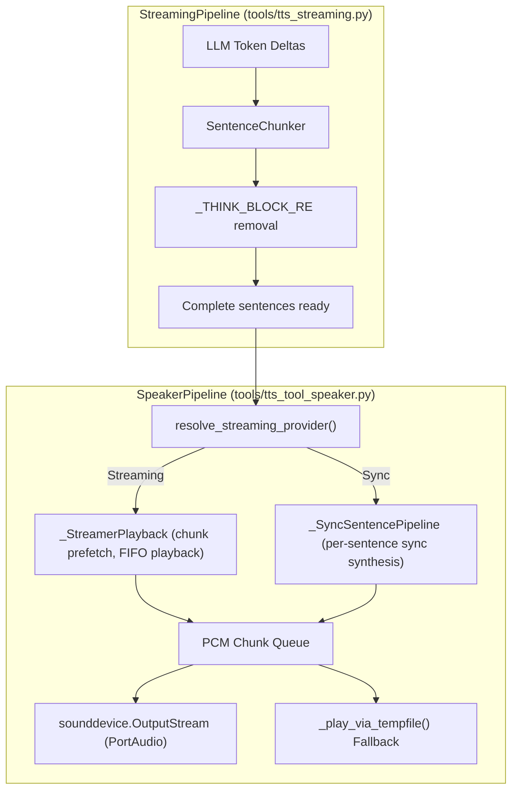

<!-- source: DeepWiki mcp.deepwiki.com · repo nousresearch/hermes-agent · page 11.2 TTS and Transcription · fetched 2026-10-26 -->

# TTS and Transcription

Relevant source files

The following files were used as context for generating this wiki page:

- [agent/tts_provider.py](agent/tts_provider.py)
- [apps/desktop/src/lib/speech-text.identifier-corpus.test.ts](apps/desktop/src/lib/speech-text.identifier-corpus.test.ts)
- [apps/desktop/src/lib/speech-text.test.ts](apps/desktop/src/lib/speech-text.test.ts)
- [apps/desktop/src/lib/speech-text.ts](apps/desktop/src/lib/speech-text.ts)
- [tests/agent/test_tts_registry.py](tests/agent/test_tts_registry.py)
- [tests/fixtures/identifier_speech_corpus.json](tests/fixtures/identifier_speech_corpus.json)
- [tests/hermes_cli/test_plugins_tts_registration.py](tests/hermes_cli/test_plugins_tts_registration.py)
- [tests/hermes_cli/test_tts_picker.py](tests/hermes_cli/test_tts_picker.py)
- [tests/hermes_cli/test_web_server_tts_lease.py](tests/hermes_cli/test_web_server_tts_lease.py)
- [tests/plugins/tts/__init__.py](tests/plugins/tts/__init__.py)
- [tests/plugins/tts/check_parity_vs_main.py](tests/plugins/tts/check_parity_vs_main.py)
- [tests/tools/conftest.py](tests/tools/conftest.py)
- [tests/tools/test_transcription.py](tests/tools/test_transcription.py)
- [tests/tools/test_transcription_dotenv_fallback.py](tests/tools/test_transcription_dotenv_fallback.py)
- [tests/tools/test_transcription_tools.py](tests/tools/test_transcription_tools.py)
- [tests/tools/test_tts_command_providers.py](tests/tools/test_tts_command_providers.py)
- [tests/tools/test_tts_deepinfra.py](tests/tools/test_tts_deepinfra.py)
- [tests/tools/test_tts_dotenv_fallback.py](tests/tools/test_tts_dotenv_fallback.py)
- [tests/tools/test_tts_gemini.py](tests/tools/test_tts_gemini.py)
- [tests/tools/test_tts_identifier_speech.py](tests/tools/test_tts_identifier_speech.py)
- [tests/tools/test_tts_lifecycle_leases.py](tests/tools/test_tts_lifecycle_leases.py)
- [tests/tools/test_tts_mistral.py](tests/tools/test_tts_mistral.py)
- [tests/tools/test_tts_piper.py](tests/tools/test_tts_piper.py)
- [tests/tools/test_tts_plugin_dispatch.py](tests/tools/test_tts_plugin_dispatch.py)
- [tests/tools/test_tts_streaming.py](tests/tools/test_tts_streaming.py)
- [tests/tools/test_tts_text_normalize.py](tests/tools/test_tts_text_normalize.py)
- [tools/transcription_audio.py](tools/transcription_audio.py)
- [tools/transcription_cloud.py](tools/transcription_cloud.py)
- [tools/transcription_command.py](tools/transcription_command.py)
- [tools/transcription_common.py](tools/transcription_common.py)
- [tools/transcription_local.py](tools/transcription_local.py)
- [tools/transcription_tools.py](tools/transcription_tools.py)
- [tools/tts_command_provider.py](tools/tts_command_provider.py)
- [tools/tts_streaming.py](tools/tts_streaming.py)
- [tools/tts_text_normalize.py](tools/tts_text_normalize.py)
- [tools/tts_tool.py](tools/tts_tool.py)
- [tools/tts_tool_delivery.py](tools/tts_tool_delivery.py)
- [tools/tts_tool_lifecycle.py](tools/tts_tool_lifecycle.py)
- [tools/tts_tool_local.py](tools/tts_tool_local.py)
- [tools/tts_tool_openai.py](tools/tts_tool_openai.py)
- [tools/tts_tool_plugins.py](tools/tts_tool_plugins.py)
- [tools/tts_tool_providers.py](tools/tts_tool_providers.py)
- [tools/tts_tool_speaker.py](tools/tts_tool_speaker.py)
- [tools/xai_http.py](tools/xai_http.py)
- [website/docs/developer-guide/streaming-tts.md](website/docs/developer-guide/streaming-tts.md)
- [website/docs/user-guide/features/tts.md](website/docs/user-guide/features/tts.md)

Hermes Agent provides a comprehensive multi-modal audio subsystem enabling Text-to-Speech (TTS) synthesis, streaming voice output, Speech-to-Text (STT) transcription, and platform-agnostic media delivery. This subsystem supports messaging gateways (Telegram, Discord, WhatsApp, Slack, Signal), the CLI, and browser-based interfaces by abstracting provider integration, local model caching, lifecycle management, and lazy SDK provisioning.

Sources: `[tools/tts_tool.py:1-25]()`, `[tools/transcription_tools.py:1-10]()`

---

## Architecture and Data Flow

The audio subsystem cleanly separates transcription and synthesis workflows, coordinated through the core agent conversation loop and streaming playback layers. Transcription handles incoming voice media, converting it into text, while synthesis converts agent-generated text into speech audio. Both transcription and synthesis dynamically select providers based on configuration, availability, and runtime state.

### Audio Pipeline Data Flow

Sources: `[tools/tts_tool.py:1-62]()`, `[tools/transcription_tools.py:1-42]()`

---

## Text-to-Speech (TTS) Synthesis Backends

The TTS subsystem is primarily implemented in `tools/tts_tool.py` and its provider-specific implementations in `tools/tts_tool_providers.py`, offering a variety of backends from local models to cloud APIs with command and plugin extensibility.

### Supported TTS Backends

| Provider | Implementation / Function | Key Features & Notes | API Key / Auth Env Variable |
|---|---|---|---|
| **Edge TTS** | `_generate_edge_tts` | Default free Microsoft neural voices, no API key needed | None |
| **ElevenLabs** | `_generate_elevenlabs` | Premium, multilingual, streaming supported | `ELEVENLABS_API_KEY` |
| **OpenAI TTS** | `_generate_openai_tts` | OpenAI-compatible endpoints (e.g., `gpt-4o-mini-tts`) | `VOICE_TOOLS_OPENAI_KEY` |
| **MiniMax TTS** | `_generate_minimax_tts` | Region-specific endpoints (global and China), voice cloning | `MINIMAX_API_KEY` or `MINIMAX_CN_API_KEY` |
| **Mistral (Voxtral)** | `_generate_mistral_tts` | Native Opus streaming | `MISTRAL_API_KEY` |
| **Google Gemini TTS** | `_generate_gemini_tts` | 30+ prebuilt voices, persona prompt support, audio tags | `GEMINI_API_KEY` |
| **xAI TTS** | `_generate_xai_tts` | Grok voice models, expressive tags, text normalization, streaming optimization | `XAI_API_KEY` |
| **DeepInfra TTS** | `_generate_deepinfra_tts` | OpenAI-compatible endpoint | `DEEPINFRA_API_KEY` |
| **NeuTTS (Local)** | `_generate_neutts` | Local zero-shot neural speech synthesis | None |
| **KittenTTS (Local)** | `_generate_kittentts` | Lightweight local int8 intonation models | None |
| **Piper (Local)** | `_generate_piper_tts` | VITS-based high-quality local synthesis | None |
| **Custom Command** | `_generate_command_tts` | User-defined CLI TTS backends configured via YAML | User configured |

### Implementation Highlights

- **Lazy SDK Imports:**
  Third-party SDKs are imported lazily at runtime to avoid errors on minimal headless systems (e.g., `sounddevice` for audio output, SDKs for ElevenLabs, Edge) using `_sdk_importer()` factory functions for conditional importing `[tools/tts_tool.py:53-88]()`.

- **Credential Resolution:**
  API keys are resolved via a shared voice-key resolver function `_resolve_provider_key()`, which consults the combined config, env variables, and credential pools transparently `[tools/tts_tool.py:29-33]()`.

- **Adaptive Output Formats:**
  Output formats vary by platform: voice-bubble messaging platforms (Telegram, Matrix, etc.) require Ogg/Opus audio, while CLI and most others use MP3. Output conversion and container repair ensure compatibility `[tools/tts_tool_delivery.py]()`.

- **Text Chunking:**
  Input text is split for each backend respecting maximum input/response size limits (e.g., 16 MiB max audio byte size) by `_split_text_for_tts()` ensuring robustness and provider compliance `[tools/tts_tool_delivery.py]()`.

- **Command and Plugin Providers:**
  The system supports external TTS backends defined as command tools (`tts.providers.<name>`) or plugins that can replace or augment built-in voices/backend implementations `[tools/tts_command_provider.py]()`, `[tools/tts_tool_plugins.py]()`.

- **Nous Managed Provider:**
  The special `"nous"` provider is a managed alias routed via the OpenAI TTS path and powered by the Nous Research Tool Gateway for subscribers with paid access `[tools/tts_tool.py:146-148]()`.

Sources: `[tools/tts_tool.py:1-156]()`, `[tools/tts_tool_providers.py:1-126]()`, `[tools/tts_tool_delivery.py]()`, `[tools/tts_command_provider.py]()`, `[tools/tts_tool_plugins.py]()`, `[website/docs/user-guide/features/tts.md:20-114]()`

---

## Streaming TTS and Speaker-Side Pipeline

Hermes supports low-latency streaming TTS output that starts playback as soon as the first spoken sentence is synthesized, overlapping synthesis and playback for natural conversational tempo.

### Streaming Pipeline Architecture

Sources: `[tools/tts_streaming.py:73-115]()`, `[tools/tts_tool_speaker.py:100-155]()`

### Key Components

- **`SentenceChunker`**
  Incrementally processes LLM text output deltas, cutting them into sentences after punctuation or paragraph breaks, stripping reasoning `<think>` tags even when split across deltas. It merges fragments shorter than a configurable threshold into the next sentence to make natural speech phrases `[tools/tts_streaming.py:73-115]()`.

- **`StreamingTTSProvider` (Abstract Base Class)**
  Defines interface for providers that yield raw int16 mono PCM audio chunks at 24 kHz by default. Subclasses implement API-specific chunked streaming, e.g., for ElevenLabs, OpenAI-compatible TTS servers, Gemini, or xAI `[tools/tts_streaming.py:118-144]()`.

- **`_SyncSentencePipeline`**
  For non-streaming providers, this pipeline overlaps per-sentence synthesis on a single-thread executor feeding a FIFO queue to a playback thread, playing synthesized WAV/MP3 from temp files. It provides lookahead buffering and backpressure control `[tools/tts_tool_speaker.py:100-155]()`.

- **`_StreamerPlayback`** (not fully shown)
  Uses a queue for PCM chunks pre-fetched by worker threads, playing back with `sounddevice.OutputStream` (PortAudio). Falls back to WAV tempfile playback if PortAudio is unavailable or errors. Handles output stream re-creation on error for resilience `[tools/tts_tool_speaker.py:156-406]()`.

- **Interruption Tracking**
  Speech interruptions (barge-in events) are latched and reported within a 2-minute TTL, allowing the agent's subsequent prompt to note that speech was interrupted, avoiding overlapping TTS with user talkover and improving conversation flow `[tools/tts_streaming.py:53-62]()`.

Sources: `[tools/tts_streaming.py:1-161]()`, `[tools/tts_tool_speaker.py:1-157]()`

---

## TTS Lifecycle and Lease Management

The TTS lifecycle manager (`tools/tts_tool_lifecycle.py`) controls model loading and leasing for local and SDK-based TTS providers. This is essential to manage shared resources in multi-instance environments such as CLI, Desktop UI, or Cron workers.

- **Warm-up:** Calls `warm_tts_provider()` to eagerly load models or probe APIs, reducing latency on first request.
- **Lease Handling:** Each surface (e.g. CLI, desktop) acquires a lease on a TTS provider; releasing the last lease triggers graceful model or client unload.
- **Memory and VRAM Conservation:** Particularly important for local GPU-backed TTS models or SDK clients holding large native resources.

This mechanism ensures efficient multi-profile and multi-instance TTS usage without runaway resource consumption.

Sources: `[tools/tts_tool_lifecycle.py]()`

---

## Speech-to-Text (STT) Transcription Tools

The transcription subsystem (main file: `tools/transcription_tools.py`) manages speech-to-text conversion from audio message files for inbound voice messages and CLI voice inputs. It supports both local in-process models and cloud-based endpoint APIs.

### Supported STT Providers

| Provider | Module / Functions | Default Model | API Key Environment Variable |
|---|---|---|---|
| **local** | `_transcribe_local()` | `base` (faster-whisper local) | None (free local) |
| **local_command** | `_transcribe_local_command()` | User-configured CLI tool | `HERMES_LOCAL_STT_COMMAND` |
| **groq** | `_transcribe_groq()` | `whisper-large-v3-turbo` | `GROQ_API_KEY` |
| **openai** | `_transcribe_openai()` | `whisper-1` | `VOICE_TOOLS_OPENAI_KEY` |
| **mistral** | `_transcribe_mistral()` | Voxtral latest | `MISTRAL_API_KEY` |
| **xai** | `_transcribe_xai()` | Grok STT | `XAI_API_KEY` |
| **elevenlabs** | `_transcribe_elevenlabs()` | `scribe_v2` | `ELEVENLABS_API_KEY` |
| **deepinfra** | `_transcribe_deepinfra()` | OpenAI-compatible | `DEEPINFRA_API_KEY` |
| **command/plugin** | `_transcribe_command_stt()` | User-defined CLI commands | User configured |

### Core Implementation Details

- **Provider Resolution:**
  Selecting which STT backend to use is governed by the `_get_provider()` function, which respects explicit config, local availability, and avoids silent fallback from local to cloud unless configured. For example, explicit `"local"` will not fallback silently to cloud providers `[tools/transcription_tools.py:132-148]()`.

- **Local Model Caching + Idle Unload:**
  The local Whisper model (using `faster-whisper`) is loaded once and cached. A background thread handles idle timeout unload, freeing memory/VRAM after configurable idle periods `[tools/transcription_tools.py:65-77]()`.

- **Audio Validation and Preprocessing:**
  Incoming audio is checked for size, format, and converted as needed (e.g., CAF or Silk to WAV) to ensure provider compatibility `[tools/transcription_audio.py]()`.

- **Command Providers:**
  Like TTS, transcription supports user-defined shell commands executed with specified environment variables and parameters, allowing extensible or experimental STT tools `[tools/transcription_command.py]()`.

- **Error Handling:**
  All transcription results follow a consistent JSON dictionary format including `"success"` boolean, `"transcript"` string, and optional `"error"` to report failures uniformly `[tools/transcription_common.py]()`.

Sources: `[tools/transcription_tools.py:1-148]()`, `[tools/transcription_local.py:1-156]()`, `[tools/transcription_cloud.py]()`, `[tools/transcription_command.py]()`, `[tests/tools/test_transcription_tools.py:80-90]()`

---

## Web Platform Adapter and Browser Audio Integration

Hermes Agent supports browser-based voice interaction using a WebSocket transport adapter integrated into the FastAPI backend serving the web UI and desktop Electron/Tauri apps.

- **Inbound Audio:**
  The browser captures microphone audio chunks and sends them through the WebSocket endpoint, where Hermes dispatches to the transcription subsystem (`transcribe_audio()`) for live speech-to-text conversion.

- **Outbound Audio:**
  Synthesized speech audio is streamed back as raw PCM chunk sequences, produced by implementations of `StreamingTTSProvider`, enabling real-time voice replies without waiting for complete synthesis.

- **Streaming TTS Abstraction:**
  The service encapsulates provider-agnostic streaming via `tools/tts_streaming.py`, ensuring consistent, low-latency multi-provider support across browser and native surfaces.

- **Latency and Segmentation:**
  Sentence chunking aligns the streaming playback and transcription, and supports expressive voice output on the web, preserving conversational flow and responsive voice interaction.

Sources: `[tools/tts_streaming.py:98-117]()`, `[tools/transcription_tools.py:1-15]()`

---

This completes the detailed technical documentation of Hermes Agent's Text-to-Speech synthesis backends, streaming TTS, transcription tools (local and cloud), and the web platform adapter enabling browser-based voice interaction. The modular design, lazy dependency management, and comprehensive provider support provide a robust foundation for multi-platform voice-enabled AI agents.

---

