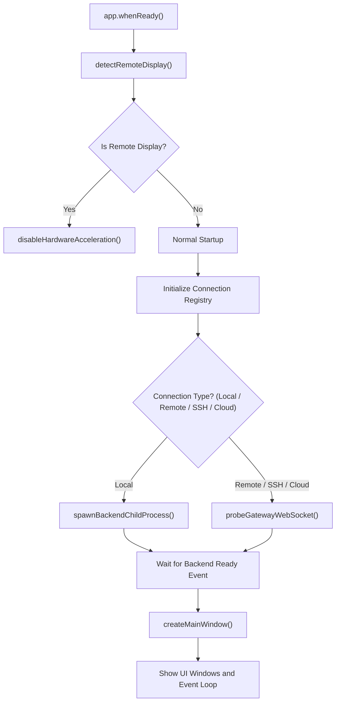
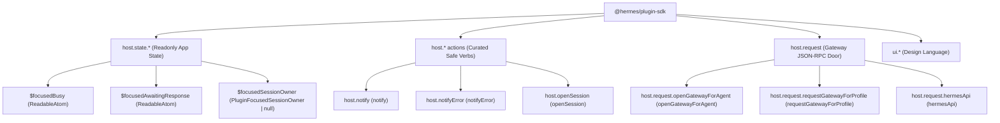

<!-- source: DeepWiki mcp.deepwiki.com · repo nousresearch/hermes-agent · page 12.1 Electron Shell and Gateway Connection · fetched 2026-10-26 -->

# Electron Shell and Gateway Connection

Relevant source files

The following files were used as context for generating this wiki page:

- [apps/desktop/electron/api-transport.test.ts](apps/desktop/electron/api-transport.test.ts)
- [apps/desktop/electron/api-transport.ts](apps/desktop/electron/api-transport.ts)
- [apps/desktop/electron/backend-health.test.ts](apps/desktop/electron/backend-health.test.ts)
- [apps/desktop/electron/backend-health.ts](apps/desktop/electron/backend-health.ts)
- [apps/desktop/electron/cloud-discovery.test.ts](apps/desktop/electron/cloud-discovery.test.ts)
- [apps/desktop/electron/cloud-discovery.ts](apps/desktop/electron/cloud-discovery.ts)
- [apps/desktop/electron/connection-apply.test.ts](apps/desktop/electron/connection-apply.test.ts)
- [apps/desktop/electron/connection-apply.ts](apps/desktop/electron/connection-apply.ts)
- [apps/desktop/electron/connection-config.test.ts](apps/desktop/electron/connection-config.test.ts)
- [apps/desktop/electron/connection-config.ts](apps/desktop/electron/connection-config.ts)
- [apps/desktop/electron/connection-registry.test.ts](apps/desktop/electron/connection-registry.test.ts)
- [apps/desktop/electron/connection-registry.ts](apps/desktop/electron/connection-registry.ts)
- [apps/desktop/electron/desktop-profile.test.ts](apps/desktop/electron/desktop-profile.test.ts)
- [apps/desktop/electron/desktop-profile.ts](apps/desktop/electron/desktop-profile.ts)
- [apps/desktop/electron/main.ts](apps/desktop/electron/main.ts)
- [apps/desktop/electron/managed-ssh-update.test.ts](apps/desktop/electron/managed-ssh-update.test.ts)
- [apps/desktop/electron/managed-ssh-update.ts](apps/desktop/electron/managed-ssh-update.ts)
- [apps/desktop/electron/native-auth-decisions.test.ts](apps/desktop/electron/native-auth-decisions.test.ts)
- [apps/desktop/electron/native-auth-decisions.ts](apps/desktop/electron/native-auth-decisions.ts)
- [apps/desktop/electron/plugin-profile-routes.test.ts](apps/desktop/electron/plugin-profile-routes.test.ts)
- [apps/desktop/electron/plugin-profile-routes.ts](apps/desktop/electron/plugin-profile-routes.ts)
- [apps/desktop/electron/preload.ts](apps/desktop/electron/preload.ts)
- [apps/desktop/electron/profile-migration.test.ts](apps/desktop/electron/profile-migration.test.ts)
- [apps/desktop/electron/profile-migration.ts](apps/desktop/electron/profile-migration.ts)
- [apps/desktop/electron/remote-lifecycle-gate-transport.test.ts](apps/desktop/electron/remote-lifecycle-gate-transport.test.ts)
- [apps/desktop/electron/remote-lifecycle-spawn.test.ts](apps/desktop/electron/remote-lifecycle-spawn.test.ts)
- [apps/desktop/electron/remote-lifecycle-v2-marker.test.ts](apps/desktop/electron/remote-lifecycle-v2-marker.test.ts)
- [apps/desktop/electron/remote-lifecycle.test.ts](apps/desktop/electron/remote-lifecycle.test.ts)
- [apps/desktop/electron/remote-lifecycle.ts](apps/desktop/electron/remote-lifecycle.ts)
- [apps/desktop/electron/remote-ssh-exec.test-helpers.ts](apps/desktop/electron/remote-ssh-exec.test-helpers.ts)
- [apps/desktop/electron/remote-update-marker-programs.test.ts](apps/desktop/electron/remote-update-marker-programs.test.ts)
- [apps/desktop/electron/remote-update-marker-programs.ts](apps/desktop/electron/remote-update-marker-programs.ts)
- [apps/desktop/electron/session-windows.test.ts](apps/desktop/electron/session-windows.test.ts)
- [apps/desktop/electron/session-windows.ts](apps/desktop/electron/session-windows.ts)
- [apps/desktop/electron/ssh-bootstrap-coordinator.test.ts](apps/desktop/electron/ssh-bootstrap-coordinator.test.ts)
- [apps/desktop/electron/ssh-bootstrap-coordinator.ts](apps/desktop/electron/ssh-bootstrap-coordinator.ts)
- [apps/desktop/electron/ssh-connection.test.ts](apps/desktop/electron/ssh-connection.test.ts)
- [apps/desktop/electron/ssh-connection.ts](apps/desktop/electron/ssh-connection.ts)
- [apps/desktop/electron/ssh-control-master-holders.test.ts](apps/desktop/electron/ssh-control-master-holders.test.ts)
- [apps/desktop/electron/ssh-control-master-holders.ts](apps/desktop/electron/ssh-control-master-holders.ts)
- [apps/desktop/electron/terminal-ipc.test.ts](apps/desktop/electron/terminal-ipc.test.ts)
- [apps/desktop/electron/window-connection-route.test.ts](apps/desktop/electron/window-connection-route.test.ts)
- [apps/desktop/electron/window-connection-route.ts](apps/desktop/electron/window-connection-route.ts)
- [apps/desktop/electron/windows-remote-lifecycle.test.ts](apps/desktop/electron/windows-remote-lifecycle.test.ts)
- [apps/desktop/electron/windows-remote-lifecycle.ts](apps/desktop/electron/windows-remote-lifecycle.ts)
- [apps/desktop/scripts/desktop-update-ui.test.mjs](apps/desktop/scripts/desktop-update-ui.test.mjs)
- [apps/desktop/src/app/gateway/hooks/use-gateway-boot.test.tsx](apps/desktop/src/app/gateway/hooks/use-gateway-boot.test.tsx)
- [apps/desktop/src/app/gateway/hooks/use-gateway-boot.ts](apps/desktop/src/app/gateway/hooks/use-gateway-boot.ts)
- [apps/desktop/src/app/session/hooks/use-session-actions/ambient-local-owner.test.tsx](apps/desktop/src/app/session/hooks/use-session-actions/ambient-local-owner.test.tsx)
- [apps/desktop/src/app/session/hooks/use-session-list-actions.test.tsx](apps/desktop/src/app/session/hooks/use-session-list-actions.test.tsx)
- [apps/desktop/src/app/session/hooks/use-session-list-actions.ts](apps/desktop/src/app/session/hooks/use-session-list-actions.ts)
- [apps/desktop/src/app/settings/cloud-team-change.ts](apps/desktop/src/app/settings/cloud-team-change.ts)
- [apps/desktop/src/app/settings/connections-registry.test.tsx](apps/desktop/src/app/settings/connections-registry.test.tsx)
- [apps/desktop/src/app/settings/connections-registry.tsx](apps/desktop/src/app/settings/connections-registry.tsx)
- [apps/desktop/src/app/settings/gateway-settings.test.tsx](apps/desktop/src/app/settings/gateway-settings.test.tsx)
- [apps/desktop/src/app/settings/gateway-settings.tsx](apps/desktop/src/app/settings/gateway-settings.tsx)
- [apps/desktop/src/app/shell/butterbar.tsx](apps/desktop/src/app/shell/butterbar.tsx)
- [apps/desktop/src/app/shell/hooks/use-statusbar-items.test.tsx](apps/desktop/src/app/shell/hooks/use-statusbar-items.test.tsx)
- [apps/desktop/src/app/shell/hooks/use-statusbar-items.tsx](apps/desktop/src/app/shell/hooks/use-statusbar-items.tsx)
- [apps/desktop/src/components/assistant-ui/tool/delegate.tsx](apps/desktop/src/components/assistant-ui/tool/delegate.tsx)
- [apps/desktop/src/components/boot-failure-cause.ts](apps/desktop/src/components/boot-failure-cause.ts)
- [apps/desktop/src/components/boot-failure-overlay.test.tsx](apps/desktop/src/components/boot-failure-overlay.test.tsx)
- [apps/desktop/src/components/boot-failure-overlay.tsx](apps/desktop/src/components/boot-failure-overlay.tsx)
- [apps/desktop/src/components/boot-failure-reauth.test.ts](apps/desktop/src/components/boot-failure-reauth.test.ts)
- [apps/desktop/src/components/boot-failure-reauth.ts](apps/desktop/src/components/boot-failure-reauth.ts)
- [apps/desktop/src/components/ui/sandboxed-frame.test.tsx](apps/desktop/src/components/ui/sandboxed-frame.test.tsx)
- [apps/desktop/src/components/ui/sandboxed-frame.tsx](apps/desktop/src/components/ui/sandboxed-frame.tsx)
- [apps/desktop/src/contrib/events.ts](apps/desktop/src/contrib/events.ts)
- [apps/desktop/src/contrib/index.ts](apps/desktop/src/contrib/index.ts)
- [apps/desktop/src/contrib/plugin.test.ts](apps/desktop/src/contrib/plugin.test.ts)
- [apps/desktop/src/contrib/plugin.ts](apps/desktop/src/contrib/plugin.ts)
- [apps/desktop/src/contrib/plugins.ts](apps/desktop/src/contrib/plugins.ts)
- [apps/desktop/src/contrib/react/boundary.tsx](apps/desktop/src/contrib/react/boundary.tsx)
- [apps/desktop/src/contrib/react/contribute.tsx](apps/desktop/src/contrib/react/contribute.tsx)
- [apps/desktop/src/contrib/react/slot.test.tsx](apps/desktop/src/contrib/react/slot.test.tsx)
- [apps/desktop/src/contrib/react/slot.tsx](apps/desktop/src/contrib/react/slot.tsx)
- [apps/desktop/src/contrib/react/use-contributions.ts](apps/desktop/src/contrib/react/use-contributions.ts)
- [apps/desktop/src/contrib/registry.ts](apps/desktop/src/contrib/registry.ts)
- [apps/desktop/src/contrib/runtime-loader.test.ts](apps/desktop/src/contrib/runtime-loader.test.ts)
- [apps/desktop/src/contrib/runtime-loader.ts](apps/desktop/src/contrib/runtime-loader.ts)
- [apps/desktop/src/global.d.ts](apps/desktop/src/global.d.ts)
- [apps/desktop/src/hermes.test.ts](apps/desktop/src/hermes.test.ts)
- [apps/desktop/src/lib/with-timeout.test.ts](apps/desktop/src/lib/with-timeout.test.ts)
- [apps/desktop/src/lib/with-timeout.ts](apps/desktop/src/lib/with-timeout.ts)
- [apps/desktop/src/plugins/hermes-bots/reclaim-refresh-in-place.test.ts](apps/desktop/src/plugins/hermes-bots/reclaim-refresh-in-place.test.ts)
- [apps/desktop/src/sdk/bridge.test.ts](apps/desktop/src/sdk/bridge.test.ts)
- [apps/desktop/src/sdk/bridge.ts](apps/desktop/src/sdk/bridge.ts)
- [apps/desktop/src/sdk/host-state.test.ts](apps/desktop/src/sdk/host-state.test.ts)
- [apps/desktop/src/sdk/index.test.ts](apps/desktop/src/sdk/index.test.ts)
- [apps/desktop/src/sdk/index.ts](apps/desktop/src/sdk/index.ts)
- [apps/desktop/src/sdk/open-session-refresh-in-place.test.ts](apps/desktop/src/sdk/open-session-refresh-in-place.test.ts)
- [apps/desktop/src/sdk/profile-routing.test.ts](apps/desktop/src/sdk/profile-routing.test.ts)
- [apps/desktop/src/store/artifacts.test.ts](apps/desktop/src/store/artifacts.test.ts)
- [apps/desktop/src/store/artifacts.ts](apps/desktop/src/store/artifacts.ts)
- [apps/desktop/src/store/connection-registry-state.ts](apps/desktop/src/store/connection-registry-state.ts)
- [apps/desktop/src/store/connections-new-chat-route.test.ts](apps/desktop/src/store/connections-new-chat-route.test.ts)
- [apps/desktop/src/store/connections.test.ts](apps/desktop/src/store/connections.test.ts)
- [apps/desktop/src/store/connections.ts](apps/desktop/src/store/connections.ts)
- [apps/desktop/src/store/gateway-activation-prune-lease.test.ts](apps/desktop/src/store/gateway-activation-prune-lease.test.ts)
- [apps/desktop/src/store/gateway-connection-lifecycle.test.ts](apps/desktop/src/store/gateway-connection-lifecycle.test.ts)
- [apps/desktop/src/store/gateway-connection-scope.test.ts](apps/desktop/src/store/gateway-connection-scope.test.ts)
- [apps/desktop/src/store/gateway-foreground-retention.test.ts](apps/desktop/src/store/gateway-foreground-retention.test.ts)
- [apps/desktop/src/store/gateway-profile-request.test.ts](apps/desktop/src/store/gateway-profile-request.test.ts)
- [apps/desktop/src/store/gateway-secondary-open-check.test.ts](apps/desktop/src/store/gateway-secondary-open-check.test.ts)
- [apps/desktop/src/store/gateway-shared-remote.test.ts](apps/desktop/src/store/gateway-shared-remote.test.ts)
- [apps/desktop/src/store/gateway-switch.test.ts](apps/desktop/src/store/gateway-switch.test.ts)
- [apps/desktop/src/store/gateway-switch.ts](apps/desktop/src/store/gateway-switch.ts)
- [apps/desktop/src/store/gateway.ts](apps/desktop/src/store/gateway.ts)
- [apps/desktop/src/store/preview-tabs-scope.test.ts](apps/desktop/src/store/preview-tabs-scope.test.ts)
- [apps/desktop/src/store/profile-agent-activation.test.ts](apps/desktop/src/store/profile-agent-activation.test.ts)
- [apps/desktop/src/store/profile-select-source.test.ts](apps/desktop/src/store/profile-select-source.test.ts)
- [apps/desktop/src/store/profile.test.ts](apps/desktop/src/store/profile.test.ts)
- [apps/desktop/src/store/profile.ts](apps/desktop/src/store/profile.ts)
- [apps/desktop/src/store/projects-connection-tag.test.ts](apps/desktop/src/store/projects-connection-tag.test.ts)
- [apps/desktop/src/store/projects.test.ts](apps/desktop/src/store/projects.test.ts)
- [apps/desktop/src/store/projects.ts](apps/desktop/src/store/projects.ts)
- [apps/desktop/src/store/session-owner-resolution.test.ts](apps/desktop/src/store/session-owner-resolution.test.ts)
- [apps/desktop/src/store/session-owner-resolution.ts](apps/desktop/src/store/session-owner-resolution.ts)
- [apps/desktop/src/store/session-states-foreground-scopes.test.ts](apps/desktop/src/store/session-states-foreground-scopes.test.ts)
- [apps/desktop/src/store/session-states-reconnect.test.ts](apps/desktop/src/store/session-states-reconnect.test.ts)
- [apps/desktop/src/store/windows.test.ts](apps/desktop/src/store/windows.test.ts)
- [apps/desktop/src/store/windows.ts](apps/desktop/src/store/windows.ts)
- [contributors/emails/RaviTharuma@users.noreply.github.com](contributors/emails/RaviTharuma@users.noreply.github.com)
- [contributors/emails/yl.tilly.everhome@gmail.com](contributors/emails/yl.tilly.everhome@gmail.com)
- [hermes_cli/free_tier_offer.py](hermes_cli/free_tier_offer.py)
- [scripts/desktop-update/marker-claim.ps1](scripts/desktop-update/marker-claim.ps1)
- [scripts/desktop-update/marker.ps1](scripts/desktop-update/marker.ps1)
- [scripts/desktop-update/marker.sh](scripts/desktop-update/marker.sh)
- [scripts/desktop-update/posix.sh](scripts/desktop-update/posix.sh)
- [scripts/desktop-update/repro.sh](scripts/desktop-update/repro.sh)
- [scripts/desktop-update/serve-ui.py](scripts/desktop-update/serve-ui.py)
- [scripts/desktop-update/ui.html](scripts/desktop-update/ui.html)
- [scripts/desktop-update/update-job.ps1](scripts/desktop-update/update-job.ps1)
- [scripts/desktop-update/windows.ps1](scripts/desktop-update/windows.ps1)
- [skills/autonomous-ai-agents/hermes-agent/references/desktop-plugins.md](skills/autonomous-ai-agents/hermes-agent/references/desktop-plugins.md)
- [tests/fixtures/legacy_desktop/update-marker-be3fd671.mts](tests/fixtures/legacy_desktop/update-marker-be3fd671.mts)
- [tests/hermes_cli/test_desktop_swap_crash_recovery.py](tests/hermes_cli/test_desktop_swap_crash_recovery.py)
- [tests/scripts/desktop_update/legacy_desktop_reader.py](tests/scripts/desktop_update/legacy_desktop_reader.py)
- [tests/scripts/desktop_update/lineage_rule_cases.py](tests/scripts/desktop_update/lineage_rule_cases.py)
- [tests/scripts/desktop_update/test_desktop_update_posix_handoff_protocol.py](tests/scripts/desktop_update/test_desktop_update_posix_handoff_protocol.py)
- [tests/scripts/desktop_update/test_desktop_update_posix_marker.py](tests/scripts/desktop_update/test_desktop_update_posix_marker.py)
- [tests/scripts/desktop_update/test_desktop_update_posix_marker_corpus.py](tests/scripts/desktop_update/test_desktop_update_posix_marker_corpus.py)
- [tests/scripts/desktop_update/test_desktop_update_windows_commit_outcome.py](tests/scripts/desktop_update/test_desktop_update_windows_commit_outcome.py)
- [tests/scripts/desktop_update/test_desktop_update_windows_handoff_lineage.py](tests/scripts/desktop_update/test_desktop_update_windows_handoff_lineage.py)
- [tests/scripts/desktop_update/test_desktop_update_windows_marker.py](tests/scripts/desktop_update/test_desktop_update_windows_marker.py)
- [tests/scripts/desktop_update/test_desktop_update_windows_marker_lock.py](tests/scripts/desktop_update/test_desktop_update_windows_marker_lock.py)
- [tests/scripts/desktop_update/test_desktop_update_windows_marker_ops.py](tests/scripts/desktop_update/test_desktop_update_windows_marker_ops.py)
- [tests/scripts/desktop_update/test_handoff_delegate_publication.py](tests/scripts/desktop_update/test_handoff_delegate_publication.py)
- [tests/scripts/desktop_update/windows_handoff_support.py](tests/scripts/desktop_update/windows_handoff_support.py)
- [website/docs/developer-guide/desktop-plugin-sdk.md](website/docs/developer-guide/desktop-plugin-sdk.md)

The Hermes desktop application functions as an Electron shell that orchestrates the lifecycle of the Hermes Agent backend and manages gateway connections. The Electron main process (`apps/desktop/electron/main.ts`) acts as a privileged orchestrator responsible for backend process supervision, multi-connection registry management (local, remote, SSH, cloud), gateway WebSocket probing, OAuth-secured network request handling, preload IPC bridging, desktop updating, and the plugin SDK infrastructure.

This page provides an in-depth technical overview of these components, detailing their implementation, data flows, key classes and functions, and integration points.

---

## 1. Electron Main Process and Lifecycle Management

### Responsibilities and Implementation

The Electron main process in `apps/desktop/electron/main.ts` serves as the core application entry point and master supervisor.

Key responsibilities include:

- **Hermes Backend Child Process Management:**  
  The main process utilizes Node.js `child_process` APIs (`spawn`, `execFileSync`) to launch and control local Hermes backend instances. It monitors process life cycles, handles graceful termination, restart strategies on failure, and tree-kills child processes to prevent orphan processes [apps/desktop/electron/main.ts:1-5]().

- **Window Creation and UI Coordination:**  
  It creates and manages various `BrowserWindow` instances for the main UI, onboarding flows, various overlays including the chrome-less HUD shell, quick-entry overlay, pet overlay, and pop-out browser windows. Window geometry, minimum sizes, URL routing with `buildBrowserWindowUrl()`, and event handling are controlled here [apps/desktop/electron/main.ts:119-124]().

- **System Environment Detection and Adaptation:**  
  Early in the startup, it detects remote desktop environments (e.g., X11 forwarding, VNC, Windows Remote Desktop) through the `detectRemoteDisplay()` utility. Under such remote display contexts, hardware acceleration is disabled to avoid rendering glitches and crashes typical on Windows and Linux under RDP or X forwarding [apps/desktop/electron/main.ts:110-114]().

- **Power and System Event Monitoring:**  
  Integration with `powerMonitor` enables listening for system suspend and resume events, feeding signals into gateway liveness monitoring and backend reconnection logic to ensure session robustness [apps/desktop/electron/main.ts:33-41]().

- **Crash Reporter Initialization:**  
  The Electron `crashReporter` is initialized to collect diagnostics for process crashes or hangs, essential for telemetry and error diagnostics [apps/desktop/electron/main.ts:23-41]().

- **OAuth Network Request Interception:**  
  Using Electron's `net` module, the main process intercepts HTTP(S) requests to gateway URLs to inject OAuth tokens securely, avoiding exposure to renderer processes. It handles OAuth redirects, stale token detection, and can kick off UI reconnect sequences on auth failures [apps/desktop/electron/main.ts:23-41](), [apps/desktop/electron/main.ts:151-158]().

### Lifecycle Startup Flow

*Diagram 1: Main Process Startup Flow — environment check, backend initialization, and UI boot*

Sources:
- [apps/desktop/electron/main.ts:1-5]()
- [apps/desktop/electron/main.ts:23-41]()
- [apps/desktop/electron/main.ts:110-114]()
- [apps/desktop/electron/main.ts:119-124]()
- [apps/desktop/electron/main.ts:151-158]()

---

## 2. Multi-Connection Registry (Local / Remote / SSH / Cloud)

The main process maintains a **Connection Registry** that tracks all active Hermes backend connections. This abstraction provides a unified interface to heterogeneous backend connection modalities: local child processes, remote gateways (over WebSocket), SSH-tunneled backends, and cloud-hosted instances.

### Supported Connection Modalities

- **Local Backends:** Spawned as child processes of the Electron main process, controlled and monitored directly.
- **Remote Gateways:** Accessed over HTTPS- and WebSocket-based authenticated connections.
- **SSH Backends:** Access via dynamic SSH tunnels, including caching of SSH credentials and inventory.
- **Cloud Gateways:** Managed Nous-hosted cloud backends with OAuth-secured sessions.

### Registry Features and Implementation

- Connections are uniquely indexed using a composite key of `(connectionId, profile)` for deterministic mapping and avoiding collisions [apps/desktop/electron/connection-config.ts:155-156]().
- Supports atomic operations:
  - `upsertConnection()` to add or update registry entries [apps/desktop/electron/connection-registry.ts:100-102]().
  - `removeConnection()` to cleanup terminated or stale connections [apps/desktop/electron/connection-registry.ts:104-106]().
  - `setPrimaryConnection()` to designate the main connection used by the UI workflows [apps/desktop/electron/connection-registry.ts:108-110]().
  - `reconcileRegistryDrift()` to detect inconsistencies between runtime established connections and persisted configuration files, and fix them [apps/desktop/electron/connection-registry.ts:112-114]().
- The registry ensures the renderer sees a consistent, race-free view of all backends, supporting multiple profiles and concurrent connections smoothly.

Sources:
- [apps/desktop/electron/connection-config.ts:155-156]()
- [apps/desktop/electron/connection-registry.ts:100-102]()
- [apps/desktop/electron/connection-registry.ts:104-106]()
- [apps/desktop/electron/connection-registry.ts:108-110]()
- [apps/desktop/electron/connection-registry.ts:112-114]()

---

## 3. Gateway WebSocket Probing and Health Monitoring

Prior to establishing a persistent connection to the Hermes backend, the main process performs **gateway WebSocket probing** to validate:

- **Network Reachability:** Confirming the gateway's URL is accessible.
- **Authorization Validity:** Detecting expired or revoked OAuth tokens.
- **Backend API Compatibility:** Ensuring the backend supports required protocol versions.

The `probeGatewayWebSocket()` function manages this by opening a short-lived WebSocket connection to the backend, carrying out handshake and authentication checks, including retry logic and handling redirects for OAuth reauthentication. This early health check prevents attempts to open broken or unauthorized backend connections [apps/desktop/electron/main.ts:153-158]() (referencing `buildGatewayWsUrl`, `buildGatewayWsUrlWithTicket`, `gatewayWsUrlIpcResult`).

Sources:
- [apps/desktop/electron/main.ts:153-158]()

---

## 4. Preload IPC Bridge and Renderer-Main Process API

The preload script (`apps/desktop/electron/preload.ts`) creates a secure **IPC bridge** exposing Electron main process functions to renderer windows under strict security constraints.

### Exposed Features and APIs

- **Backend Connection Access:**
  - `getConnection(profile, opts)`: Acquire or spawn a backend connection for a given profile [apps/desktop/electron/preload.ts:38]().
  - `getConnectionFor({connectionId, profile})`: Registry-scoped backend resolution by connection and profile [apps/desktop/electron/preload.ts:42]().
- **Gateway WebSocket URLs:**
  - `getGatewayWsUrl(profile)`: Retrieve scoped, ephemeral WebSocket URLs with embedded auth tokens [apps/desktop/electron/preload.ts:45]().
- **Session and Window Management:**
  - APIs to open session windows, browser pop-out windows, quick-entry overlays, and pet overlays [apps/desktop/electron/preload.ts:51-54](), [apps/desktop/electron/preload.ts:90-117]().
- **Ambient Indicator and Wake State:**
  - Grant ambient cues (e.g., turn-end audio) without duplication across multiple windows [apps/desktop/electron/preload.ts:70]().
  - Manage wake indicator states for power-save or UI feedback [apps/desktop/electron/preload.ts:77-85]().

### Security and Data Isolation

The preload layer strictly validates parameters, marshals objects, and uses Electron IPC to keep privileged operations confined to the main process, preventing unauthorized access or token leakage from untrusted renderer code [apps/desktop/electron/preload.ts:1-708](), [apps/desktop/src/global.d.ts:35-135]().

Sources:
- [apps/desktop/electron/preload.ts:1-708]()
- [apps/desktop/electron/preload.ts:38]()
- [apps/desktop/electron/preload.ts:42]()
- [apps/desktop/electron/preload.ts:45]()
- [apps/desktop/electron/preload.ts:51-54]()
- [apps/desktop/electron/preload.ts:70]()
- [apps/desktop/electron/preload.ts:77-85]()
- [apps/desktop/electron/preload.ts:90-117]()
- [apps/desktop/src/global.d.ts:35-135]()

---

## 5. OAuth-secured Net Request Handling and Desktop Updater

### OAuth Token Injection

Electron's `net` module in the main process intercepts outbound HTTP(S) requests to Hermes gateways, injecting OAuth tokens transparently. This prevents exposure of tokens in renderer environments.

Key aspects:

- Detects gateway-related URLs needing token injection [apps/desktop/electron/main.ts:151-158]() (referencing `isGatewayAuthRejection`, `resolveAuthMode`).
- Uses internal token stores and possibly refresh flows to maintain valid credentials.
- Handles OAuth redirects and triggers user login flows or re-authentication UI when necessary [apps/desktop/electron/main.ts:151-158]().

### Desktop Application Updater and Backend Shutdown

- The updater safely downloads and applies Hermes Desktop updates in the background. The update process is handled by platform-specific scripts (`scripts/desktop-update/windows.ps1`, `scripts/desktop-update/posix.sh`) which are invoked by the Electron main process [scripts/desktop-update/windows.ps1:1-135](), [scripts/desktop-update/posix.sh:1-132]().
- Backend child processes are gracefully stopped using utilities such as `stopBackendChildImpl`, which recursively terminates spawned processes to avoid orphans [apps/desktop/electron/main.ts:66]().
- Coordination with Electron lifecycle events ensures updates and shutdowns happen smoothly, minimizing user interruption.

Sources:
- [apps/desktop/electron/main.ts:66]()
- [apps/desktop/electron/main.ts:151-158]()
- [scripts/desktop-update/windows.ps1:1-135]()
- [scripts/desktop-update/posix.sh:1-132]()

---

## 6. Hermes Desktop Plugin SDK

### Overview and Design

The Plugin SDK (`apps/desktop/src/sdk/index.ts`) provides a unified, extensible API for plugin authors. Modeled after the VSCode extension host, plugin authors import a single module and obtain a rich, safe environment without touching internal codebase internals [apps/desktop/src/sdk/index.ts:1-19](), [website/docs/developer-guide/desktop-plugin-sdk.md:35-63]().

### Delivery Modes

- **Bundled Plugins:** Included at build time via path aliases (`src/plugins/<plugin-name>/`) [website/docs/developer-guide/desktop-plugin-sdk.md:65-71]().
- **Runtime-Fetched Plugins:** Injected dynamically by the plugin host as `window.__HERMES_PLUGIN_SDK__`, allowing published plugins to type-check against the SDK while isolating them from core internals [apps/desktop/src/sdk/index.ts:1-19]().

### Capability Tiers

*Diagram 2: Plugin SDK Capability Tiers with Representative Features*

### Key SDK Components

- **Readonly App State (`host.state.*`):** Nanostore atoms exposing app state slices like `$focusedBusy`, `$focusedAwaitingResponse`, and `$focusedSessionOwner` [apps/desktop/src/sdk/index.ts:139-179]().
- **Safe Actions (`host.*`):** Curated verbs like `notify`, `notifyError`, `openSession` [apps/desktop/src/sdk/index.ts:53-63]().
- **Gateway JSON-RPC Access (`host.request`):** Powerful plugin access to backend gateway features via JSON-RPC methods, including `openGatewayForAgent`, `requestGatewayForProfile`, and `hermesApi` [apps/desktop/src/sdk/index.ts:53-63]().
- **UI Design Language (`ui.*`):** Components and utilities to build native-feeling plugin UIs [website/docs/developer-guide/desktop-plugin-sdk.md:61-63]().

Sources:
- [apps/desktop/src/sdk/index.ts:1-19]()
- [apps/desktop/src/sdk/index.ts:53-63]()
- [apps/desktop/src/sdk/index.ts:139-179]()
- [website/docs/developer-guide/desktop-plugin-sdk.md:35-63]()
- [website/docs/developer-guide/desktop-plugin-sdk.md:61-63]()
- [website/docs/developer-guide/desktop-plugin-sdk.md:65-71]()

---

## Summary Table of Key Code Artifacts

| Code Entity                            | Description                                                                                     | Location                                    |
|--------------------------------------|-------------------------------------------------------------------------------------------------|---------------------------------------------|
| Electron main process                 | Lifecycle control, backend child supervision, system environment adaptation, crash reporting     | `[apps/desktop/electron/main.ts]()`         |
| Multi-Connection Registry             | Concurrent backend connection management (local, remote, SSH, cloud)                            | `[apps/desktop/electron/connection-registry.ts]()` |
| `buildGatewayWsUrl`, `isGatewayAuthRejection` | WebSocket-based gateway health and auth probe                                                  | `[apps/desktop/electron/main.ts:153-158]()`   |
| Preload IPC bridge                   | Secure API exposure to renderer processes                                                      | `[apps/desktop/electron/preload.ts]()`       |
| Use Gateway Boot React Hook           | Manages gateway connection lifecycle, reconnection, and liveness probes                        | `[apps/desktop/src/app/gateway/hooks/use-gateway-boot.ts]()` |
| OAuth Net Request Interceptor         | Injects OAuth tokens in main process network requests                                          | `[apps/desktop/electron/main.ts:151-158]()` |
| Desktop Updater and Backend Shutdown | Background updates and process tree termination                                               | `[scripts/desktop-update/windows.ps1]()`, `[scripts/desktop-update/posix.sh]()` |
| Hermes Desktop Plugin SDK             | Type-safe API for writing Hermes desktop plugins                                              | `[apps/desktop/src/sdk/index.ts]()`          |

---

This architecture equips Hermes Desktop with a robust, scalable, and secure foundation for native desktop AI agent operations. It effectively unifies diverse backend connectivity methods under a consistent runtime while providing seamless OAuth security, extensibility via plugins, and a performant Electron shell for the user interface.

---

## References and Sources

- `[apps/desktop/electron/main.ts]()`
- `[apps/desktop/electron/preload.ts]()`
- `[apps/desktop/electron/connection-registry.ts]()`
- `[apps/desktop/src/app/gateway/hooks/use-gateway-boot.ts]()`
- `[apps/desktop/src/global.d.ts]()`
- `[apps/desktop/src/sdk/index.ts]()`
- `[scripts/desktop-update/windows.ps1]()`
- `[scripts/desktop-update/posix.sh]()`
- `[website/docs/developer-guide/desktop-plugin-sdk.md]()`

---

