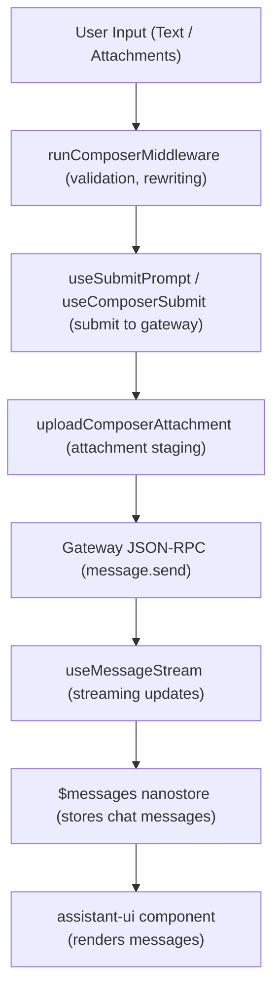
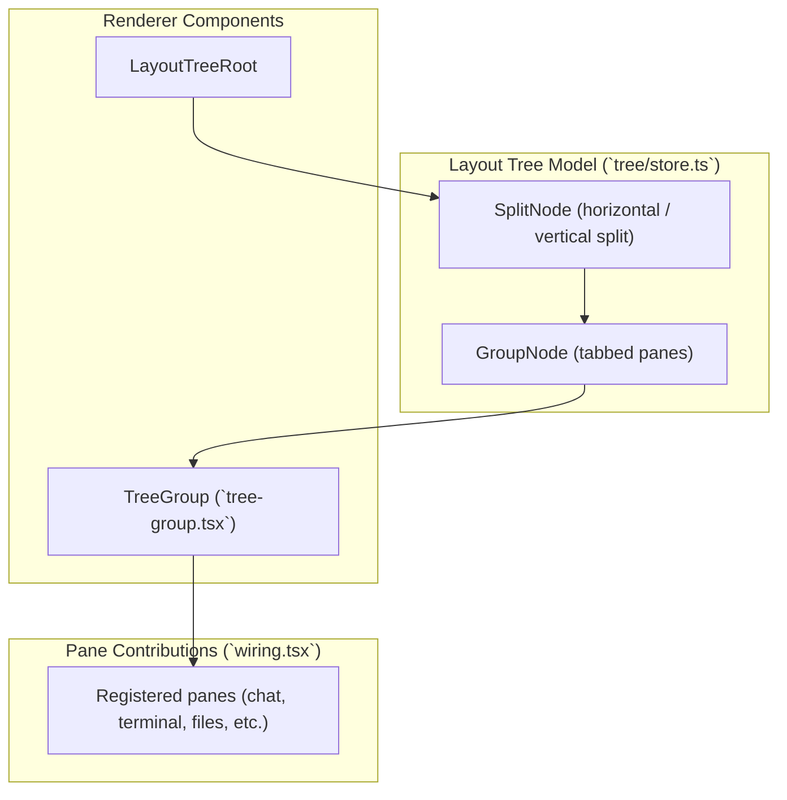
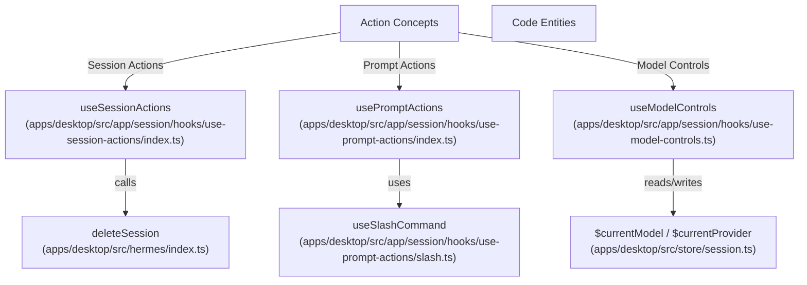

<!-- source: DeepWiki mcp.deepwiki.com · repo nousresearch/hermes-agent · page 12.2 Desktop UI Components · fetched 2026-10-26 -->

# Desktop UI Components

Relevant source files

The following files were used as context for generating this wiki page:

- [apps/desktop/src/app/chat/composer/hooks/use-composer-queue.test.tsx](apps/desktop/src/app/chat/composer/hooks/use-composer-queue.test.tsx)
- [apps/desktop/src/app/chat/composer/hooks/use-composer-queue.ts](apps/desktop/src/app/chat/composer/hooks/use-composer-queue.ts)
- [apps/desktop/src/app/chat/composer/hooks/use-composer-submit.test.tsx](apps/desktop/src/app/chat/composer/hooks/use-composer-submit.test.tsx)
- [apps/desktop/src/app/chat/composer/hooks/use-composer-submit.ts](apps/desktop/src/app/chat/composer/hooks/use-composer-submit.ts)
- [apps/desktop/src/app/chat/composer/hooks/use-live-completion-adapter.ts](apps/desktop/src/app/chat/composer/hooks/use-live-completion-adapter.ts)
- [apps/desktop/src/app/chat/composer/hooks/use-slash-completions.test.tsx](apps/desktop/src/app/chat/composer/hooks/use-slash-completions.test.tsx)
- [apps/desktop/src/app/chat/composer/hooks/use-slash-completions.ts](apps/desktop/src/app/chat/composer/hooks/use-slash-completions.ts)
- [apps/desktop/src/app/chat/session-drag.test.ts](apps/desktop/src/app/chat/session-drag.test.ts)
- [apps/desktop/src/app/chat/session-drag.ts](apps/desktop/src/app/chat/session-drag.ts)
- [apps/desktop/src/app/chat/session-tile-actions.test.ts](apps/desktop/src/app/chat/session-tile-actions.test.ts)
- [apps/desktop/src/app/chat/session-tile-actions.ts](apps/desktop/src/app/chat/session-tile-actions.ts)
- [apps/desktop/src/app/chat/sidebar/chat-sidebar.integration.test.tsx](apps/desktop/src/app/chat/sidebar/chat-sidebar.integration.test.tsx)
- [apps/desktop/src/app/chat/sidebar/chrome.tsx](apps/desktop/src/app/chat/sidebar/chrome.tsx)
- [apps/desktop/src/app/chat/sidebar/filter-menu.tsx](apps/desktop/src/app/chat/sidebar/filter-menu.tsx)
- [apps/desktop/src/app/chat/sidebar/index.tsx](apps/desktop/src/app/chat/sidebar/index.tsx)
- [apps/desktop/src/app/chat/sidebar/order.test.ts](apps/desktop/src/app/chat/sidebar/order.test.ts)
- [apps/desktop/src/app/chat/sidebar/order.ts](apps/desktop/src/app/chat/sidebar/order.ts)
- [apps/desktop/src/app/chat/sidebar/projects/entered-content.tsx](apps/desktop/src/app/chat/sidebar/projects/entered-content.tsx)
- [apps/desktop/src/app/chat/sidebar/projects/index.ts](apps/desktop/src/app/chat/sidebar/projects/index.ts)
- [apps/desktop/src/app/chat/sidebar/projects/model.test.ts](apps/desktop/src/app/chat/sidebar/projects/model.test.ts)
- [apps/desktop/src/app/chat/sidebar/projects/model.ts](apps/desktop/src/app/chat/sidebar/projects/model.ts)
- [apps/desktop/src/app/chat/sidebar/projects/overview-row.test.tsx](apps/desktop/src/app/chat/sidebar/projects/overview-row.test.tsx)
- [apps/desktop/src/app/chat/sidebar/projects/overview-row.tsx](apps/desktop/src/app/chat/sidebar/projects/overview-row.tsx)
- [apps/desktop/src/app/chat/sidebar/projects/project-menu.tsx](apps/desktop/src/app/chat/sidebar/projects/project-menu.tsx)
- [apps/desktop/src/app/chat/sidebar/projects/workspace-group.tsx](apps/desktop/src/app/chat/sidebar/projects/workspace-group.tsx)
- [apps/desktop/src/app/chat/sidebar/projects/workspace-groups.test.ts](apps/desktop/src/app/chat/sidebar/projects/workspace-groups.test.ts)
- [apps/desktop/src/app/chat/sidebar/projects/workspace-groups.ts](apps/desktop/src/app/chat/sidebar/projects/workspace-groups.ts)
- [apps/desktop/src/app/chat/sidebar/projects/workspace-header.tsx](apps/desktop/src/app/chat/sidebar/projects/workspace-header.tsx)
- [apps/desktop/src/app/chat/sidebar/session-row-actions.test.tsx](apps/desktop/src/app/chat/sidebar/session-row-actions.test.tsx)
- [apps/desktop/src/app/chat/sidebar/session-row-details.ts](apps/desktop/src/app/chat/sidebar/session-row-details.ts)
- [apps/desktop/src/app/chat/sidebar/sessions-section-new-session-drag.test.tsx](apps/desktop/src/app/chat/sidebar/sessions-section-new-session-drag.test.tsx)
- [apps/desktop/src/app/chat/sidebar/sessions-section.tsx](apps/desktop/src/app/chat/sidebar/sessions-section.tsx)
- [apps/desktop/src/app/chat/sidebar/virtual-session-list.test.tsx](apps/desktop/src/app/chat/sidebar/virtual-session-list.test.tsx)
- [apps/desktop/src/app/chat/sidebar/virtual-session-list.tsx](apps/desktop/src/app/chat/sidebar/virtual-session-list.tsx)
- [apps/desktop/src/app/chat/transcript-backfill.test.ts](apps/desktop/src/app/chat/transcript-backfill.test.ts)
- [apps/desktop/src/app/chat/transcript-backfill.ts](apps/desktop/src/app/chat/transcript-backfill.ts)
- [apps/desktop/src/app/chat/transcript-retention.test.ts](apps/desktop/src/app/chat/transcript-retention.test.ts)
- [apps/desktop/src/app/chat/transcript-retention.ts](apps/desktop/src/app/chat/transcript-retention.ts)
- [apps/desktop/src/app/chat/use-transcript-retention.test.tsx](apps/desktop/src/app/chat/use-transcript-retention.test.tsx)
- [apps/desktop/src/app/chat/use-transcript-retention.ts](apps/desktop/src/app/chat/use-transcript-retention.ts)
- [apps/desktop/src/app/contrib/hooks/completed-reply-refresh.test.tsx](apps/desktop/src/app/contrib/hooks/completed-reply-refresh.test.tsx)
- [apps/desktop/src/app/contrib/hooks/use-background-sync.test.ts](apps/desktop/src/app/contrib/hooks/use-background-sync.test.ts)
- [apps/desktop/src/app/contrib/hooks/use-background-sync.test.tsx](apps/desktop/src/app/contrib/hooks/use-background-sync.test.tsx)
- [apps/desktop/src/app/contrib/hooks/use-background-sync.ts](apps/desktop/src/app/contrib/hooks/use-background-sync.ts)
- [apps/desktop/src/app/contrib/hooks/use-session-tile-delegate.test.ts](apps/desktop/src/app/contrib/hooks/use-session-tile-delegate.test.ts)
- [apps/desktop/src/app/contrib/hooks/use-session-tile-delegate.ts](apps/desktop/src/app/contrib/hooks/use-session-tile-delegate.ts)
- [apps/desktop/src/app/contrib/wiring.tsx](apps/desktop/src/app/contrib/wiring.tsx)
- [apps/desktop/src/app/open-session.test.ts](apps/desktop/src/app/open-session.test.ts)
- [apps/desktop/src/app/open-session.ts](apps/desktop/src/app/open-session.ts)
- [apps/desktop/src/app/session/hooks/use-background-queue-drain.test.tsx](apps/desktop/src/app/session/hooks/use-background-queue-drain.test.tsx)
- [apps/desktop/src/app/session/hooks/use-background-queue-drain.ts](apps/desktop/src/app/session/hooks/use-background-queue-drain.ts)
- [apps/desktop/src/app/session/hooks/use-message-stream/gateway-event/tools.ts](apps/desktop/src/app/session/hooks/use-message-stream/gateway-event/tools.ts)
- [apps/desktop/src/app/session/hooks/use-message-stream/replay-gap.test.tsx](apps/desktop/src/app/session/hooks/use-message-stream/replay-gap.test.tsx)
- [apps/desktop/src/app/session/hooks/use-prompt-actions/index.test.tsx](apps/desktop/src/app/session/hooks/use-prompt-actions/index.test.tsx)
- [apps/desktop/src/app/session/hooks/use-prompt-actions/index.ts](apps/desktop/src/app/session/hooks/use-prompt-actions/index.ts)
- [apps/desktop/src/app/session/hooks/use-prompt-actions/resolve-target-session.ts](apps/desktop/src/app/session/hooks/use-prompt-actions/resolve-target-session.ts)
- [apps/desktop/src/app/session/hooks/use-prompt-actions/rewind.test.ts](apps/desktop/src/app/session/hooks/use-prompt-actions/rewind.test.ts)
- [apps/desktop/src/app/session/hooks/use-prompt-actions/rewind.ts](apps/desktop/src/app/session/hooks/use-prompt-actions/rewind.ts)
- [apps/desktop/src/app/session/hooks/use-prompt-actions/single-flight-resume.test.ts](apps/desktop/src/app/session/hooks/use-prompt-actions/single-flight-resume.test.ts)
- [apps/desktop/src/app/session/hooks/use-prompt-actions/single-flight-resume.ts](apps/desktop/src/app/session/hooks/use-prompt-actions/single-flight-resume.ts)
- [apps/desktop/src/app/session/hooks/use-prompt-actions/slash.ts](apps/desktop/src/app/session/hooks/use-prompt-actions/slash.ts)
- [apps/desktop/src/app/session/hooks/use-prompt-actions/submission-destination.test.tsx](apps/desktop/src/app/session/hooks/use-prompt-actions/submission-destination.test.tsx)
- [apps/desktop/src/app/session/hooks/use-prompt-actions/submission-destination.ts](apps/desktop/src/app/session/hooks/use-prompt-actions/submission-destination.ts)
- [apps/desktop/src/app/session/hooks/use-prompt-actions/submit-unknown-receipt.test.tsx](apps/desktop/src/app/session/hooks/use-prompt-actions/submit-unknown-receipt.test.tsx)
- [apps/desktop/src/app/session/hooks/use-prompt-actions/submit.ts](apps/desktop/src/app/session/hooks/use-prompt-actions/submit.ts)
- [apps/desktop/src/app/session/hooks/use-prompt-actions/utils.ts](apps/desktop/src/app/session/hooks/use-prompt-actions/utils.ts)
- [apps/desktop/src/app/session/hooks/use-route-resume.test.tsx](apps/desktop/src/app/session/hooks/use-route-resume.test.tsx)
- [apps/desktop/src/app/session/hooks/use-route-resume.ts](apps/desktop/src/app/session/hooks/use-route-resume.ts)
- [apps/desktop/src/app/session/hooks/use-session-actions.test.tsx](apps/desktop/src/app/session/hooks/use-session-actions.test.tsx)
- [apps/desktop/src/app/session/hooks/use-session-actions/index.ts](apps/desktop/src/app/session/hooks/use-session-actions/index.ts)
- [apps/desktop/src/app/session/hooks/use-session-actions/resolve-stored-session.test.ts](apps/desktop/src/app/session/hooks/use-session-actions/resolve-stored-session.test.ts)
- [apps/desktop/src/app/session/hooks/use-session-actions/utils.test.ts](apps/desktop/src/app/session/hooks/use-session-actions/utils.test.ts)
- [apps/desktop/src/app/session/hooks/use-session-actions/utils.ts](apps/desktop/src/app/session/hooks/use-session-actions/utils.ts)
- [apps/desktop/src/app/session/hooks/use-session-state-cache.test.tsx](apps/desktop/src/app/session/hooks/use-session-state-cache.test.tsx)
- [apps/desktop/src/app/session/hooks/use-session-state-cache.ts](apps/desktop/src/app/session/hooks/use-session-state-cache.ts)
- [apps/desktop/src/app/session/hooks/wrong-session-closeout.test.tsx](apps/desktop/src/app/session/hooks/wrong-session-closeout.test.tsx)
- [apps/desktop/src/app/session/session-state-cache.test.ts](apps/desktop/src/app/session/session-state-cache.test.ts)
- [apps/desktop/src/app/session/session-state-cache.ts](apps/desktop/src/app/session/session-state-cache.ts)
- [apps/desktop/src/app/settings/env-var-actions-menu.tsx](apps/desktop/src/app/settings/env-var-actions-menu.tsx)
- [apps/desktop/src/components/assistant-ui/thread/timeline.test.ts](apps/desktop/src/components/assistant-ui/thread/timeline.test.ts)
- [apps/desktop/src/components/onboarding/first-run/kickoff.test.ts](apps/desktop/src/components/onboarding/first-run/kickoff.test.ts)
- [apps/desktop/src/components/onboarding/first-run/kickoff.ts](apps/desktop/src/components/onboarding/first-run/kickoff.ts)
- [apps/desktop/src/components/onboarding/skip-setup.tsx](apps/desktop/src/components/onboarding/skip-setup.tsx)
- [apps/desktop/src/components/pane-shell/pane-lifecycle.test.ts](apps/desktop/src/components/pane-shell/pane-lifecycle.test.ts)
- [apps/desktop/src/components/pane-shell/pane-visibility.test.ts](apps/desktop/src/components/pane-shell/pane-visibility.test.ts)
- [apps/desktop/src/components/pane-shell/tree/hide-only-strip-tabs.test.ts](apps/desktop/src/components/pane-shell/tree/hide-only-strip-tabs.test.ts)
- [apps/desktop/src/components/pane-shell/tree/lone-chat-sibling-zone.test.ts](apps/desktop/src/components/pane-shell/tree/lone-chat-sibling-zone.test.ts)
- [apps/desktop/src/components/pane-shell/tree/renderer/collapse-restore-affordance.test.tsx](apps/desktop/src/components/pane-shell/tree/renderer/collapse-restore-affordance.test.tsx)
- [apps/desktop/src/components/pane-shell/tree/renderer/strip-visibility.test.ts](apps/desktop/src/components/pane-shell/tree/renderer/strip-visibility.test.ts)
- [apps/desktop/src/components/pane-shell/tree/renderer/strip-visibility.ts](apps/desktop/src/components/pane-shell/tree/renderer/strip-visibility.ts)
- [apps/desktop/src/components/ui/confirm-dialog.test.tsx](apps/desktop/src/components/ui/confirm-dialog.test.tsx)
- [apps/desktop/src/debug/watched-atoms.ts](apps/desktop/src/debug/watched-atoms.ts)
- [apps/desktop/src/lib/desktop-slash-commands.test.ts](apps/desktop/src/lib/desktop-slash-commands.test.ts)
- [apps/desktop/src/lib/desktop-slash-commands.ts](apps/desktop/src/lib/desktop-slash-commands.ts)
- [apps/desktop/src/lib/desktop-slash-registry.json](apps/desktop/src/lib/desktop-slash-registry.json)
- [apps/desktop/src/lib/keybinds/composer-focus-keys.test.ts](apps/desktop/src/lib/keybinds/composer-focus-keys.test.ts)
- [apps/desktop/src/lib/keybinds/composer-focus-keys.ts](apps/desktop/src/lib/keybinds/composer-focus-keys.ts)
- [apps/desktop/src/lib/session-date-groups.test.ts](apps/desktop/src/lib/session-date-groups.test.ts)
- [apps/desktop/src/lib/session-date-groups.ts](apps/desktop/src/lib/session-date-groups.ts)
- [apps/desktop/src/lib/session-project-label.ts](apps/desktop/src/lib/session-project-label.ts)
- [apps/desktop/src/store/clarify.test.ts](apps/desktop/src/store/clarify.test.ts)
- [apps/desktop/src/store/clarify.ts](apps/desktop/src/store/clarify.ts)
- [apps/desktop/src/store/composer-queue.test.ts](apps/desktop/src/store/composer-queue.test.ts)
- [apps/desktop/src/store/composer-queue.ts](apps/desktop/src/store/composer-queue.ts)
- [apps/desktop/src/store/connection-request.ts](apps/desktop/src/store/connection-request.ts)
- [apps/desktop/src/store/layout-sidebar-view.test.ts](apps/desktop/src/store/layout-sidebar-view.test.ts)
- [apps/desktop/src/store/layout.ts](apps/desktop/src/store/layout.ts)
- [apps/desktop/src/store/onboarding-run.test.ts](apps/desktop/src/store/onboarding-run.test.ts)
- [apps/desktop/src/store/onboarding-run.ts](apps/desktop/src/store/onboarding-run.ts)
- [apps/desktop/src/store/onboarding-session.ts](apps/desktop/src/store/onboarding-session.ts)
- [apps/desktop/src/store/parked-card-answers.test.ts](apps/desktop/src/store/parked-card-answers.test.ts)
- [apps/desktop/src/store/parked-card-answers.ts](apps/desktop/src/store/parked-card-answers.ts)
- [apps/desktop/src/store/session-color.test.ts](apps/desktop/src/store/session-color.test.ts)
- [apps/desktop/src/store/session-color.ts](apps/desktop/src/store/session-color.ts)
- [apps/desktop/src/store/session-removal.test.ts](apps/desktop/src/store/session-removal.test.ts)
- [apps/desktop/src/store/session-removal.ts](apps/desktop/src/store/session-removal.ts)
- [apps/desktop/src/store/session-states.test.ts](apps/desktop/src/store/session-states.test.ts)
- [apps/desktop/src/store/session-states.ts](apps/desktop/src/store/session-states.ts)
- [apps/desktop/src/store/session-watchdog.test.ts](apps/desktop/src/store/session-watchdog.test.ts)
- [apps/desktop/src/store/session.test.ts](apps/desktop/src/store/session.test.ts)
- [apps/desktop/src/store/session.ts](apps/desktop/src/store/session.ts)
- [apps/desktop/src/store/setup-beat.test.ts](apps/desktop/src/store/setup-beat.test.ts)
- [apps/desktop/src/store/setup-beat.ts](apps/desktop/src/store/setup-beat.ts)
- [apps/desktop/src/store/sidebar-archive.test.ts](apps/desktop/src/store/sidebar-archive.test.ts)
- [apps/desktop/src/store/sidebar-archive.ts](apps/desktop/src/store/sidebar-archive.ts)
- [apps/desktop/src/store/sidebar-nav.test.ts](apps/desktop/src/store/sidebar-nav.test.ts)
- [apps/desktop/src/store/sidebar-nav.ts](apps/desktop/src/store/sidebar-nav.ts)
- [apps/desktop/src/store/sidebar-sort.test.ts](apps/desktop/src/store/sidebar-sort.test.ts)
- [apps/desktop/src/store/sidebar-sort.ts](apps/desktop/src/store/sidebar-sort.ts)
- [apps/desktop/src/store/theme-pick.ts](apps/desktop/src/store/theme-pick.ts)
- [apps/desktop/src/store/transcript-tail.test.ts](apps/desktop/src/store/transcript-tail.test.ts)
- [apps/desktop/src/store/transcript-tail.ts](apps/desktop/src/store/transcript-tail.ts)
- [scripts/dump_desktop_slash_registry.py](scripts/dump_desktop_slash_registry.py)
- [scripts/gen-bootstrap-pins.py](scripts/gen-bootstrap-pins.py)
- [tests/hermes_cli/test_desktop_slash_registry.py](tests/hermes_cli/test_desktop_slash_registry.py)
- [tests/tui_gateway/test_project_tree.py](tests/tui_gateway/test_project_tree.py)
- [tui_gateway/project_tree.py](tui_gateway/project_tree.py)

The Hermes Desktop application implements a React frontend embedded within an Electron shell, providing a rich user interface for interacting with the Hermes agent system. The UI encompasses chat composition, session navigation, profile management, command execution, and settings configuration, along with a specialized assistant thread component for conversational interactions.

This page documents the key Desktop UI components: the **Chat Composer**, **Session Sidebar**, **Session/Prompt Action Hooks**, **Profile Switcher**, **Command Palette**, **Settings Panels** (Model, Appearance, MCP), and the **Assistant-UI Thread** component. It covers implementation details, data flow, and the core React hooks and stores underpinning them.

---

## 1. Chat Composer (`ChatBar`)

The `ChatBar` component is the central input interface where users compose messages, attach files, and interact with voice and command completions.

### Implementation Details

- **Rich Text Editor**: It uses the `ComposerPrimitive` component from the `@assistant-ui/react` library with a specialized rich input slot (`RICH_INPUT_SLOT`) to manage rich text, links, and attachment "chips". This enables complex user inputs beyond plain text, including visible chips for file/image attachments and inline URL previews [apps/desktop/src/app/chat/composer/index.tsx:1-76]().

- **Middleware Chain**: Submissions pass through `runComposerMiddleware`, a pipeline allowing input interception, blocking, or rewriting by middleware before dispatch to the backend gateway. This opens up extensibility points for plugins and custom behavior [apps/desktop/src/app/chat/composer/index.tsx:131-157]().

- **Voice Integration**: Special phrases like "stop" typed in the composer act as commands to terminate ongoing voice sessions, integrating voice control with typed input seamlessly [apps/desktop/src/app/chat/composer/index.tsx:131-146]().

- **Completions**: The composer integrates popup completion hooks for:
  - At-mentions (`useAtCompletions`)
  - Emojis (`useEmojiCompletions`)
  - Slash commands (`useSlashCompletions`)
  
  These auto-suggestion features improve user efficiency and interface richness [apps/desktop/src/app/session/hooks/use-prompt-actions/slash.ts]().

- **Attachment Handling**: The utility `uploadComposerAttachment` uploads files/images either by path or by transferring bytes depending on the backend environment. This is crucial for hybrid scenarios like remote gateways or containerized terminals to ensure proper attachment usage [apps/desktop/src/app/session/hooks/use-prompt-actions/index.ts:113-176]().

### Data Flow: User Input to Gateway

User input including text and file/image attachments enters the `ChatBar`. Validation and rewriting occur in middleware before the prompt is submitted. Attachments are conditionally uploaded or referenced by path. The message is sent to the backend gateway via JSON-RPC. Streaming updates are processed incrementally and stored in the `$messages` nanostore, which the `Thread` component consumes to render the transcript.

Sources:
- `apps/desktop/src/app/chat/composer/index.tsx`
- `apps/desktop/src/app/session/hooks/use-prompt-actions/slash.ts`
- `apps/desktop/src/app/session/hooks/use-prompt-actions/index.ts`
- `apps/desktop/src/app/session/hooks/use-prompt-actions/submit.ts`
- `apps/desktop/src/store/session.ts`
- `apps/desktop/src/app/chat/index.tsx`

---

## 2. Session Sidebar and Profile Switcher

### Session Sidebar (`ChatSidebar`)

The Session Sidebar provides a navigation pane listing active and archived sessions, organized by projects, workspaces, and messaging platforms.

- It supports hierarchical grouping with collapsible sections, session pinning, manual and automatic ordering, and visibility toggles.
- Data is managed reactively using nanostores such as `$pinnedSessionIds`, `$sidebarSessionOrderManual`, and session-related filters [apps/desktop/src/store/layout.ts:38-77]().
- The sidebar consumes live gateway session events reflected in the `$sessions` atom enabling near real-time updates [apps/desktop/src/store/session.ts:65-66]().
- Users can search sessions based on title and metadata using utilities like `sessionMatchesSearch` [apps/desktop/src/lib/session-search.ts]().
- Sidebar items reflect session metadata, platform avatars, and read/unread state.

### Profile Switcher (`ProfileRail`)

Profiles represent isolated backend agent configurations and credentials, each maintaining independent session lists, navigation states, and workspace scopes.

- Storage keys for remembered last sessions and routes are scoped and namespaced by profile to prevent cross-profile data leakage [apps/desktop/src/store/session.ts:85-144]().
- Changing the active profile triggers backend gateway activation with `ensureGatewayProfile` and reloads associated sessions and UI state [apps/desktop/src/store/profile.ts:68-71]().
- The ProfileRail UI allows quick switching among profiles with visual cues aligned to profile colors and states.

This multi-profile architecture facilitates concurrent agent identities within the desktop, supporting parallel workflows.

Sources:
- `apps/desktop/src/app/chat/sidebar/index.tsx`
- `apps/desktop/src/store/layout.ts`
- `apps/desktop/src/store/session.ts`
- `apps/desktop/src/store/profile.ts`

---

## 3. Session and Prompt Action Hooks

The Desktop app centralizes session lifecycle management and prompt interactions in React hooks with complex state mutation coordination and gateway orchestration.

### `useSessionActions`

- Controls session lifecycle: creation, archival, deletion, and retrieval [apps/desktop/src/app/session/hooks/use-session-actions/index.ts:15-20]().
- Manages session focus, ownership hints, and session state caching for multi-pane and multi-session views [apps/desktop/src/app/session/hooks/use-session-actions/index.ts:78-79, 101]().
- Supports backfill of session transcripts and merging of live transcript tail with stored messages [apps/desktop/src/app/chat/transcript-backfill.ts:5-10]().
- Handles branching of sessions, tile pane opening, and routing navigation [apps/desktop/src/app/session/hooks/use-session-actions/index.ts:170-172, 123-125]().
- Coordinates with nanostores like `$sessions`, `$activeSessionId`, and `$messages` [apps/desktop/src/app/session/hooks/use-session-actions/index.ts:69-70, 72]().
- Ensures synchronization of in-memory session states and persistent session records via backend RPCs and store updates [apps/desktop/src/app/session/hooks/use-session-actions/index.ts:104-108]().

### `usePromptActions`

- Manages prompt editing, message submission, rewind, restore, and reload functionalities [apps/desktop/src/app/session/hooks/use-prompt-actions/rewind.ts:67-73]().
- Supports async message submission pipelines, attachment staging (`uploadComposerAttachment`), voice transcription integration, and clarify tool calls management [apps/desktop/src/app/session/hooks/use-prompt-actions/index.ts:111-112, 7-8, 17-18]().
- Interfaces with slash commands and handles retry on busy or unowned session RPC errors [apps/desktop/src/app/session/hooks/use-prompt-actions/slash.ts:1-2]().
- Handles session background status resets and notification management [apps/desktop/src/store/composer-status.ts:40]().

### `useSubmitPrompt`

- The core prompt submission handler sanitizes composer input, uploads attachments conditionally, and dispatches the prepared prompt to the backend gateway via JSON-RPC [apps/desktop/src/app/session/hooks/use-prompt-actions/submit.ts:7-8, 19-22, 60-63]().
- Implements retry logic for session ownership errors by creating backend sessions if requested [apps/desktop/src/app/session/hooks/use-prompt-actions/submit.ts:65-73]().
- Manages side-effects such as haptic feedback, voice playback control, and composer's submission state flags [apps/desktop/src/lib/haptics.ts:13](), [apps/desktop/src/lib/voice-playback.ts:10-15]().
- Supports options for overriding session creation parameters and fallback strategies [apps/desktop/src/app/session/hooks/use-session-actions/create-overrides.ts:1-2]().

Sources:
- `apps/desktop/src/app/session/hooks/use-session-actions/index.ts`
- `apps/desktop/src/app/session/hooks/use-session-actions/utils.ts`
- `apps/desktop/src/app/session/hooks/use-session-actions/utils.test.ts`
- `apps/desktop/src/app/session/hooks/use-session-actions.test.tsx`
- `apps/desktop/src/app/session/hooks/use-prompt-actions/index.ts`
- `apps/desktop/src/app/session/hooks/use-prompt-actions/index.test.tsx`
- `apps/desktop/src/app/session/hooks/use-prompt-actions/submit.ts`
- `apps/desktop/src/app/session/hooks/use-prompt-actions/rewind.ts`
- `apps/desktop/src/app/session/hooks/use-prompt-actions/slash.ts`
- `apps/desktop/src/app/chat/transcript-backfill.ts`
- `apps/desktop/src/store/composer-status.ts`
- `apps/desktop/src/lib/haptics.ts`
- `apps/desktop/src/lib/voice-playback.ts`

---

## 4. Command Palette (`CommandPalette`)

The Command Palette offers a keyboard-driven interface for command execution and navigation similar to those found in advanced IDEs.

- Implements fuzzy and exact matching of commands with heuristic scoring based on word matches (`scoreItem`) [apps/desktop/src/app/command-palette/index.tsx:190-206]().
- Supports a wide set of commands covering session management, gateway actions, profile switching, and desktop features [apps/desktop/src/lib/desktop-slash-commands.ts:1-2]().
- Integrates contribution hooks for extensibility by plugins or third-party commands.
- Synchronizes command state with the global profile and session stores.
- Exposed as an overlay accessible by keyboard shortcuts.

Sources:
- `apps/desktop/src/app/command-palette/index.tsx`
- `apps/desktop/src/lib/desktop-slash-commands.ts`

---

## 5. Layout Tree and Pane System

Hermes Desktop uses a flexible multi-pane layout organized as a hierarchical tree model for rendering chat, terminal, file browser, and other UI panes.

- The core layout tree consists of nodes representing splits (horizontal or vertical) and groups (tabbed collections) [apps/desktop/src/components/pane-shell/tree/store.ts:26-33]().
- Panes correspond to registered components rendered as leaves or groups in the tree, maintaining independent state.
- The tree facilitates dynamic pane creation, moving, resizing, and collapsing.
- Multiple concurrent session tiles allow side-by-side chat views each with isolated states.
- The reactive state `$sessionTiles` tracks tiles with associated stored and runtime session IDs [apps/desktop/src/store/session-states.ts:118-120]().

### Layout Tree and Pane Architecture Diagram

Sources:
- `apps/desktop/src/components/pane-shell/tree/store.ts`
- `apps/desktop/src/store/session-states.ts`

---

## 6. Assistant-UI Thread and Streaming

The chat transcript rendering leverages the `@assistant-ui/react` framework that supports rich user-assistant interactions with streaming content.

- The `$messages` nanostore holds the session messages array, updated reactively by stream events [apps/desktop/src/store/session.ts:8]().

- The hook `useIncrementalExternalStoreRuntime` adapts the Nanostores message data into the React external store interface required by `<AssistantRuntimeProvider>`, central to all thread components [apps/desktop/src/app/chat/index.tsx:1-53]().

- `useMessageStream` listens to gateway streaming RPC events (e.g., `message.delta`, `tool.call`) and applies incremental updates preserving reasoning and tool-call parts to the stored messages, supporting partial completions and live assistant replies [apps/desktop/src/app/contrib/wiring.tsx:138](), [apps/desktop/src/app/session/hooks/use-message-stream/gateway-event/tools.ts:1-2]().

- The `<Thread>` component renders messages with rich interactive features including structured reasoning blocks and attachment chips.

This infrastructure ensures smooth rendering of the chat transcript including in-progress assistant responses and user-initiated edits.

Sources:
- `apps/desktop/src/store/session.ts`
- `apps/desktop/src/app/chat/index.tsx`
- `apps/desktop/src/app/contrib/wiring.tsx`
- `apps/desktop/src/app/session/hooks/use-message-stream/gateway-event/tools.ts`

---

## 7. Settings Panels and Model Controls

The application provides comprehensive settings interfaces for model configuration, appearance, and multi-cloud-provider integration.

- Persistent nanostores scoped by profile and connection maintain model selection, provider, reasoning effort, fast mode, and service tiers in `$currentModel`, `$currentProvider`, and related atoms [apps/desktop/src/store/session.ts:34-39]().

- The hook `useHermesConfig` coordinates agent backend configuration syncing, model catalog loading, and sets UI defaults accordingly [apps/desktop/src/app/contrib/wiring.tsx:137]().

- Model controls managed by `useModelControls` expose reactive state and setters for managing model source, reasoning effort, and service tier with corresponding UI bindings [apps/desktop/src/app/contrib/wiring.tsx:139]().

- Settings panels appear as modal overlays or routed views allowing users to tweak model, appearance, MCP credentials, and more.

Sources:
- `apps/desktop/src/store/session.ts`
- `apps/desktop/src/app/contrib/wiring.tsx`

---

## Natural Language Space to Code Entity Mapping (UI Components)

```mermaid
graph TB
  UIConcepts["Desktop UI Concepts"]
  CodeEntities["Code Entities"]

  UIConcepts -->|Chat Composer| ChatBar
  UIConcepts -->|Session Sidebar| ChatSidebar
  UIConcepts -->|Profile Switcher| ProfileRail
  UIConcepts -->|Command Palette| CommandPalette
  UIConcepts -->|Layout Tree| LayoutTreeRoot
  UIConcepts -->|Assistant-UI Thread| Thread
  UIConcepts -->|Submit Pipeline| UseSubmitPrompt

  ChatBar["ChatBar\n(apps/desktop/src/app/chat/composer/index.tsx)"]
  ChatSidebar["ChatSidebar\n(apps/desktop/src/app/chat/sidebar/index.tsx)"]
  ProfileRail["ProfileRail\n(apps/desktop/src/app/chat/sidebar/profile-switcher.tsx)"]
  CommandPalette["CommandPalette\n(apps/desktop/src/app/command-palette/index.tsx)"]
  LayoutTreeRoot["LayoutTreeRoot\n(apps/desktop/src/components/pane-shell/tree/store.ts)"]
  Thread["AssistantRuntimeProvider\n(apps/desktop/src/app/chat/index.tsx)"]
  UseSubmitPrompt["useSubmitPrompt\n(apps/desktop/src/app/session/hooks/use-prompt-actions/submit.ts)"]

  ChatBar -->|uses| useComposerSubmit["useComposerSubmit\n(apps/desktop/src/app/chat/composer/hooks/use-composer-submit.ts)"]
  ChatSidebar -->|queries| $sessions["$sessions atom\n(apps/desktop/src/store/session.ts)"]
  ProfileRail -->|modifies| $activeGatewayProfile["$activeGatewayProfile\n(apps/desktop/src/store/profile.ts)"]
  Thread -->|subscribes| $messages["$messages atom\n(apps/desktop/src/store/session.ts)"]
  UseSubmitPrompt -->|uploads attachments| UploadAttachment["uploadComposerAttachment\n(apps/desktop/src/app/session/hooks/use-prompt-actions/index.ts)"]
```

---

## Natural Language Space to Code Entity Mapping (Session & Actions)

---

**Sources:**  
- `apps/desktop/src/app/chat/composer/index.tsx`  
- `apps/desktop/src/app/chat/sidebar/index.tsx`  
- `apps/desktop/src/store/session.ts`  
- `apps/desktop/src/store/profile.ts`  
- `apps/desktop/src/store/session-states.ts`  
- `apps/desktop/src/app/command-palette/index.tsx`  
- `apps/desktop/src/components/pane-shell/tree/store.ts`  
- `apps/desktop/src/app/contrib/wiring.tsx`  
- `apps/desktop/src/app/chat/index.tsx`  
- `apps/desktop/src/app/session/hooks/use-session-actions/index.ts`  
- `apps/desktop/src/app/session/hooks/use-prompt-actions/index.ts`  
- `apps/desktop/src/app/session/hooks/use-prompt-actions/submit.ts`  
- `apps/desktop/src/app/session/hooks/use-prompt-actions/slash.ts`  
- `apps/desktop/src/app/session/hooks/use-model-controls.ts`  
- `apps/desktop/src/hermes/index.ts`  
- `apps/desktop/src/app/session/hooks/use-prompt-actions/rewind.ts`
- `apps/desktop/src/app/session/hooks/use-session-actions/utils.ts`
- `apps/desktop/src/app/session/hooks/use-session-actions/utils.test.ts`
- `apps/desktop/src/app/session/hooks/use-session-actions.test.tsx`
- `apps/desktop/src/app/session/hooks/use-prompt-actions/index.test.tsx`
- `apps/desktop/src/app/chat/transcript-backfill.ts`
- `apps/desktop/src/store/composer-status.ts`
- `apps/desktop/src/lib/haptics.ts`
- `apps/desktop/src/lib/voice-playback.ts`
- `apps/desktop/src/lib/desktop-slash-commands.ts`
- `apps/desktop/src/app/session/hooks/use-message-stream/gateway-event/tools.ts`

---

