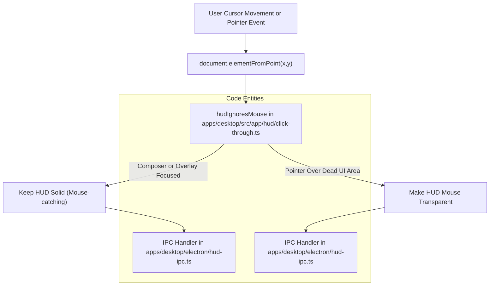
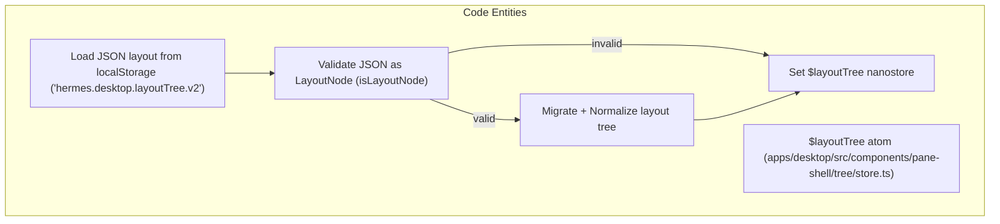
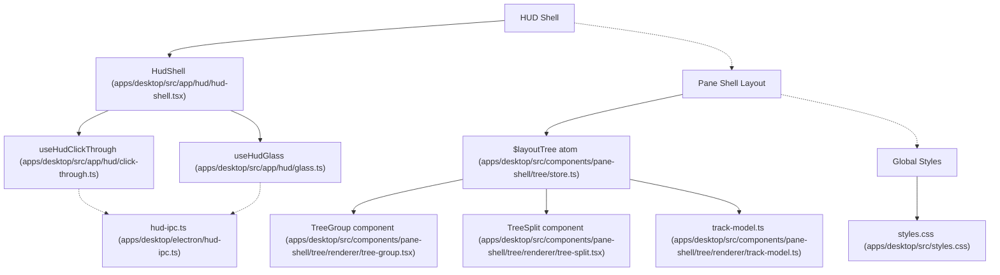

<!-- source: DeepWiki mcp.deepwiki.com · repo nousresearch/hermes-agent · page 12.3 HUD, Panes, and Window Management · fetched 2026-10-26 -->

# HUD, Panes, and Window Management

<details>
<summary>Relevant source files</summary>

The following files were used as context for generating this wiki page:

- [apps/desktop/electron/hud-cursor.test.ts](apps/desktop/electron/hud-cursor.test.ts)
- [apps/desktop/electron/hud-cursor.ts](apps/desktop/electron/hud-cursor.ts)
- [apps/desktop/electron/hud-ipc.ts](apps/desktop/electron/hud-ipc.ts)
- [apps/desktop/src/app/chat/composer/index.tsx](apps/desktop/src/app/chat/composer/index.tsx)
- [apps/desktop/src/app/chat/index.tsx](apps/desktop/src/app/chat/index.tsx)
- [apps/desktop/src/app/chat/pane-mirror.ts](apps/desktop/src/app/chat/pane-mirror.ts)
- [apps/desktop/src/app/chat/session-tile.tsx](apps/desktop/src/app/chat/session-tile.tsx)
- [apps/desktop/src/app/contrib/controller.tsx](apps/desktop/src/app/contrib/controller.tsx)
- [apps/desktop/src/app/hud/click-through.test.ts](apps/desktop/src/app/hud/click-through.test.ts)
- [apps/desktop/src/app/hud/click-through.ts](apps/desktop/src/app/hud/click-through.ts)
- [apps/desktop/src/app/hud/composer-drag.test.ts](apps/desktop/src/app/hud/composer-drag.test.ts)
- [apps/desktop/src/app/hud/composer-drag.ts](apps/desktop/src/app/hud/composer-drag.ts)
- [apps/desktop/src/app/hud/glass.test.tsx](apps/desktop/src/app/hud/glass.test.tsx)
- [apps/desktop/src/app/hud/glass.ts](apps/desktop/src/app/hud/glass.ts)
- [apps/desktop/src/app/hud/hud-shell.tsx](apps/desktop/src/app/hud/hud-shell.tsx)
- [apps/desktop/src/app/hud/resize-handle.test.ts](apps/desktop/src/app/hud/resize-handle.test.ts)
- [apps/desktop/src/app/hud/resize-handle.ts](apps/desktop/src/app/hud/resize-handle.ts)
- [apps/desktop/src/app/hud/transcript-band.test.tsx](apps/desktop/src/app/hud/transcript-band.test.tsx)
- [apps/desktop/src/app/hud/transcript-band.ts](apps/desktop/src/app/hud/transcript-band.ts)
- [apps/desktop/src/app/shell/titlebar.test.ts](apps/desktop/src/app/shell/titlebar.test.ts)
- [apps/desktop/src/app/shell/titlebar.ts](apps/desktop/src/app/shell/titlebar.ts)
- [apps/desktop/src/components/pane-shell/geometry.ts](apps/desktop/src/components/pane-shell/geometry.ts)
- [apps/desktop/src/components/pane-shell/tree/model.ts](apps/desktop/src/components/pane-shell/tree/model.ts)
- [apps/desktop/src/components/pane-shell/tree/pane-share-memory.test.ts](apps/desktop/src/components/pane-shell/tree/pane-share-memory.test.ts)
- [apps/desktop/src/components/pane-shell/tree/remove-pane.test.ts](apps/desktop/src/components/pane-shell/tree/remove-pane.test.ts)
- [apps/desktop/src/components/pane-shell/tree/renderer/drag-session.ts](apps/desktop/src/components/pane-shell/tree/renderer/drag-session.ts)
- [apps/desktop/src/components/pane-shell/tree/renderer/index.tsx](apps/desktop/src/components/pane-shell/tree/renderer/index.tsx)
- [apps/desktop/src/components/pane-shell/tree/renderer/main-placement-floor.test.tsx](apps/desktop/src/components/pane-shell/tree/renderer/main-placement-floor.test.tsx)
- [apps/desktop/src/components/pane-shell/tree/renderer/pane-body.tsx](apps/desktop/src/components/pane-shell/tree/renderer/pane-body.tsx)
- [apps/desktop/src/components/pane-shell/tree/renderer/panel-titlebar-lifecycle.test.tsx](apps/desktop/src/components/pane-shell/tree/renderer/panel-titlebar-lifecycle.test.tsx)
- [apps/desktop/src/components/pane-shell/tree/renderer/panel-titlebar.test.tsx](apps/desktop/src/components/pane-shell/tree/renderer/panel-titlebar.test.tsx)
- [apps/desktop/src/components/pane-shell/tree/renderer/panel-titlebar.ts](apps/desktop/src/components/pane-shell/tree/renderer/panel-titlebar.ts)
- [apps/desktop/src/components/pane-shell/tree/renderer/tab-strip-hide.test.tsx](apps/desktop/src/components/pane-shell/tree/renderer/tab-strip-hide.test.tsx)
- [apps/desktop/src/components/pane-shell/tree/renderer/track-model.ts](apps/desktop/src/components/pane-shell/tree/renderer/track-model.ts)
- [apps/desktop/src/components/pane-shell/tree/renderer/tree-group.test.tsx](apps/desktop/src/components/pane-shell/tree/renderer/tree-group.test.tsx)
- [apps/desktop/src/components/pane-shell/tree/renderer/tree-group.tsx](apps/desktop/src/components/pane-shell/tree/renderer/tree-group.tsx)
- [apps/desktop/src/components/pane-shell/tree/renderer/tree-node.tsx](apps/desktop/src/components/pane-shell/tree/renderer/tree-node.tsx)
- [apps/desktop/src/components/pane-shell/tree/renderer/tree-split-cascade-resize.test.tsx](apps/desktop/src/components/pane-shell/tree/renderer/tree-split-cascade-resize.test.tsx)
- [apps/desktop/src/components/pane-shell/tree/renderer/tree-split.tsx](apps/desktop/src/components/pane-shell/tree/renderer/tree-split.tsx)
- [apps/desktop/src/components/pane-shell/tree/store.ts](apps/desktop/src/components/pane-shell/tree/store.ts)
- [apps/desktop/src/components/ui/button.tsx](apps/desktop/src/components/ui/button.tsx)
- [apps/desktop/src/lib/platform.ts](apps/desktop/src/lib/platform.ts)
- [apps/desktop/src/styles.css](apps/desktop/src/styles.css)

</details>


This page documents the desktop windowing surfaces in Hermes Agent, detailing the chrome-less Heads-Up Display (HUD) shell, overlay components, secondary browser windows, the pane-shell tree layout engine, and global styling infrastructure.

---

## 1. HUD Shell and Behaviors

The HUD is a minimalistic, translucent overlay designed to remain always-on-top of other applications, providing a "Spotlight" style quick-entry bar alongside a fading transcript panel that shows ongoing conversation context.

### 1.1 Activity and Transcript Lifecycle

The HUD dynamically shifts between the minimal idle state and the full transcript display based on user interaction and message flow. This behavior is encapsulated in `apps/desktop/src/app/hud/hud-shell.tsx`, where several hooks coordinate HUD visibility states:

- **`useRecentActivity`** uses a 1100ms hold timer (`HUD_RECENT_HOLD_MS`) to keep the transcript visible after recent conversation activity such as new messages or user interaction. It ensures that after the user stops interacting or message flow ends, the transcript fades smoothly rather than vanishing abruptly [apps/desktop/src/app/hud/hud-shell.tsx:25-26]().

- **`useHudHeld`** enforces persistent transcript visibility during important states including:
  - When the agent is busy (e.g., streaming messages or tool calls).
  - When an explicit input prompt awaits user response.
  - When "game overlay mode" is active, disabling fadeout to ensure continuous chat log visibility [apps/desktop/src/app/hud/hud-shell.tsx:155-160]().

These composable visibility flags are combined in CSS and React state to render a robust HUD experience without excess flicker or CPU usage. The transcript band blends translucency with opacity transitions keyed on these state flags, triggered by the message store (`$messages`) and busy state (`$busy`) [apps/desktop/src/app/hud/hud-shell.tsx:8-9]().

Sources:
- `apps/desktop/src/app/hud/hud-shell.tsx:8-9`
- `apps/desktop/src/app/hud/hud-shell.tsx:25-26`
- `apps/desktop/src/app/hud/hud-shell.tsx:155-160`

### 1.2 Click-Through and Mouse Pass-Through Handling

Electron's always-on-top windows can block mouse events to underlying apps. To permit click-through on transparent HUD areas while retaining interactivity on composited elements, `apps/desktop/src/app/hud/click-through.ts` implements a comprehensive heuristic system for toggling mouse transparency.

Key aspects:

- The function `hudIgnoresMouse` checks whether the HUD composer (chat input) is focused or if overlays have focus, keeping the HUD solid to allow input and interaction.

- If no focus exists, it inspects the element under the cursor to identify if it is an invisible, disabled, or pointer-events:none UI component (a "dead zone"), in which case the HUD window becomes mouse-transparent allowing clicks to pass through.

- Mouse transparency state changes are communicated to the Electron main process via IPC messages (`'hermes:hud:ignore-mouse'`) implemented in `apps/desktop/electron/hud-ipc.ts`.


Sources:
- `apps/desktop/src/app/hud/click-through.ts`
- `apps/desktop/electron/hud-ipc.ts`

### 1.3 Glass and Translucency Integration

The HUD surface simulates native frosted glass translucency to create a visually distinctive UI layer:

- On **macOS**, uses `NSVisualEffectView` vibrancy via the Electron main process integration, leveraging system-level blur and transparency.

- On **Windows** and **Linux**, corresponding Electron APIs provide similar blur/transparency effects.

The React hook `useHudGlass` in `apps/desktop/src/app/hud/glass.ts` observes key HUD compositor status flags (focus, typing activity) and calls `window.hermesDesktop.hud.setFrost(true/false)`. This call triggers IPC messages to the main process to update the OS-level glass effect efficiently without destroying the composited window, striking a balance between responsiveness and visual fidelity [apps/desktop/src/app/hud/glass.ts]() and `apps/desktop/electron/hud-ipc.ts`().

Sources:
- `apps/desktop/src/app/hud/glass.ts`
- `apps/desktop/electron/hud-ipc.ts`

---

## 2. Overlays and Pop-Out Windows

Hermes Agent supports multiple overlay surfaces and secondary windows in addition to the main HUD and desktop:

- **Quick-Entry Overlay:** A globally accessible prompt window enabling rapid task or chat input, allowing users to engage without switching context from other tasks.

- **Pet Overlay:** An animated, floating "pet" companion implemented in a separate overlay window, rendered with its own lifecycle and composited atop other windows. The `$petOverlayActive` store controls its visibility [apps/desktop/src/store/pet-overlay.ts]().

- **Pop-Out Browser Windows:** These windows host isolated React roots but share the same origin and local storage as the main app. They purposely do **not** persist layout tree state to avoid polluting or overwriting the user's primary layout customizations. The `BrowserPopoutShell` component renders these windows [apps/desktop/src/app/contrib/controller.tsx:100]().

Pop-out window identification is performed using window state predicates (`isBrowserWindow()`, `isSecondaryWindow()`) defined in `apps/desktop/src/store/windows.ts`. These flags toggle relevant persistence and UI behavior for the window [apps/desktop/src/store/windows.ts](). The `persist` function in `apps/desktop/src/components/pane-shell/tree/store.ts` explicitly checks these flags to prevent secondary windows from writing layout changes [apps/desktop/src/components/pane-shell/tree/store.ts:58-63]().

Sources:
- `apps/desktop/src/store/pet-overlay.ts`
- `apps/desktop/src/app/contrib/controller.tsx:100`
- `apps/desktop/src/store/windows.ts`
- `apps/desktop/src/components/pane-shell/tree/store.ts:58-63`

---

## 3. Pane-Shell Tree Layout Engine

Hermes Agent's desktop UI employs a composable pane-shell tree layout, supporting a hierarchical composition of panes tiled in splits and tabbed zones.

### 3.1 Layout Tree and Persistence

The layout state is modeled as a normalized tree of `LayoutNode`s differentiated as:

- **Split Nodes:** Flex containers (horizontal or vertical) subdividing space for child layouts.

- **Group Nodes:** Zones hosting multiple panes displayed as stacked tabs.

The global tree is held in the nanostore atom `$layoutTree` in `apps/desktop/src/components/pane-shell/tree/store.ts`. On app startup:

- The layout JSON is read from the persistent localStorage key `hermes.desktop.layoutTree.v2`.
- Parsed JSON is validated using `isLayoutNode()`.
- Legacy data is migrated using `migratePersistedTree()`.
- The tree is normalized by removing empty nodes or resolving inconsistencies.

Secondary windows or pop-outs **do not** write back to localStorage to avoid overwriting the primary layout tree, enforced by `persist(tree: LayoutNode | null)` guard at store write [apps/desktop/src/components/pane-shell/tree/store.ts:58-79]().


Sources:
- `apps/desktop/src/components/pane-shell/tree/store.ts:58-79`

### 3.2 Structural Splits and Group Zones

- **TreeSplit Renderer:** `TreeSplit` renders a flex row or column group of child layout nodes with draggable sash handles for resizing. It uses tightly scoped subscriptions to `$paneStates` to update only relevant subtree overrides during drag, optimizing render performance [apps/desktop/src/components/pane-shell/tree/renderer/tree-split.tsx:1-171]().

- **TreeGroup Renderer:** `TreeGroup` represents one tabbed zone composed of panes. It renders:
  - A tab strip showing all panes in that zone.
  - Active pane content.
  - Minimize toggle chevrons controlling zone collapse.
  - Context menus exposed on right-click with tab-related actions for close, close others, close to right, close all, reload pane, etc.
  - Support for "hide-only" tabs (e.g., session tile tabs that do not close but hide, preventing accidental data loss), switching close verbs for hide/show [apps/desktop/src/components/pane-shell/tree/renderer/tree-group.tsx:1-175]().

The store marks special sentinel drag values:
- `SESSION_TILE_DRAG` for dragging a session tile pane [apps/desktop/src/components/pane-shell/tree/store.ts:102]().
- `NEW_SESSION_DRAG` for dragging a "new session" template [apps/desktop/src/components/pane-shell/tree/store.ts:111]().

These sentinels enable zone overlays to highlight appropriate drop targets and allow session linking behavior during drag-and-drop [apps/desktop/src/components/pane-shell/tree/store.ts:102-111]().

Sources:
- `apps/desktop/src/components/pane-shell/tree/renderer/tree-split.tsx:1-171`
- `apps/desktop/src/components/pane-shell/tree/renderer/tree-group.tsx:1-175`
- `apps/desktop/src/components/pane-shell/tree/store.ts:102`
- `apps/desktop/src/components/pane-shell/tree/store.ts:111`
- `apps/desktop/src/components/pane-shell/tree/store.ts:102-111`

### 3.3 Track Model for Pane Sizing

Pane sizes within splits are computed according to the "track model":

- **Fixed track:** Corresponds to a CSS length-based pane (e.g. sidebar width), holding a fixed pixel or percentage size.

- **Flexible track:** Shares remaining space weighted proportionally among flexible panes.

The `PaneSizing` interface includes options for `width`, `minWidth`, `maxWidth`, and vertical analogues, allowing per-pane configuration of sizing constraints [apps/desktop/src/components/pane-shell/tree/renderer/track-model.ts:36-44]().

Special care is given to the minimum size of collapsed zones:

- `COLLAPSED_ZONE_PX` is set to 28px, which differs from the default `MIN_PANE_PX` 80px, allowing tool panels (like terminal/log panes) to collapse into a narrow rail strip gracefully before fully hiding or sizing [apps/desktop/src/components/pane-shell/tree/renderer/track-model.ts:29-30]().

Sources:
- `apps/desktop/src/components/pane-shell/tree/renderer/track-model.ts:36-44`
- `apps/desktop/src/components/pane-shell/tree/renderer/track-model.ts:29-30`

---

## 4. Global Styles and Theme Variables

Global CSS styling for the desktop environment is maintained in `apps/desktop/src/styles.css`. It integrates:

- **Tailwind CSS** with plugins such as typography and shimmer animations [apps/desktop/src/styles.css:1-3]().

- **Font imports** for JetBrains Mono and VSCode Codicons provide developer-centric iconography and monospaced text [apps/desktop/src/styles.css:5](), [apps/desktop/src/styles.css:103-125]().

- **Theme variables custom properties** within the `@theme inline` block define color palettes, font families, spacing scales, border radii, and sidebar accent colors, mapped from system-wide design tokens for consistent theming [apps/desktop/src/styles.css:127-172]().

Sources:
- `apps/desktop/src/styles.css:1-3`
- `apps/desktop/src/styles.css:5`
- `apps/desktop/src/styles.css:103-125`
- `apps/desktop/src/styles.css:127-172`

### 4.1 Animation and Transition Control

To preserve CPU/GPU resources when the app is minimized, unfocused, or hidden, a global attribute `[data-renderer-animations-paused]` disables CSS animations and transition effects on many visually rich UI elements such as shimmer effects, pet wobbles, glow effects, and code block cursors.

This mechanism ensures the UI freezes smoothly without artifacts or lingering animations, improving battery life and performance [apps/desktop/src/styles.css:67-89]().

```css
:root[data-renderer-animations-paused]
  :is(
    .shimmer,
    .quest-glow,
    .pet-egg,
    .pet-egg__glow,
    .pet-egg-shadow,
    .pet-wobble,
    .progress-slide,
    .kanban-arc,
    .glyph-spinner__strip,
    .decode-cursor-blink
  ),
:root[data-renderer-animations-paused] .arc-border::before,
:root[data-renderer-animations-paused]
  [data-slot='aui_assistant-message-content']
  .aui-md
  [data-slot='code-card'][data-streaming='true'] {
  animation-play-state: paused !important;
}
```
Sources:
- `apps/desktop/src/styles.css:67-89`

---

## 5. System Overview: Natural Language UI to Code Entity Mapping

This diagram maps conceptual UI elements to their primary code artifacts to assist navigation and understanding of the system.


Sources:
- `apps/desktop/src/app/hud/hud-shell.tsx`
- `apps/desktop/src/app/hud/click-through.ts`
- `apps/desktop/src/app/hud/glass.ts`
- `apps/desktop/electron/hud-ipc.ts`
- `apps/desktop/src/components/pane-shell/tree/store.ts`
- `apps/desktop/src/components/pane-shell/tree/renderer/tree-group.tsx`
- `apps/desktop/src/components/pane-shell/tree/renderer/tree-split.tsx`
- `apps/desktop/src/components/pane-shell/tree/renderer/track-model.ts`
- `apps/desktop/src/styles.css`

---

# Summary

Hermes Agent's desktop environment delivers:

- A **chrome-less HUD shell** with native OS-level glass translucency and adaptive mouse click-through, enabling a persistent yet unobtrusive chat interface.

- Multiple **secondary overlays and pop-out windows** that support rapid input, animated companion pets, and isolated browser views for multitasking.

- A **persistent pane-shell tree layout** system allowing flexible, sash-resizable splits and tabbed panes with drag-and-drop reordering and per-zone minimizing, persisted and normalized across user sessions.

- A **robust global styling framework** leveraging Tailwind CSS, design tokens, and careful animation control to produce a visually consistent, performant UI.

Together these components form a scalable, extensible window management foundation optimized for AI agent interaction on the desktop.

---

Sources:
- `apps/desktop/src/app/hud/hud-shell.tsx`
- `apps/desktop/src/app/hud/click-through.ts`
- `apps/desktop/src/app/hud/glass.ts`
- `apps/desktop/electron/hud-ipc.ts`
- `apps/desktop/src/store/pet-overlay.ts`
- `apps/desktop/src/app/contrib/controller.tsx:100`
- `apps/desktop/src/store/windows.ts`
- `apps/desktop/src/components/pane-shell/tree/store.ts`
- `apps/desktop/src/components/pane-shell/tree/renderer/tree-group.tsx`
- `apps/desktop/src/components/pane-shell/tree/renderer/tree-split.tsx`
- `apps/desktop/src/components/pane-shell/tree/renderer/track-model.ts`
- `apps/desktop/src/styles.css`

---

