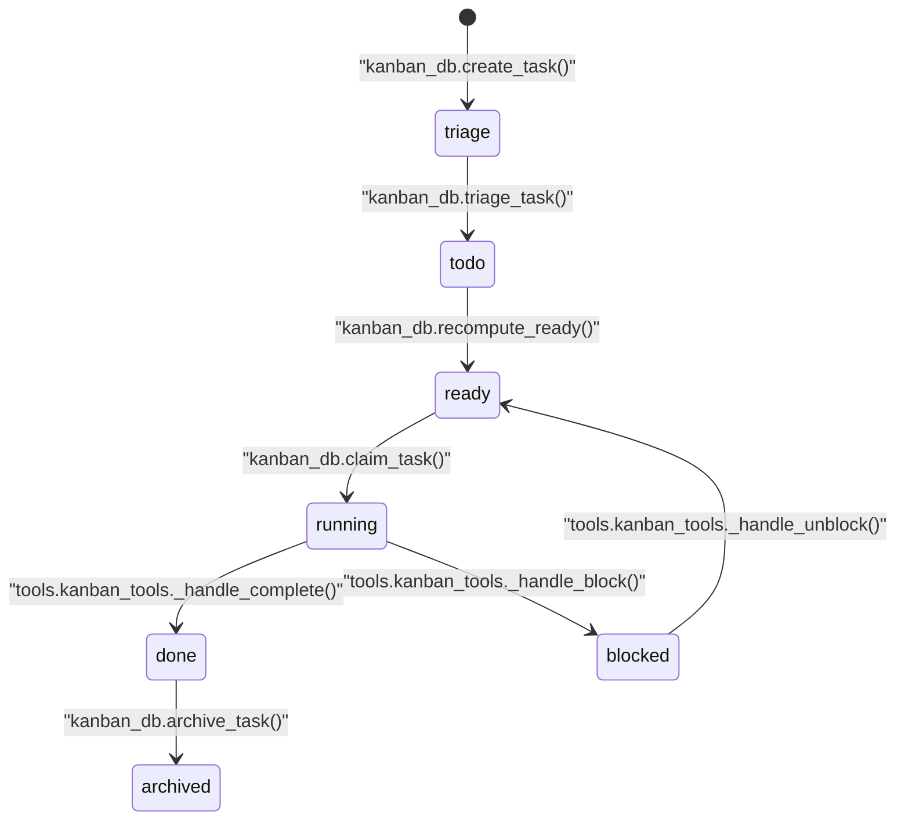
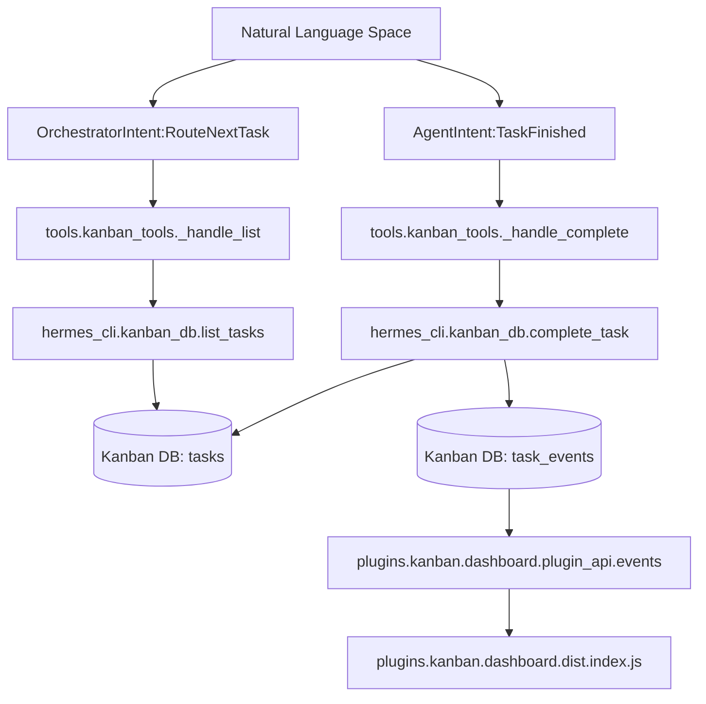

<!-- source: DeepWiki mcp.deepwiki.com · repo nousresearch/hermes-agent · page 13.2 Kanban Tools and Dashboard · fetched 2026-10-26 -->

# Kanban Tools and Dashboard

<details>
<summary>Relevant source files</summary>

The following files were used as context for generating this wiki page:

- [.github/actions/plugin-validate/action.yml](.github/actions/plugin-validate/action.yml)
- [.github/workflows/plugin-catalog-ci.yml](.github/workflows/plugin-catalog-ci.yml)
- [contributors/emails/robertlisowski57@gmail.com](contributors/emails/robertlisowski57@gmail.com)
- [hermes_cli/kanban.py](hermes_cli/kanban.py)
- [hermes_cli/kanban_db.py](hermes_cli/kanban_db.py)
- [hermes_cli/kanban_db_connect.py](hermes_cli/kanban_db_connect.py)
- [hermes_cli/kanban_db_dispatch.py](hermes_cli/kanban_db_dispatch.py)
- [hermes_cli/kanban_db_notify.py](hermes_cli/kanban_db_notify.py)
- [hermes_cli/kanban_db_workspace.py](hermes_cli/kanban_db_workspace.py)
- [hermes_cli/kanban_diagnostics.py](hermes_cli/kanban_diagnostics.py)
- [hermes_cli/kanban_ops.py](hermes_cli/kanban_ops.py)
- [hermes_cli/kanban_output.py](hermes_cli/kanban_output.py)
- [hermes_cli/kanban_parser.py](hermes_cli/kanban_parser.py)
- [hermes_cli/kanban_swarm.py](hermes_cli/kanban_swarm.py)
- [hermes_cli/kanban_transfer.py](hermes_cli/kanban_transfer.py)
- [hermes_cli/kanban_workflow.py](hermes_cli/kanban_workflow.py)
- [hermes_cli/plugin_catalog.py](hermes_cli/plugin_catalog.py)
- [hermes_cli/plugins_cmd.py](hermes_cli/plugins_cmd.py)
- [hermes_cli/plugins_cmd_catalog.py](hermes_cli/plugins_cmd_catalog.py)
- [hermes_cli/plugins_cmd_install.py](hermes_cli/plugins_cmd_install.py)
- [hermes_cli/plugins_transaction.py](hermes_cli/plugins_transaction.py)
- [hermes_cli/subcommands/plugins.py](hermes_cli/subcommands/plugins.py)
- [optional-skills/autonomous-ai-agents/agent-merge-conflict-arbiter/SKILL.md](optional-skills/autonomous-ai-agents/agent-merge-conflict-arbiter/SKILL.md)
- [plugin-catalog/README.md](plugin-catalog/README.md)
- [plugins/kanban/dashboard/dist/index.js](plugins/kanban/dashboard/dist/index.js)
- [plugins/kanban/dashboard/dist/style.css](plugins/kanban/dashboard/dist/style.css)
- [plugins/kanban/dashboard/plugin_api.py](plugins/kanban/dashboard/plugin_api.py)
- [scripts/scan_plugin_payloads.py](scripts/scan_plugin_payloads.py)
- [scripts/validate_plugin_catalog.py](scripts/validate_plugin_catalog.py)
- [tests/ci/test_plugin_catalog_ci_confinement.py](tests/ci/test_plugin_catalog_ci_confinement.py)
- [tests/hermes_cli/test_kanban_block_kinds.py](tests/hermes_cli/test_kanban_block_kinds.py)
- [tests/hermes_cli/test_kanban_cli.py](tests/hermes_cli/test_kanban_cli.py)
- [tests/hermes_cli/test_kanban_complete_live_claim_guard.py](tests/hermes_cli/test_kanban_complete_live_claim_guard.py)
- [tests/hermes_cli/test_kanban_core_functionality.py](tests/hermes_cli/test_kanban_core_functionality.py)
- [tests/hermes_cli/test_kanban_db.py](tests/hermes_cli/test_kanban_db.py)
- [tests/hermes_cli/test_kanban_diagnostics.py](tests/hermes_cli/test_kanban_diagnostics.py)
- [tests/hermes_cli/test_kanban_dispatch_claim_allowlist.py](tests/hermes_cli/test_kanban_dispatch_claim_allowlist.py)
- [tests/hermes_cli/test_kanban_gc_retention.py](tests/hermes_cli/test_kanban_gc_retention.py)
- [tests/hermes_cli/test_kanban_list_undecodable_text.py](tests/hermes_cli/test_kanban_list_undecodable_text.py)
- [tests/hermes_cli/test_kanban_notify.py](tests/hermes_cli/test_kanban_notify.py)
- [tests/hermes_cli/test_kanban_review_lifecycle.py](tests/hermes_cli/test_kanban_review_lifecycle.py)
- [tests/hermes_cli/test_kanban_review_lifecycle_complete.py](tests/hermes_cli/test_kanban_review_lifecycle_complete.py)
- [tests/hermes_cli/test_kanban_review_surfaces.py](tests/hermes_cli/test_kanban_review_surfaces.py)
- [tests/hermes_cli/test_kanban_swarm.py](tests/hermes_cli/test_kanban_swarm.py)
- [tests/hermes_cli/test_kanban_transfer.py](tests/hermes_cli/test_kanban_transfer.py)
- [tests/hermes_cli/test_kanban_watch_banner.py](tests/hermes_cli/test_kanban_watch_banner.py)
- [tests/hermes_cli/test_kanban_workflow.py](tests/hermes_cli/test_kanban_workflow.py)
- [tests/hermes_cli/test_kanban_worktree_teardown.py](tests/hermes_cli/test_kanban_worktree_teardown.py)
- [tests/hermes_cli/test_plugin_catalog.py](tests/hermes_cli/test_plugin_catalog.py)
- [tests/hermes_cli/test_plugin_update_transaction.py](tests/hermes_cli/test_plugin_update_transaction.py)
- [tests/hermes_cli/test_plugins_cmd.py](tests/hermes_cli/test_plugins_cmd.py)
- [tests/hermes_cli/test_plugins_cmd_catalog.py](tests/hermes_cli/test_plugins_cmd_catalog.py)
- [tests/hermes_cli/test_plugins_cmd_enable_disable_nested.py](tests/hermes_cli/test_plugins_cmd_enable_disable_nested.py)
- [tests/plugins/test_kanban_dashboard_plugin.py](tests/plugins/test_kanban_dashboard_plugin.py)
- [tests/plugins/test_kanban_workflow_matrix.py](tests/plugins/test_kanban_workflow_matrix.py)
- [tests/scripts/test_scan_plugin_payloads.py](tests/scripts/test_scan_plugin_payloads.py)
- [tests/scripts/test_validate_plugin_catalog.py](tests/scripts/test_validate_plugin_catalog.py)
- [tests/tools/test_kanban_tools.py](tests/tools/test_kanban_tools.py)
- [tests/website/test_extract_plugins.py](tests/website/test_extract_plugins.py)
- [tests/website/test_extract_skills.py](tests/website/test_extract_skills.py)
- [tools/kanban_tools.py](tools/kanban_tools.py)
- [tools/kanban_tools_schemas.py](tools/kanban_tools_schemas.py)
- [website/docs/developer-guide/plugins/catalog-submission.md](website/docs/developer-guide/plugins/catalog-submission.md)
- [website/docs/developer-guide/plugins/index.md](website/docs/developer-guide/plugins/index.md)
- [website/docs/user-guide/features/kanban-worker-lanes.md](website/docs/user-guide/features/kanban-worker-lanes.md)
- [website/docs/user-guide/features/kanban.md](website/docs/user-guide/features/kanban.md)
- [website/docs/user-guide/features/plugin-catalog.md](website/docs/user-guide/features/plugin-catalog.md)
- [website/docs/user-stories.mdx](website/docs/user-stories.mdx)
- [website/i18n/zh-Hans/docusaurus-plugin-content-docs/current/user-guide/features/kanban-worker-lanes.md](website/i18n/zh-Hans/docusaurus-plugin-content-docs/current/user-guide/features/kanban-worker-lanes.md)
- [website/i18n/zh-Hans/docusaurus-plugin-content-docs/current/user-guide/features/kanban.md](website/i18n/zh-Hans/docusaurus-plugin-content-docs/current/user-guide/features/kanban.md)
- [website/i18n/zh-Hans/docusaurus-plugin-content-docs/current/user-guide/features/skills.md](website/i18n/zh-Hans/docusaurus-plugin-content-docs/current/user-guide/features/skills.md)
- [website/scripts/extract-plugins.py](website/scripts/extract-plugins.py)
- [website/scripts/extract-skills.py](website/scripts/extract-skills.py)
- [website/src/components/UserStoriesCollage/index.tsx](website/src/components/UserStoriesCollage/index.tsx)
- [website/src/components/UserStoriesCollage/styles.module.css](website/src/components/UserStoriesCollage/styles.module.css)
- [website/src/data/userStories.json](website/src/data/userStories.json)
- [website/src/pages/plugins/index.tsx](website/src/pages/plugins/index.tsx)
- [website/src/pages/plugins/styles.module.css](website/src/pages/plugins/styles.module.css)
- [website/src/pages/skills/index.tsx](website/src/pages/skills/index.tsx)
- [website/src/pages/skills/styles.module.css](website/src/pages/skills/styles.module.css)

</details>


This page documents the Hermes Kanban system's agent-facing tool interface, the web dashboard plugin backend (`plugins/kanban/dashboard/plugin_api.py`) and frontend SPA (`plugins/kanban/dashboard/dist/index.js`), and the specialized `kanban-worker` and `kanban-orchestrator` skills enabling multi-agent coordination and stateful task management.

---

## Agent Tool Interface (`kanban_tools`)

The Kanban integration provides structured agent tools implemented in [`tools/kanban_tools.py`](tools/kanban_tools.py) that allow worker and orchestrator agents to manipulate task lifecycles and query board state without invoking CLI commands or the dashboard UI directly. These tools offer a programmatic API for agents, tightly integrated with Kanban’s durable SQLite-backed task queue.

### Tool Visibility and Gating

The Kanban toolset registers conditionally to enforce appropriate agent roles and their permitted operations:

- **Worker Agent Mode:** When the environment includes `HERMES_KANBAN_TASK` (indicating a dispatcher-spawned worker), only a minimal Kanban toolset related to lifecycle mutations is injected. These tools allow:

  - Completes (`kanban_complete`)
  - Blocking (`kanban_block`)
  - Sending heartbeats (`kanban_heartbeat`)
  - Commenting (`kanban_comment`)

  Board-wide enumeration or routing tools like `kanban_list`, `kanban_unblock` are omitted in this context to prevent unauthorized broad visibility or mutations. This gating is managed by inspecting environment variables and delegation context predicates to detect worker vs orchestrator contexts [tools/kanban_tools.py:37-90]().

- **Orchestrator Mode:** When the active agent profile explicitly enables the `"kanban"` toolset (checked in `toolsets` configuration), and the agent is not bound to a single Kanban task via `HERMES_KANBAN_TASK`, the full Kanban toolset is available to the agent. This mode enables board-wide routing, unblocking, listing, and workflow orchestration [tools/kanban_tools.py:37-53,74-103]().

- **Default Case:** Agents without the toolset or environment variables have no Kanban tools available, ensuring accidental board manipulation is prevented in normal chat or unrelated contexts [tools/kanban_tools.py:37-53]().

### Mutation Restrictions for Delegate Child Contexts

Agents spawned via `delegate_task` inherit Kanban environment context but are forbidden from making any Kanban mutations. Mutation attempts in these delegated child contexts raise immediate exceptions, preventing unsafe concurrent writes that could corrupt durable Kanban state.

This guard is enforced at both:

- Tool layer, raising `_Reject` exceptions to abort invalid tool invocations.
- Kanban DB mutation layer, throwing `PermissionError` on forbidden mutations [tools/kanban_tools.py:138-147](), [hermes_cli/kanban_db.py:138-150]().

### Core Tool Handlers

Key Kanban tools and their handlers inside `tools/kanban_tools.py` offer direct programmatic access to durable Kanban functionality. These handlers directly call into the Kanban DB API [`hermes_cli.kanban_db`](hermes_cli/kanban_db.py) for data fetching and modification.

| Tool Name | Purpose | Implementation Reference |
| :-------------------- | :---------------------------------------------------- | :--------------------------------------------------------- |
| `kanban_show` | Retrieve detailed task metadata, comments, runs | `_handle_show` [tools/kanban_tools.py:172-184]() |
| `kanban_complete` | Mark task done with summary, metadata, attachments | `_handle_complete` [tools/kanban_tools.py:254-276]() |
| `kanban_block` | Block a task with typed reason and message | `_handle_block` [tools/kanban_tools.py:280-301]() |
| `kanban_heartbeat` | Send a heartbeat to refresh task claim TTL | `_handle_heartbeat` [tools/kanban_tools.py:301-321]() |
| `kanban_list` | List and filter Kanban tasks by criteria | `_handle_list` [tools/kanban_tools.py:439-460]() |
| `kanban_unblock` | Unblock a blocked task, restoring ready state | `_handle_unblock` [tools/kanban_tools.py:350-370]() |

Validation checks ensure that mutation tools run only in owned task contexts and reject mutations from invalid runs or unauthorized contexts. The internal `_Reject` exception propagates structured tool error messages for invalid transitions or forbidden actions [tools/kanban_tools.py:117-174]().

### Goal Mode Integration and Judge Verification

The Kanban completion process integrates tightly with goal mode acceptance via an external judge function (`judge_goal` from `hermes_cli.goals`). This ensures objective verification of task completion:

- If a task was created with `goal_mode=True`, invoking `kanban_complete` triggers a judge verdict that either accepts the completion or requests further evidence (blocking immediate completion).
- The verdict values `"accept"` or `"continue"` gate the lifecycle, preventing premature completion.
- This mechanism ensures that task finishing is based on criteria external to the worker's own assertions and supports iterative refinement [tools/kanban_tools.py:19, 210-238](), [tests/tools/test_kanban_tools.py:163-200]().

Sources:
- `tools/kanban_tools.py:19`
- `tools/kanban_tools.py:37-53`
- `tools/kanban_tools.py:37-90`
- `tools/kanban_tools.py:74-82`
- `tools/kanban_tools.py:74-103`
- `tools/kanban_tools.py:117-174`
- `tools/kanban_tools.py:138-147`
- `tools/kanban_tools.py:172-184`
- `tools/kanban_tools.py:210-238`
- `tools/kanban_tools.py:254-276`
- `tools/kanban_tools.py:280-301`
- `tools/kanban_tools.py:301-321`
- `tools/kanban_tools.py:350-370`
- `tools/kanban_tools.py:439-460`
- `hermes_cli/kanban_db.py:138-150`
- `tests/tools/test_kanban_tools.py:163-200`

---

## Web Dashboard Plugin

The Kanban dashboard plugin integrates the Kanban board into the Hermes Web UI, providing a live, interactive Kanban view with drag-and-drop support and near real-time updates.

### Backend API (`plugin_api.py`)

- Implements FastAPI routes mounted at `/api/plugins/kanban/` [plugins/kanban/dashboard/plugin_api.py:1-91]().

- The API handlers directly wrap calls to the shared durable `kanban_db` layer, ensuring consistency with CLI and gateway command results.

- Board slugs in query parameters are strictly normalized and validated. Missing slugs default to the current board. Requests with unknown or archived boards return HTTP 404 errors [plugins/kanban/dashboard/plugin_api.py:60-91]().

- The `/events` endpoint implements a WebSocket tail on the append-only `task_events` table, performing short-poll reads on SQLite WAL for efficient real-time event streaming without blocking writes.

- WebSocket upgrade requests are gated by the dashboard's canonical WS auth logic, ensuring secure access to event streams [plugins/kanban/dashboard/plugin_api.py:10-59]().

### Frontend SPA (`dist/index.js`)

- A React SPA renders the Kanban board with columns such as `triage`, `todo`, `ready`, `running`, `blocked`, `review`, and `done`.

- Supports user-friendly drag-and-drop for card reordering and status changes, with cards displaying Markdown content and comments rendered using the marked library and sanitized with DOMPurify.

- Provides backward-compatible compatibility shims to support dashboards running on older Hermes UI versions.

- API error handling ensures user-friendly alerts and prevents raw HTTP error leaks into the UI.

- Diagnostic banners highlight hallucinated or stale references in task relations, helping operators identify issues [tests/plugins/test_kanban_dashboard_plugin.py:178-191](), [plugins/kanban/dashboard/dist/index.js:75-87,126-129]().

Sources:
- `plugins/kanban/dashboard/plugin_api.py:1-91`
- `plugins/kanban/dashboard/plugin_api.py:10-59`
- `plugins/kanban/dashboard/plugin_api.py:60-91`
- `plugins/kanban/dashboard/dist/index.js:75-87`
- `plugins/kanban/dashboard/dist/index.js:126-129`
- `tests/plugins/test_kanban_dashboard_plugin.py:178-191`

---

## Multi-Agent Coordination and Skills

Kanban supports coordination of multiple Hermes agent profiles via a shared durable SQLite-based task queue. The system enforces strict role demarcation:

- **Worker Agents:** Spawned by the Kanban dispatcher with environment variable `HERMES_KANBAN_TASK` set. These agents run isolated lifecycles executing one task at a time, mutating that task via lifecycle tools (`kanban_complete`, `kanban_block`, etc.) with concurrency and claim ownership guarantees [tools/kanban_tools.py:136-141]().

- **Orchestrator Agents:** Run with the full Kanban toolset enabled, having broad visibility to enumerate (`kanban_list`), unblock (`kanban_unblock`), route, and manage many tasks across the board, coordinating workflows and balancing work distribution [tools/kanban_tools.py:74-82]().

The agent skill bindings can be summarized:

```mermaid
graph TD
    AgentSkills["Agent Skills"] --> KanbanWorker["kanban-worker (tools/kanban_tools with HERMES_KANBAN_TASK)"]
    AgentSkills --> KanbanOrchestrator["kanban-orchestrator (kanban toolset enabled)"]
    KanbanWorker --> LifecycleAPI["Task Lifecycle API"]
    KanbanOrchestrator --> RoutingAPI["Board Querying & Routing"]
    LifecycleAPI --> SQLiteDB["`hermes_cli.kanban_db` (kanban.db)"]
    RoutingAPI --> SQLiteDB
```

*Figure 2: Kanban Agent Skills Mapped to Their APIs and Shared Durable Kanban DB.*

Sources:
- `tools/kanban_tools.py:74-82`
- `tools/kanban_tools.py:136-141`

---

## Kanban Task Lifecycle State Machine

Tasks in Kanban traverse a durable state machine stored in the SQLite database. State transitions are managed with transactional atomicity employing SQLite Write-Ahead Logging and `BEGIN IMMEDIATE` locks, along with compare-and-swap on the `tasks.status` and `claim_lock` fields to serialize writes without a distributed lock service [hermes_cli/kanban_db.py:6-12]():



- Tasks start in `triage` upon creation and move to `todo` and `ready` based on dependency resolution and readiness checks.

- The `running` state indicates exclusive claim by a worker agent.

- A `running` task can transition to `done` (completed) or `blocked` (with typed reasons such as `dependency`, `needs_input`).

- Block/unblock cycles are tracked with recurrence counts; exceeding limits routes tasks back to `triage` to break infinite cycles [hermes_cli/kanban_db.py:110-115]().

- Tasks `done` can be later archived.

Sources:
- `hermes_cli/kanban_db.py:6-12`
- `hermes_cli/kanban_db.py:110-115`

---

## Diagnostics and Recovery Mechanisms

- **Hallucination Detection:** When completions reference phantom linked tasks or IDs that do not exist, diagnostic events record hallucinations. These surface in the dashboard as banners to alert operators and encourage grounding improvements [plugins/kanban/dashboard/dist/index.js:126-129]().

- **Crash and Stale Claim Reclamation:** The Kanban dispatcher monitors worker heartbeat timestamps and worker PID liveness. It reclaims crashed or stale tasks, preventing the pipeline from stalling or losing progress [hermes_cli/kanban_db_dispatch.py:1-145]().

- **Unblock Loop Prevention:** Recurrence counts of unblock cycles are limited to prevent infinite loops. Once limits are exceeded, tasks are re-routed to `triage` for manual inspection or retry [hermes_cli/kanban_db.py:110-115]().

- **Notify Subscriptions:** Event-driven notification subscriptions receive updates derived from the append-only `task_events` table. These are integrated with gateway-based notifications and dispatch [hermes_cli/kanban_db_notify.py](), [tests/hermes_cli/test_kanban_core_functionality.py:104-150]().

Sources:
- `plugins/kanban/dashboard/dist/index.js:126-129`
- `hermes_cli/kanban_db.py:110-115`
- `hermes_cli/kanban_db_dispatch.py:1-145`
- `hermes_cli/kanban_db_notify.py`
- `tests/hermes_cli/test_kanban_core_functionality.py:104-150`

---

## Summary

The Hermes Kanban system provides:

- A shared durable task queue implemented as a SQLite database (`kanban.db`) with strong concurrency controls.

- A structured Kanban toolset for agents, differentiating worker-bound lifecycle mutation tools from orchestrator-wide routing and listing tools.

- A real-time, secure Web dashboard plugin with backend API and frontend React SPA for human users.

- Specialized skills (`kanban-worker` and `kanban-orchestrator`) enabling multi-agent coordination with isolated execution and routing.

- Robust diagnostics, hallucination detection, crash recovery, and unblock protections for long-running resilient multi-agent coordination.

Together, these components form a scalable, fault-tolerant multi-profile multi-project task coordination primitive within Hermes Agent.

---

## Diagrams

### Figure 1: Agent Intent to Code Entity Mapping for Kanban Tool API and Dashboard



### Figure 2: Kanban Agent Skills Mapped to Their APIs and Shared Durable Kanban DB

```mermaid
graph TD
    AgentSkills["Agent Skills"] --> KanbanWorker["kanban-worker (tools/kanban_tools with HERMES_KANBAN_TASK)"]
    AgentSkills --> KanbanOrchestrator["kanban-orchestrator (kanban toolset enabled)"]
    KanbanWorker --> LifecycleAPI["Task Lifecycle API"]
    KanbanOrchestrator --> RoutingAPI["Board Querying & Routing"]
    LifecycleAPI --> SQLiteDB["`hermes_cli.kanban_db` (kanban.db)"]
    RoutingAPI --> SQLiteDB
```

### Figure 3: Kanban Task Lifecycle State Machine


---

## Sources

- `tools/kanban_tools.py:1-165`
- `tools/kanban_tools.py:136-141`
- `tools/kanban_tools.py:172-184`
- `tools/kanban_tools.py:210-238`
- `tools/kanban_tools.py:254-276`
- `tools/kanban_tools.py:280-301`
- `tools/kanban_tools.py:301-321`
- `tools/kanban_tools.py:350-370`
- `tools/kanban_tools.py:439-460`
- `hermes_cli/kanban_db.py:1-170`
- `hermes_cli/kanban_db.py:6-12`
- `hermes_cli/kanban_db.py:93`
- `hermes_cli/kanban_db.py:106-115`
- `hermes_cli/kanban_db.py:138-150`
- `hermes_cli/kanban_db_dispatch.py:1-145`
- `hermes_cli/kanban_db_dispatch.py:1-3013`
- `hermes_cli/kanban_db_notify.py`
- `plugins/kanban/dashboard/plugin_api.py:1-91`
- `plugins/kanban/dashboard/plugin_api.py:10-59`
- `plugins/kanban/dashboard/plugin_api.py:60-91`
- `plugins/kanban/dashboard/dist/index.js:1-163`
- `plugins/kanban/dashboard/dist/index.js:75-87`
- `plugins/kanban/dashboard/dist/index.js:126-129`
- `tests/tools/test_kanban_tools.py:1-186`
- `tests/hermes_cli/test_kanban_core_functionality.py:104-150`
- `tests/plugins/test_kanban_dashboard_plugin.py:170-191`
- `website/docs/user-guide/features/kanban.md:1-102`
- `hermes_cli/kanban.py:1-150`

---

