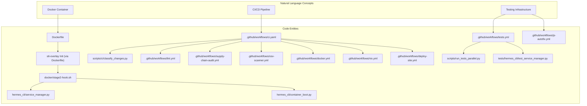

<!-- source: DeepWiki mcp.deepwiki.com · repo nousresearch/hermes-agent · page 14 Infrastructure and CI/CD · fetched 2026-10-26 -->

# Infrastructure and CI/CD

Relevant source files

The following files were used as context for generating this wiki page:

- [.coderabbit.yaml](.coderabbit.yaml)
- [.dockerignore](.dockerignore)
- [.github/actions/check-clean-worktree/action.yml](.github/actions/check-clean-worktree/action.yml)
- [.github/actions/detect-changes/action.yml](.github/actions/detect-changes/action.yml)
- [.github/actions/get-app-token/action.yml](.github/actions/get-app-token/action.yml)
- [.github/actions/nix-setup/action.yml](.github/actions/nix-setup/action.yml)
- [.github/workflows/ci-review-comment.yml](.github/workflows/ci-review-comment.yml)
- [.github/workflows/ci.yaml](.github/workflows/ci.yaml)
- [.github/workflows/contributor-check.yml](.github/workflows/contributor-check.yml)
- [.github/workflows/deploy-site.yml](.github/workflows/deploy-site.yml)
- [.github/workflows/docker-lint.yml](.github/workflows/docker-lint.yml)
- [.github/workflows/docker.yml](.github/workflows/docker.yml)
- [.github/workflows/docs-site-checks.yml](.github/workflows/docs-site-checks.yml)
- [.github/workflows/e2e-desktop.yml](.github/workflows/e2e-desktop.yml)
- [.github/workflows/history-check.yml](.github/workflows/history-check.yml)
- [.github/workflows/js-autofix.yml](.github/workflows/js-autofix.yml)
- [.github/workflows/js-tests.yml](.github/workflows/js-tests.yml)
- [.github/workflows/label-rerun.yml](.github/workflows/label-rerun.yml)
- [.github/workflows/lint.yml](.github/workflows/lint.yml)
- [.github/workflows/live-providers.yml](.github/workflows/live-providers.yml)
- [.github/workflows/lockfile-diff.yml](.github/workflows/lockfile-diff.yml)
- [.github/workflows/nix.yml](.github/workflows/nix.yml)
- [.github/workflows/osv-scanner.yml](.github/workflows/osv-scanner.yml)
- [.github/workflows/skills-index-freshness.yml](.github/workflows/skills-index-freshness.yml)
- [.github/workflows/skills-index.yml](.github/workflows/skills-index.yml)
- [.github/workflows/supply-chain-audit.yml](.github/workflows/supply-chain-audit.yml)
- [.github/workflows/tests-os.yml](.github/workflows/tests-os.yml)
- [.github/workflows/tests.yml](.github/workflows/tests.yml)
- [.github/workflows/uv-lockfile-check.yml](.github/workflows/uv-lockfile-check.yml)
- [.github/workflows/windows-install-update-e2e.yml](.github/workflows/windows-install-update-e2e.yml)
- [.gitignore](.gitignore)
- [.hadolint.yaml](.hadolint.yaml)
- [Dockerfile](Dockerfile)
- [apps/desktop/e2e/visual-snapshot.ts](apps/desktop/e2e/visual-snapshot.ts)
- [contributors/emails/dstkwll@users.noreply.github.com](contributors/emails/dstkwll@users.noreply.github.com)
- [docker-compose.yml](docker-compose.yml)
- [docker/cont-init.d/02-reconcile-profiles](docker/cont-init.d/02-reconcile-profiles)
- [docker/entrypoint-dispatch.sh](docker/entrypoint-dispatch.sh)
- [docker/entrypoint.sh](docker/entrypoint.sh)
- [docker/hermes-exec-shim.sh](docker/hermes-exec-shim.sh)
- [docker/main-wrapper.sh](docker/main-wrapper.sh)
- [docker/s6-rc.d/dashboard/run](docker/s6-rc.d/dashboard/run)
- [docker/stage2-hook.sh](docker/stage2-hook.sh)
- [hermes_cli/container_boot.py](hermes_cli/container_boot.py)
- [hermes_cli/copilot_auth.py](hermes_cli/copilot_auth.py)
- [hermes_cli/dashboard_register.py](hermes_cli/dashboard_register.py)
- [hermes_cli/main_profile_recovery.py](hermes_cli/main_profile_recovery.py)
- [hermes_cli/service_manager.py](hermes_cli/service_manager.py)
- [hermes_time.py](hermes_time.py)
- [registration_lifecycle.py](registration_lifecycle.py)
- [scripts/ci/assemble_review_comment.py](scripts/ci/assemble_review_comment.py)
- [scripts/ci/check_catalog_cors.py](scripts/ci/check_catalog_cors.py)
- [scripts/ci/classify_changes.py](scripts/ci/classify_changes.py)
- [scripts/ci/live_comment.py](scripts/ci/live_comment.py)
- [scripts/ci/timings_report.py](scripts/ci/timings_report.py)
- [scripts/docker_rebootstrap_nous_session.py](scripts/docker_rebootstrap_nous_session.py)
- [setup.py](setup.py)
- [tests/ci/test_assemble_review_comment.py](tests/ci/test_assemble_review_comment.py)
- [tests/ci/test_check_catalog_cors.py](tests/ci/test_check_catalog_cors.py)
- [tests/ci/test_classify_changes.py](tests/ci/test_classify_changes.py)
- [tests/ci/test_clean_worktree_check.py](tests/ci/test_clean_worktree_check.py)
- [tests/ci/test_live_comment.py](tests/ci/test_live_comment.py)
- [tests/ci/test_timings_report.py](tests/ci/test_timings_report.py)
- [tests/ci/test_update_ci_routing.py](tests/ci/test_update_ci_routing.py)
- [tests/ci/test_update_transitive_routing.py](tests/ci/test_update_transitive_routing.py)
- [tests/ci/workflow_steps.py](tests/ci/workflow_steps.py)
- [tests/cron/test_timezone.py](tests/cron/test_timezone.py)
- [tests/dashboard/test_ws_client_host.py](tests/dashboard/test_ws_client_host.py)
- [tests/docker/__init__.py](tests/docker/__init__.py)
- [tests/docker/conftest.py](tests/docker/conftest.py)
- [tests/docker/test_config_migration.py](tests/docker/test_config_migration.py)
- [tests/docker/test_container_restart.py](tests/docker/test_container_restart.py)
- [tests/docker/test_dashboard.py](tests/docker/test_dashboard.py)
- [tests/docker/test_docker_exec_privilege_drop.py](tests/docker/test_docker_exec_privilege_drop.py)
- [tests/docker/test_gateway_bootstrap_state.py](tests/docker/test_gateway_bootstrap_state.py)
- [tests/docker/test_gateway_run_supervised.py](tests/docker/test_gateway_run_supervised.py)
- [tests/docker/test_home_override_scripts.py](tests/docker/test_home_override_scripts.py)
- [tests/docker/test_license_file_present.py](tests/docker/test_license_file_present.py)
- [tests/docker/test_main_invocation.py](tests/docker/test_main_invocation.py)
- [tests/docker/test_profile_gateway.py](tests/docker/test_profile_gateway.py)
- [tests/docker/test_s6_profile_gateway_integration.py](tests/docker/test_s6_profile_gateway_integration.py)
- [tests/docker/test_tui_passthrough.py](tests/docker/test_tui_passthrough.py)
- [tests/docker/test_zombie_reaping.py](tests/docker/test_zombie_reaping.py)
- [tests/hermes_cli/test_apply_profile_override.py](tests/hermes_cli/test_apply_profile_override.py)
- [tests/hermes_cli/test_container_boot.py](tests/hermes_cli/test_container_boot.py)
- [tests/hermes_cli/test_copilot_auth.py](tests/hermes_cli/test_copilot_auth.py)
- [tests/hermes_cli/test_copilot_token_exchange.py](tests/hermes_cli/test_copilot_token_exchange.py)
- [tests/hermes_cli/test_credential_pool_off_loop.py](tests/hermes_cli/test_credential_pool_off_loop.py)
- [tests/hermes_cli/test_dashboard_register.py](tests/hermes_cli/test_dashboard_register.py)
- [tests/hermes_cli/test_doctor_terminal_backends.py](tests/hermes_cli/test_doctor_terminal_backends.py)
- [tests/hermes_cli/test_gateway_s6_dispatch.py](tests/hermes_cli/test_gateway_s6_dispatch.py)
- [tests/hermes_cli/test_profile_export_default_path.py](tests/hermes_cli/test_profile_export_default_path.py)
- [tests/hermes_cli/test_service_manager.py](tests/hermes_cli/test_service_manager.py)
- [tests/hermes_cli/test_setup_terminal.py](tests/hermes_cli/test_setup_terminal.py)
- [tests/hermes_cli/test_terminal_backend_docker_probe.py](tests/hermes_cli/test_terminal_backend_docker_probe.py)
- [tests/hermes_cli/test_update_flat_install_state_gitignore.py](tests/hermes_cli/test_update_flat_install_state_gitignore.py)
- [tests/tools/test_docker_find.py](tests/tools/test_docker_find.py)
- [tests/tools/test_docker_rebootstrap_nous_session.py](tests/tools/test_docker_rebootstrap_nous_session.py)
- [tests/tools/test_stage2_hook_api_server_keygen.py](tests/tools/test_stage2_hook_api_server_keygen.py)
- [tests/tools/test_stage2_hook_nous_routing_env.py](tests/tools/test_stage2_hook_nous_routing_env.py)
- [tests/tools/test_stage2_hook_seed_one_symlinks.py](tests/tools/test_stage2_hook_seed_one_symlinks.py)
- [tests/tools/test_stage2_hook_symlink_chown.py](tests/tools/test_stage2_hook_symlink_chown.py)
- [tests/tui_gateway/test_cold_start_gil_stall.py](tests/tui_gateway/test_cold_start_gil_stall.py)
- [tests/tui_gateway/test_entry_sys_path.py](tests/tui_gateway/test_entry_sys_path.py)
- [tests/tui_gateway/test_subprocess_encoding.py](tests/tui_gateway/test_subprocess_encoding.py)
- [tests/website/test_fetch_plugin_stars.py](tests/website/test_fetch_plugin_stars.py)
- [toolset_distributions.py](toolset_distributions.py)
- [website/docs/user-guide/docker.md](website/docs/user-guide/docker.md)
- [website/i18n/zh-Hans/docusaurus-plugin-content-docs/current/user-guide/docker.md](website/i18n/zh-Hans/docusaurus-plugin-content-docs/current/user-guide/docker.md)
- [website/scripts/fetch-plugin-stars.py](website/scripts/fetch-plugin-stars.py)
- [website/scripts/prebuild.mjs](website/scripts/prebuild.mjs)

The Hermes Agent framework is supported by a comprehensive infrastructure and CI/CD system that ensures robust, portable deployment, secure and reproducible builds, and thorough automated testing. This infrastructure integrates container technology, Nix-based packaging, GitHub Actions workflows, and parallel test execution to maintain high code quality and streamline release management.

The infrastructure components work synergistically to enable reliable lifecycle management for the AI agent framework across diverse environments and release scenarios. The resulting system supports Hermes' core capabilities such as skill self-improvement, environment orchestration, and process supervision, while safeguarding supply chain integrity and test isolation.

---

## 14.1 Docker Deployment

Hermes Agent is primarily containerized using Docker with a sophisticated multi-stage build process. A dedicated build stage compiles a pinned SQLite shared library version to avoid upstream WAL-reset corruption bugs present in Debian 13 base images. This custom SQLite library is preferred at runtime to ensure stable and bug-free database operations [Dockerfile:1-43]().

The runtime container employs `s6-overlay` as the init system (PID 1) to provide reliable UNIX signal handling, zombie process reaping, and supervision of multiple Hermes services, including the main agent, the dashboard service, and per-profile gateways. Environment variables like `PYTHONUNBUFFERED=1` and `PLAYWRIGHT_BROWSERS_PATH` are configured for correct Python logging behavior and chromium integration support [Dockerfile:49-61]().

A key bootstrap step inside the container is the `docker/stage2-hook.sh` script. Executed by s6-overlay after the supervision tree is live but before user services start, it performs UID/GID remapping of the built-in `hermes` user according to container environment variables (`HERMES_UID`/`HERMES_GID` or their aliases). This approach replaces the unsupported practice of launching containers with arbitrary `--user` flags, which break s6-overlay supervision and volume permission management. The script also handles ownership corrections on mounted volumes, config seeding, and skills synchronization [docker/stage2-hook.sh:1-18](), [docker/stage2-hook.sh:26-140]().

Service management inside the container leverages `hermes_cli/service_manager.py`, which abstracts lifecycle operations over a `ServiceManager` protocol supporting systemd, launchd, Windows services, and crucially, the s6 service manager used internally by the container. It validates profile naming (which maps to s6 service directories) and supports starting, stopping, restarting, and dynamic registration/unregistration of per-profile gateway services under s6 supervision [hermes_cli/service_manager.py:22-99]().

Additionally, `hermes_cli/container_boot.py` implements reconciliation logic that runs on container startup to restore and align s6 per-profile gateway services with the persistent profile configurations. This ensures container restarts cleanly restore prior service states and operator intent [hermes_cli/container_boot.py:1-15]().

Local development environments may use `docker-compose.yml` files to orchestrate multi-container setups, enabling hosted gateway services alongside other infrastructure components in development iterations.

Together, these components establish a robust container deployment environment tailored for Hermes Agent's complex multi-profile gateway architecture, with emphasis on stable dependencies, permissions correctness, and resilient runtime supervision.

For in-depth details on the Docker image build, init system integration, stage2 hook logic, multi-container management, and in-container lifecycle control, see the child page [Docker Deployment](#14.1).

Sources:
[Dockerfile:1-43](), [Dockerfile:49-61](), [docker/stage2-hook.sh:1-18](), [docker/stage2-hook.sh:26-140](), [hermes_cli/service_manager.py:22-99](), [hermes_cli/container_boot.py:1-15]()

---

## 14.2 CI/CD and Release Management

Hermes maintains a sophisticated CI/CD pipeline orchestrated primarily via GitHub Actions workflows, ensuring reliable build/test automation, auditability, and streamlined release management.

Key aspects of the CI/CD system include:

- **Linting and Typing:** The `.github/workflows/lint.yml` workflow runs `ruff` and `ty` to perform Python code linting and static typing checks, enforcing code style and correctness. It provides advisory diffs on PRs and blocking enforcement in merges, alongside specialized checks for Windows environment, portable bash shebangs, and large file detection [.github/workflows/lint.yml:1-169]().

- **Supply Chain Security Audits:** A dedicated audit workflow scans PR diffs for risky supply chains signals like `.pth` files with suspicious entries and runtime `eval` payload injections, guarding against supply chain attacks [.github/workflows/supply-chain-audit.yml]().

- **OSV Vulnerability Scanning:** Periodic scans against the OSV vulnerability database are run via `.github/workflows/osv-scanner.yml` to flag known CVEs in dependencies, providing security advisories without blocking merges [.github/workflows/osv-scanner.yml]().

- **Docker Build, Test, and Publish:** The `.github/workflows/docker.yml` workflow supports multi-architecture Docker image builds, leveraging caching strategies and running integration tests inside containers. It distinguishes build-only and publish phases for stable releases and handles manifest creation for multi-arch images. Build triggers respond to classification of relevant file changes and release tags [.github/workflows/docker.yml]().

- **Test Runner Pipelines:** The `.github/workflows/tests.yml` runs the Python test suite in parallel slices with hermetic environment isolation and several concurrency options. It intelligently selects whether to run expensive end-to-end tests based on code change classification. It also restores test duration caches to optimize flaky test detection [.github/workflows/tests.yml:1-145]().

- **JavaScript/TypeScript Test and Lint:** JS/TS tests and lint fixes are orchestrated via `.github/workflows/js-autofix.yml`, which installs Node.js 26, caches dependencies, runs `vitest` test suites in parallel, ESLint, and TypeScript checks.

- **Contributor Metadata and Audit:** Contributor compliance with metadata guidelines is enforced by a dedicated workflow [.github/workflows/contributor-check.yml]().

- **Nix Packaging and Flake Building:** The `.github/workflows/nix.yml` workflow builds and verifies the Nix flake packages, dev shells, and runs an extensive suite of static checks to guarantee reproducible builds across development and deployment environments [.github/workflows/nix.yml]().

- **Release Automation:** Releases rely on `scripts/release.py`, a Python-based CalVer release utility that claims attempts, manages stable and canary tags, and interacts with GitHub Releases and Actions to publish artifacts and Docker images. The release entrypoint script enforces safe version incrementing and integrates tightly with the stable release workflow [.github/workflows/deploy-site.yml](). The full operational flow is documented in the developer guide.

### CI/CD Workflow Integration Diagram

```mermaid
graph TD

  subgraph "Code Changes"
    Commit[("Code Commit / PR")]
  end

  subgraph "GitHub Actions Orchestration"
    CI_YAML[.github/workflows/ci.yaml]
    DETECT_CHANGES[scripts/ci/classify_changes.py]
  end

  subgraph "Sub-Workflows (Triggered by ci.yaml)"
    LINT_WF[.github/workflows/lint.yml]
    SUPPLY_CHAIN_WF[.github/workflows/supply-chain-audit.yml]
    OSV_SCAN_WF[.github/workflows/osv-scanner.yml]
    DOCKER_WF[.github/workflows/docker.yml]
    NIX_WF[.github/workflows/nix.yml]
    TESTS_WF[.github/workflows/tests.yml]
    JS_TESTS_WF[.github/workflows/js-autofix.yml]
    CONTRIBUTOR_WF[.github/workflows/contributor-check.yml]
    DEPLOY_SITE_WF[.github/workflows/deploy-site.yml]
  end

  subgraph "Release Management"
    RELEASE_SCRIPT[scripts/release.py]
    DOCKER_PUBLISH["Docker Image Publish"]
    PYPI_PUBLISH["PyPI Package Upload"]
    SITE_DEPLOY["Website Deployment"]
  end

  Commit --> CI_YAML
  CI_YAML --> DETECT_CHANGES
  DETECT_CHANGES -- "Outputs: python, docker, nix, e2e, etc." --> CI_YAML

  CI_YAML -- "if: detect.outputs.python == 'true'" --> LINT_WF
  CI_YAML -- "if: detect.outputs.scan == 'true'" --> SUPPLY_CHAIN_WF
  CI_YAML -- "if: detect.outputs.scan == 'true'" --> OSV_SCAN_WF
  CI_YAML -- "if: detect.outputs.docker == 'true'" --> DOCKER_WF
  CI_YAML -- "if: detect.outputs.nix == 'true'" --> NIX_WF
  CI_YAML -- "if: detect.outputs.python == 'true'" --> TESTS_WF
  CI_YAML -- "if: detect.outputs.frontend == 'true'" --> JS_TESTS_WF
  CI_YAML -- "if: detect.outputs.contributor == 'true'" --> CONTRIBUTOR_WF
  CI_YAML -- "if: detect.outputs.site == 'true'" --> DEPLOY_SITE_WF

  LINT_WF --> RELEASE_SCRIPT
  SUPPLY_CHAIN_WF --> RELEASE_SCRIPT
  OSV_SCAN_WF --> RELEASE_SCRIPT
  TESTS_WF --> RELEASE_SCRIPT
  CONTRIBUTOR_WF --> RELEASE_SCRIPT

  RELEASE_SCRIPT --> DOCKER_PUBLISH
  RELEASE_SCRIPT --> PYPI_PUBLISH
  DEPLOY_SITE_WF --> SITE_DEPLOY

  DOCKER_WF --> DOCKER_PUBLISH
  NIX_WF --> PYPI_PUBLISH
```

For detailed explanations of each workflow, the release script internals, the use of calendar versioning (CalVer), and the update rollout process, see the child page [CI/CD and Release Management](#14.2).

Sources:
[.github/workflows/lint.yml:1-169](), [.github/workflows/supply-chain-audit.yml](), [.github/workflows/osv-scanner.yml](), [.github/workflows/docker.yml](), [.github/workflows/tests.yml:1-145](), [.github/workflows/js-autofix.yml](), [.github/workflows/contributor-check.yml](), [.github/workflows/nix.yml](), [.github/workflows/deploy-site.yml](), [scripts/ci/classify_changes.py:1-78]()

---

## 14.3 Testing Infrastructure

Hermes' testing infrastructure supports both Python and JavaScript/TypeScript codebases with rigorous isolation and performance optimization.

- The Python test suite is housed mainly under `tests/`, while JS/TS tests reside in `tests-js/`.
- The `tests/conftest.py` module enforces hermetic testing conditions by clearing credential environment variables, sandboxing `HERMES_HOME` to temporary directories per-test, setting deterministic environment variables (e.g., locale, timezone), and sanitizing subprocess environments to prevent session state leakage or shared state bleeding between tests [tests/conftest.py:1-143]().
- Each Python test file runs in an isolated Python subprocess to avoid global state interference caused by module imports or side effects.
- The custom parallel test runner script `scripts/run_tests_parallel.py` orchestrates parallel execution of these subprocesses, bounding concurrency to available CPU cores and ensuring efficient utilization without collisions [scripts/run_tests_parallel.py:1-147]().
- The `tests.yml` GitHub Actions workflow configures concurrency, restores cached test duration data to improve rerun prioritization, and selectively runs long end-to-end (e2e) tests and upgrade scenarios based on changed files [.github/workflows/tests.yml:87-111]().
- JS/TS tests are managed separately in their own GitHub workflow (`js-autofix.yml`) which installs the Node.js environment, caches dependencies fully, and runs `vitest`, ESLint, and TypeScript checks in parallel.
- The test environment ensures reproducible, side-effect-free runs, critical for a complex agent framework with persistent session artifacts and diverse stateful components.

For detailed documentation of test suite layout, hermetic fixtures, parallel runner scripts, e2e harnesses, integration with JS/TS tests, and concurrency setup, refer to the child page [Testing Infrastructure](#14.3).

Sources:
[.github/workflows/tests.yml:87-111](), [tests/conftest.py:1-143](), [scripts/run_tests_parallel.py:1-147](), [.github/workflows/js-autofix.yml](), [tests/hermes_cli/test_service_manager.py:70-105]()

---

## Code to Entity Mapping: Natural Language to Code Entities

This diagram bridges key infrastructure concepts to their code artifacts, connecting both deployment and CI/CD components to their implementation files and scripts.

---

# Summary

Hermes Agent’s infrastructure and CI/CD system cohesively enable:

- **Portable and robust container deployment** using Docker with `s6-overlay` supervision, UID/GID mapping, and internal service management.

- **Strong CI/CD automation** via GitHub Actions with reproducible `uv`-based dependency installs, supply-chain and security scanning, linting and typing enforcement, container build/test pipelines, and release scripting with CalVer tagging.

- **Reliable and hermetic test execution** with per-file isolation, parallel subprocess orchestration for Python tests, JS/TS checks, and integrated caching for speeding up repeat runs.

For in-depth architecture, implementation details, configuration, and usage of these systems, follow the linked child pages:

- [Docker Deployment](#14.1)
- [CI/CD and Release Management](#14.2)
- [Testing Infrastructure](#14.3)

---

Sources:
[Dockerfile:1-43](), [Dockerfile:49-61](), [docker/stage2-hook.sh:1-18](), [docker/stage2-hook.sh:26-140](), [hermes_cli/service_manager.py:22-99](), [hermes_cli/container_boot.py:1-15](),
[.github/workflows/lint.yml:1-169](), [.github/workflows/supply-chain-audit.yml](), [.github/workflows/osv-scanner.yml](), [.github/workflows/docker.yml](), [.github/workflows/tests.yml:1-145](), [.github/workflows/js-autofix.yml](), [.github/workflows/contributor-check.yml](), [.github/workflows/nix.yml](), [.github/workflows/deploy-site.yml](),
[.github/workflows/tests.yml:87-111](), [tests/conftest.py:1-143](), [scripts/run_tests_parallel.py:1-147](), [tests/hermes_cli/test_service_manager.py:70-105](), [.github/workflows/js-autofix.yml]()

---

