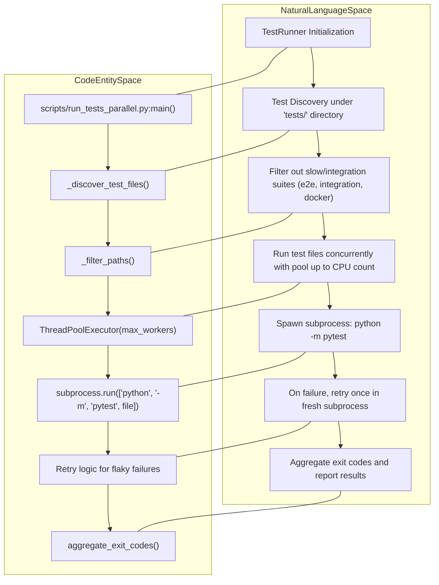
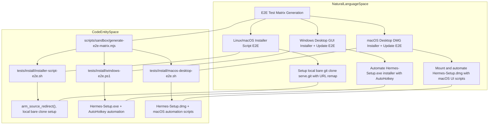
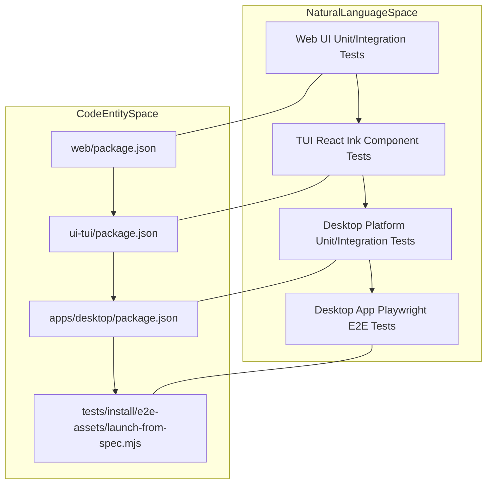

<!-- source: DeepWiki mcp.deepwiki.com · repo nousresearch/hermes-agent · page 14.3 Testing Infrastructure · fetched 2026-10-26 -->

# Testing Infrastructure

Relevant source files

The following files were used as context for generating this wiki page:

- [.github/workflows/install-e2e-macos-run.yml](.github/workflows/install-e2e-macos-run.yml)
- [.github/workflows/install-e2e-run.yml](.github/workflows/install-e2e-run.yml)
- [.github/workflows/install-e2e-windows-run.yml](.github/workflows/install-e2e-windows-run.yml)
- [.github/workflows/install-e2e.yml](.github/workflows/install-e2e.yml)
- [.npmrc](.npmrc)
- [apps/bootstrap-installer/package.json](apps/bootstrap-installer/package.json)
- [apps/desktop/e2e/window-input.unit.test.ts](apps/desktop/e2e/window-input.unit.test.ts)
- [apps/desktop/electron/updater/index.ts](apps/desktop/electron/updater/index.ts)
- [apps/desktop/package.json](apps/desktop/package.json)
- [apps/desktop/src/app/settings/about-settings.test.tsx](apps/desktop/src/app/settings/about-settings.test.tsx)
- [apps/desktop/update-feed.d.cts](apps/desktop/update-feed.d.cts)
- [apps/shared/package.json](apps/shared/package.json)
- [apps/shared/src/index.ts](apps/shared/src/index.ts)
- [apps/shared/src/skill-scaffold.test.ts](apps/shared/src/skill-scaffold.test.ts)
- [apps/shared/src/skill-scaffold.ts](apps/shared/src/skill-scaffold.ts)
- [gateway/browser_control_artifacts.py](gateway/browser_control_artifacts.py)
- [gateway/browser_control_broker.py](gateway/browser_control_broker.py)
- [hermes_cli/subcommands/_shared.py](hermes_cli/subcommands/_shared.py)
- [hermes_cli/subcommands/peer.py](hermes_cli/subcommands/peer.py)
- [lefthook.yml](lefthook.yml)
- [package-lock.json](package-lock.json)
- [package.json](package.json)
- [ruff.pre-commit.toml](ruff.pre-commit.toml)
- [ruff.toml](ruff.toml)
- [scripts/run_tests.sh](scripts/run_tests.sh)
- [scripts/run_tests_parallel.py](scripts/run_tests_parallel.py)
- [scripts/sandbox/generate-e2e-matrix.mjs](scripts/sandbox/generate-e2e-matrix.mjs)
- [scripts/whatsapp-bridge/package-lock.json](scripts/whatsapp-bridge/package-lock.json)
- [scripts/whatsapp-bridge/package.json](scripts/whatsapp-bridge/package.json)
- [tests-js/e2e-matrix-route.test.ts](tests-js/e2e-matrix-route.test.ts)
- [tests-js/install-process-close.test.ts](tests-js/install-process-close.test.ts)
- [tests-js/package.json](tests-js/package.json)
- [tests-js/scripts/launch-from-spec.test.ts](tests-js/scripts/launch-from-spec.test.ts)
- [tests-js/update-ui.test.mjs](tests-js/update-ui.test.mjs)
- [tests/agent/test_phantom_tool_references.py](tests/agent/test_phantom_tool_references.py)
- [tests/ci/test_strict_ruff_target.py](tests/ci/test_strict_ruff_target.py)
- [tests/conftest.py](tests/conftest.py)
- [tests/gateway/test_browser_control_api.py](tests/gateway/test_browser_control_api.py)
- [tests/gateway/test_browser_control_artifacts.py](tests/gateway/test_browser_control_artifacts.py)
- [tests/gateway/test_browser_control_broker.py](tests/gateway/test_browser_control_broker.py)
- [tests/gateway/test_browser_control_broker_hardening.py](tests/gateway/test_browser_control_broker_hardening.py)
- [tests/gateway/test_browser_control_cloud.py](tests/gateway/test_browser_control_cloud.py)
- [tests/gateway/test_peer_dm_bot_chat_authority.py](tests/gateway/test_peer_dm_bot_chat_authority.py)
- [tests/gateway/test_peer_dm_hidden_e2e.py](tests/gateway/test_peer_dm_hidden_e2e.py)
- [tests/gateway/test_peer_dm_into_open_bot_chat.py](tests/gateway/test_peer_dm_into_open_bot_chat.py)
- [tests/hermes_cli/test_peer_cmd.py](tests/hermes_cli/test_peer_cmd.py)
- [tests/hermes_cli/test_peer_dm_reporting.py](tests/hermes_cli/test_peer_dm_reporting.py)
- [tests/hermes_cli/test_reasoning_effort_menu.py](tests/hermes_cli/test_reasoning_effort_menu.py)
- [tests/install/README.md](tests/install/README.md)
- [tests/install/e2e-assets/drive-dmg-install.sh](tests/install/e2e-assets/drive-dmg-install.sh)
- [tests/install/e2e-assets/drive-update.cjs](tests/install/e2e-assets/drive-update.cjs)
- [tests/install/e2e-assets/install-and-launch.ahk](tests/install/e2e-assets/install-and-launch.ahk)
- [tests/install/e2e-assets/install-button.png](tests/install/e2e-assets/install-button.png)
- [tests/install/e2e-assets/launch-button.png](tests/install/e2e-assets/launch-button.png)
- [tests/install/e2e-assets/launch-from-spec.mjs](tests/install/e2e-assets/launch-from-spec.mjs)
- [tests/install/e2e-assets/playback.html](tests/install/e2e-assets/playback.html)
- [tests/install/e2e-assets/process-close.cjs](tests/install/e2e-assets/process-close.cjs)
- [tests/install/e2e-assets/pty-run.py](tests/install/e2e-assets/pty-run.py)
- [tests/install/e2e-assets/smoke-env.d.mts](tests/install/e2e-assets/smoke-env.d.mts)
- [tests/install/e2e-assets/smoke-env.mjs](tests/install/e2e-assets/smoke-env.mjs)
- [tests/install/e2e-assets/source-branch-probe.cjs](tests/install/e2e-assets/source-branch-probe.cjs)
- [tests/install/e2e-assets/source-driver.sh](tests/install/e2e-assets/source-driver.sh)
- [tests/install/e2e-assets/ts-prefix.ps1](tests/install/e2e-assets/ts-prefix.ps1)
- [tests/install/e2e-assets/ts-prefix.sh](tests/install/e2e-assets/ts-prefix.sh)
- [tests/install/e2e-assets/update-ui.cjs](tests/install/e2e-assets/update-ui.cjs)
- [tests/install/e2e-assets/window-input.cjs](tests/install/e2e-assets/window-input.cjs)
- [tests/install/installer-script-e2e.sh](tests/install/installer-script-e2e.sh)
- [tests/install/macos-desktop-e2e.sh](tests/install/macos-desktop-e2e.sh)
- [tests/install/windows-e2e.ps1](tests/install/windows-e2e.ps1)
- [tests/scripts/install/test_dmg_install_driver.py](tests/scripts/install/test_dmg_install_driver.py)
- [tests/scripts/install/test_install_ps1_native_calls.py](tests/scripts/install/test_install_ps1_native_calls.py)
- [tests/scripts/test_run_tests_parallel.py](tests/scripts/test_run_tests_parallel.py)
- [tests/scripts/test_source_driver.py](tests/scripts/test_source_driver.py)
- [tests/test_basetemp_isolation.py](tests/test_basetemp_isolation.py)
- [tests/tools/test_browser_cdp_tool.py](tests/tools/test_browser_cdp_tool.py)
- [tests/tools/test_browser_extension_router.py](tests/tools/test_browser_extension_router.py)
- [tests/tools/test_browser_extension_router_wiring.py](tests/tools/test_browser_extension_router_wiring.py)
- [tests/tools/test_browser_hardening.py](tests/tools/test_browser_hardening.py)
- [tests/tools/test_browser_headed_mode.py](tests/tools/test_browser_headed_mode.py)
- [tests/tools/test_browser_hybrid_routing.py](tests/tools/test_browser_hybrid_routing.py)
- [tests/tools/test_browser_open_timeout.py](tests/tools/test_browser_open_timeout.py)
- [tests/tools/test_browser_supervisor.py](tests/tools/test_browser_supervisor.py)
- [tests/tools/test_browser_supervisor_capture.py](tests/tools/test_browser_supervisor_capture.py)
- [tests/tools/test_browser_supervisor_capture_dispatch.py](tests/tools/test_browser_supervisor_capture_dispatch.py)
- [tests/tools/test_browser_supervisor_reconnect.py](tests/tools/test_browser_supervisor_reconnect.py)
- [tests/tools/test_model_tools.py](tests/tools/test_model_tools.py)
- [tools/browser_cdp_tool.py](tools/browser_cdp_tool.py)
- [tools/browser_dialog_tool.py](tools/browser_dialog_tool.py)
- [tools/browser_extension_router.py](tools/browser_extension_router.py)
- [tools/browser_supervisor.py](tools/browser_supervisor.py)
- [tools/browser_supervisor_capture.py](tools/browser_supervisor_capture.py)
- [tools/browser_supervisor_dialogs.py](tools/browser_supervisor_dialogs.py)
- [tools/browser_supervisor_frames.py](tools/browser_supervisor_frames.py)
- [tui_gateway/methods_browser_control.py](tui_gateway/methods_browser_control.py)
- [ui-tui/package.json](ui-tui/package.json)
- [ui-tui/packages/hermes-ink/ambient.d.ts](ui-tui/packages/hermes-ink/ambient.d.ts)
- [ui-tui/packages/hermes-ink/index.js](ui-tui/packages/hermes-ink/index.js)
- [ui-tui/packages/hermes-ink/package.json](ui-tui/packages/hermes-ink/package.json)
- [web/package.json](web/package.json)
- [website/.npmrc](website/.npmrc)
- [website/docs/developer-guide/browser-supervisor.md](website/docs/developer-guide/browser-supervisor.md)
- [website/docusaurus.config.ts](website/docusaurus.config.ts)
- [website/package-lock.json](website/package-lock.json)
- [website/package.json](website/package.json)
- [website/src/components/PluginCatalog/pages.module.css](website/src/components/PluginCatalog/pages.module.css)
- [website/src/css/custom.css](website/src/css/custom.css)

This page details the testing infrastructure of the Hermes Agent codebase, covering the layout of test suites, hermetic side-effect guards, parallel test runner scripts, conformance and performance guard suites, install E2E harnesses, and the JavaScript/TypeScript test setups for the web, TUI, and desktop applications.

---

## Test Suite Layout

The Hermes Agent project organizes its tests into structured top-level directories separating backend Python logic from frontend JavaScript/TypeScript components:

| Directory | Scope |
|---|---|
| `tests/` | Python-based tests for core agent, CLI (`hermes_cli/`), gateway (`gateway/`), tools, and backend subsystems [scripts/run_tests_parallel.py:60](). |
| `tests-js/` | JavaScript/TypeScript unit and integration tests for shared frontend utilities and mock servers [package.json:11](). |
| `apps/desktop/e2e/` | Playwright end-to-end (E2E) tests targeting the Electron desktop application runtime [apps/desktop/package.json:75](). |
| `web/` | Vitest unit tests for the full-featured web application dashboard UI [web/package.json:14](). |
| `ui-tui/` | Vitest unit tests for the Terminal User Interface renderer package (`hermes-ink`) [package.json:10](). |

This separation ensures clear boundaries between backend and frontend testing responsibility, and facilitates suitable testing stacks per environment.

Sources: [scripts/run_tests_parallel.py:60](), [package.json:10-11](), [apps/desktop/package.json:75](), [web/package.json:14]()

---

## Python Test Runner and Hermetic Guards

### Parallel Test Runner (`scripts/run_tests_parallel.py`)

Hermes employs a custom parallel test runner as a minimum-viable replacement for `pytest-xdist` to guarantee greater isolation and stability:

- **Per-File Subprocess Isolation**: Each test file is executed as a separate Python process running `python -m pytest <file>`. This avoids cross-file module-level state leakage, which was a frequent source of flaky tests. Although spawning a subprocess per file adds startup overhead (~250ms per file), the approach remains viable given ~850 test files [scripts/run_tests_parallel.py:4-16]().

- **Bounded Parallelism**: Concurrency is restricted by a thread pool with the worker count defaulting to the host CPU count (`os.cpu_count()`), configurable via `HERMES_TEST_WORKERS`. This maximizes resource usage while preventing exhaustion or contention [scripts/run_tests_parallel.py:37](), [scripts/run_tests_parallel.py:136-138]().

- **Test Discovery and Filtering**: Tests are discovered recursively under the `tests/` directory by default. Slices or filters exclude slow, integration, or environment-intensive suites (like `tests/e2e/`, `tests/integration/`, and `tests/docker/`), which run in isolated dedicated CI jobs [scripts/run_tests_parallel.py:114-132]().

- **File-Level Timeout & Flaky Retrying**: Each test file gets a wall-clock timeout (default 300 seconds) to accommodate Python interpreter start and import overhead. If a test file fails initially, it is retried once in a fresh subprocess. Passing on retry marks the file as flaky but overall passing, so transient flakes don’t cause a whole suite failure [scripts/run_tests_parallel.py:135-151]().

- **Temporary Directory Management**: The runner creates disk-backed temporary directories (commonly under `/var/tmp/hermes-pytest-<uid>` on Linux) to avoid issues with RAM-backed `/tmp` and impose stable socket path lengths, crucial for tests using Unix sockets [scripts/run_tests_parallel.py:90-109]().

- **Duration Cache**: Per-file test duration data is cached in a JSON file (`test_durations.json`) to improve timeout scaling and parallel splitting strategies in CI [scripts/run_tests_parallel.py:82-103]().

*Diagram: Bridging Parallel Test Runner Concepts to Key Code Entities*

Sources: [scripts/run_tests_parallel.py:1-148]()

---

### Hermetic Side-Effect Guards (`tests/conftest.py`)

The file `tests/conftest.py` configures deep hermetic isolation for the tests, enforcing several crucial invariants:

- **Credential Environment Variable Scrubbing**: All environment variables matching credential-like patterns (`*_API_KEY`, `*_TOKEN`, `*_SECRET`, etc.) are unset before each test. This prevents accidental leakage of real credentials during tests [tests/conftest.py:5-7]().

- **Isolated `HERMES_HOME` and Temp Directories**: The `HERMES_HOME` environment variable and the platform-default Hermes root directory (e.g., `~/.hermes` on Unix, `%LOCALAPPDATA%\hermes` on Windows) are sandboxed within uniquely generated temporary directories for each test. This prevents interference with the developer's or CI's actual agent home, including logs, state databases, and caches [tests/conftest.py:8-11](), [tests/conftest.py:48-144]().

- **Deterministic Runtime Environment**: The environment is fixed to timezone UTC (`TZ=UTC`), locale `C.UTF-8`, and deterministic hashing seed (`PYTHONHASHSEED=0`) to remove nondeterministic variability and locale dependencies from test outcomes [tests/conftest.py:12-14]().

- **Session Environment Sanitization**: All `HERMES_SESSION_*` environment variables, which would expose state from previous gateway sessions, are cleared to ensure no session state leaks into test runs [tests/conftest.py:13-14]().

- **Early Logging Handler Isolation**: `conftest.py` executes early to override `HERMES_HOME` before any module imports attach logging handlers, preventing test logs from polluting real user agent logs under `~/.hermes/logs`. This silences test noise from production logs [tests/conftest.py:48-72]().

- **Test Invariant Enforcement**: These guards enforce invariants that make tests hermetic and consistent across local and CI environments, matching the rationale detailed in the project's AGENTS.md.

Sources: [tests/conftest.py:1-144]()

---

## Conformance, Performance Guards, and Install E2E Harnesses

### Install/Update End-to-End (E2E) Harnesses

Hermes testing includes multi-platform install and update end-to-end (E2E) tests verifying upgrade paths through authentic user flows:

| Platform | Driver Script | Purpose |
|---|---|---|
| Linux/macOS | `tests/install/installer-script-e2e.sh` | Runs real shell installer scripts with a staged bare Git clone (`serve.git`) using URL rewrite to simulate real-world installs and updates without network interference [tests/install/installer-script-e2e.sh:2-26](). |
| Windows | `tests/install/windows-e2e.ps1` | Automates GUI installation of the real `Hermes-Setup.exe` installer using AutoHotkey clicks, runs update flows via the app’s Settings UI button, testing the whole update and relaunch chain [tests/install/windows-e2e.ps1:2-31](). |
| macOS Desktop | `tests/install/macos-desktop-e2e.sh` | Mounts and runs the official DMG installer with UI automation to verify install and update flows. |

These harnesses rely on a local bare Git clone of the repository (`serve.git`) with the Git URL remapped locally using `url.<file://serve.git>.insteadOf`. This avoids network dependencies and ensures stable, deterministic test environments for install/update workflows [tests/install/windows-e2e.ps1:32-44](), [tests/install/installer-script-e2e.sh:6-13]().

### Install/Update Test Matrix Generation

The combinatorial matrix for install/update E2E tests is generated from a canonical source of truth script:

- `scripts/sandbox/generate-e2e-matrix.mjs` creates the matrix of OSes, install methods, and update methods, which the CI workflows consume to run appropriate E2E legs per platform and release tag.

This design enables one centralized specification of E2E test coverage across platforms and upgrade paths, neatly scaling CI workflow configurations [scripts/sandbox/generate-e2e-matrix.mjs:1-128](), [.github/workflows/install-e2e.yml:1-146]().

*Diagram: Bridging Deploy Install E2E Concepts to Automation Drivers*

Sources: [tests/install/windows-e2e.ps1:1-119](), [tests/install/installer-script-e2e.sh:1-120](), [scripts/sandbox/generate-e2e-matrix.mjs:1-128](), [.github/workflows/install-e2e.yml:1-146]()

---

## JavaScript/TypeScript Test Setups

### Web and TUI

- The **Web** application uses Vitest for unit and integration testing of its React dashboard UI and frontend codebases, configured in `web/package.json` [web/package.json:14]().

- The **Terminal User Interface (TUI)** (`ui-tui/`) also uses Vitest for testing React Ink components (`hermes-ink`), maintaining live feedback and integration flows customary in modern JS/TS test environments [package.json:10]().

### Desktop Application

- The **Electron Desktop application** (`apps/desktop/`) contains tests in two categories:

  - Unit and integration tests for application modules, defined in `apps/desktop/package.json` [apps/desktop/package.json:65-66]().
  
  - End-to-end Playwright tests under `apps/desktop/e2e/`, which exercise the actual desktop runtime environment in headed or headless modes. These tests enable UI automation, visual snapshot comparisons, and reproducible scenarios driven by recorded launch specifications ([tests/install/e2e-assets/launch-from-spec.mjs:1-81]()).

*Diagram: Bridging JS/TS Testing Frameworks to Package Script Entities*

Sources: [tests/install/e2e-assets/launch-from-spec.mjs:1-81](), [web/package.json:14](), [apps/desktop/package.json:65-66](), [package.json:10]()

---

# Summary

The Hermes Agent testing infrastructure is designed for maximal reliability and isolation through:

- Granular per-file parallelism via subprocess isolation, eliminating cross-test state leakage [scripts/run_tests_parallel.py:4-16]().

- Hermetic environment configuration and side-effect guards that remove credential leakage and contamination with real user files during tests [tests/conftest.py:1-144]().

- Multi-language layered test setups accommodating both backend Python and frontend JS/TS codebases with framework-appropriate tooling.

- Comprehensive install/update end-to-end runners simulating authentic user workflows on Linux, macOS, and Windows, coordinated by matrix-driven CI workflows [tests/install/windows-e2e.ps1:2-31](), [tests/install/installer-script-e2e.sh:2-26]().

- Custom parallel test runner balancing high concurrency, flaky retry resilience, and deterministic test execution order for fast, stable CI runs [scripts/run_tests_parallel.py:37-103]().

These design choices ensure scalable, fast, and safe testing environments for local dev and CI usage.

---

# Appendix: Key File References

| Topic | File Reference |
|---|---|
| Parallel test runner script | `scripts/run_tests_parallel.py` |
| Test environment guards | `tests/conftest.py` |
| Windows Install E2E driver | `tests/install/windows-e2e.ps1` |
| POSIX Install E2E driver | `tests/install/installer-script-e2e.sh` |
| E2E Matrix Generator | `scripts/sandbox/generate-e2e-matrix.mjs` |
| Desktop E2E Launch Spec | `tests/install/e2e-assets/launch-from-spec.mjs` |

---

# END OF PAGE

---

