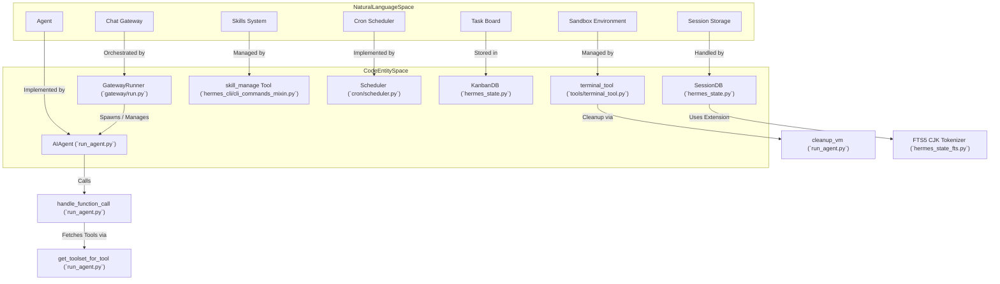
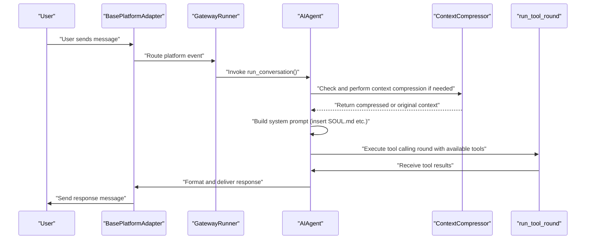

<!-- source: DeepWiki mcp.deepwiki.com · repo nousresearch/hermes-agent · page 15 Glossary · fetched 2026-10-26 -->

# Glossary

Relevant source files

The following files were used as context for generating this wiki page:

- [agent/auxiliary_client.py](agent/auxiliary_client.py)
- [agent/onboarding_facts.py](agent/onboarding_facts.py)
- [agent/onboarding_first_tasks.py](agent/onboarding_first_tasks.py)
- [agent/onboarding_flow.py](agent/onboarding_flow.py)
- [agent/onboarding_record.py](agent/onboarding_record.py)
- [agent/onboarding_text.py](agent/onboarding_text.py)
- [agent/plugin_live_notes.py](agent/plugin_live_notes.py)
- [apps/desktop/src/app/capabilities/plugins/plugins-tab.test.tsx](apps/desktop/src/app/capabilities/plugins/plugins-tab.test.tsx)
- [apps/desktop/src/app/capabilities/plugins/plugins-tab.tsx](apps/desktop/src/app/capabilities/plugins/plugins-tab.tsx)
- [apps/desktop/src/app/session/hooks/use-prompt-actions/upload-composer-attachment.test.ts](apps/desktop/src/app/session/hooks/use-prompt-actions/upload-composer-attachment.test.ts)
- [apps/desktop/src/app/settings/plugin-install-modal.test.tsx](apps/desktop/src/app/settings/plugin-install-modal.test.tsx)
- [apps/desktop/src/app/settings/plugin-install-modal.tsx](apps/desktop/src/app/settings/plugin-install-modal.tsx)
- [apps/desktop/src/store/agent-plugins.ts](apps/desktop/src/store/agent-plugins.ts)
- [apps/shared/src/gateway-contract.generated.ts](apps/shared/src/gateway-contract.generated.ts)
- [apps/shared/src/gateway-contract.openrpc.json](apps/shared/src/gateway-contract.openrpc.json)
- [cli-config.yaml.example](cli-config.yaml.example)
- [cli.py](cli.py)
- [gateway/run.py](gateway/run.py)
- [gateway/session.py](gateway/session.py)
- [gateway/slash_commands.py](gateway/slash_commands.py)
- [hermes_cli/cli_commands_mixin.py](hermes_cli/cli_commands_mixin.py)
- [hermes_cli/cli_process_dock.py](hermes_cli/cli_process_dock.py)
- [hermes_cli/commands.py](hermes_cli/commands.py)
- [hermes_cli/config.py](hermes_cli/config.py)
- [hermes_cli/config_defaults.py](hermes_cli/config_defaults.py)
- [hermes_cli/config_migrations.py](hermes_cli/config_migrations.py)
- [hermes_cli/config_version_stamp.py](hermes_cli/config_version_stamp.py)
- [hermes_cli/main.py](hermes_cli/main.py)
- [hermes_cli/plugin_catalog_presence.py](hermes_cli/plugin_catalog_presence.py)
- [hermes_cli/plugins_activation.py](hermes_cli/plugins_activation.py)
- [hermes_cli/plugins_activation_live.py](hermes_cli/plugins_activation_live.py)
- [hermes_cli/setup.py](hermes_cli/setup.py)
- [hermes_constants.py](hermes_constants.py)
- [hermes_constants_scratch.py](hermes_constants_scratch.py)
- [hermes_state.py](hermes_state.py)
- [run_agent.py](run_agent.py)
- [scripts/docker_config_migrate.py](scripts/docker_config_migrate.py)
- [tests/agent/test_auxiliary_client.py](tests/agent/test_auxiliary_client.py)
- [tests/agent/test_onboarding_first_tasks.py](tests/agent/test_onboarding_first_tasks.py)
- [tests/agent/test_onboarding_flow.py](tests/agent/test_onboarding_flow.py)
- [tests/agent/test_plugin_live_notes_delivery.py](tests/agent/test_plugin_live_notes_delivery.py)
- [tests/cron/test_cron_manage_profile_scope.py](tests/cron/test_cron_manage_profile_scope.py)
- [tests/cron/test_jobs_file_ownership.py](tests/cron/test_jobs_file_ownership.py)
- [tests/cron/test_jobs_shrink_merge.py](tests/cron/test_jobs_shrink_merge.py)
- [tests/gateway/test_media_cache_cleanup_signature.py](tests/gateway/test_media_cache_cleanup_signature.py)
- [tests/gateway/test_session.py](tests/gateway/test_session.py)
- [tests/hermes_cli/test_atomic_json_write.py](tests/hermes_cli/test_atomic_json_write.py)
- [tests/hermes_cli/test_commands.py](tests/hermes_cli/test_commands.py)
- [tests/hermes_cli/test_config.py](tests/hermes_cli/test_config.py)
- [tests/hermes_cli/test_config_migration_nested_guards.py](tests/hermes_cli/test_config_migration_nested_guards.py)
- [tests/hermes_cli/test_config_unversioned_migration.py](tests/hermes_cli/test_config_unversioned_migration.py)
- [tests/hermes_cli/test_doctor_cache_hogs.py](tests/hermes_cli/test_doctor_cache_hogs.py)
- [tests/hermes_cli/test_ensure_hermes_home_uid.py](tests/hermes_cli/test_ensure_hermes_home_uid.py)
- [tests/hermes_cli/test_plugin_presence_by_name.py](tests/hermes_cli/test_plugin_presence_by_name.py)
- [tests/hermes_cli/test_plugins_live_notice.py](tests/hermes_cli/test_plugins_live_notice.py)
- [tests/test_atomic_json_writers_unified.py](tests/test_atomic_json_writers_unified.py)
- [tests/test_atomic_replace_symlinks.py](tests/test_atomic_replace_symlinks.py)
- [tests/test_hermes_constants.py](tests/test_hermes_constants.py)
- [tests/test_scratch_dir.py](tests/test_scratch_dir.py)
- [tests/test_scratch_scan_failures.py](tests/test_scratch_scan_failures.py)
- [tests/test_utils_atomic_roundtrip_yaml_save.py](tests/test_utils_atomic_roundtrip_yaml_save.py)
- [tests/tools/test_docker_config_migrate.py](tests/tools/test_docker_config_migrate.py)
- [tests/tools/test_local_temp_dir.py](tests/tools/test_local_temp_dir.py)
- [tests/tools/test_setup_beat_plugin_skills.py](tests/tools/test_setup_beat_plugin_skills.py)
- [tests/tools/test_setup_beat_tool.py](tests/tools/test_setup_beat_tool.py)
- [tests/tui_gateway/test_onboarding_e2e.py](tests/tui_gateway/test_onboarding_e2e.py)
- [tests/tui_gateway/test_onboarding_endings.py](tests/tui_gateway/test_onboarding_endings.py)
- [tests/tui_gateway/test_onboarding_fresh_launch.py](tests/tui_gateway/test_onboarding_fresh_launch.py)
- [tests/tui_gateway/test_onboarding_run_rpc.py](tests/tui_gateway/test_onboarding_run_rpc.py)
- [tests/tui_gateway/test_onboarding_session.py](tests/tui_gateway/test_onboarding_session.py)
- [tests/tui_gateway/test_onboarding_welcome_claim.py](tests/tui_gateway/test_onboarding_welcome_claim.py)
- [tests/tui_gateway/test_tui_gateway_server_deep_truncate.py](tests/tui_gateway/test_tui_gateway_server_deep_truncate.py)
- [tools/setup_beat_tool.py](tools/setup_beat_tool.py)
- [tui_gateway/contracts/billing_delegation_pets.py](tui_gateway/contracts/billing_delegation_pets.py)
- [tui_gateway/contracts/canonical_sessions.py](tui_gateway/contracts/canonical_sessions.py)
- [tui_gateway/contracts/events.py](tui_gateway/contracts/events.py)
- [tui_gateway/contracts/groups_bot_relay.py](tui_gateway/contracts/groups_bot_relay.py)
- [tui_gateway/contracts/profiles_vault_complete_foreign_subagents.py](tui_gateway/contracts/profiles_vault_complete_foreign_subagents.py)
- [tui_gateway/contracts/projects_pets.py](tui_gateway/contracts/projects_pets.py)
- [tui_gateway/contracts/prompt_voice.py](tui_gateway/contracts/prompt_voice.py)
- [tui_gateway/contracts/server_requests.py](tui_gateway/contracts/server_requests.py)
- [tui_gateway/contracts/sessions.py](tui_gateway/contracts/sessions.py)
- [tui_gateway/contracts/tools_commands.py](tui_gateway/contracts/tools_commands.py)
- [tui_gateway/contracts/tools_mcp_plugins.py](tui_gateway/contracts/tools_mcp_plugins.py)
- [tui_gateway/methods_onboarding.py](tui_gateway/methods_onboarding.py)
- [ui-tui/src/__tests__/details.test.ts](ui-tui/src/__tests__/details.test.ts)
- [ui-tui/src/domain/details.ts](ui-tui/src/domain/details.ts)
- [utils.py](utils.py)
- [website/docs/getting-started/quickstart.md](website/docs/getting-started/quickstart.md)
- [website/docs/integrations/providers.md](website/docs/integrations/providers.md)
- [website/docs/reference/cli-commands.md](website/docs/reference/cli-commands.md)
- [website/docs/reference/environment-variables.md](website/docs/reference/environment-variables.md)
- [website/docs/reference/slash-commands.md](website/docs/reference/slash-commands.md)
- [website/docs/user-guide/cli.md](website/docs/user-guide/cli.md)
- [website/docs/user-guide/configuration.md](website/docs/user-guide/configuration.md)
- [website/docs/user-guide/features/fallback-providers.md](website/docs/user-guide/features/fallback-providers.md)
- [website/docs/user-guide/messaging/index.md](website/docs/user-guide/messaging/index.md)
- [website/docs/user-guide/tui.md](website/docs/user-guide/tui.md)

This page defines codebase-specific terminology, architectural concepts, and domain jargon used throughout the Hermes Agent project. It serves as a technical reference for onboarding engineers to map natural language concepts to specific code entities and understand their detailed implementation, data flow, and code pointers.

---

## Core Architectural Terms

### 1. AIAgent
The core orchestration class managing conversation loops, tool executions, and agent state. It acts as the central reasoning engine of Hermes Agent.

- **Implementation:** The `AIAgent` class is defined across multiple mixins and the main body in [run_agent.py:1-154](). It composes many mixins such as `ClientLifecycleMixin`, `InterruptControlMixin`, `SessionPersistenceMixin`, `CompressionFacadeMixin`, and `TurnFacadeMixin` to span lifecycle management, error handling, session persistence, prompt compression, and turn orchestration.
- **Responsibilities:** Performs iterative conversation turns, managing inputs from users, performing prompt/context assembly, reasoning with LLMs, invoking tools, managing session persistence, rate limiting, message sanitization, and error classification.
- **Conversation Loop:** Controlled primarily by the `run_conversation()` method which drives the turn lifecycle from user input through tool call resolution to response finalization and delivery [agent/conversation_loop.py:1-143]() (not fully provided here but referenced).
- **Agent Cache Management:** In the multi-session Gateway context, an LRU cache with a capacity of 128 active agents keyed by session handles expensive agent state caching, evicting agents idle for more than one hour [gateway/run.py:49-52]().

Sources: [run_agent.py:1-154](), [agent/conversation_loop.py:1-143](), [gateway/run.py:49-52]()

### 2. Toolset
A configurable group of tools that the agent can execute, enabling modular capabilities and platform-specific or mode-specific extensions.

- **Implementation:** Toolsets are resolved dynamically by the agent at runtime using `get_toolset_for_tool()` to find the toolset containing a particular tool [run_agent.py:103]().
- **Usage:** Agents obtain their command repertoire and capabilities from one or more active toolsets, which may be composed from configuration and skills directories.

Sources: [run_agent.py:103]()

### 3. Iteration Budget
A concurrency-safe counter limiting the maximum number of iterations (reasoning steps or tool call cycles) per conversation turn to protect from runaway loops or excessive resource use.

- **Implementation:** The `IterationBudget` class manages counters, allotments, and exhaustion signaling [run_agent.py:91](). It supports sharing budgets across subagents spawned via delegation tools.
- **Functionality:** Enforces iteration limits and budgets per turn or per session.

Sources: [run_agent.py:91](), [agent/conversation_loop.py:15-70]()

### 4. Gateway
The multi-platform messaging interface enabling Hermes Agent to operate on chat and messaging platforms such as Telegram, Discord, Slack, WhatsApp, Matrix, and others.

- **Implementation:** The `GatewayRunner` class orchestrates platform adapters, session lifecycle, routing, multiplexing multiple profiles, message formatting, and service integration such as cron jobs [gateway/run.py:1-130]().
- **Platform Adapters:** Each messaging platform adapter implements the `BasePlatformAdapter` interface defined in `gateway/platforms/base.py` and provides streaming consumers for message delivery and platform-specific formatting.
- **Session Store:** Gateway sessions and message histories are persisted in an SQLite-backed session database (`SessionDB`) managed within `hermes_state.py`.

Sources: [gateway/run.py:1-130](), [gateway/platforms/base.py:1-157](), [hermes_state.py:1-151]()

### 5. Auxiliary Client
A secondary LLM client subsystem dedicated to auxiliary or side tasks outside the main conversation loop, such as web extraction, text compression, or image/video analysis.

- **Implementation:** This subsystem manages task-specific provider resolution chains and fallback strategies involving providers like OpenRouter, Nous Portal, Anthropic, and others. It handles HTTP 402 payment errors with fallback re-routing.
- **Code Location:** Implemented primarily in [agent/auxiliary_client.py:1-170]().

Sources: [agent/auxiliary_client.py:1-170]()

---

## Technical Mapping: From Concept to Code

The following diagram bridges user-visible system concepts to codebase entities, helping engineers connect natural language terms with concrete code components for rapid navigation and understanding.

### System Entities and Code Classes

Sources: [run_agent.py:1-154](), [gateway/run.py:1-130](), [agent/conversation_loop.py:1-143](), [hermes_cli/cli_commands_mixin.py](), [hermes_state.py:1-151](), [hermes_state_fts.py:1-32]()

---

## Domain Jargon & Abbreviations

| Term                  | Definition                                                                                                               | Code Pointer                                         |
|-----------------------|--------------------------------------------------------------------------------------------------------------------------|-----------------------------------------------------|
| **ACP**               | Agent Client Protocol — protocol for IDE/editor integration supporting session and edit synchronization communication.    | [hermes_cli/main.py:101-103]()                         |
| **Auxiliary Client**   | An LLM client subsystem for non-core tasks like vision, text compression, and web content extraction with fallback chains.| [agent/auxiliary_client.py:1-170]()                  |
| **Context Compression**| Automatic summarization of chat history to fit token limits, implemented via `ContextCompressor` class.                  | [agent/conversation_compression.py:35-39]()         |
| **FTS5**              | SQLite Full-Text Search extension used for efficient, language-aware indexing of messages in sessions.                     | [hermes_state_fts.py:53]()                         |
| **Honcho**            | An AI-native memory provider featuring dialectic queries and prefetching mechanisms for improved agent memory.            | [agent/memory_provider.py:1-107]()                   |
| **Kanban**            | A multi-profile task board stored in SQLite enabling coordination between agents and humans for task management.           | [hermes_state.py:1-159]()                            |
| **SOUL.md**           | The primary agent persona definition file in Markdown, injected into system prompts to define agent identity and personality.| [hermes_cli/default_soul.py:39]() (referenced docs)    |
| **Slash Command**     | Commands that start with `/` used in CLI and messaging platforms to trigger special actions in the agent or gateway.        | [gateway/slash_commands.py:1-20]()                   |
| **TUI**               | Terminal User Interface — React Ink based full-screen CLI frontend with advanced UI features versus default prompt_toolkit.| [cli.py:46]()                                     |
| **Trajectory**        | Step-by-step logs of agent reasoning, decisions, and tool calls for evaluation and training purposes.                      | [hermes_state.py:1-159]()                            |
| **WAL Mode**          | SQLite Write-Ahead Logging mode, enabling concurrent reader/writer access with crash durability, used for session DB.      | [hermes_state_wal.py:1-73]()                         |

Sources: [hermes_cli/main.py:101-103](), [agent/auxiliary_client.py:1-170](), [agent/conversation_compression.py:35-39](), [hermes_state_fts.py:53](), [agent/memory_provider.py:1-107](), [hermes_state.py:1-159](), [hermes_cli/default_soul.py:39](), [gateway/slash_commands.py:1-20](), [cli.py:46](), [hermes_state_wal.py:1-73]()

---

## Data Flow: Message Processing

This sequence diagram illustrates the journey of a user message through the Gateway, the agent's conversation loop (with context compression), tool invocation, and response delivery.

### Message Trajectory & Execution Flow

Sources: [run_agent.py:1-154](), [gateway/run.py:1-130](), [agent/conversation_loop.py:1-143]()

---

## Execution Environment Backends

Hermes Agent supports multiple backend environments to run tools or commands with different isolation, performance, or distribution properties.

| Backend   | Description                                                      | Code Pointer             |
|-----------|------------------------------------------------------------------|--------------------------|
| **local**  | Runs shell commands directly on the local machine environment.    | [run_agent.py:49]()    |
| **docker** | Runs commands inside Docker containers for isolation and uniformity.| [hermes_cli/config_defaults.py:8]()    |
| **ssh**    | Executes commands remotely over SSH connections.                 | [hermes_cli/config.py:46]()    |
| **modal**  | Runs code in serverless Modal cloud sandbox environments.        | [cli.py:40]()          |

- Environment selection is done via configuration variables like `TERMINAL_ENV` and user profiles.

Sources: [run_agent.py:49](), [hermes_cli/config_defaults.py:8](), [hermes_cli/config.py:46](), [cli.py:40]()

---

## Configuration Hierarchy & Profiles

Hermes Agent resolves configuration values through a clear precedence order to enable flexible, layered customization:

1.  **CLI Arguments:** Highest priority per-invocation overrides (e.g., `hermes chat --model anthropic/claude-opus-4`).
2.  **Config File (`config.yaml`):** Main user-editable configuration stored at `~/.hermes/config.yaml` [website/docs/user-guide/configuration.md:53-64]().
3.  **Environment Variables (`.env`):** Secrets like API keys and tokens with fallback via `~/.hermes/.env`.
4.  **Built-in Defaults:** Hardcoded safe fallback values when no other setting exists.

Additional notes:

-   OAuth tokens and API keys are stored securely in `~/.hermes/auth.json` with file locking for concurrent safety.
-   Profiles allow maintaining separate configurations per context, with certain settings scoped per active profile.

Sources: [website/docs/user-guide/configuration.md:53-64](), [run_agent.py:90-125]()

---

This glossary is designed to assist onboarding engineers and developers in navigating the Hermes Agent codebase by tying domain and architectural concepts to code elements and explaining the flows and components in technical detail. For deeper exploration, see the related section documentation linked from the project documentation tree.