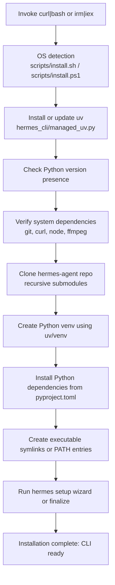
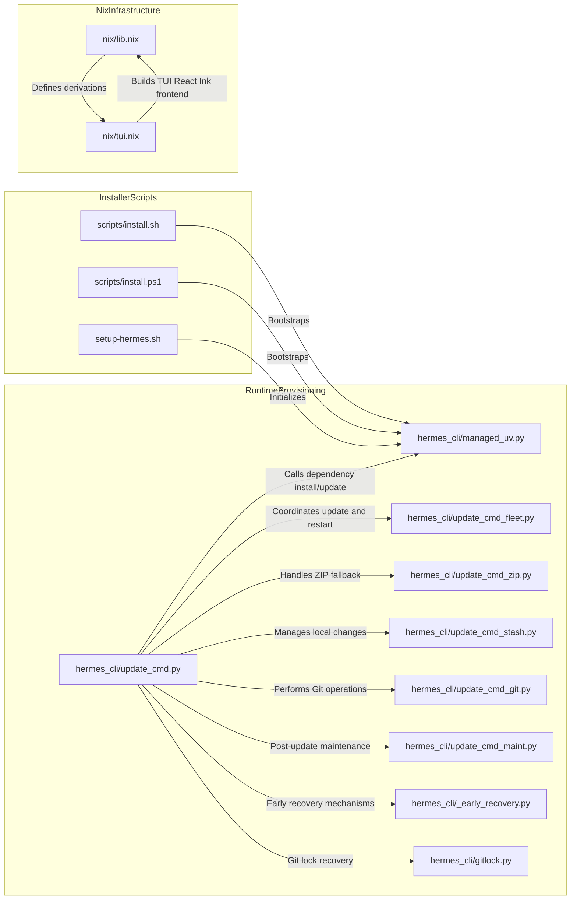

<!-- source: DeepWiki mcp.deepwiki.com · repo nousresearch/hermes-agent · page 2.1 Installation · fetched 2026-10-26 -->

# Installation

<details>
<summary>Relevant source files</summary>

The following files were used as context for generating this wiki page:

- [activate](activate)
- [activate.fish](activate.fish)
- [activate.ps1](activate.ps1)
- [agent/legacy_cli.py](agent/legacy_cli.py)
- [contributors/emails/alan.harman-box@burningsuit.co.uk](contributors/emails/alan.harman-box@burningsuit.co.uk)
- [hermes](hermes)
- [hermes_cli/_early_recovery.py](hermes_cli/_early_recovery.py)
- [hermes_cli/_early_recovery_zip.py](hermes_cli/_early_recovery_zip.py)
- [hermes_cli/gitlock.py](hermes_cli/gitlock.py)
- [hermes_cli/managed_uv.py](hermes_cli/managed_uv.py)
- [hermes_cli/update_cmd.py](hermes_cli/update_cmd.py)
- [hermes_cli/update_cmd_check.py](hermes_cli/update_cmd_check.py)
- [hermes_cli/update_cmd_commit.py](hermes_cli/update_cmd_commit.py)
- [hermes_cli/update_cmd_git.py](hermes_cli/update_cmd_git.py)
- [hermes_cli/update_cmd_maint.py](hermes_cli/update_cmd_maint.py)
- [hermes_cli/update_cmd_stash.py](hermes_cli/update_cmd_stash.py)
- [hermes_cli/update_cmd_zip.py](hermes_cli/update_cmd_zip.py)
- [hermes_cli/update_host_obligation.py](hermes_cli/update_host_obligation.py)
- [hermes_cli/update_serve_resume.py](hermes_cli/update_serve_resume.py)
- [scripts/_activation.sh](scripts/_activation.sh)
- [scripts/install.ps1](scripts/install.ps1)
- [scripts/install.sh](scripts/install.sh)
- [setup-hermes.sh](setup-hermes.sh)
- [tests/acp_adapter/test_edit_approval.py](tests/acp_adapter/test_edit_approval.py)
- [tests/agent/test_legacy_cli.py](tests/agent/test_legacy_cli.py)
- [tests/gateway/test_multiplex_notice_egress_profile_adapter.py](tests/gateway/test_multiplex_notice_egress_profile_adapter.py)
- [tests/gateway/test_planned_restart_notice_multiplex.py](tests/gateway/test_planned_restart_notice_multiplex.py)
- [tests/hermes_cli/test_cmd_update.py](tests/hermes_cli/test_cmd_update.py)
- [tests/hermes_cli/test_discard_lockfile_churn.py](tests/hermes_cli/test_discard_lockfile_churn.py)
- [tests/hermes_cli/test_early_recovery.py](tests/hermes_cli/test_early_recovery.py)
- [tests/hermes_cli/test_gitlock.py](tests/hermes_cli/test_gitlock.py)
- [tests/hermes_cli/test_gitlock_tmp_packs.py](tests/hermes_cli/test_gitlock_tmp_packs.py)
- [tests/hermes_cli/test_launcher.py](tests/hermes_cli/test_launcher.py)
- [tests/hermes_cli/test_setup_pin_values.py](tests/hermes_cli/test_setup_pin_values.py)
- [tests/hermes_cli/test_shallow_boundary_repair.py](tests/hermes_cli/test_shallow_boundary_repair.py)
- [tests/hermes_cli/test_shallow_graft_prune.py](tests/hermes_cli/test_shallow_graft_prune.py)
- [tests/hermes_cli/test_shared_profile_warning.py](tests/hermes_cli/test_shared_profile_warning.py)
- [tests/hermes_cli/test_tag_fetch_partial_clone.py](tests/hermes_cli/test_tag_fetch_partial_clone.py)
- [tests/hermes_cli/test_update_autostash.py](tests/hermes_cli/test_update_autostash.py)
- [tests/hermes_cli/test_update_commit_obligations.py](tests/hermes_cli/test_update_commit_obligations.py)
- [tests/hermes_cli/test_update_completion_routing.py](tests/hermes_cli/test_update_completion_routing.py)
- [tests/hermes_cli/test_update_existing_branch_baseline.py](tests/hermes_cli/test_update_existing_branch_baseline.py)
- [tests/hermes_cli/test_update_fetch_failure_classifier.py](tests/hermes_cli/test_update_fetch_failure_classifier.py)
- [tests/hermes_cli/test_update_fork_sync_identity.py](tests/hermes_cli/test_update_fork_sync_identity.py)
- [tests/hermes_cli/test_update_head_moved_gate.py](tests/hermes_cli/test_update_head_moved_gate.py)
- [tests/hermes_cli/test_update_host_obligation.py](tests/hermes_cli/test_update_host_obligation.py)
- [tests/hermes_cli/test_update_import_guard.py](tests/hermes_cli/test_update_import_guard.py)
- [tests/hermes_cli/test_update_interrupted_pull.py](tests/hermes_cli/test_update_interrupted_pull.py)
- [tests/hermes_cli/test_update_parked_branch_guard.py](tests/hermes_cli/test_update_parked_branch_guard.py)
- [tests/hermes_cli/test_update_post_pull_syntax_guard.py](tests/hermes_cli/test_update_post_pull_syntax_guard.py)
- [tests/hermes_cli/test_update_products.py](tests/hermes_cli/test_update_products.py)
- [tests/hermes_cli/test_update_shallow_heal.py](tests/hermes_cli/test_update_shallow_heal.py)
- [tests/hermes_cli/test_update_sqlite_remediation.py](tests/hermes_cli/test_update_sqlite_remediation.py)
- [tests/hermes_cli/test_update_target_identity.py](tests/hermes_cli/test_update_target_identity.py)
- [tests/hermes_cli/test_update_upstream_prompt_noninteractive.py](tests/hermes_cli/test_update_upstream_prompt_noninteractive.py)
- [tests/hermes_cli/test_update_venv_holder_retirement.py](tests/hermes_cli/test_update_venv_holder_retirement.py)
- [tests/hermes_cli/test_update_zip_completion.py](tests/hermes_cli/test_update_zip_completion.py)
- [tests/hermes_cli/test_update_zip_fallback_guards.py](tests/hermes_cli/test_update_zip_fallback_guards.py)
- [tests/hermes_cli/test_update_zip_release_preserve.py](tests/hermes_cli/test_update_zip_release_preserve.py)
- [tests/hermes_cli/test_update_zip_symlink_reject.py](tests/hermes_cli/test_update_zip_symlink_reject.py)
- [tests/hermes_cli/test_update_zip_two_phase.py](tests/hermes_cli/test_update_zip_two_phase.py)
- [tests/install/e2e-assets/source-build-env.ps1](tests/install/e2e-assets/source-build-env.ps1)
- [tests/pm/activation_support.py](tests/pm/activation_support.py)
- [tests/pm/test_activate_fish.py](tests/pm/test_activate_fish.py)
- [tests/pm/test_activate_scripts.py](tests/pm/test_activate_scripts.py)
- [tests/pm/test_activation_runtime.py](tests/pm/test_activation_runtime.py)
- [tests/pm/test_environment_script.py](tests/pm/test_environment_script.py)
- [tests/pm/test_setup_lock_format.py](tests/pm/test_setup_lock_format.py)
- [tests/scripts/install/test_install_sh_repository_stage.py](tests/scripts/install/test_install_sh_repository_stage.py)
- [tests/scripts/test_install_ps1_desktop_stage.py](tests/scripts/test_install_ps1_desktop_stage.py)
- [tests/scripts/test_install_sh_launch_handoff.py](tests/scripts/test_install_sh_launch_handoff.py)
- [tests/scripts/test_install_stage_frames.py](tests/scripts/test_install_stage_frames.py)
- [tests/scripts/test_mint_launchers.py](tests/scripts/test_mint_launchers.py)
- [tests/test_windows_subprocess_no_window_flags.py](tests/test_windows_subprocess_no_window_flags.py)
- [tests/tools/test_send_message_multiplex_profile_adapter.py](tests/tools/test_send_message_multiplex_profile_adapter.py)
- [website/docs/getting-started/installation.md](website/docs/getting-started/installation.md)
- [website/docs/getting-started/updating.md](website/docs/getting-started/updating.md)

</details>


This page covers the installation methods for Hermes Agent, including `curl|bash`, PowerShell, manual setups, Nix flakes, and the Tauri bootstrap installer. It also details dependency provisioning via `uv` and `managed_uv`, the update pipeline (`hermes update`), and platform-specific considerations across Linux, macOS, Windows, and Android Termux.

---

## Overview

Hermes Agent provides a zero-configuration, automated installer designed to provision an isolated Python environment and manage dependencies across diverse platforms. The primary entry points are:

- `scripts/install.sh` for POSIX-compliant environments (Linux, macOS, WSL2, Android Termux) [scripts/install.sh:1-15]()
- `scripts/install.ps1` for Windows PowerShell environments [scripts/install.ps1:1-15]()
- Declarative Nix flake packaging and build assistance in `nix/lib.nix`
- Hermes-managed Python and `uv` runtimes implemented in `hermes_cli/managed_uv.py` [hermes_cli/managed_uv.py:1-46]()

The installation subsystem automates OS detection, package manager selection, `uv` and Python environment provisioning, repository cloning, and CLI integration.

Sources: [scripts/install.sh:1-15](), [scripts/install.ps1:1-15](), [hermes_cli/managed_uv.py:1-46]()

---

## Installation Methods

### 1. Quick Install: curl|bash or PowerShell Script

#### Linux, macOS, WSL2, Android (Termux) — `install.sh`

Invoke the POSIX install script directly from the web using:

```bash
curl -fsSL https://hermes-agent.nousresearch.com/install.sh | bash
```

**Implementation Details:**

- The script runs in strict mode (`set -u`) to fail on unset variables, ensuring early detection of errors [scripts/install.sh:15-16]().

- It sanitizes the environment by unsetting `PYTHONPATH` and `PYTHONHOME` to prevent conflicts affecting fresh virtual environments.

- The installation detects the host OS and environment, adapting provisioning for special cases such as Termux on Android where Rust-based `uv` binaries are incompatible; the installer falls back to Python `venv` in such cases [scripts/install.sh:6-7]().

- `uv`, a Rust-based Python environment and dependency manager, is installed or updated to create a consistent virtual environment [scripts/install.sh:77-80]().

- The Hermes Agent repository is cloned recursively with submodules. Shallow cloning is used where possible to expedite deployment.

- After environment setup, the installer runs a post-clone completion step that installs dependencies and sets executable shims.

Sources: [scripts/install.sh:15-16](), [scripts/install.sh:77-80]()

#### Windows Native PowerShell — `install.ps1`

Run the PowerShell installation command as:

```powershell
iex (irm https://hermes-agent.nousresearch.com/install.ps1)
```

**Technical Highlights:**

- The installer sets the console output encoding to UTF-8 (`[Console]::OutputEncoding`) forcibly to enable proper rendering of Unicode progress bars and glyphs on Windows consoles, avoiding mojibake and garbled output.

- Windows paths often include 8.3 short-path aliases (e.g., `FIRST~1.LAS`). PowerShell cmdlets such as `Test-Path` or `New-Item` may malfunction with these; the installer performs path normalization using multiple strategies including:
  - Calling WinAPI `GetLongPathNameW`
  - Using Windows Scripting Host `FileSystemObject` COM object
  - Substituting user profile root paths
  This ensures reliable file system operations during installation [scripts/install.ps1:108-121]().

- A bundled MinGit version is included in `%LOCALAPPDATA%\hermes\git` to isolate git operations from any system Git installations, improving stability and consistency during updates [scripts/install.ps1:93-105]().

- The installer supports an optional desktop app build stage (`-IncludeDesktop`) that builds the Electron-based desktop UI bundled with Hermes [scripts/install.ps1:8]().

Sources: [scripts/install.ps1:8](), [scripts/install.ps1:93-121]()

---

### 2. Manual Installation (Developer or Custom Deployments)

For fine-grained control or development environments, users can manually clone the repository and perform a setup:

```bash
git clone --recurse-submodules https://github.com/NousResearch/hermes-agent.git
cd hermes-agent
./setup-hermes.sh
```

This script:
- Creates a Python virtual environment using `uv` or falls back to Python `venv` if necessary.
- Installs pinned dependencies based on `pyproject.toml`, including optional extras like skills and TUI support.
- Configures workspace overlays and local plugins.

Sources: []()

---

### 3. Nix Flake and NixOS Module Support

Hermes supports declarative, reproducible builds using the Nix package manager:
- `nix/lib.nix` provides reusable Nix functions and derivations to build Python packages with Poetry dependencies, filtering unnecessary files such as JS bundles, docs, and tests to optimize build time and store size.
- The file defines build inputs, poetry dependency resolution, and workspace tooling including NPM overlays.
- `nix/tui.nix` builds the React Ink terminal UI frontend as a Nix derivation, ensuring integration into the Nix ecosystem.

Sources: []()

---

### 4. Tauri Bootstrap Installer (Desktop GUI)

Hermes's bootstrap installer (based on the Tauri framework) provides a native desktop app installation experience:
- The `--include-desktop` flag in PowerShell or POSIX installers triggers the build of the Tauri/Electron-based desktop React UI app (located in `apps/desktop`) [scripts/install.ps1:8](), [scripts/install.sh:32]().
- The installer handles in-use executable file locking, atomic updates, and graceful handoff to running background services on all platforms.
- Native installers for Windows and macOS adapt the update channel and restart logic for desktop apps.

Sources: [scripts/install.ps1:8](), [scripts/install.sh:32]()

---

## Dependency Management & Update Pipeline

### Managed UV and Python Runtime Provisioning

The `hermes_cli/managed_uv.py` module implements Hermes's controlled Python runtime and dependency environment:
- It provides a managed `uv` executable installed under `$HERMES_HOME/bin/` which is a Rust-based utility that wraps Python virtual environment management and caching [hermes_cli/managed_uv.py:20-38]().
- A stable, shared Python runtime is installed at `<repo-root>/.hermes-runtime/python` allowing all Hermes profiles to share the same base runtime, optimizing disk space and startup.
- On macOS, Hermes signs the managed Python runtimes with a stable entitlement (identifier: `com.nousresearch.hermes.managed-python`), satisfying Transparent Consent and Control (TCC) permissions for runtime environments.

Sources: [hermes_cli/managed_uv.py:1-38]()

### The `hermes update` Command

The update command (`hermes update`) automates secure, atomic upgrades of Hermes Agent:
- It stashes or parks local modifications to the repository safely to avoid data loss during git pulls and status resets [hermes_cli/update_cmd.py:78-85]().
- The update fetches the configured branch or stable release tag and applies code and submodules [hermes_cli/update_cmd.py:96-105]().
- Python dependencies are reinstalled efficiently using the `uv` tool's caching layers, minimizing download and build times [hermes_cli/update_cmd.py:92-95]().
- Background services such as gateway runners, launchd/systemd units, Windows services, and s6 supervisors are gracefully stopped and restarted after updates [hermes_cli/update_cmd.py:56-71]().
- The update system contains multi-layer recovery and fallback mechanisms (including a ZIP-download fallback on Windows for broken Git installations implemented in `hermes_cli/update_cmd_zip.py`) to guarantee that Hermes runs a consistent version after updates [hermes_cli/update_cmd_zip.py:1-77]().

Sources: [hermes_cli/update_cmd.py:56-105](), [hermes_cli/update_cmd_zip.py:1-77](), [hermes_cli/update_cmd_stash.py:1-139](), [hermes_cli/update_cmd_git.py:1-105](), [hermes_cli/update_cmd_fleet.py:1-71](), [hermes_cli/old_updater_deps.py:70]()

---

## Platform-Specific Considerations

| Platform          | Key Aspects                                                                                                 |
|-------------------|------------------------------------------------------------------------------------------------------------|
| Windows           | - Console output is forcibly set to UTF-8 to enable Unicode progress bars                                  |
|                   | - 8.3 short-path aliases in Windows paths are expanded to avoid PowerShell cmdlet failures [scripts/install.ps1:108-121]() |
|                   | - Bundled portable MinGit ensures isolated and consistent git usage [scripts/install.ps1:93-105]()           |
|                   | - Optional desktop app build process with shortcuts and integration [scripts/install.ps1:8]()            |
| Linux/macOS       | - Supports FHS-style root installation with symlinks in `/usr/local/bin`                                   |
| Android Termux    | - Rust-based `uv` tool is not used for ABI incompatibility; fallback to Python `venv` and pip is applied [scripts/install.sh:6-7]() |

Sources: [scripts/install.ps1:8](), [scripts/install.ps1:93-121](), [scripts/install.sh:6-7]()

---

## Installation Flow Diagrams

### Diagram: Installation Provisioning Flow



Sources: [scripts/install.sh:1-145](), [scripts/install.ps1:1-121](), [hermes_cli/managed_uv.py:20-38]()

---

### Diagram: Installer Scripts and Update Submodules



Sources: [scripts/install.sh:1-15](), [scripts/install.ps1:1-15](), [hermes_cli/managed_uv.py:1-46](), [hermes_cli/update_cmd.py:1-111](), [hermes_cli/update_cmd_fleet.py:1-71](), [hermes_cli/update_cmd_zip.py:1-77](), [hermes_cli/update_cmd_stash.py:1-139](), [hermes_cli/update_cmd_git.py:1-105](), [hermes_cli/update_cmd_maint.py:1-175](), [hermes_cli/_early_recovery.py:1-167](), [hermes_cli/gitlock.py:1-136]()

---

## Summary

Hermes Agent’s installation solution encompasses multiple methods suited for diverse platforms, utilizing automated script bootstraps, a managed Python runtime via `hermes_cli/managed_uv.py`, a robust update pipeline with fallback safety (`hermes_cli/update_cmd.py` and `hermes_cli/update_cmd_zip.py`), and platform-specific accommodations across POSIX, Windows PowerShell, and Nix.

---

