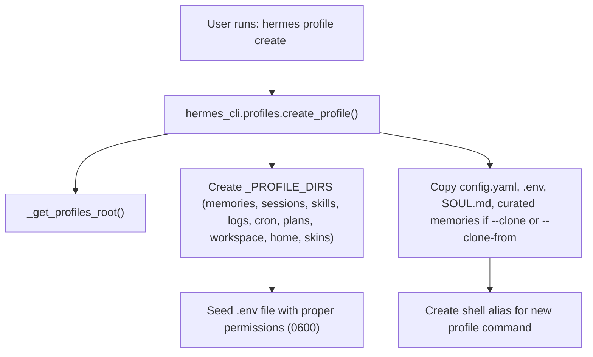
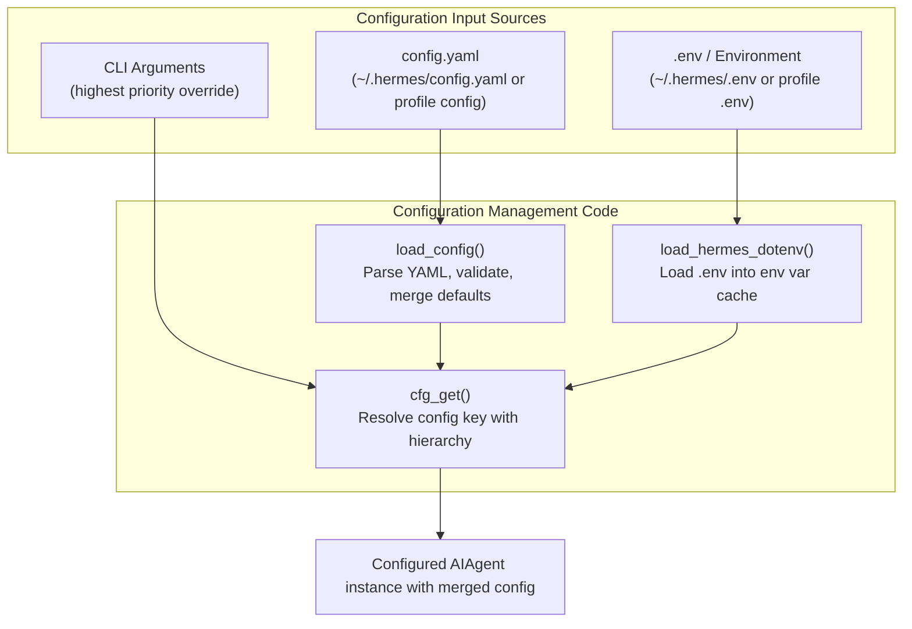
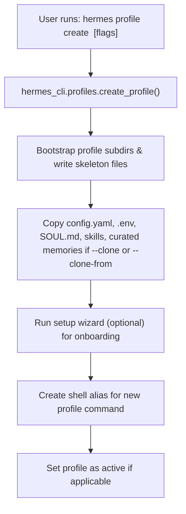

<!-- source: DeepWiki mcp.deepwiki.com · repo nousresearch/hermes-agent · page 2.2 Configuration and Setup · fetched 2026-10-26 -->

# Configuration and Setup

Relevant source files

The following files were used as context for generating this wiki page:

- [agent/auxiliary_client.py](agent/auxiliary_client.py)
- [agent/secret_scope.py](agent/secret_scope.py)
- [agent/secret_sources/__init__.py](agent/secret_sources/__init__.py)
- [agent/secret_sources/_cache.py](agent/secret_sources/_cache.py)
- [agent/secret_sources/base.py](agent/secret_sources/base.py)
- [agent/secret_sources/bitwarden.py](agent/secret_sources/bitwarden.py)
- [agent/secret_sources/command.py](agent/secret_sources/command.py)
- [agent/secret_sources/onepassword.py](agent/secret_sources/onepassword.py)
- [agent/secret_sources/registry.py](agent/secret_sources/registry.py)
- [cli-config.yaml.example](cli-config.yaml.example)
- [cli.py](cli.py)
- [cron/job_definition.py](cron/job_definition.py)
- [cron/scheduler_script.py](cron/scheduler_script.py)
- [gateway/run.py](gateway/run.py)
- [gateway/session.py](gateway/session.py)
- [gateway/slash_commands.py](gateway/slash_commands.py)
- [hermes_cli/cli_commands_mixin.py](hermes_cli/cli_commands_mixin.py)
- [hermes_cli/commands.py](hermes_cli/commands.py)
- [hermes_cli/config.py](hermes_cli/config.py)
- [hermes_cli/config_backups.py](hermes_cli/config_backups.py)
- [hermes_cli/config_defaults.py](hermes_cli/config_defaults.py)
- [hermes_cli/config_migrations.py](hermes_cli/config_migrations.py)
- [hermes_cli/config_version_stamp.py](hermes_cli/config_version_stamp.py)
- [hermes_cli/env_loader.py](hermes_cli/env_loader.py)
- [hermes_cli/kanban_decompose.py](hermes_cli/kanban_decompose.py)
- [hermes_cli/kanban_specify.py](hermes_cli/kanban_specify.py)
- [hermes_cli/main.py](hermes_cli/main.py)
- [hermes_cli/profile_cmd.py](hermes_cli/profile_cmd.py)
- [hermes_cli/profile_describer.py](hermes_cli/profile_describer.py)
- [hermes_cli/profile_distribution.py](hermes_cli/profile_distribution.py)
- [hermes_cli/profiles.py](hermes_cli/profiles.py)
- [hermes_cli/setup.py](hermes_cli/setup.py)
- [hermes_cli/subcommands/profile.py](hermes_cli/subcommands/profile.py)
- [hermes_cli/xai_retirement.py](hermes_cli/xai_retirement.py)
- [hermes_state.py](hermes_state.py)
- [run_agent.py](run_agent.py)
- [scripts/docker_config_migrate.py](scripts/docker_config_migrate.py)
- [tests/agent/test_auxiliary_client.py](tests/agent/test_auxiliary_client.py)
- [tests/agent/test_env_loader_secret_sources.py](tests/agent/test_env_loader_secret_sources.py)
- [tests/agent/test_onepassword_secrets.py](tests/agent/test_onepassword_secrets.py)
- [tests/agent/test_secret_scope.py](tests/agent/test_secret_scope.py)
- [tests/agent/test_secret_scope_pinned_launch_home.py](tests/agent/test_secret_scope_pinned_launch_home.py)
- [tests/cron/test_cron_multiplex_desktop_ticker_scope.py](tests/cron/test_cron_multiplex_desktop_ticker_scope.py)
- [tests/cron/test_cron_no_agent.py](tests/cron/test_cron_no_agent.py)
- [tests/cron/test_cron_script.py](tests/cron/test_cron_script.py)
- [tests/cron/test_script_claim_heartbeat.py](tests/cron/test_script_claim_heartbeat.py)
- [tests/gateway/test_session.py](tests/gateway/test_session.py)
- [tests/hermes_cli/test_commands.py](tests/hermes_cli/test_commands.py)
- [tests/hermes_cli/test_config.py](tests/hermes_cli/test_config.py)
- [tests/hermes_cli/test_config_backups.py](tests/hermes_cli/test_config_backups.py)
- [tests/hermes_cli/test_config_lkg_backup.py](tests/hermes_cli/test_config_lkg_backup.py)
- [tests/hermes_cli/test_config_migration_nested_guards.py](tests/hermes_cli/test_config_migration_nested_guards.py)
- [tests/hermes_cli/test_config_unversioned_migration.py](tests/hermes_cli/test_config_unversioned_migration.py)
- [tests/hermes_cli/test_desktop_cron_ticker_gateway_standdown.py](tests/hermes_cli/test_desktop_cron_ticker_gateway_standdown.py)
- [tests/hermes_cli/test_desktop_cron_ticker_profiles.py](tests/hermes_cli/test_desktop_cron_ticker_profiles.py)
- [tests/hermes_cli/test_env_loader.py](tests/hermes_cli/test_env_loader.py)
- [tests/hermes_cli/test_env_sanitize_on_load.py](tests/hermes_cli/test_env_sanitize_on_load.py)
- [tests/hermes_cli/test_kanban_aux_affinity.py](tests/hermes_cli/test_kanban_aux_affinity.py)
- [tests/hermes_cli/test_kanban_decompose.py](tests/hermes_cli/test_kanban_decompose.py)
- [tests/hermes_cli/test_kanban_decompose_db.py](tests/hermes_cli/test_kanban_decompose_db.py)
- [tests/hermes_cli/test_kanban_specify.py](tests/hermes_cli/test_kanban_specify.py)
- [tests/hermes_cli/test_kanban_specify_db.py](tests/hermes_cli/test_kanban_specify_db.py)
- [tests/hermes_cli/test_kanban_worktree_isolation.py](tests/hermes_cli/test_kanban_worktree_isolation.py)
- [tests/hermes_cli/test_migrate_xai.py](tests/hermes_cli/test_migrate_xai.py)
- [tests/hermes_cli/test_noninteractive_config_guard.py](tests/hermes_cli/test_noninteractive_config_guard.py)
- [tests/hermes_cli/test_profile_alias_orphan_removal.py](tests/hermes_cli/test_profile_alias_orphan_removal.py)
- [tests/hermes_cli/test_profile_delete_service_name.py](tests/hermes_cli/test_profile_delete_service_name.py)
- [tests/hermes_cli/test_profile_describer.py](tests/hermes_cli/test_profile_describer.py)
- [tests/hermes_cli/test_profile_distribution.py](tests/hermes_cli/test_profile_distribution.py)
- [tests/hermes_cli/test_profile_export_credentials.py](tests/hermes_cli/test_profile_export_credentials.py)
- [tests/hermes_cli/test_profile_export_special_files.py](tests/hermes_cli/test_profile_export_special_files.py)
- [tests/hermes_cli/test_profile_rename_service.py](tests/hermes_cli/test_profile_rename_service.py)
- [tests/hermes_cli/test_profiles.py](tests/hermes_cli/test_profiles.py)
- [tests/hermes_cli/test_secret_source_bootstrap.py](tests/hermes_cli/test_secret_source_bootstrap.py)
- [tests/hermes_cli/test_uninstall_shell_configs.py](tests/hermes_cli/test_uninstall_shell_configs.py)
- [tests/hermes_cli/test_web_profile_soul_writes.py](tests/hermes_cli/test_web_profile_soul_writes.py)
- [tests/hermes_cli/test_web_profiles_off_loop.py](tests/hermes_cli/test_web_profiles_off_loop.py)
- [tests/hermes_cli/test_xai_retirement.py](tests/hermes_cli/test_xai_retirement.py)
- [tests/secret_sources/test_profile_secrets.py](tests/secret_sources/test_profile_secrets.py)
- [tests/tools/test_docker_config_migrate.py](tests/tools/test_docker_config_migrate.py)
- [ui-tui/src/__tests__/details.test.ts](ui-tui/src/__tests__/details.test.ts)
- [ui-tui/src/domain/details.ts](ui-tui/src/domain/details.ts)
- [website/docs/developer-guide/secret-source-plugin.md](website/docs/developer-guide/secret-source-plugin.md)
- [website/docs/getting-started/quickstart.md](website/docs/getting-started/quickstart.md)
- [website/docs/guides/cron-troubleshooting.md](website/docs/guides/cron-troubleshooting.md)
- [website/docs/integrations/providers.md](website/docs/integrations/providers.md)
- [website/docs/reference/cli-commands.md](website/docs/reference/cli-commands.md)
- [website/docs/reference/environment-variables.md](website/docs/reference/environment-variables.md)
- [website/docs/reference/faq.md](website/docs/reference/faq.md)
- [website/docs/reference/profile-commands.md](website/docs/reference/profile-commands.md)
- [website/docs/reference/slash-commands.md](website/docs/reference/slash-commands.md)
- [website/docs/user-guide/cli.md](website/docs/user-guide/cli.md)
- [website/docs/user-guide/configuration.md](website/docs/user-guide/configuration.md)
- [website/docs/user-guide/features/fallback-providers.md](website/docs/user-guide/features/fallback-providers.md)
- [website/docs/user-guide/messaging/index.md](website/docs/user-guide/messaging/index.md)
- [website/docs/user-guide/profile-distributions.md](website/docs/user-guide/profile-distributions.md)
- [website/docs/user-guide/profiles.md](website/docs/user-guide/profiles.md)
- [website/docs/user-guide/secrets/index.md](website/docs/user-guide/secrets/index.md)
- [website/docs/user-guide/tui.md](website/docs/user-guide/tui.md)
- [website/i18n/zh-Hans/docusaurus-plugin-content-docs/current/guides/cron-troubleshooting.md](website/i18n/zh-Hans/docusaurus-plugin-content-docs/current/guides/cron-troubleshooting.md)
- [website/i18n/zh-Hans/docusaurus-plugin-content-docs/current/reference/profile-commands.md](website/i18n/zh-Hans/docusaurus-plugin-content-docs/current/reference/profile-commands.md)
- [website/i18n/zh-Hans/docusaurus-plugin-content-docs/current/user-guide/profile-distributions.md](website/i18n/zh-Hans/docusaurus-plugin-content-docs/current/user-guide/profile-distributions.md)
- [website/i18n/zh-Hans/docusaurus-plugin-content-docs/current/user-guide/profiles.md](website/i18n/zh-Hans/docusaurus-plugin-content-docs/current/user-guide/profiles.md)

This page covers the detailed mechanics of configuration management, profiles, setup, and migrations in Hermes Agent. It explains the layered configuration hierarchy governing runtime settings, multi-profile isolation, configuration migrations, and key configuration files.

---

## Directory Structure and Profiles

Hermes stores configuration, persistent data, and runtime artifacts in a structured user directory (`~/.hermes/` by default), which can be overridden via the `HERMES_HOME` environment variable. The core layout is ensured by `ensure_hermes_home()` which creates the directory if missing and sets up the initial structure [hermes_cli/setup.py:23-30]().

Named profiles allow running multiple isolated instances of Hermes concurrently. Each profile lives under `~/.hermes/profiles/<profile_name>/` and maintains isolated subdirectories for session data, memories, skill definitions, logs, and other runtime artifacts. The standard profile subdirectories bootstrapped include:

- `memories/`
- `sessions/`
- `skills/`
- `logs/`
- `cron/`
- `plans/`
- `workspace/`
- `home/`
- `skins/`

These subdirectories are defined and created during profile initialization to ensure full profile isolation, enabling each Hermes agent instance to operate independently without data conflicts [hermes_cli/profiles.py:30-104](). 

| Path          | Purpose                                            | Code Reference                     |
|---------------|---------------------------------------------------|----------------------------------|
| `config.yaml` | Main structured settings (models, toolsets, terminal backend) | [tests/hermes_cli/test_profiles.py:167-169]() |
| `.env`        | Environment-specific overrides and sensitive secrets | [hermes_cli/profiles.py:99-104]() |
| `auth.json`   | OAuth provider credentials (Nous Portal, etc.)    | [website/docs/user-guide/configuration.md:25]() |
| `SOUL.md`     | Primary agent identity persona used for system prompts | [website/docs/user-guide/configuration.md:26]() |
| `memories/`   | Persistent memory files (`MEMORY.md`, `USER.md`)  | [hermes_cli/profiles.py:33]()    |
| `skills/`     | User-defined or downloaded skills                   | [hermes_cli/profiles.py:33]()    |
| `cron/`       | Scheduled task jobs                                 | [hermes_cli/profiles.py:33]()    |
| `sessions/`   | Gateway session data and conversation states       | [hermes_cli/profiles.py:33]()    |
| `logs/`       | Rotating system logs with automatic secret redaction | [hermes_cli/profiles.py:33]()    |

### Profile Isolation Flow Diagram

Sources: [hermes_cli/profiles.py:30-104](), [hermes_cli/setup.py:23-30](), [tests/hermes_cli/test_profiles.py:167-169](), [website/docs/user-guide/configuration.md:25-26]()

---

## Configuration Hierarchy and Resolution

Hermes resolves configuration settings through a strict precedence hierarchy to provide flexibility and security:

1. **CLI Arguments**: Immediate runtime overrides passed interactively via command-line options (e.g., `hermes chat --model anthropic/claude-opus-4`) that apply only for the current invocation [website/docs/user-guide/configuration.md:61]().
2. **`config.yaml`**: The primary user-editable YAML configuration file located in the Hermes home directory or active profile directory. It contains most agent behavior settings including provider choices, model names, session parameters, toolsets, and terminal backend options [website/docs/user-guide/configuration.md:62]().
3. **`.env`**: A dotenv-style environment file co-located with config.yaml that holds API keys, tokens, and sensitive secret variables. This file overrides shell environment variables and is separate from config.yaml to safeguard secrets [website/docs/user-guide/configuration.md:63]().
4. **Built-In Defaults**: Hardcoded fallback defaults supply safe baseline values when no other source provides them, preventing runtime failures [website/docs/user-guide/configuration.md:64]().

This layered resolution cleanly separates secrets management (.env) from general settings (config.yaml) while integrating immediate CLI overrides.

### Configuration Resolution Architecture

### Implementation Details

- **Loading Config**: `load_config()` parses `config.yaml` with robust error handling, creating timestamped backup files upon parse failures to prevent data loss and warn the user [hermes_cli/config.py:50-100]().

- **Environment Loading**: `.env` is loaded through `load_hermes_dotenv()` which reads and parses dotenv files with strict owner-only (0600) permission enforcement to secure secrets [hermes_cli/env_loader.py:1-110]().

- **Merged Access**: `cfg_get()` provides unified access to configuration keys, layering CLI overrides, config.yaml values, loaded environment variables, and built-in defaults [hermes_cli/config.py:40-80]().

- **Secrets vs Config Handling**: Explicit separation is enforced so secret environment variables (UPPER_SNAKE_CASE keys) live only in `.env`, while structured keys with dotted notation (e.g., `model.provider`, `terminal.backend`) live in `config.yaml` [website/docs/user-guide/configuration.md:54]().

Sources: [website/docs/user-guide/configuration.md:57-68](), [hermes_cli/config.py:1-145](), [hermes_cli/env_loader.py:1-110]()

---

## Configuration Migrations

Hermes manages configuration schema evolution through a migration framework that automatically upgrades user config files on load to maintain compatibility:

- Migrations are keyed by `_config_version` present in the root of `config.yaml` which tracks the version of the config schema applied [cli-config.yaml.example:10]().

- On loading a config with a version older than the current supported version, migration functions run sequentially to transform keys, values, and the structure as needed.

- Migrations can normalize deprecated keys, move settings from environment to config.yaml or vice versa, and clean up obsolete values.

- The migration code ensures idempotency and runs only when strictly necessary to avoid disrupting user-customized settings.

- It uses partial persistence to update only affected keys and writes files atomically to prevent corruption.

This system allows Hermes to evolve internal settings without forcing manual edits or breaking compatibility.

Sources: [cli-config.yaml.example:10](), [hermes_cli/config.py:1-55]()

---

## Setup Wizard and Tool Configuration

Hermes offers an interactive command-line setup wizard accessible via `hermes setup` that aids users in creating and updating their configuration interactively [hermes_cli/setup.py:1-141]().

- The setup wizard is a prompt-driven, stepwise system with forward and backward navigation support.

- Users are guided through configuration sections, including:
  - **Model & Provider:** Selecting the preferred default LLM provider, setting API keys, base URLs, and default models.
  - **Terminal Backend:** Choosing execution backend (local shell, Docker, Modal, Vercel Sandbox).
  - **Agent Settings:** Configuring agent runtime limits, session caps, and reasoning effort.
  - **Messaging Platforms:** Enabling and configuring supported messaging platform gateways.
  - **Toolsets & Skills:** Specifying included toolsets and enabling skill sets.

- The wizard uses exceptions `_SetupCancelled` and `_SetupGoBack` for internal flow control in navigation.

- Changes are written back atomically to `config.yaml` and `.env` with correct file ownership and permission handling to maintain security and integrity.

- The setup respects the active profile context, configuring the correct isolated profile directory.

Sources: [hermes_cli/setup.py:1-141](), [website/docs/user-guide/configuration.md:25-32]()

---

## Profiles: Multi-Instance Isolation and Identity

Profiles provide isolated Hermes homes to run multiple independent agent instances on the same machine. Each profile maintains its own secrets, configurations, memories, sessions, skills, and gateway states.

- Profiles reside under `~/.hermes/profiles/<profile_name>/` with full sandboxing of configuration and data directories:

- Profile creation scaffolds the directory hierarchy, optionally cloning or copying configuration from an existing profile or default.

- Each profile can have a shell alias generated for convenience, mapping commands to the appropriate `HERMES_PROFILE` environment variable.

- Identity files like `SOUL.md` (agent personality), `auth.json` (OAuth credentials), and `config.yaml` define each profile's autonomous configuration state.

### Profiles and Setup Workflow Diagram

Sources: [hermes_cli/profiles.py:30-104](), [website/docs/user-guide/configuration.md:23-30]()

---

## Key Configuration Files

| File Name    | Location                        | Description                                                                                     |
|--------------|--------------------------------|-------------------------------------------------------------------------------------------------|
| `config.yaml`| `HERMES_HOME/config.yaml` or `<profile>/config.yaml` | YAML file capturing main structured configuration: selected model, toolsets, agent limits, terminal backend settings, and runtime options. |
| `.env`       | `HERMES_HOME/.env` or `<profile>/.env` | Environment variable overrides, API keys, tokens, and sensitive secrets. Owner permission (`0600`) enforced. Separate from structured config. |
| `auth.json`  | `HERMES_HOME/auth.json` or `<profile>/auth.json` | OAuth tokens and subscription info, especially for Nous Portal integrations.                    |
| `SOUL.md`    | `HERMES_HOME/SOUL.md` or `<profile>/SOUL.md` | The core agent persona file defining system prompts, personality, and behavior traits for conversations. |
| `memories/`  | `<profile>/memories/`           | Memory files (`MEMORY.md`, `USER.md`) storing long-term data used in agent context.             |
| `skills/`    | `<profile>/skills/`             | User-installed or bundled skill definitions controlling agent abilities.                         |
| `cron/`      | `<profile>/cron/`               | Scheduled task job definitions for periodic activities.                                         |
| `sessions/`  | `<profile>/sessions/`           | Persistent session data and conversation states from chat gateways.                             |

Sources: [hermes_cli/profiles.py:30-104](), [website/docs/user-guide/configuration.md:23-32]()

---

# Summary

Hermes Agent's configuration and setup system provides:

- A **hierarchical resolution** of configuration keys applying CLI arguments → `config.yaml` → `.env` → built-in defaults, ensuring flexibility and security separation of secrets [website/docs/user-guide/configuration.md:57-68]().
- **Profile-based isolation**: fully sandboxed directories per profile to support concurrent agent instances without conflicts [hermes_cli/profiles.py:30-104]().
- **Automatic migration and validation** framework to upgrade user configs smoothly across schema changes [hermes_cli/config.py:1-55]().
- An **interactive setup wizard** implemented with robust navigation and lifecycle control, enabling stepwise onboarding and configuration of models, toolsets, and backends [hermes_cli/setup.py:1-141]().
- Clear separation of **secrets management** (`.env`) from **structured config** (`config.yaml`), enforcing file permission policies and override rules [website/docs/user-guide/configuration.md:66-68]().

This system forms the cornerstone for Hermes' maintainability, multi-user deployments, and proper handling of secrets and user preferences.

Sources: [hermes_cli/config.py:1-145](), [hermes_cli/profiles.py:30-104](), [hermes_cli/setup.py:1-141](), [website/docs/user-guide/configuration.md:57-68]()

---

