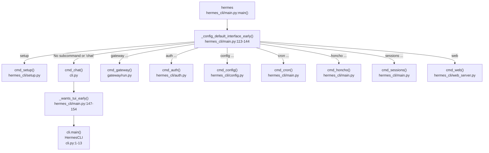
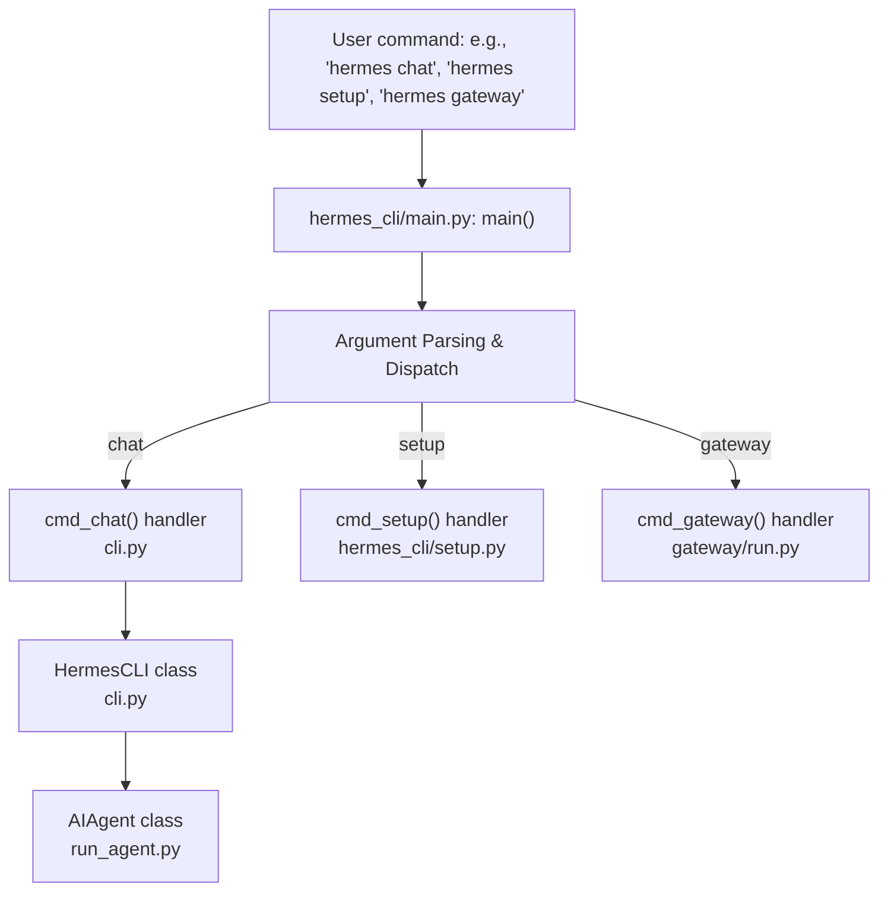
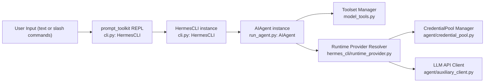

<!-- source: DeepWiki mcp.deepwiki.com · repo nousresearch/hermes-agent · page 3 CLI · fetched 2026-10-26 -->

# CLI

Relevant source files

The following files were used as context for generating this wiki page:

- [agent/auxiliary_client.py](agent/auxiliary_client.py)
- [cli-config.yaml.example](cli-config.yaml.example)
- [cli.py](cli.py)
- [gateway/run.py](gateway/run.py)
- [gateway/session.py](gateway/session.py)
- [gateway/slash_commands.py](gateway/slash_commands.py)
- [hermes_cli/cli_commands_mixin.py](hermes_cli/cli_commands_mixin.py)
- [hermes_cli/commands.py](hermes_cli/commands.py)
- [hermes_cli/config.py](hermes_cli/config.py)
- [hermes_cli/config_defaults.py](hermes_cli/config_defaults.py)
- [hermes_cli/config_migrations.py](hermes_cli/config_migrations.py)
- [hermes_cli/config_version_stamp.py](hermes_cli/config_version_stamp.py)
- [hermes_cli/main.py](hermes_cli/main.py)
- [hermes_cli/setup.py](hermes_cli/setup.py)
- [hermes_state.py](hermes_state.py)
- [run_agent.py](run_agent.py)
- [scripts/docker_config_migrate.py](scripts/docker_config_migrate.py)
- [tests/agent/test_auxiliary_client.py](tests/agent/test_auxiliary_client.py)
- [tests/gateway/test_session.py](tests/gateway/test_session.py)
- [tests/hermes_cli/test_commands.py](tests/hermes_cli/test_commands.py)
- [tests/hermes_cli/test_config.py](tests/hermes_cli/test_config.py)
- [tests/hermes_cli/test_config_migration_nested_guards.py](tests/hermes_cli/test_config_migration_nested_guards.py)
- [tests/hermes_cli/test_config_unversioned_migration.py](tests/hermes_cli/test_config_unversioned_migration.py)
- [tests/tools/test_docker_config_migrate.py](tests/tools/test_docker_config_migrate.py)
- [ui-tui/src/__tests__/details.test.ts](ui-tui/src/__tests__/details.test.ts)
- [ui-tui/src/domain/details.ts](ui-tui/src/domain/details.ts)
- [website/docs/getting-started/quickstart.md](website/docs/getting-started/quickstart.md)
- [website/docs/integrations/providers.md](website/docs/integrations/providers.md)
- [website/docs/reference/cli-commands.md](website/docs/reference/cli-commands.md)
- [website/docs/reference/environment-variables.md](website/docs/reference/environment-variables.md)
- [website/docs/reference/slash-commands.md](website/docs/reference/slash-commands.md)
- [website/docs/user-guide/cli.md](website/docs/user-guide/cli.md)
- [website/docs/user-guide/configuration.md](website/docs/user-guide/configuration.md)
- [website/docs/user-guide/features/fallback-providers.md](website/docs/user-guide/features/fallback-providers.md)
- [website/docs/user-guide/messaging/index.md](website/docs/user-guide/messaging/index.md)
- [website/docs/user-guide/tui.md](website/docs/user-guide/tui.md)

This page provides a high-level overview of the Hermes Agent command-line interface (CLI). It covers the main entry point, operating modes, configuration hierarchy, subcommand groups, and the key components bridging user interaction with the core AI agent orchestration. Detailed technical information and usage instructions for each subtopic are provided in dedicated child pages linked below.

Sources: [hermes_cli/main.py:1-9](), [cli.py:1-3]()

---

## Entry Point

The main CLI entry point of Hermes Agent is the `hermes` executable, implemented by the `hermes_cli/main.py` module. Its `main()` function parses command-line arguments and dispatches to the appropriate subcommands such as interactive chat, gateway, setup, auth, config, cron, honcho, sessions, or web UI. Early in startup, it sets environment variables to isolate the active profile and uses `hermes_bootstrap` to ensure UTF-8 stdio support on Windows platforms.

The command dispatch flow routes user commands to specific handlers or interfaces, as illustrated below:

Sources: [hermes_cli/main.py:1-154](), [gateway/run.py:1-4](), [cli.py:1-13]()

---

## Operating Modes

The Hermes CLI supports multiple modes suited to various user needs:

| Mode                   | Invocation              | Description                                                                                          |
|------------------------|-------------------------|--------------------------------------------------------------------------------------------------|
| **Interactive CLI**     | `hermes` or `hermes chat`| Launches the interactive prompt shell implemented by the `HermesCLI` class using `prompt_toolkit` for multiline editing, history, and rich text rendering. Core CLI logic resides in `cli.py`. |
| **Interactive TUI**     | `hermes --tui`          | Starts a React Ink-based Terminal User Interface with enhanced terminal features, mouse support, and an embedded JSON-RPC gateway server for UI interaction. Offers a richer terminal experience differing from prompt_toolkit CLI. |
| **Single-query Mode**   | `hermes chat -q "query"`| Runs a single prompt without launching an interactive shell, streaming the response to stdout. Useful for scripting and automation workflows. |

These modes integrate tightly with the core agent runtime and model/tool provider resolution layers.

For insights into the interactive shell's session and conversation controls, slash commands, and bang-shell mode, see the [Interactive Chat](#3.1) child page. The TUI mode’s architecture and differences are detailed on the [TUI (Terminal User Interface)](#3.3) page.

Sources: [cli.py:51-73](), [hermes_cli/main.py:135-180]()

---

## Configuration Hierarchy

Hermes CLI's configuration resolution is a layered design combining convenience and security:

1. **Command-line Arguments:** Highest precedence to allow per-invocation overrides.
2. **User Configuration File:** The YAML config at `~/.hermes/config.yaml` holds primary settings like model selection, agent tuning, terminal backend, and toolsets.
3. **Environment Variables and Secrets:** The `.env` file at `~/.hermes/.env` stores secret credentials (API keys, tokens) and environment variables needed by providers and plugins.
4. **Built-in Defaults:** Hardcoded fallback values within the codebase.

This system supports seamless override of defaults, secure external secrets storage, and avoiding accidental credential leaks in plaintext configs.

An interactive setup wizard (`hermes setup`) assists users in generating or repairing configuration, profile management, and credential provisioning.

Certain environment variables that affect loading/execution environments (like `PATH`, `LD_PRELOAD`, `PYTHONPATH`) are explicitly write-protected from config management commands to preserve runtime integrity and security.

Sources: [website/docs/user-guide/configuration.md:53-64](), [hermes_cli/setup.py:1-12](), [hermes_cli/config.py:94-134]()

---

## Subcommand Reference and Web Dashboard

The Hermes CLI includes robust subcommands covering the full feature set:

- **Model Management:** Selecting and listing models, validating context lengths, and analyzing usage metadata.
- **Messaging Gateway:** Running platform adapters (Telegram, Discord, Slack, etc.) that bridge multi-platform messaging and the AI agent.
- **Configuration Management:** Console commands for viewing, editing, and validating config and secrets.
- **Cron Scheduling:** Managing scheduled jobs and recurrent tasks.
- **Diagnostics:** `hermes doctor`, `hermes verify`, status checks, and debugging tools.
- **Session Controls:** Creating, exporting, importing, and managing chat sessions.
- **Skills System:** Managing agent skills toolsets and skill catalogs.
- **Web UI Dashboard:** Running the FastAPI backend and React UI for managing sessions, cron jobs, analytics, API keys, and skills.

The `hermes web` command launches a full browser-based management console backed by the FastAPI server in `hermes_cli/web_server.py`.

For comprehensive detailed documentation of subcommands, see the [Command Reference](#3.2) child page. For web UI dashboard internals, see [Web UI Dashboard](#3.4).

Sources: [hermes_cli/main.py:1-44]()

---

## Bridging the Natural Language Space to Code Entities

Developers working with the CLI can map user-intent and commands to core components and code entities. The following diagrams clarify these mappings.

### Diagram 1: CLI Command Dispatch and Agent Initialization

This diagram shows how user commands proceed through CLI entry points into the agent runtime classes and submodules.

Sources: [hermes_cli/main.py:1-44](), [cli.py:1-13](), [hermes_cli/setup.py:1-12](), [gateway/run.py:1-4](), [run_agent.py:1-7]()

---

### Diagram 2: Interactive Chat Command Flow and Provider Resolution

This diagram illustrates the processing chain from user input in the interactive prompt through the command handler, core agent, tool invocation, and LLM provider client resolution.

The flowchart identifies how natural language input is routed through CLI classes, resolves tools, and finally invokes model clients via provider resolvers and credential management.

Sources: [cli.py:1-13](), [run_agent.py:1-7]()

---

## Child Pages

- [Interactive Chat](#3.1) — Covers the interactive REPL mode, slash commands, bang-shell mode, session management, and conversation controls
- [Command Reference](#3.2) — Provides a comprehensive reference for all hermes subcommands (`chat`, `model`, `gateway`, `setup`, `config`, `skills`, `sessions`, `verify`, `doctor`, etc.)
- [TUI (Terminal User Interface)](#3.3) — Documents the React Ink-based TUI frontend (`--tui` flag), the `hermes-ink` renderer package, its JSON-RPC gateway server, components, and differences from the default `prompt_toolkit` CLI
- [Web UI Dashboard](#3.4) — Documents the `hermes web` command, the FastAPI backend (`hermes_cli/web_server.py`), web routers, and the React dashboard for managing configuration, sessions, cron jobs, skills, analytics, and API keys via a browser interface

Sources: [hermes_cli/main.py:1-44](), [cli.py:1-13]()

---

