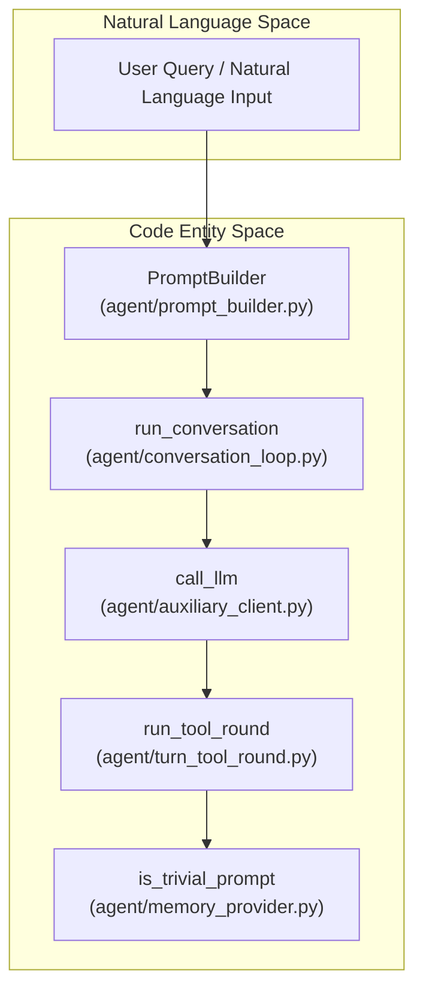
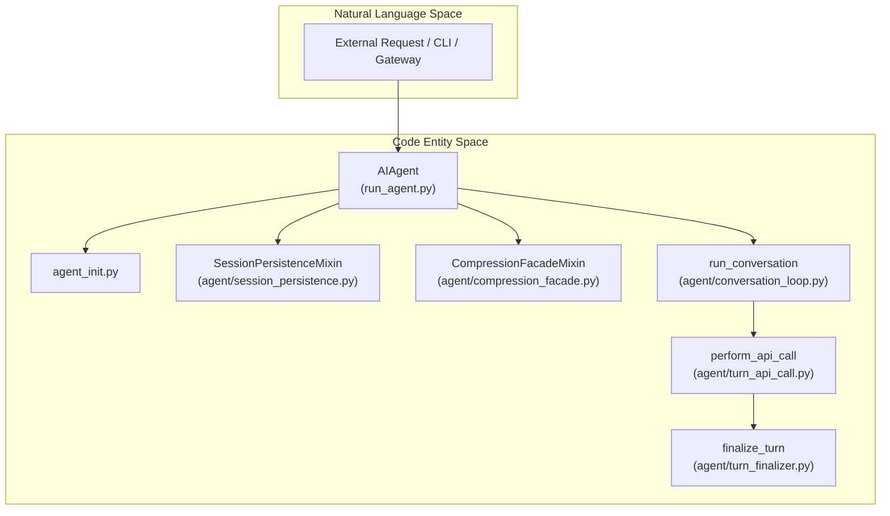

<!-- source: DeepWiki mcp.deepwiki.com · repo nousresearch/hermes-agent · page 4 Core Agent · fetched 2026-10-26 -->

# Core Agent

Relevant source files

The following files were used as context for generating this wiki page:

- [agent/agent_init.py](agent/agent_init.py)
- [agent/agent_runtime_helpers.py](agent/agent_runtime_helpers.py)
- [agent/chat_completion_helpers.py](agent/chat_completion_helpers.py)
- [agent/compaction_display.py](agent/compaction_display.py)
- [agent/compression_facade.py](agent/compression_facade.py)
- [agent/context_compressor.py](agent/context_compressor.py)
- [agent/conversation_compression.py](agent/conversation_compression.py)
- [agent/conversation_compression_archive.py](agent/conversation_compression_archive.py)
- [agent/conversation_compression_manual.py](agent/conversation_compression_manual.py)
- [agent/conversation_loop.py](agent/conversation_loop.py)
- [agent/inline_tool_executors.py](agent/inline_tool_executors.py)
- [agent/micro_compaction.py](agent/micro_compaction.py)
- [agent/tool_dispatch_helpers.py](agent/tool_dispatch_helpers.py)
- [agent/tool_executor.py](agent/tool_executor.py)
- [agent/turn_context.py](agent/turn_context.py)
- [agent/turn_finalizer.py](agent/turn_finalizer.py)
- [apps/desktop/e2e/core/reply-painted-once.spec.ts](apps/desktop/e2e/core/reply-painted-once.spec.ts)
- [apps/desktop/src/app/session/hooks/use-message-stream/reused-final-after-tool.test.tsx](apps/desktop/src/app/session/hooks/use-message-stream/reused-final-after-tool.test.tsx)
- [apps/desktop/src/app/session/hooks/use-message-stream/test-harness.tsx](apps/desktop/src/app/session/hooks/use-message-stream/test-harness.tsx)
- [scripts/micro_compaction_report.py](scripts/micro_compaction_report.py)
- [tests/agent/test_compression_commit_fence_race.py](tests/agent/test_compression_commit_fence_race.py)
- [tests/agent/test_compression_concurrent_fork.py](tests/agent/test_compression_concurrent_fork.py)
- [tests/agent/test_compression_stall_fallback.py](tests/agent/test_compression_stall_fallback.py)
- [tests/agent/test_compressor_truncated_summary_guard.py](tests/agent/test_compressor_truncated_summary_guard.py)
- [tests/agent/test_context_compressor.py](tests/agent/test_context_compressor.py)
- [tests/agent/test_conversation_compression_manual.py](tests/agent/test_conversation_compression_manual.py)
- [tests/agent/test_empty_response_recovery_persistence.py](tests/agent/test_empty_response_recovery_persistence.py)
- [tests/agent/test_in_place_merged_user_rows.py](tests/agent/test_in_place_merged_user_rows.py)
- [tests/agent/test_message_sequence_repair.py](tests/agent/test_message_sequence_repair.py)
- [tests/agent/test_micro_compaction.py](tests/agent/test_micro_compaction.py)
- [tests/agent/test_proactive_prune_rearm_threshold.py](tests/agent/test_proactive_prune_rearm_threshold.py)
- [tests/agent/test_proactive_prune_restart_safety.py](tests/agent/test_proactive_prune_restart_safety.py)
- [tests/agent/test_proactive_tool_result_pruning.py](tests/agent/test_proactive_tool_result_pruning.py)
- [tests/agent/test_setup_beat_card_round.py](tests/agent/test_setup_beat_card_round.py)
- [tests/agent/test_tool_call_args_sanitizer.py](tests/agent/test_tool_call_args_sanitizer.py)
- [tests/agent/test_tool_dispatch_helpers.py](tests/agent/test_tool_dispatch_helpers.py)
- [tests/agent/test_turn_finalizer_final_response_persistence.py](tests/agent/test_turn_finalizer_final_response_persistence.py)
- [tests/agent/test_turn_finalizer_iteration_limit_exit.py](tests/agent/test_turn_finalizer_iteration_limit_exit.py)
- [tests/agent/test_unicode_ascii_codec.py](tests/agent/test_unicode_ascii_codec.py)
- [tests/gateway/test_api_server_compaction_projection.py](tests/gateway/test_api_server_compaction_projection.py)
- [tests/hermes_cli/test_kanban_comment_queries.py](tests/hermes_cli/test_kanban_comment_queries.py)
- [tests/tools/test_kanban_comment_injection.py](tests/tools/test_kanban_comment_injection.py)
- [tests/tools/test_kanban_persisted_identity.py](tests/tools/test_kanban_persisted_identity.py)
- [tests/tui_gateway/test_manual_compress_history_fence.py](tests/tui_gateway/test_manual_compress_history_fence.py)
- [tests/tui_gateway/test_turn_payload_reused_final.py](tests/tui_gateway/test_turn_payload_reused_final.py)
- [website/docs/developer-guide/context-compression-and-caching.md](website/docs/developer-guide/context-compression-and-caching.md)

The Core Agent is the central orchestration component of Hermes Agent, implemented by the `AIAgent` class in `run_agent.py` [run_agent.py:2-7](). It manages the complete lifecycle of AI-powered conversations, coordinating language model interactions, tool execution, context management, memory handling, and session persistence. All entry points—including the CLI, Gateway service, and Batch Runner—instantiate an `AIAgent` and invoke its conversation methods to execute AI agent tasks [run_agent.py:4-6]().

This page provides a high-level overview of the `AIAgent` class structure, its initialization, core responsibilities, and how it bridges natural language inputs to underlying code entities managing the conversation loop, tools, and memory subsystems.

---

## Purpose and Scope

The Core Agent serves as the unified interface for running AI conversations within Hermes Agent. It abstracts complex system tasks such as:

- Selecting and managing LLM providers and client instances via provider auto-detection and proxy resolution [agent/agent_init.py:1-25]().
- Discovering, enabling, and dispatching tools using the centralized toolset system [run_agent.py:130-131]().
- Maintaining conversation context, system prompts, and user memory, including sanitization and redaction [agent/message_sanitization.py:1-25]().
- Handling persistent sessions, including message logging, trajectory management, and native tokenizer extensions [hermes_state.py:1-6]().
- Enforcing turn iteration budgets, subagent delegation, and user interrupt handling [agent/iteration_budget.py:1-10]().

The Core Agent is designed for high concurrency and integration with multiple frontends and service backends.

Sources: [run_agent.py:2-21](), [run_agent.py:130-154](), [agent/agent_init.py:1-25](), [agent/message_sanitization.py:1-25](), [hermes_state.py:1-6](), [agent/iteration_budget.py:1-10]()

---

## AIAgent Class Overview

The `AIAgent` class embodies the Core Agent. Due to its complexity, its implementation is split across multiple mixins and helper modules under `agent/`. It acts as the primary coordinator for session and conversation management [run_agent.py:2-7]().

### Diagram: Natural Language Space to Code Entity Space (Execution Flow)

This diagram shows how natural language queries flow through various code modules: from prompt building to conversation iteration, LLM API calls, tool execution rounds, and memory checks.

Sources: [run_agent.py:2-7](), [agent/conversation_loop.py:1-7](), [agent/prompt_builder.py:1-30](), [agent/memory_provider.py:136-140]()

---

### Diagram: Natural Language Space to Code Entity Space (Subsystem Architecture)

This diagram captures major Core Agent components: the main `AIAgent` coordinates initialization, session persistence, compression facades, conversation loop execution, API calls, and turn finalization.

Sources: [run_agent.py:108-154](), [agent/conversation_loop.py:35-51](), [agent/agent_init.py:1-25]()

---

## Initialization and Configuration

`AIAgent` supports multiple configuration dimensions provided at construction. These include LLM model parameters, toolsets, session control, iteration budgets, and memory/session backends.

| Configuration Area | Key Parameters | Description |
|--------------------|----------------|-------------|
| **LLM Setup** | `model`, `base_url`, `api_key`, `provider` | Specifies the model identity and endpoint, enabling flexible provider resolution [run_agent.py:5-6]() |
| **Tool Management** | `toolsets`, `disabled_toolsets` | Defines which toolsets are enabled or disabled for tool calls during conversations [run_agent.py:130-131]() |
| **Conversation Control** | `max_iterations`, `iteration_budget` | Controls iteration limits for reasoning loops and tool call budgets [agent/iteration_budget.py:1-10]() |
| **Persistent Sessions** | `session_id`, `_session_db` | Enables session persistence with SQLite-backed state and message trajectory logging [run_agent.py:146-147]() |

The agent also integrates with the `agent_init` bootstrap process to resolve runtime environment and prompt context engines upon startup [agent/agent_init.py:1-25]().

Sources: [run_agent.py:2-7](), [run_agent.py:130-131](), [run_agent.py:146-147](), [agent/iteration_budget.py:1-10](), [agent/agent_init.py:1-25]()

---

## Core Responsibilities of `AIAgent`

### 1. Conversation Loop and Tool Execution

The agent manages an iterative reasoning loop, receiving user messages, querying LLMs, executing tools in rounds, and integrating results back into the conversation context. This loop enforces iteration budgets and handles error classification, interrupts, and concurrency [agent/conversation_loop.py:3-6]().

For comprehensive details, see the child page [Conversation Loop](#4.1).

Sources: [agent/conversation_loop.py:3-6]()

---

### 2. Context and Prompt Management

`AIAgent` orchestrates system prompt construction, injecting persona information from `SOUL.md`, managing message sanitization (e.g., tool call ID uniqueness), prompt caching, and sensitive data redaction during conversation turns [agent/message_sanitization.py:1-25]().

For comprehensive details, see the child page [Context and Prompt Management](#4.2).

Sources: [agent/message_sanitization.py:1-25]()

---

### 3. Memory and Sessions

The agent interfaces with the persistent session backend (`SessionDB`, SQLite-based) to log message trajectories and manage per-user memory files (`MEMORY.md`, `USER.md`). It supports session search, recovery flows, and extends SQLite with native tokenizers for languages such as CJK [hermes_state.py:1-6]().

For comprehensive details, see the child page [Memory and Sessions](#4.3).

Sources: [hermes_state.py:1-6]()

---

### 4. Honcho Integration

The Core Agent optionally integrates with Honcho, a native AI memory system that mediates session state, controlling write frequencies, managing prefetch pipelines, and providing dialectic query capabilities for efficient memory handling [agent/agent_init.py:54-72]().

For comprehensive details, see the child page [Honcho Integration](#4.4).

Sources: [agent/agent_init.py:54-72]()

---

### 5. Auxiliary Client

For side tasks such as vision processing, compression, or web content extraction, `AIAgent` uses an auxiliary LLM client abstraction. This resolves appropriate providers and delegates work to adapters specialized for Anthropic, Bedrock, Codex, Gemini, and others [agent/auxiliary_client.py:24-33]().

For comprehensive details, see the child page [Auxiliary Client](#4.5).

Sources: [agent/auxiliary_client.py:24-33]()

---

## Child Pages

This page serves as a high-level parent; detailed technical coverage is available in the following child pages:

- [Conversation Loop](#4.1) — Deep dive into the iterative conversation loop, tool calling flow, turn finalization, transports, error classification, iteration budget, and interrupt handling.
- [Context and Prompt Management](#4.2) — System prompt building, context file usage, SOUL.md persona injection, prompt caching, message sanitization, redaction, and dynamic prompt injection.
- [Memory and Sessions](#4.3) — Session persistence, trajectory logging, MEMORY.md/USER.md management, session search and recovery, and native CJK FTS5 tokenizer extensions.
- [Honcho Integration](#4.4) — AI-native Honcho memory system, HonchoSessionManager, write frequency modes, prefetch pipeline, and dialectic queries.
- [Auxiliary Client](#4.5) — Auxiliary LLM client subsystem for side tasks, provider resolution for auxiliary tasks, and adapters for Anthropic, Bedrock, Codex, Gemini, etc.

Sources: [run_agent.py:2-7]()

---

