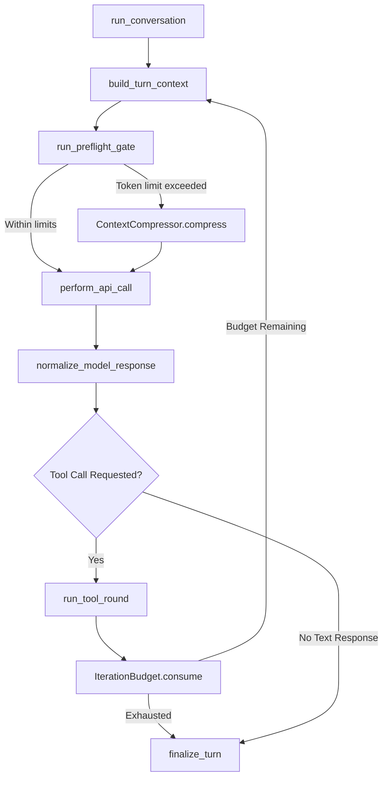
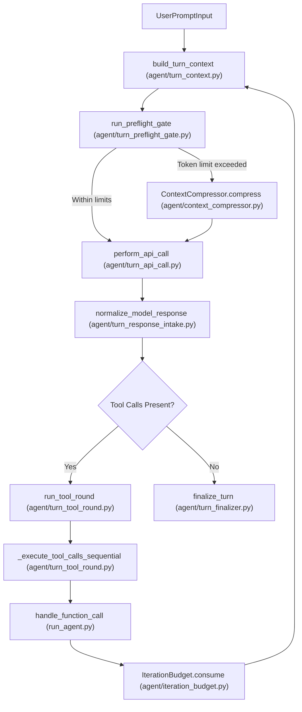

<!-- source: DeepWiki mcp.deepwiki.com · repo nousresearch/hermes-agent · page 4.1 Conversation Loop · fetched 2026-10-26 -->

# Conversation Loop

Relevant source files

The following files were used as context for generating this wiki page:

- [agent/agent_init.py](agent/agent_init.py)
- [agent/agent_runtime_helpers.py](agent/agent_runtime_helpers.py)
- [agent/auxiliary_async_rebuild.py](agent/auxiliary_async_rebuild.py)
- [agent/auxiliary_fallback_recovery.py](agent/auxiliary_fallback_recovery.py)
- [agent/chat_completion_helpers.py](agent/chat_completion_helpers.py)
- [agent/compaction_display.py](agent/compaction_display.py)
- [agent/compression_facade.py](agent/compression_facade.py)
- [agent/context_compressor.py](agent/context_compressor.py)
- [agent/conversation_compression.py](agent/conversation_compression.py)
- [agent/conversation_compression_archive.py](agent/conversation_compression_archive.py)
- [agent/conversation_compression_manual.py](agent/conversation_compression_manual.py)
- [agent/conversation_loop.py](agent/conversation_loop.py)
- [agent/display.py](agent/display.py)
- [agent/error_classifier.py](agent/error_classifier.py)
- [agent/inline_tool_executors.py](agent/inline_tool_executors.py)
- [agent/message_sanitization.py](agent/message_sanitization.py)
- [agent/micro_compaction.py](agent/micro_compaction.py)
- [agent/portal_tags.py](agent/portal_tags.py)
- [agent/prompt_cache_scope.py](agent/prompt_cache_scope.py)
- [agent/tool_dispatch_helpers.py](agent/tool_dispatch_helpers.py)
- [agent/tool_executor.py](agent/tool_executor.py)
- [agent/transports/chat_completions.py](agent/transports/chat_completions.py)
- [agent/turn_api_error.py](agent/turn_api_error.py)
- [agent/turn_context.py](agent/turn_context.py)
- [agent/turn_finalizer.py](agent/turn_finalizer.py)
- [agent/turn_loop_errors.py](agent/turn_loop_errors.py)
- [agent/turn_recovery.py](agent/turn_recovery.py)
- [apps/desktop/e2e/core/reply-painted-once.spec.ts](apps/desktop/e2e/core/reply-painted-once.spec.ts)
- [apps/desktop/src/app/session/hooks/use-message-stream/reused-final-after-tool.test.tsx](apps/desktop/src/app/session/hooks/use-message-stream/reused-final-after-tool.test.tsx)
- [apps/desktop/src/app/session/hooks/use-message-stream/test-harness.tsx](apps/desktop/src/app/session/hooks/use-message-stream/test-harness.tsx)
- [contributors/emails/coffee@coffeebot.dev](contributors/emails/coffee@coffeebot.dev)
- [contributors/emails/sahabatheri@gmail.com](contributors/emails/sahabatheri@gmail.com)
- [plugins/model-providers/actual/__init__.py](plugins/model-providers/actual/__init__.py)
- [plugins/model-providers/ai-gateway/__init__.py](plugins/model-providers/ai-gateway/__init__.py)
- [plugins/model-providers/bedrock/__init__.py](plugins/model-providers/bedrock/__init__.py)
- [plugins/model-providers/commandcode/__init__.py](plugins/model-providers/commandcode/__init__.py)
- [plugins/model-providers/commandcode/plugin.yaml](plugins/model-providers/commandcode/plugin.yaml)
- [plugins/model-providers/copilot-acp/__init__.py](plugins/model-providers/copilot-acp/__init__.py)
- [plugins/model-providers/custom/__init__.py](plugins/model-providers/custom/__init__.py)
- [plugins/model-providers/fireworks/__init__.py](plugins/model-providers/fireworks/__init__.py)
- [plugins/model-providers/gmi/__init__.py](plugins/model-providers/gmi/__init__.py)
- [plugins/model-providers/minimax/__init__.py](plugins/model-providers/minimax/__init__.py)
- [plugins/model-providers/nous/__init__.py](plugins/model-providers/nous/__init__.py)
- [plugins/model-providers/openrouter/__init__.py](plugins/model-providers/openrouter/__init__.py)
- [plugins/model-providers/router/__init__.py](plugins/model-providers/router/__init__.py)
- [plugins/model-providers/router/plugin.yaml](plugins/model-providers/router/plugin.yaml)
- [providers/README.md](providers/README.md)
- [scripts/micro_compaction_report.py](scripts/micro_compaction_report.py)
- [tests/agent/test_auxiliary_named_custom_providers.py](tests/agent/test_auxiliary_named_custom_providers.py)
- [tests/agent/test_auxiliary_parameter_rung_chaining.py](tests/agent/test_auxiliary_parameter_rung_chaining.py)
- [tests/agent/test_background_review_cache_parity.py](tests/agent/test_background_review_cache_parity.py)
- [tests/agent/test_compression_commit_fence_race.py](tests/agent/test_compression_commit_fence_race.py)
- [tests/agent/test_compression_concurrent_fork.py](tests/agent/test_compression_concurrent_fork.py)
- [tests/agent/test_compression_stall_fallback.py](tests/agent/test_compression_stall_fallback.py)
- [tests/agent/test_compressor_truncated_summary_guard.py](tests/agent/test_compressor_truncated_summary_guard.py)
- [tests/agent/test_context_compressor.py](tests/agent/test_context_compressor.py)
- [tests/agent/test_conversation_compression_manual.py](tests/agent/test_conversation_compression_manual.py)
- [tests/agent/test_credential_pool_provider_boundary.py](tests/agent/test_credential_pool_provider_boundary.py)
- [tests/agent/test_declared_conversation_scope.py](tests/agent/test_declared_conversation_scope.py)
- [tests/agent/test_display.py](tests/agent/test_display.py)
- [tests/agent/test_empty_response_recovery_persistence.py](tests/agent/test_empty_response_recovery_persistence.py)
- [tests/agent/test_error_classifier.py](tests/agent/test_error_classifier.py)
- [tests/agent/test_image_corrupt_recovery.py](tests/agent/test_image_corrupt_recovery.py)
- [tests/agent/test_image_rejection_fallback.py](tests/agent/test_image_rejection_fallback.py)
- [tests/agent/test_in_place_merged_user_rows.py](tests/agent/test_in_place_merged_user_rows.py)
- [tests/agent/test_malformed_tool_args_no_fallback.py](tests/agent/test_malformed_tool_args_no_fallback.py)
- [tests/agent/test_message_sequence_repair.py](tests/agent/test_message_sequence_repair.py)
- [tests/agent/test_micro_compaction.py](tests/agent/test_micro_compaction.py)
- [tests/agent/test_minimax_provider.py](tests/agent/test_minimax_provider.py)
- [tests/agent/test_portal_tags.py](tests/agent/test_portal_tags.py)
- [tests/agent/test_proactive_prune_rearm_threshold.py](tests/agent/test_proactive_prune_rearm_threshold.py)
- [tests/agent/test_proactive_prune_restart_safety.py](tests/agent/test_proactive_prune_restart_safety.py)
- [tests/agent/test_proactive_tool_result_pruning.py](tests/agent/test_proactive_tool_result_pruning.py)
- [tests/agent/test_prompt_cache_scope.py](tests/agent/test_prompt_cache_scope.py)
- [tests/agent/test_review_fork_cache_scope.py](tests/agent/test_review_fork_cache_scope.py)
- [tests/agent/test_setup_beat_card_round.py](tests/agent/test_setup_beat_card_round.py)
- [tests/agent/test_tool_call_args_sanitizer.py](tests/agent/test_tool_call_args_sanitizer.py)
- [tests/agent/test_tool_dispatch_helpers.py](tests/agent/test_tool_dispatch_helpers.py)
- [tests/agent/test_turn_finalizer_final_response_persistence.py](tests/agent/test_turn_finalizer_final_response_persistence.py)
- [tests/agent/test_turn_finalizer_iteration_limit_exit.py](tests/agent/test_turn_finalizer_iteration_limit_exit.py)
- [tests/agent/test_unicode_ascii_codec.py](tests/agent/test_unicode_ascii_codec.py)
- [tests/agent/transports/test_chat_completions.py](tests/agent/transports/test_chat_completions.py)
- [tests/agent/transports/test_router_codex_efforts.py](tests/agent/transports/test_router_codex_efforts.py)
- [tests/gateway/test_api_server_compaction_projection.py](tests/gateway/test_api_server_compaction_projection.py)
- [tests/gateway/test_api_server_declared_conversation.py](tests/gateway/test_api_server_declared_conversation.py)
- [tests/gateway/test_discord_format.py](tests/gateway/test_discord_format.py)
- [tests/hermes_cli/test_actual_provider.py](tests/hermes_cli/test_actual_provider.py)
- [tests/hermes_cli/test_ai_gateway_models.py](tests/hermes_cli/test_ai_gateway_models.py)
- [tests/hermes_cli/test_bedrock_mantle_key_env.py](tests/hermes_cli/test_bedrock_mantle_key_env.py)
- [tests/hermes_cli/test_bedrock_region_scoped_picker.py](tests/hermes_cli/test_bedrock_region_scoped_picker.py)
- [tests/hermes_cli/test_copilot_in_model_list.py](tests/hermes_cli/test_copilot_in_model_list.py)
- [tests/hermes_cli/test_fireworks_provider.py](tests/hermes_cli/test_fireworks_provider.py)
- [tests/hermes_cli/test_gmi_provider.py](tests/hermes_cli/test_gmi_provider.py)
- [tests/hermes_cli/test_inventory_reasoning_caps.py](tests/hermes_cli/test_inventory_reasoning_caps.py)
- [tests/hermes_cli/test_kanban_comment_queries.py](tests/hermes_cli/test_kanban_comment_queries.py)
- [tests/hermes_cli/test_keyed_provider_credential_pool.py](tests/hermes_cli/test_keyed_provider_credential_pool.py)
- [tests/hermes_cli/test_model_flow_pooled_credentials.py](tests/hermes_cli/test_model_flow_pooled_credentials.py)
- [tests/hermes_cli/test_prompt_api_key.py](tests/hermes_cli/test_prompt_api_key.py)
- [tests/hermes_cli/test_router_provider.py](tests/hermes_cli/test_router_provider.py)
- [tests/hermes_state/test_conversation_root.py](tests/hermes_state/test_conversation_root.py)
- [tests/plugins/model_providers/test_commandcode_profile.py](tests/plugins/model_providers/test_commandcode_profile.py)
- [tests/plugins/model_providers/test_custom_profile.py](tests/plugins/model_providers/test_custom_profile.py)
- [tests/plugins/model_providers/test_fireworks_profile.py](tests/plugins/model_providers/test_fireworks_profile.py)
- [tests/plugins/model_providers/test_minimax_profile.py](tests/plugins/model_providers/test_minimax_profile.py)
- [tests/plugins/model_providers/test_nous_profile.py](tests/plugins/model_providers/test_nous_profile.py)
- [tests/providers/test_fetch_models_base_url.py](tests/providers/test_fetch_models_base_url.py)
- [tests/providers/test_profile_wiring.py](tests/providers/test_profile_wiring.py)
- [tests/providers/test_provider_profiles.py](tests/providers/test_provider_profiles.py)
- [tests/providers/test_transport_parity.py](tests/providers/test_transport_parity.py)
- [tests/tools/test_kanban_comment_injection.py](tests/tools/test_kanban_comment_injection.py)
- [tests/tools/test_kanban_persisted_identity.py](tests/tools/test_kanban_persisted_identity.py)
- [tests/tui_gateway/test_manual_compress_history_fence.py](tests/tui_gateway/test_manual_compress_history_fence.py)
- [tests/tui_gateway/test_turn_payload_reused_final.py](tests/tui_gateway/test_turn_payload_reused_final.py)
- [website/docs/developer-guide/adding-providers.md](website/docs/developer-guide/adding-providers.md)
- [website/docs/developer-guide/context-compression-and-caching.md](website/docs/developer-guide/context-compression-and-caching.md)

This page details the internal mechanics of the Hermes Agent's conversation loop, implemented primarily in `agent/conversation_loop.py` [agent/conversation_loop.py:1-6]() and orchestrated by `run_agent.AIAgent`. It covers the iterative process of managing a conversational turn, tool calling flows, multi-provider model transports, error classification, iteration budgeting, and interrupt handling.

---

## Overview and Scope

The core lifecycle of a conversational turn is managed by `run_conversation` in `agent/conversation_loop.py` [agent/conversation_loop.py:1-6](). It coordinates message context construction, prompt caching plans, context compression, API calls across various model transports, tool execution, turn finalization, and error recovery.

Sources:
- `agent/conversation_loop.py:1-6`

---

## The Iterative Conversation Loop

The conversation loop executes iteratively for a given user prompt until a final assistant text response is produced, an error forces termination, or the iteration budget is exhausted.

### Loop Phases

1.  **Pre-flight & Turn Context Construction**: `build_turn_context` [agent/turn_context.py:1-10]() prepares system prompts, persona injection (`SOUL.md`), and ephemeral API content sidecars.
2.  **Compression Check**: `run_preflight_gate` [agent/turn_preflight_gate.py:1-35]() evaluates whether token usage exceeds thresholds, triggering history summarization via `ContextCompressor` [agent/context_compressor.py:1-38]().
3.  **API Request Assembly**: `assemble_api_request` [agent/turn_request_assembly.py:1-50]() and `build_api_request` [agent/turn_api_request.py:1-50]() construct the payload containing messages, tools, and caching headers.
4.  **Model Transport Execution**: Calls the configured LLM backend using streaming or non-streaming transports with rate-limit guards (`nous_rate_limit_guard`) [agent/turn_api_call.py:43]().
5.  **Response Intake & Sanitization**: `normalize_model_response` [agent/turn_response_intake.py:1-45]() parses assistant text, reasoning blocks (`<think>`), and tool call requests.
6.  **Tool Dispatch**: If the model requests tool execution, `run_tool_round` [agent/turn_tool_round.py:1-35]() executes tools sequentially or concurrently via `_execute_tool_calls_sequential` [agent/turn_tool_round.py:60]().
7.  **Iteration Budget Accounting**: `IterationBudget.consume()` [agent/iteration_budget.py:1-47]() decrements remaining allowances.
8.  **Turn Finalization**: `finalize_turn` [agent/turn_finalizer.py:1-100]() saves trajectories, logs metrics, and flushes message history to `SessionDB`.

### Conversation Loop Flow

Sources:
- `agent/conversation_loop.py:1-56`
- `agent/turn_context.py:1-10`
- `agent/turn_preflight_gate.py:1-35`
- `agent/context_compressor.py:1-38`
- `agent/turn_api_call.py:43`
- `agent/turn_tool_round.py:1-35`
- `agent/turn_tool_round.py:60`
- `agent/iteration_budget.py:1-47`
- `agent/turn_finalizer.py:1-100`
- `agent/turn_request_assembly.py:1-50`
- `agent/turn_api_request.py:1-50`
- `agent/turn_response_intake.py:1-45`

---

## Model Transports

Hermes Agent supports multiple model backend transports to interact with diverse LLM APIs, handling protocol translation, response streaming, and formatting differences.

### Transport Implementations

-   **Chat Completions (`chat_completions.py`):** The standard OpenAI-compatible transport handling standard streaming and non-streaming requests, function call schemas, and custom headers [agent/transports/chat_completions.py:1-100](). It also includes logic for handling router timeout shims, where a router failure is encoded as a successful ChatCompletion [agent/transports/chat_completions.py:113-135]().
-   **Codex Transport (`codex.py`):** Adapts OpenAI Codex and specialized provider schemas, mapping raw completions and responses adapters (`agent/codex_responses_adapter.py`).
-   **Anthropic Adapter (`anthropic_adapter.py`):** Translates standard tool definitions and message histories into Anthropic Messages API formats, supporting prompt caching headers and structured block parsing.
-   **Bedrock Adapter (`bedrock_adapter.py`):** Interfaces with AWS Bedrock inference endpoints, handling model invocation payloads and credential negotiation.
-   **Gemini Native Adapter (`gemini_native_adapter.py`):** Connects directly to Google AI Studio or Vertex AI endpoints, mapping Gemini safety settings, thought parts, and native tool-calling structures [agent/gemini_native_adapter.py:1-75]().

Sources:
- `agent/transports/chat_completions.py:1-100`
- `agent/transports/chat_completions.py:113-135`
- `agent/gemini_native_adapter.py:1-75`

---

## Iteration Budget and Interrupt Handling

### Iteration Budget Management

-   **Purpose:** Prevents runaway agent loops and infinite tool recursion.
-   **Class:** `IterationBudget` tracks allowed assistant-model turns and tool roundtrips [agent/iteration_budget.py:1-47]().
-   **Sharing:** Subagent delegation (`delegate_task`) proportionally shares budget pools [agent/agent_runtime_helpers.py:92-93]().

### Interrupt Handling

-   **Hard Interrupts:** Triggered via `request_hard_interrupt()` from the CLI or signal handlers.
-   **Scaffold Markers:** When interrupted while awaiting model responses, turns insert `_INTERRUPT_SCAFFOLD_MARKER` to record user intervention [agent/conversation_loop.py:72](). This marker is shared with the `api_messages` ghost-row filter to ensure consistency [agent/conversation_loop.py:71]().
-   **Sequence Repair:** `close_interrupted_tool_sequence()` [agent/message_sanitization.py:28]() patches dangling tool call blocks to maintain transcript validity.
-   **Relay Teardown:** `_join_worker_for_relay_teardown` [agent/chat_completion_helpers.py:83-101]() ensures that Relay LLM scopes are properly joined before raising `InterruptedError` to prevent race conditions during turn teardown.

Sources:
- `agent/iteration_budget.py:1-47`
- `agent/agent_runtime_helpers.py:92-93`
- `agent/conversation_loop.py:72`
- `agent/conversation_loop.py:71`
- `agent/message_sanitization.py:28`
- `agent/chat_completion_helpers.py:83-101`

---

## Error Classification and Recovery

When API errors or stream failures occur during a turn, Hermes classifies the exception to determine the recovery strategy.

### Error Classification Taxonomy

-   **ClassifiedError (`error_classifier.py`):** Evaluates provider status codes, malformed payloads, and stream disruptions [agent/error_classifier.py:70-85]().
-   **Failover Reasons:** Categorizes failures into conditions such as `rate_limit`, `context_overflow`, `auth_permanent`, or `server_error` [agent/error_classifier.py:34-67]().
-   **Credential Rotation:** `resolve_runtime_pool_key` [agent/agent_runtime_helpers.py:30]() switches API keys or accounts upon encountering 429 rate limits.
-   **Model Fallbacks:** `_init_fallback_chain` [agent/agent_init.py:32]() and fallback chains manage automatic failover to alternative provider models when primary endpoints exhaust retries.
-   **Provider Stream Error:** `ProviderStreamError` [agent/chat_completion_helpers.py:109-132]() is raised when a provider encodes an API error as streaming content instead of a standard SDK error. This allows for specific handling of such cases.
-   **Hygiene Cooldowns:** `_is_hygiene_preagent_only_cooldown` [agent/context_compressor.py:137-145]() identifies cooldowns that are specific to pre-agent hygiene processes (e.g., watchdog timeouts or turn-hold deferrals) and should not block the in-agent compressor.

Sources:
- `agent/error_classifier.py:70-85`
- `agent/error_classifier.py:34-67`
- `agent/agent_runtime_helpers.py:30`
- `agent/agent_init.py:32`
- `agent/chat_completion_helpers.py:109-132`
- `agent/context_compressor.py:137-145`

---

## Diagram: Natural Language to Code Entity Mapping

The following diagram bridges natural language interactions to the underlying Python classes and functions executing the conversation loop.

Sources:
- `agent/turn_context.py:1-10`
- `agent/turn_preflight_gate.py:1-35`
- `agent/context_compressor.py:1-38`
- `agent/turn_api_call.py:43`
- `agent/turn_response_intake.py:1-45`
- `agent/turn_tool_round.py:1-35`
- `agent/turn_tool_round.py:60`
- `agent/iteration_budget.py:1-47`
- `agent/turn_finalizer.py:1-100`

---

## Diagram: Tool Execution and Response Lifecycle

Sources:
- `agent/turn_tool_round.py:1-35`
- `agent/turn_tool_round.py:60`
- `agent/agent_runtime_helpers.py:20-25`
- `agent/iteration_budget.py:1-47`
- `agent/turn_context.py:1-10`

---

## References and Sources

- `agent/conversation_loop.py:1-1860`
- `agent/turn_context.py:1-155`
- `agent/context_compressor.py:1-148`
- `agent/conversation_compression.py:1-130`
- `agent/iteration_budget.py:1-47`
- `agent/error_classifier.py:1-119`
- `agent/agent_runtime_helpers.py:1-141`
- `agent/message_sanitization.py:28`
- `agent/transports/chat_completions.py:1-135`
- `agent/gemini_native_adapter.py:1-75`
- `agent/turn_preflight_gate.py:1-35`
- `agent/turn_request_assembly.py:1-50`
- `agent/turn_api_request.py:1-50`
- `agent/turn_response_intake.py:1-45`
- `agent/turn_api_call.py:43`
- `agent/turn_finalizer.py:1-100`
- `agent/chat_completion_helpers.py:83-132`
- `agent/agent_init.py:32`
- `agent/turn_tool_round.py:1-60`

---

