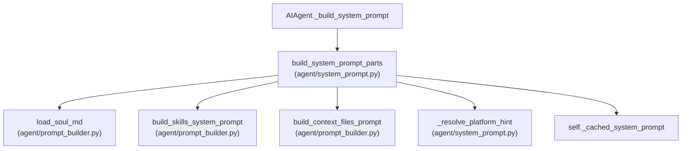
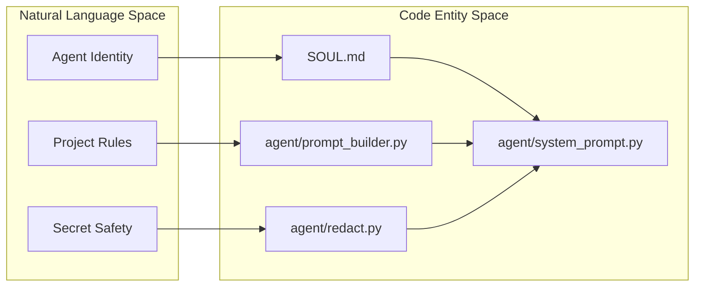
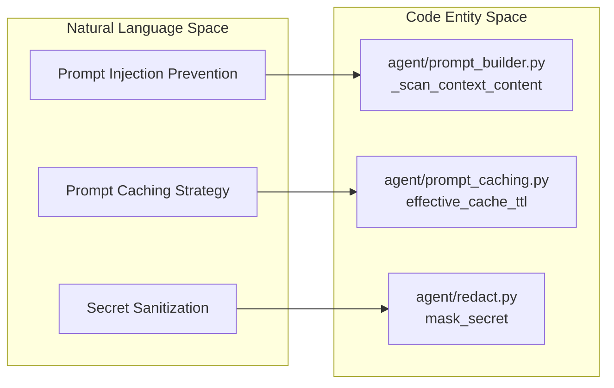

<!-- source: DeepWiki mcp.deepwiki.com · repo nousresearch/hermes-agent · page 4.2 Context and Prompt Management · fetched 2026-10-26 -->

# Context and Prompt Management

Relevant source files

The following files were used as context for generating this wiki page:

- [agent/codex_responses_adapter.py](agent/codex_responses_adapter.py)
- [agent/coding_context.py](agent/coding_context.py)
- [agent/native_compaction.py](agent/native_compaction.py)
- [agent/prompt_builder.py](agent/prompt_builder.py)
- [agent/prompt_cache_boundary.py](agent/prompt_cache_boundary.py)
- [agent/prompt_caching.py](agent/prompt_caching.py)
- [agent/skill_commands.py](agent/skill_commands.py)
- [agent/skill_utils.py](agent/skill_utils.py)
- [agent/surface_switch.py](agent/surface_switch.py)
- [agent/system_prompt.py](agent/system_prompt.py)
- [agent/transports/codex.py](agent/transports/codex.py)
- [contributors/emails/qhs19950124@outlook.com](contributors/emails/qhs19950124@outlook.com)
- [tests/agent/test_codex_responses_adapter.py](tests/agent/test_codex_responses_adapter.py)
- [tests/agent/test_coding_context.py](tests/agent/test_coding_context.py)
- [tests/agent/test_compaction_prompt_rebuild.py](tests/agent/test_compaction_prompt_rebuild.py)
- [tests/agent/test_failover_identity.py](tests/agent/test_failover_identity.py)
- [tests/agent/test_moa_aggregator_prefix_stability.py](tests/agent/test_moa_aggregator_prefix_stability.py)
- [tests/agent/test_native_compaction.py](tests/agent/test_native_compaction.py)
- [tests/agent/test_native_compaction_nontext_retention.py](tests/agent/test_native_compaction_nontext_retention.py)
- [tests/agent/test_native_compaction_typed_user_retention.py](tests/agent/test_native_compaction_typed_user_retention.py)
- [tests/agent/test_prompt_builder.py](tests/agent/test_prompt_builder.py)
- [tests/agent/test_prompt_cache_boundary.py](tests/agent/test_prompt_cache_boundary.py)
- [tests/agent/test_prompt_caching.py](tests/agent/test_prompt_caching.py)
- [tests/agent/test_provider_parity.py](tests/agent/test_provider_parity.py)
- [tests/agent/test_responses_empty_tool_replay.py](tests/agent/test_responses_empty_tool_replay.py)
- [tests/agent/test_skill_cache_thrash.py](tests/agent/test_skill_cache_thrash.py)
- [tests/agent/test_skill_commands.py](tests/agent/test_skill_commands.py)
- [tests/agent/test_skill_commands_reload.py](tests/agent/test_skill_commands_reload.py)
- [tests/agent/test_skill_invocation_description.py](tests/agent/test_skill_invocation_description.py)
- [tests/agent/test_skill_utils.py](tests/agent/test_skill_utils.py)
- [tests/agent/test_system_prompt.py](tests/agent/test_system_prompt.py)
- [tests/agent/test_system_prompt_switch_invalidation.py](tests/agent/test_system_prompt_switch_invalidation.py)
- [tests/agent/transports/test_codex_transport.py](tests/agent/transports/test_codex_transport.py)
- [tests/fixtures/spark_failing_turn_shape.json](tests/fixtures/spark_failing_turn_shape.json)
- [tests/gateway/test_reload_skills_command.py](tests/gateway/test_reload_skills_command.py)
- [tests/gateway/test_stacked_skill_platform_disabled.py](tests/gateway/test_stacked_skill_platform_disabled.py)
- [tests/hermes_cli/test_session_skill_previews.py](tests/hermes_cli/test_session_skill_previews.py)
- [tests/hermes_cli/test_session_system_prompt_dedup.py](tests/hermes_cli/test_session_system_prompt_dedup.py)
- [tests/tools/test_skills_tool.py](tests/tools/test_skills_tool.py)
- [tests/tools/test_vision_history_budget.py](tests/tools/test_vision_history_budget.py)
- [tools/skills_tool.py](tools/skills_tool.py)
- [tools/vision_tools_history_budget.py](tools/vision_tools_history_budget.py)
- [tools/vision_tools_image_prep.py](tools/vision_tools_image_prep.py)
- [website/docs/user-guide/features/vision.md](website/docs/user-guide/features/vision.md)

## Purpose and Scope

This page explains the end-to-end prompt lifecycle within Hermes Agent (`agent/prompt_builder.py` [agent/prompt_builder.py:1-5](), `agent/system_prompt.py` [agent/system_prompt.py:1-10]()). It covers system prompt assembly into a cached structure, discovery and validation of global and project-local context files (`SOUL.md`, `AGENTS.md`, `.cursorrules`, `.hermes.md`), prompt caching mechanisms (`agent/prompt_caching.py`, `agent/prompt_cache_boundary.py`), message payload sanitization (`agent/message_sanitization.py`), secret redaction, and dynamic prompt injection defenses.

Sources: [agent/prompt_builder.py:1-5](), [agent/system_prompt.py:1-10]()

---

## System Prompt Assembly

The core logic for system prompt construction is orchestrated by `AIAgent._build_system_prompt()`, which relies on `build_system_prompt_parts()` defined in `agent/system_prompt.py` [agent/system_prompt.py:1-24](). The system prompt is built once per session and reused across all turns to optimize upstream prefix caching; it is only rebuilt when context compression occurs [agent/system_prompt.py:3-5]().

### Three-Tier Prompt Structure
The prompt is assembled by joining three tiers with double newlines (`\n\n`) [agent/system_prompt.py:10]():

1.  **Stable Tier:** Contains the core identity (from `SOUL.md` or `DEFAULT_AGENT_IDENTITY` [agent/prompt_builder.py:160]()), tool guidance, computer-use guidance, model-specific operational instructions, and platform hints [agent/system_prompt.py:12-16]().
2.  **Context Tier:** Includes the caller-supplied `system_message`, context files discovered in the working directory (`.hermes.md`, `HERMES.md`, `AGENTS.md`, `.cursorrules`), and a snapshot of the current coding workspace [agent/system_prompt.py:17-19]().
3.  **Volatile Tier:** Contains the dynamic skills index, memory snapshots, the `USER.md` profile, external memory provider blocks, and a metadata line containing the timestamp, session ID, and model provider [agent/system_prompt.py:20-22]().

### Platform Hints and Overrides
Platform-specific instructions are resolved via `_resolve_platform_hint()` [agent/system_prompt.py:54-68](). This function reads `agent._platform_hint_overrides` from the configuration and allows for `replace` or `append` operations on default hints [agent/system_prompt.py:59-67](). For instance, if the agent runs in the desktop's embedded terminal, a specific clarifier is appended to the TUI hint [agent/system_prompt.py:77-83]().

### System Prompt Assembly Flow

Title: "System Prompt Assembly Architecture"

Sources: [agent/system_prompt.py:1-24](), [agent/system_prompt.py:54-68](), [agent/prompt_builder.py:1-46]()

---

## Context Files and Persona (SOUL.md)

### Persona Discovery
The agent's persona is defined by `DEFAULT_AGENT_IDENTITY` [agent/prompt_builder.py:160](), but can be overridden by a `SOUL.md` file located in the Hermes home directory (`HERMES_HOME`). The `load_soul_md` function in `agent/prompt_builder.py` is responsible for loading this file [tests/agent/test_prompt_builder.py:85]().

### Project Context Discovery and Timeout Protection
Hermes scans for project-specific instructions in files named `.hermes.md` or `HERMES.md` [agent/prompt_builder.py:141-150](). Context file reads use `_read_text_with_timeout()` with a strict deadline (`_CONTEXT_FILE_READ_TIMEOUT_SECS = 5.0`) executed on a daemon thread to prevent network-backed filesystems (e.g., NFS, iCloud Drive) from stalling startup [agent/prompt_builder.py:36-81]().

### Security Scanning
To prevent prompt injection, all context file content is scanned via `_scan_context_content()` [agent/prompt_builder.py:83-111]().
- It utilizes `_scan_for_threats` from `tools.threat_patterns.py` with the `context` scope [agent/prompt_builder.py:30](), [agent/prompt_builder.py:101]().
- If a threat is detected, the content is blocked and replaced with a warning placeholder in the system prompt [agent/prompt_builder.py:109-110]().
- For user-authored files (such as `SOUL.md` in `HERMES_HOME`), a detected injection pattern results in a warning, but the content is still loaded [agent/prompt_builder.py:103-107](). This is because `SOUL.md` sits in the same trust class as `config.yaml` [agent/prompt_builder.py:90-93]().
- Project-dir files (`AGENTS.md`, `.cursorrules`, `.hermes.md`) and `SOUL.md` owned by a profile distribution (e.g., installed via `hermes profile install <git-url>`) will still block on injection patterns [agent/prompt_builder.py:94-96](), [tests/agent/test_prompt_builder.py:80-93]().
- It strips UTF-8 BOMs and YAML frontmatter using `_strip_yaml_frontmatter()` to ensure only the markdown body reaches the LLM [agent/prompt_builder.py:98-100](), [agent/prompt_builder.py:153-158]().

### Content Truncation
Context files are subject to truncation to fit within token budgets. The character limit is either a static constant (`CONTEXT_FILE_MAX_CHARS`) or a dynamic value calculated based on the model's context window, configurable via `context_file_max_chars` in `config.yaml` [tests/agent/test_prompt_builder.py:24-27](), [tests/agent/test_prompt_builder.py:165-175](). Truncation warnings are managed per-context using `contextvars` [tests/agent/test_prompt_builder.py:136-163]().

Sources: [agent/prompt_builder.py:36-160](), [tests/agent/test_prompt_builder.py:24-27](), [tests/agent/test_prompt_builder.py:80-93](), [tests/agent/test_prompt_builder.py:136-163](), [tests/agent/test_prompt_builder.py:165-175]()

---

## Prompt Caching Strategy

Hermes implements an Anthropic-compatible prompt caching strategy managed by `agent/prompt_caching.py` and `agent/prompt_cache_boundary.py`.

### Breakpoints and TTL Management
- **Layout:** Cache markers (`cache_control`) are placed at strategic breakpoints including the static system prefix boundary, the end of the system prompt, and recent non-system messages.
- **TTL Resolution:** The function `effective_cache_ttl()` clamps requested cache TTLs (`5m` or `1h`) based on destination provider capabilities and model constraints.
- **Request-Local Splitting:** `_apply_cache_marker()` and `_apply_system_cache_markers()` dynamically inject cache control properties into message payloads at request time without mutating stored session histories.

Sources: [agent/prompt_caching.py:1-139](), [agent/prompt_cache_boundary.py:1-12]()

---

## Redaction and Secret Sanitization

Hermes uses a regex-based redaction system in `agent/redact.py` to prevent API keys and credentials from appearing in logs or tool outputs.

### Redaction Logic
- **Prefix Matching:** The system maintains a comprehensive list of known API key prefixes (e.g., `sk-`, `ghp_`, `AIza`, `glpat-`) in `_PREFIX_PATTERNS` [agent/redact.py:138-140]().
- **Assignment Matching:** It identifies secrets in environment variable assignments (`_ENV_ASSIGN_RE`) covering secret keywords like `API_KEY`, `TOKEN`, `SECRET`, and `PASSWORD` [tests/agent/test_redact.py:142-145]().
- **Masking Strategy:** The `mask_secret()` function fully masks short tokens and preserves the edges of longer tokens for debugging [agent/redact.py:1-5]().
- **Vault Value Redaction:** Exact secret values that transit a server-side vault fill (e.g., `browser_vault`) are registered via `register_vault_redaction_value()` and scrubbed from tool results [agent/redact.py:20-58]().
- **Sensitive Query Parameters:** Sensitive query string parameters (`access_token`, `api_key`, `password`) are scrubbed [agent/redact.py:78-87]().
- **Feature Flag:** Redaction status is governed by `_REDACT_ENABLED`, initialized from `HERMES_REDACT_SECRETS` or `security.redact_secrets` in `config.yaml` [agent/redact.py:91-97]().

Sources: [agent/redact.py:1-140](), [tests/agent/test_redact.py:22-145]()

---

## Message Sanitization

Message payloads are normalized and sanitized via `agent/message_sanitization.py` prior to dispatching LLM requests [agent/message_sanitization.py:1-6]().
- **Surrogate Repair:** `_sanitize_surrogates()` intercepts lone surrogate code points (`[\ud800-\udfff]`) that would otherwise crash JSON serialization in the OpenAI SDK or upstream clients [agent/message_sanitization.py:21-36]().
- **Tool Argument Recovery:** Malformed JSON tool arguments and structural elements are repaired via `_sanitize_structure()` and `_sanitize_messages()` [agent/message_sanitization.py:74-121]().

Sources: [agent/message_sanitization.py:1-121]()

---

## Plugin and Middleware Integration

Plugins can dynamically inject content into the system prompt and interact with execution loops.

### Middleware Hooks
The middleware system allows plugins to intercept and rewrite LLM requests, tool arguments, and execution callbacks across four kinds: `llm_request`, `llm_execution`, `tool_request`, and `tool_execution`.

### Plugin Context Injection
Plugins can register hooks to render custom prompt sections. The `AIAgent` resolves these via `_frozen_plugin_prompt_sections()` and embeds them safely inside canonical XML-like framing [agent/system_prompt.py:113-135](). These sections are rendered once per session and frozen on the agent, with a snapshot stored in `_plugin_system_prompt_sections_snapshot` [agent/system_prompt.py:118-119]().

Sources: [agent/system_prompt.py:1-32](), [agent/system_prompt.py:113-135]()

---

## Dynamic Prompt Injection

Dynamic prompt injection refers to inserting context-relevant information into the prompt at runtime:

-   **Skill Indexing:** `build_skills_system_prompt()` in `agent/prompt_builder.py` dynamically generates a list of available skills and descriptions. `_parse_skill_file()` extracts metadata, and `_skill_should_show()` determines relevance based on platform, environment, and application conditions.
-   **Environment Hints:** `build_environment_hints()` provides the LLM with OS info, available tools, and other contextual variables.
-   **Kanban Guidance:** When operating as a Kanban worker, `KANBAN_GUIDANCE` is injected via `_tool_guidance_block()` [agent/system_prompt.py:24]().
-   **Memory Guidance:** Guidance on how to use memory tools is injected when enabled.
-   **Title Generation:** `agent/title_generator.py` dynamically generates session titles from user messages.
-   **Shell Hooks:** `agent/shell_hooks.py` allows dynamic injection of shell scripts as hooks.

Sources: [agent/prompt_builder.py:1-5](), [tools/skills_tool.py:21](), [agent/skill_commands.py:18-34](), [agent/system_prompt.py:24](), [agent/title_generator.py:1-6](), [agent/shell_hooks.py:1-5]()

---

## Mapping Concepts to Code Entities

The following diagrams bridge natural language concepts to the specific code entities responsible for them.

Title: "Prompt Construction Mapping"

Sources: [agent/prompt_builder.py:1-158](), [agent/system_prompt.py:1-24]()

Title: "Context Injection Caching and Filtering"

Sources: [agent/prompt_builder.py:81-109](), [agent/prompt_cache_boundary.py:1-12]()

---

