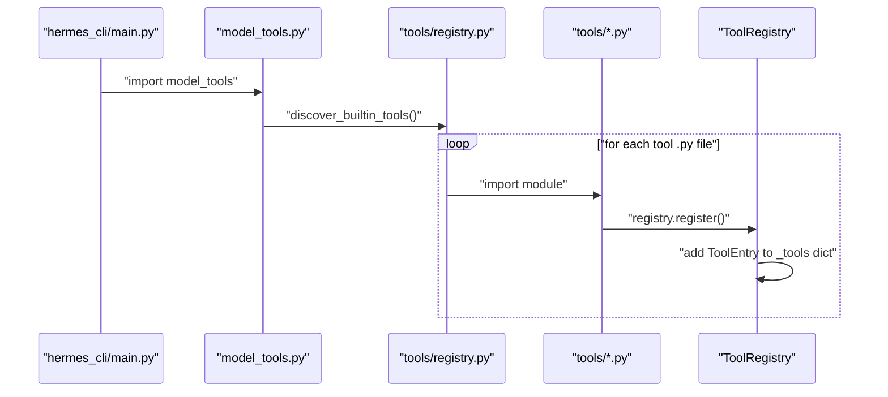
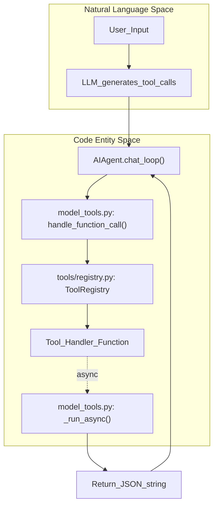
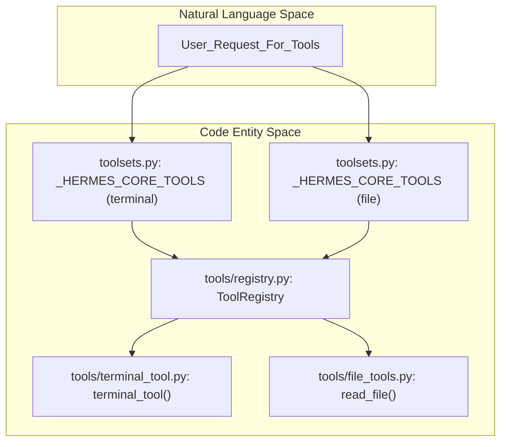

<!-- source: DeepWiki mcp.deepwiki.com · repo nousresearch/hermes-agent · page 5 Tool System · fetched 2026-10-26 -->

# Tool System

Relevant source files

The following files were used as context for generating this wiki page:

- [contributors/emails/Cryptodombili@gmail.com](contributors/emails/Cryptodombili@gmail.com)
- [contributors/emails/fangliquan@qq.com](contributors/emails/fangliquan@qq.com)
- [contributors/emails/southpawinmusic@gmail.com](contributors/emails/southpawinmusic@gmail.com)
- [gateway/authz_mixin.py](gateway/authz_mixin.py)
- [gateway/channel_directory.py](gateway/channel_directory.py)
- [gateway/config_env.py](gateway/config_env.py)
- [gateway/pairing.py](gateway/pairing.py)
- [hermes_cli/nous_auth_keepalive.py](hermes_cli/nous_auth_keepalive.py)
- [hermes_cli/nous_subscription.py](hermes_cli/nous_subscription.py)
- [hermes_cli/pairing.py](hermes_cli/pairing.py)
- [hermes_cli/plugin_validate.py](hermes_cli/plugin_validate.py)
- [hermes_cli/plugin_validate_core_override.py](hermes_cli/plugin_validate_core_override.py)
- [hermes_cli/plugin_validate_desktop.py](hermes_cli/plugin_validate_desktop.py)
- [hermes_cli/plugin_validate_private_imports.py](hermes_cli/plugin_validate_private_imports.py)
- [hermes_cli/portal_cli.py](hermes_cli/portal_cli.py)
- [hermes_cli/tools_config.py](hermes_cli/tools_config.py)
- [model_tools.py](model_tools.py)
- [tests/agent/test_codex_token_expired_replay_recovery.py](tests/agent/test_codex_token_expired_replay_recovery.py)
- [tests/agent/test_tool_arg_coercion.py](tests/agent/test_tool_arg_coercion.py)
- [tests/gateway/test_channel_directory.py](tests/gateway/test_channel_directory.py)
- [tests/gateway/test_env_override_explicit_disable.py](tests/gateway/test_env_override_explicit_disable.py)
- [tests/gateway/test_multiplex_pairing_stores.py](tests/gateway/test_multiplex_pairing_stores.py)
- [tests/gateway/test_pairing.py](tests/gateway/test_pairing.py)
- [tests/gateway/test_pairing_allowlist_bypass.py](tests/gateway/test_pairing_allowlist_bypass.py)
- [tests/gateway/test_whatsapp_cloud_allowed_users.py](tests/gateway/test_whatsapp_cloud_allowed_users.py)
- [tests/hermes_cli/test_install_cua_driver.py](tests/hermes_cli/test_install_cua_driver.py)
- [tests/hermes_cli/test_nous_auth_keepalive.py](tests/hermes_cli/test_nous_auth_keepalive.py)
- [tests/hermes_cli/test_nous_subscription.py](tests/hermes_cli/test_nous_subscription.py)
- [tests/hermes_cli/test_plugin_validate.py](tests/hermes_cli/test_plugin_validate.py)
- [tests/hermes_cli/test_plugin_validate_private_imports.py](tests/hermes_cli/test_plugin_validate_private_imports.py)
- [tests/hermes_cli/test_tools_config.py](tests/hermes_cli/test_tools_config.py)
- [tests/tools/test_container_cwd_sanitize.py](tests/tools/test_container_cwd_sanitize.py)
- [tests/tools/test_image_generation_managed.py](tests/tools/test_image_generation_managed.py)
- [tests/tools/test_modal_sandbox_fixes.py](tests/tools/test_modal_sandbox_fixes.py)
- [tests/tools/test_plugin_guard.py](tests/tools/test_plugin_guard.py)
- [tests/tools/test_project_tools.py](tests/tools/test_project_tools.py)
- [tests/tools/test_registry.py](tests/tools/test_registry.py)
- [tests/tools/test_schema_sanitizer.py](tests/tools/test_schema_sanitizer.py)
- [tests/tools/test_self_repo_guard.py](tests/tools/test_self_repo_guard.py)
- [tests/tools/test_skills_guard.py](tests/tools/test_skills_guard.py)
- [tests/tools/test_skills_guard_agent_config.py](tests/tools/test_skills_guard_agent_config.py)
- [tests/tools/test_terminal_requirements.py](tests/tools/test_terminal_requirements.py)
- [tests/tools/test_terminal_self_repo_guard.py](tests/tools/test_terminal_self_repo_guard.py)
- [tests/tools/test_terminal_tool_requirements.py](tests/tools/test_terminal_tool_requirements.py)
- [tests/tools/test_tts_path_traversal.py](tests/tools/test_tts_path_traversal.py)
- [tools/__init__.py](tools/__init__.py)
- [tools/arg_coercion.py](tools/arg_coercion.py)
- [tools/blueprints.py](tools/blueprints.py)
- [tools/image_generation_managed.py](tools/image_generation_managed.py)
- [tools/path_security.py](tools/path_security.py)
- [tools/plugin_guard.py](tools/plugin_guard.py)
- [tools/plugin_guard_context.py](tools/plugin_guard_context.py)
- [tools/project_tools.py](tools/project_tools.py)
- [tools/registry.py](tools/registry.py)
- [tools/schema_sanitizer.py](tools/schema_sanitizer.py)
- [tools/self_repo_guard.py](tools/self_repo_guard.py)
- [tools/skills_guard.py](tools/skills_guard.py)
- [toolsets.py](toolsets.py)
- [website/docs/developer-guide/agent-loop.md](website/docs/developer-guide/agent-loop.md)
- [website/docs/developer-guide/architecture.md](website/docs/developer-guide/architecture.md)
- [website/docs/developer-guide/cron-internals.md](website/docs/developer-guide/cron-internals.md)
- [website/docs/developer-guide/gateway-internals.md](website/docs/developer-guide/gateway-internals.md)
- [website/docs/developer-guide/provider-runtime.md](website/docs/developer-guide/provider-runtime.md)
- [website/docs/reference/tools-reference.md](website/docs/reference/tools-reference.md)
- [website/docs/reference/toolsets-reference.md](website/docs/reference/toolsets-reference.md)
- [website/docs/user-guide/features/tool-gateway.md](website/docs/user-guide/features/tool-gateway.md)

The tool system provides the Hermes Agent with its action capabilities through a structured function-calling architecture. This page introduces the high-level framework of the tool registry, how toolsets are composed and managed, and how tool discovery and execution flow through the system.

Specific technical details about individual tool categories and implementations are delegated to child pages, linked below. This parent page provides the architectural context and explains the integration among major components involved in the Hermes tool system.

Sources: [tools/registry.py:1-6]()

---

## Architecture Overview

The Hermes Agent leverages a **centralized registry pattern** for tools, where each tool module self-registers its schema, handler, and availability check function at module import time [tools/registry.py:1-6]().

- The **tool registry singleton** (`ToolRegistry`) holds metadata and handlers, serving as the definitive source of available tools in the system [tools/registry.py:1-27]().
- The `model_tools.py` module orchestrates tool discovery by importing all tool modules, then provides the public API for retrieving tool schemas and handling function calls [model_tools.py:1-7]().
- Toolsets declared in `toolsets.py` group tools by use case or scenario, defining core tool pools like `_HERMES_CORE_TOOLS` [toolsets.py:11-39]().
- MCP (Model Context Protocol) servers provide dynamically registered external tools integrated into the same registry.

For details on toolset composition and platform-specific configurations, see [Tool Registry and Toolsets](#5.1).

Sources: [tools/registry.py:1-27](), [model_tools.py:1-7](), [toolsets.py:11-39]()

---

## Tool Registration and Discovery

Each tool registers itself by calling `registry.register()` at module load time [tools/registry.py:1-6](). Tool discovery scans candidate modules in `tools/` using `discover_builtin_tools()` [tools/registry.py:96-141]() and leverages a persistent cache (`tool_discovery_cache.json`) to memoize AST registrations [tools/registry.py:98-104](). Schema sanitization ensures strict backend compatibility via `tools/schema_sanitizer.py` [tools/schema_sanitizer.py:81-84]().

For details, see [Tool Registry and Toolsets](#5.1).

Title: "Tool Discovery Sequence"

Sources: [tools/registry.py:96-141](), [tools/schema_sanitizer.py:81-84]()

---

## Tool Dispatch and Execution

Tool execution bridges LLM function calls to registered handlers. The `model_tools.py` module provides the `handle_function_call()` entry point, which dispatches to the appropriate tool handler [model_tools.py:1-7](). Asynchronous tool handlers are managed by `_run_async()` to ensure compatibility with various execution contexts, including running event loops [model_tools.py:94-146](). Security guards protect execution via `tools/self_repo_guard.py` [tools/self_repo_guard.py:1-13]() and `tools/skills_guard.py` [tools/skills_guard.py:1-8]().

Title: "Tool Dispatch Flow bridging Natural Language Space to Code Entity Space"

Sources: [model_tools.py:1-7](), [model_tools.py:94-146](), [tools/registry.py:1-30](), [tools/self_repo_guard.py:1-13](), [tools/skills_guard.py:1-8]()

---

## Toolsets and Sub-Topics

Tools are categorized into functional toolsets and specialized execution domains, detailed in the child pages. Toolsets are defined in `toolsets.py` and can be configured per-session, per-platform, or interactively [toolsets.py:1-132](), [website/docs/reference/toolsets-reference.md:20-49]().

- [Tool Registry and Toolsets](#5.1) — Registration, schema sanitization, tool search/deferral [tools/registry.py:1-155](), [tools/schema_sanitizer.py:1-84]().
- [Terminal and File Operations](#5.2) — Terminal execution, file read/write/patch, fuzzy matching, and safety guards.
- [Process Management](#5.3) — Background process spawning, process registry, and execution kernels.
- [Security and Command Approval](#5.4) — Dangerous command detection, Tirith integration, self-repo guards (`tools/self_repo_guard.py` [tools/self_repo_guard.py:1-13]()), and allowlists.
- [Web, Browser, and Vision Tools](#5.5) — Web search/extract, Playwright automation, vision analysis, and video processing.
- [Code Execution and MCP Tools](#5.6) — `execute_code` sandbox, MCP server integration and transports.
- [Subagent Delegation](#5.7) — `delegate_task` tool, async subagent spawning, and iteration budget sharing.
- [Other Tools](#5.8) — Memory tools, todo management, image/video generation, skill management (`tools/skills_guard.py` [tools/skills_guard.py:1-8]()), and Petdex.

Title: "Toolset and Tool Code Entity Mapping bridging Natural Language Space to Code Entity Space"

Sources: [tools/registry.py:86-125](), [tools/skills_guard.py:1-8](), [toolsets.py:1-132](), [website/docs/reference/toolsets-reference.md:20-49]()

---

## Related Child Pages

For detailed technical documentation and implementation specifics, see the following child pages:

- [Tool Registry and Toolsets](#5.1) — Tool registration, discovery, and platform-specific configurations.
- [Terminal and File Operations](#5.2) — Terminal execution and semantic file tools.
- [Process Management](#5.3) — Background process spawning and lifecycle management.
- [Security and Command Approval](#5.4) — Dangerous command detection and approval callbacks.
- [Web, Browser, and Vision Tools](#5.5) — Web search, Playwright automation, and multimodal analysis.
- [Code Execution and MCP Tools](#5.6) — Python sandbox and MCP server integration.
- [Subagent Delegation](#5.7) — Subagent spawning and iteration budget sharing.
- [Other Tools](#5.8) — Memory, image/video generation, and computer use.

Sources: [tools/registry.py:1-27]()

---

