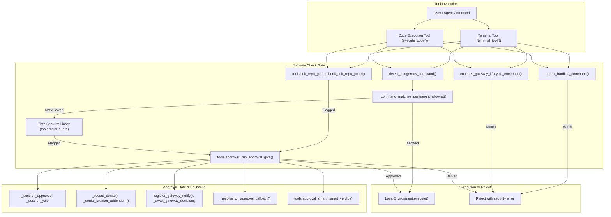

<!-- source: DeepWiki mcp.deepwiki.com · repo nousresearch/hermes-agent · page 5.4 Security and Command Approval · fetched 2026-10-26 -->

# Security and Command Approval

Relevant source files

The following files were used as context for generating this wiki page:

- [contributors/emails/jethachan@gmail.com](contributors/emails/jethachan@gmail.com)
- [contributors/emails/southpawinmusic@gmail.com](contributors/emails/southpawinmusic@gmail.com)
- [cron/lifecycle_guard.py](cron/lifecycle_guard.py)
- [evals/approval_deny_dispatch.py](evals/approval_deny_dispatch.py)
- [hermes_cli/plugin_validate.py](hermes_cli/plugin_validate.py)
- [hermes_cli/plugin_validate_core_override.py](hermes_cli/plugin_validate_core_override.py)
- [hermes_cli/plugin_validate_desktop.py](hermes_cli/plugin_validate_desktop.py)
- [hermes_cli/plugin_validate_private_imports.py](hermes_cli/plugin_validate_private_imports.py)
- [tests/agent/test_tool_arg_coercion.py](tests/agent/test_tool_arg_coercion.py)
- [tests/cron/test_lifecycle_guard_profile_scan.py](tests/cron/test_lifecycle_guard_profile_scan.py)
- [tests/gateway/test_approve_deny_commands.py](tests/gateway/test_approve_deny_commands.py)
- [tests/gateway/test_matrix_project_context_isolation.py](tests/gateway/test_matrix_project_context_isolation.py)
- [tests/gateway/test_session_boundary_security_state.py](tests/gateway/test_session_boundary_security_state.py)
- [tests/gateway/test_yolo_command.py](tests/gateway/test_yolo_command.py)
- [tests/hermes_cli/test_gateway_restart_loop.py](tests/hermes_cli/test_gateway_restart_loop.py)
- [tests/hermes_cli/test_plugin_validate.py](tests/hermes_cli/test_plugin_validate.py)
- [tests/hermes_cli/test_plugin_validate_private_imports.py](tests/hermes_cli/test_plugin_validate_private_imports.py)
- [tests/tools/test_approval.py](tests/tools/test_approval.py)
- [tests/tools/test_approval_bun_deno_eval.py](tests/tools/test_approval_bun_deno_eval.py)
- [tests/tools/test_approval_cancelled_attribution.py](tests/tools/test_approval_cancelled_attribution.py)
- [tests/tools/test_approval_deny_rules.py](tests/tools/test_approval_deny_rules.py)
- [tests/tools/test_approval_grep_in_substitution.py](tests/tools/test_approval_grep_in_substitution.py)
- [tests/tools/test_approval_interrupt.py](tests/tools/test_approval_interrupt.py)
- [tests/tools/test_container_cwd_sanitize.py](tests/tools/test_container_cwd_sanitize.py)
- [tests/tools/test_cron_approval_mode.py](tests/tools/test_cron_approval_mode.py)
- [tests/tools/test_hardline_blocklist.py](tests/tools/test_hardline_blocklist.py)
- [tests/tools/test_mcp_trust_gating.py](tests/tools/test_mcp_trust_gating.py)
- [tests/tools/test_modal_sandbox_fixes.py](tests/tools/test_modal_sandbox_fixes.py)
- [tests/tools/test_plugin_guard.py](tests/tools/test_plugin_guard.py)
- [tests/tools/test_project_tools.py](tests/tools/test_project_tools.py)
- [tests/tools/test_registry.py](tests/tools/test_registry.py)
- [tests/tools/test_schema_sanitizer.py](tests/tools/test_schema_sanitizer.py)
- [tests/tools/test_self_repo_guard.py](tests/tools/test_self_repo_guard.py)
- [tests/tools/test_skills_guard.py](tests/tools/test_skills_guard.py)
- [tests/tools/test_skills_guard_agent_config.py](tests/tools/test_skills_guard_agent_config.py)
- [tests/tools/test_smart_approval_injection.py](tests/tools/test_smart_approval_injection.py)
- [tests/tools/test_smart_approval_policy.py](tests/tools/test_smart_approval_policy.py)
- [tests/tools/test_terminal_requirements.py](tests/tools/test_terminal_requirements.py)
- [tests/tools/test_terminal_self_repo_guard.py](tests/tools/test_terminal_self_repo_guard.py)
- [tests/tools/test_terminal_tool_requirements.py](tests/tools/test_terminal_tool_requirements.py)
- [tests/tools/test_tts_path_traversal.py](tests/tools/test_tts_path_traversal.py)
- [tests/tools/test_yolo_mode.py](tests/tools/test_yolo_mode.py)
- [tools/approval.py](tools/approval.py)
- [tools/approval_context.py](tools/approval_context.py)
- [tools/approval_detection.py](tools/approval_detection.py)
- [tools/approval_floors.py](tools/approval_floors.py)
- [tools/approval_gateway_wait.py](tools/approval_gateway_wait.py)
- [tools/approval_human_wait.py](tools/approval_human_wait.py)
- [tools/approval_prompt.py](tools/approval_prompt.py)
- [tools/approval_smart.py](tools/approval_smart.py)
- [tools/arg_coercion.py](tools/arg_coercion.py)
- [tools/blueprints.py](tools/blueprints.py)
- [tools/path_security.py](tools/path_security.py)
- [tools/plugin_guard.py](tools/plugin_guard.py)
- [tools/plugin_guard_context.py](tools/plugin_guard_context.py)
- [tools/project_tools.py](tools/project_tools.py)
- [tools/registry.py](tools/registry.py)
- [tools/schema_sanitizer.py](tools/schema_sanitizer.py)
- [tools/self_repo_guard.py](tools/self_repo_guard.py)
- [tools/skills_guard.py](tools/skills_guard.py)
- [website/docs/developer-guide/observer-hooks.md](website/docs/developer-guide/observer-hooks.md)
- [website/docs/user-guide/security.md](website/docs/user-guide/security.md)
- [website/i18n/zh-Hans/docusaurus-plugin-content-docs/current/reference/mcp-config-reference.md](website/i18n/zh-Hans/docusaurus-plugin-content-docs/current/reference/mcp-config-reference.md)

## Purpose and Scope

The Security and Command Approval system in Hermes Agent provides a defense-in-depth architecture designed to protect the host system from destructive, malicious, or inadvertent commands generated by the AI agent or users. It intercepts tool executions and terminal invocations, enforcing strict security policies before any external side effects occur.

The system combines pattern-based threat analysis, external binary security scanning (`Tirith`), hardline blocking rules, gateway lifecycle protection, self-repository mutation guards, context-local session tracking, and interactive/async approval workflows.

Key mechanisms include:

- **Dangerous Command Detection**: Regex-based heuristics identifying risky operations such as recursive deletions or forced overrides [tools/approval_detection.py:20-43]().
- **Hardline Blocklist**: Unconditional vetoes for catastrophic commands (e.g., root wipes) that bypass all override toggles [tools/approval_detection.py:88-109]().
- **Gateway Lifecycle Guard**: Specialized detection preventing infinite restart loops caused by agent-scheduled tasks or commands targeting the gateway itself [website/docs/user-guide/security.md:97-103]().
- **Tirith Security Integration**: An external security binary (`tirith`) that analyzes command strings for homograph URLs, pipe-to-interpreter risks, and terminal injection [tools/skills_guard.py:1-8]().
- **Self-Repo Guards**: Specialized detection preventing Git operations (like `checkout`, `switch`, `rebase`, or `bisect`) from mutating the specific source checkout backing the running process [tools/self_repo_guard.py:1-24]().
- **Per-Session Approval State**: Thread-safe state tracking keyed by session identifiers and pattern hashes [tools/approval.py:50-57]().
- **Circuit Breaker for Smart Approvals**: Consecutive-denial tracking that escalates guardian LLM rejections into hard-stop instructions [tools/approval.py:58-111]().

Sources: [tools/approval.py:1-42](), [tools/approval_detection.py:1-109](), [tools/skills_guard.py:1-8](), [tools/self_repo_guard.py:1-24](), [website/docs/user-guide/security.md:97-103]().

---

## System Architecture and Data Flow

The security guard sits between the agent's tool dispatchers (such as the Terminal Tool or code execution handlers) and environment-level execution backends. It analyzes commands for dangerous patterns, consults per-session and permanent allowlists, invokes external security scanning, and potentially prompts for user approval.

**Diagram:** Security Command Approval and Enforcement Flow

- The agent submits commands through terminal or code execution tools.
- The system first applies **hardline rules** that veto commands unconditionally.
- Next, **gateway lifecycle guard** prevents dangerous commands targeting the Hermes gateway lifecycle.
- The **self-repo guard** detects risky Git operations that may mutate the agent's running source.
- The **dangerous command detector** finds suspicious commands via regex patterns.
- Commands are checked against a **permanent allowlist** and transient session approvals, skipping unnecessary prompts.
- Suspicious commands go through the **Tirith scanner** (an external binary) for advanced static analysis.
- When approval is required, various interactive or automated approval flows are invoked, including CLI prompts, gateway message queues, and a "smart" LLM reviewer.
- Approved commands are executed in the environment backend.
- Denied commands are blocked with an error.

Sources: [tools/approval.py:1-40](), [tools/approval_detection.py:1-109](), [tools/skills_guard.py:1-8](), [tools/self_repo_guard.py:1-24](), [website/docs/user-guide/security.md:97-103]().

---

## Dangerous Command Detection and Guards

Hermes enforces a tiered detection model to identify risky commands that could cause data loss or host damage without user approval.

### 1. Hardline Blocklist

Certain commands matching catastrophic patterns are blocked unconditionally. These include:

- Recursive deletion of critical system directories (e.g., `/`, `/etc`, `/usr`, `/var`).
- Forced formatting of device partitions.
- Writing raw data directly to devices (e.g., `dd of=/dev/sda`).

Such patterns are stored in the `HARDLINE_PATTERNS` list within `tools/approval_detection.py` and match based on anchored regular expressions with careful normalization to avoid false positives [tools/approval_detection.py:88-109]().

These commands are rejected regardless of any override or YOLO mode settings.

### 2. Gateway Lifecycle Guard

To prevent an infinite restart or stop loop of the Hermes gateway service, commands that target the gateway lifecycle are detected and rejected. These include:

- `hermes gateway restart`, `hermes gateway stop`
- `launchctl kickstart/unload/submit` targeting hermes-gateway labels
- `systemctl restart/stop hermes-gateway`
- Process killer commands (`pkill`, `taskkill`, `Stop-Process`) targeting the gateway or the hosting Python interpreter processes.

The lifecycle guard uses regex-based detection defined in `cron/lifecycle_guard.py` and is designed as a defense-in-depth layer that cannot be bypassed by approval or force flags [cron/lifecycle_guard.py:30-108](), [website/docs/user-guide/security.md:97-103]().

### 3. Pattern-Based Detection

`detect_dangerous_command` in `tools/approval_detection.py` applies a wide array of regex patterns to recognize dangerous or sensitive command usage, including but not limited to:

- Permuted GNU `rm` flags (e.g., `rm build/ -rf`).
- Windows command shell patterns: `del /f /q`, `rmdir /s /q`.
- PowerShell destructive commands including encoded commands (`encodedCommand`).
- Package manager uninstall commands across npm, pnpm, yarn, pip, and brew (e.g., `npm uninstall`, `pip uninstall`).
- Sensitive file writes to locations like `~/.ssh/`, `~/.hermes/.env`, shell RC files, and credential file paths.

The detection accounts for shell quoting, command wrappers (e.g., sudo), and platform-specific variations [tools/approval_detection.py:20-43](), [tests/tools/test_approval.py:22-34](), [tests/hermes_cli/test_gateway_restart_loop.py:28-53]().

Sources: [tools/approval_detection.py:1-109](), [tests/tools/test_approval.py:22-34](), [tests/tools/test_approval.py:95-110](), [tests/hermes_cli/test_gateway_restart_loop.py:28-53](), [cron/lifecycle_guard.py:30-108](), [website/docs/user-guide/security.md:97-103]().

---

## Tirith Security Integration

Tirith is an external security binary wrapped by the `tools.skills_guard` module, which performs advanced analysis beyond pattern matching, including:

- Detection of homograph or IDN-link URLs that masquerade as safe targets.
- Pipe-to-plaintext interpreter attacks.
- Terminal injection and other shell-related threats.

The core of this support lies in `tools/skills_guard.py`, a module that is also responsible for scanning skill or plugin source files through regex-based threat patterns. The Tirith binary checks commands on a deeper semantic and syntactic level before the approval gate.

Key features:

- `tools.skills_guard.scan_file` performs regex scans per file to identify threat patterns [tools/skills_guard.py:157-162]().
- Verdicts (safe, caution, dangerous) are mapped from the set of findings via severity aggregation in `_determine_verdict` [tools/skills_guard.py:70-79]().
- Installation is gated by `should_allow_install`, which applies trust-based policies involving known trusted repos and community validations [tools/skills_guard.py:29-30](), [tests/tools/test_skills_guard.py:102-105]().

Hermes also applies a related `tools.plugin_guard` module during plugin installations, leveraging similar pattern sets and tuning exemptions for known benign plugin behaviors like environment variable reading [tools/plugin_guard.py:1-10](), [tools/plugin_guard.py:57-65]().

Sources: [tools/skills_guard.py:1-136](), [tools/skills_guard.py:157-162](), [tools/skills_guard.py:70-79](), [tools/skills_guard.py:29-30](), [tests/tools/test_skills_guard.py:102-105](), [tools/plugin_guard.py:1-127]().

---

## Per-Session State, Circuit Breaker, and Approval Callbacks

The approval system maintains thread-safe state in `tools/approval.py` to track approvals, YOLO mode, pending approval requests, and denial tallies keyed by the unique session key.

### Key State Variables

- `_pending`: Dictionary of currently pending approval entries per session key.
- `_session_approved`: Per-session sets of pattern keys (command signatures) that have been approved.
- `_session_yolo`: Set of session keys currently running with YOLO mode enabled (disabling prompts).
- `_launch_yolo_applied`: Tracks if YOLO was already applied at session launch.
- `_permanent_approved`: A set of permanently approved commands that bypass approval gates.
- `_permanent_approved_by_home`: For routed multiplex profiles, keeps allowlists by home directory [tools/approval.py:50-60]().
- `_denial_tally`: Tracks consecutive smart rejection counts per session for circuit breaking [tools/approval.py:61-111]().

### Denial Circuit Breaker

When the guardian LLM repeatedly denies a command beyond a configured threshold (default 3), further retries are blocked with an escalated hard stop message. This prevents denial loops wasting LLM calls and confuses agents.

Functions involved:

- `_record_denial(session_key)`: Increment denial count.
- `_reset_denials(session_key)`: Clear denial count after approval.
- `_denial_breaker_addendum(session_key)`: Fetches escalation text when threshold exceeded [tools/approval.py:80-115]().

### Approval Callbacks and Blocking Waits

The approval system supports multiple modes for requesting approval:

- **CLI Interactive Approvals**: Uses `_resolve_cli_approval_callback()` and `prompt_dangerous_approval()` for interactive prompts on local agents [tools/approval_context.py:27-30](), [tools/approval_prompt.py]().

- **Gateway Approvals**: For gateway sessions, the approval request is enqueued in `_gateway_queues` per session and passed to a registered notify callback (`register_gateway_notify()`). The system then blocks waiting for decisions with `_await_gateway_decision()` until user action or timeout [tools/approval.py:121-144](), [tools/approval_gateway_wait.py]().

- **Smart LLM Approvals**: Uses auxiliary LLM calls (`_smart_verdict`) to auto-approve or deny low-risk cases without human input. This is configurable via `approvals.mode = smart` [tools/approval_smart.py:40](), [tests/tools/test_approval.py:59-90]().

### Mode Configuration and Behavior

The approval system behavior and fallback policies depend on context and configuration keys such as:

- `approvals.mode` (`smart` | `manual` | `off`)
- `cron_mode`, `single_query_mode`, `unattended_mode` defining auto-approval vs deny behavior for those contexts.
- YOLO mode toggled per session or via CLI flags disables approval prompts except hardline blocks.

Sources: [tools/approval.py:50-144](), [tools/approval_context.py:27-30](), [tools/approval_prompt.py:1-100](), [tools/approval_gateway_wait.py:1-100](), [tools/approval_smart.py:1-100](), [website/docs/user-guide/security.md:24-95]().

---

## Self-Repo Guards and Allowlist System

Hermes protects its own running source checkout from being mutated by agent-initiated Git commands through the Self-Repo Guard implemented in `tools/self_repo_guard.py` [tools/self_repo_guard.py:1-79]().

### Guarded Operations

The guard monitors for commands containing Git worktree mutation verbs, such as:

- `checkout`, `switch`, `rebase`, `merge`, `pull`
- `restore`, `clean`, `cherry-pick`, `revert`, `bisect`

and file manipulations that would affect the repository backing the running agent.

### Shell Parsing and Deobfuscation

Given that shell commands can be obfuscated with variable assignments, wrappers (`sudo`, `env`), command substitutions, and heredocs, the guard includes utilities that parse and normalize shell command words and skip comments:

- `_shell_words_at(command, start)`
- `_consume_options(words, start, options_with_arg)`
- `_command_parts(words)`
- `_scope_keys(command, starts)`
- Detection scopes track nested subshells and quoting states.

These routines ensure accurate detection even with complex syntaxes [tools/self_repo_guard.py:70-155]().

### Running Source Root

The current source root is identified by resolving the path of the running `__file__` two levels up and verifying presence of a `.git` directory [tools/self_repo_guard.py:71-77]().

### Allowlist System

Commands that are pre-approved in permanent allowlists bypass the approval process, as do commands that have already been approved in the current session. This reduces excessive prompting and facilitates safe repeated operations.

- `_command_matches_permanent_allowlist(command)`: Checks permanent allowlist [tools/approval_floors.py:33-36]().
- `_session_approved`: Tracks session-scoped approvals [tools/approval.py:52]().

Sources: [tools/self_repo_guard.py:1-79](), [tools/approval.py:33-36](), [tools/approval.py:52-56](), [tools/approval_floors.py:33-36]().

---

## Code Entity Reference Diagram

```mermaid
classDiagram
    class ApprovalModule {
        <<tools/approval.py>>
        +_lock: Lock
        +_pending: dict
        +_session_approved: dict
        +_session_yolo: set
        +_permanent_approved: set
        +_permanent_approved_by_home: dict
        +_denial_tally: dict
        +_gateway_queues: dict
        +_gateway_notify_cbs: dict
        +check_all_command_guards(command, env_type)
        +approve_session(session_key)
        +resolve_gateway_approval(session_key, choice, resolve_all, reason, request_id)
    }

    class ApprovalDetection {
        <<tools/approval_detection.py>>
        +detect_dangerous_command(command)
        +detect_hardline_command(command)
        +HARDLINE_PATTERNS: list
    }

    class ApprovalFloors {
        <<tools/approval_floors.py>>
        +_command_matches_permanent_allowlist(command)
        +_match_user_deny_rule(command)
    }

    class ApprovalGatewayWait {
        <<tools/approval_gateway_wait.py>>
        +_await_gateway_decision(session_key, entry_id, timeout)
    }

    class ApprovalPrompt {
        <<tools/approval_prompt.py>>
        +prompt_dangerous_approval(command, description, session_key, is_dangerous, is_hardline, is_self_repo)
    }

    class ApprovalSmart {
        <<tools/approval_smart.py>>
        +_smart_verdict(command, description)
    }

    class SkillsGuard {
        <<tools/skills_guard.py>>
        +scan_file(file_path, file_name)
        +should_allow_install(scan_result, force)
        +THREAT_PATTERNS: list
    }

    class SelfRepoGuard {
        <<tools/self_repo_guard.py>>
        +check_self_repo_guard(command)
        +get_running_source_root()
    }

    class CronLifecycleGuard {
        <<cron/lifecycle_guard.py>>
        +_GATEWAY_LIFECYCLE_PATTERN: re
        +contains_gateway_lifecycle_command(command)
    }

    ApprovalModule --> ApprovalDetection : "uses for command classification"
    ApprovalModule --> ApprovalFloors : "checks allowlists and deny rules"
    ApprovalModule --> ApprovalGatewayWait : "waits for gateway decisions"
    ApprovalModule --> ApprovalPrompt : "presents interactive prompts"
    ApprovalModule --> ApprovalSmart : "requests LLM-based verdicts"
    ApprovalModule --> SkillsGuard : "integrates external scanner"
    ApprovalModule --> SelfRepoGuard : "applies self-repo protection"
    ApprovalModule --> CronLifecycleGuard : "checks for gateway lifecycle commands"
```

**Diagram:** Detailed Security Module Interactions

Sources: [tools/approval.py:1-143](), [tools/approval_detection.py:1-1501](), [tools/approval_floors.py:1-100](), [tools/approval_gateway_wait.py:1-100](), [tools/approval_prompt.py:1-100](), [tools/approval_smart.py:1-100](), [tools/skills_guard.py:1-852](), [tools/self_repo_guard.py:1-79](), [cron/lifecycle_guard.py:1-1285]().

---

# Summary

The Hermes Agent Security and Command Approval system defines a robust multi-layer defense designed to prevent destructive or malicious commands from executing on the user's host environment. The system leverages a combination of regular expression detection, immutable blocklists, external security analysis (`Tirith`), lifecycle guards, and stateful approval management to enforce strict safety boundaries.

Per-session and permanent allowlists reduce repetitive prompting, while a flexible approval callback system enables interactive CLI prompts, async gateway notifications, and smart LLM-based decision making. The self-repo guard protects agent source integrity from accidental rewriting operations.

This careful architecture allows Hermes Agent to safely execute complex shell and code commands generated autonomously while maintaining host system safety and operational integrity.

---

