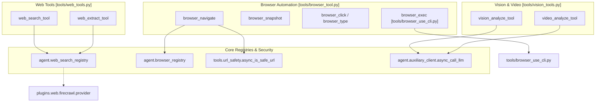
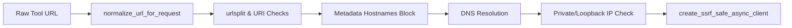

<!-- source: DeepWiki mcp.deepwiki.com · repo nousresearch/hermes-agent · page 5.5 Web, Browser, and Vision Tools · fetched 2026-10-26 -->

# Web, Browser, and Vision Tools

<details>
<summary>Relevant source files</summary>

The following files were used as context for generating this wiki page:

- [contributors/emails/kuangmi@nudge.com.cn](contributors/emails/kuangmi@nudge.com.cn)
- [contributors/emails/yinz7032@gmail.com](contributors/emails/yinz7032@gmail.com)
- [hermes_cli/backup.py](hermes_cli/backup.py)
- [hermes_cli/backup_restore.py](hermes_cli/backup_restore.py)
- [hermes_cli/browser_connect.py](hermes_cli/browser_connect.py)
- [hermes_cli/cli_auto_maintenance.py](hermes_cli/cli_auto_maintenance.py)
- [hermes_cli/nous_account.py](hermes_cli/nous_account.py)
- [plugins/image_gen/fal/plugin.yaml](plugins/image_gen/fal/plugin.yaml)
- [plugins/video_gen/deepinfra/__init__.py](plugins/video_gen/deepinfra/__init__.py)
- [plugins/video_gen/fal/__init__.py](plugins/video_gen/fal/__init__.py)
- [plugins/video_gen/xai/__init__.py](plugins/video_gen/xai/__init__.py)
- [plugins/video_gen/xai/plugin.yaml](plugins/video_gen/xai/plugin.yaml)
- [plugins/web/exa/provider.py](plugins/web/exa/provider.py)
- [plugins/web/firecrawl/provider.py](plugins/web/firecrawl/provider.py)
- [plugins/web/keyless_mcp.py](plugins/web/keyless_mcp.py)
- [plugins/web/parallel/provider.py](plugins/web/parallel/provider.py)
- [plugins/web/perplexity/provider.py](plugins/web/perplexity/provider.py)
- [plugins/web/searxng/__init__.py](plugins/web/searxng/__init__.py)
- [plugins/web/searxng/plugin.yaml](plugins/web/searxng/plugin.yaml)
- [plugins/web/searxng/provider.py](plugins/web/searxng/provider.py)
- [plugins/web/tavily/__init__.py](plugins/web/tavily/__init__.py)
- [plugins/web/tavily/plugin.yaml](plugins/web/tavily/plugin.yaml)
- [plugins/web/tavily/provider.py](plugins/web/tavily/provider.py)
- [tests/agent/test_safe_worker_policy.py](tests/agent/test_safe_worker_policy.py)
- [tests/agent/test_secret_scope_tier1_migration.py](tests/agent/test_secret_scope_tier1_migration.py)
- [tests/agent/test_vision_tool_messages.py](tests/agent/test_vision_tool_messages.py)
- [tests/hermes_cli/test_backup.py](tests/hermes_cli/test_backup.py)
- [tests/hermes_cli/test_browser_connect_default_chromium.py](tests/hermes_cli/test_browser_connect_default_chromium.py)
- [tests/hermes_cli/test_nous_policy_filter.py](tests/hermes_cli/test_nous_policy_filter.py)
- [tests/hermes_cli/test_nous_policy_surfaces.py](tests/hermes_cli/test_nous_policy_surfaces.py)
- [tests/hermes_cli/test_pricing_cache_auth_key.py](tests/hermes_cli/test_pricing_cache_auth_key.py)
- [tests/hermes_cli/test_restore_source_integrity.py](tests/hermes_cli/test_restore_source_integrity.py)
- [tests/hermes_cli/test_snapshot_restore_oauth.py](tests/hermes_cli/test_snapshot_restore_oauth.py)
- [tests/plugins/browser/check_parity_vs_main.py](tests/plugins/browser/check_parity_vs_main.py)
- [tests/plugins/image_gen/check_parity_vs_main.py](tests/plugins/image_gen/check_parity_vs_main.py)
- [tests/plugins/image_gen/test_fal_provider.py](tests/plugins/image_gen/test_fal_provider.py)
- [tests/plugins/video_gen/test_fal_plugin.py](tests/plugins/video_gen/test_fal_plugin.py)
- [tests/plugins/video_gen/test_xai_plugin.py](tests/plugins/video_gen/test_xai_plugin.py)
- [tests/plugins/video_gen/test_xai_plugin_integration.py](tests/plugins/video_gen/test_xai_plugin_integration.py)
- [tests/plugins/web/test_web_search_provider_plugins.py](tests/plugins/web/test_web_search_provider_plugins.py)
- [tests/tools/test_browser_camofox.py](tests/tools/test_browser_camofox.py)
- [tests/tools/test_browser_camofox_persistence.py](tests/tools/test_browser_camofox_persistence.py)
- [tests/tools/test_browser_camofox_private_page_guard.py](tests/tools/test_browser_camofox_private_page_guard.py)
- [tests/tools/test_browser_camofox_state.py](tests/tools/test_browser_camofox_state.py)
- [tests/tools/test_browser_cloud_provider_cache.py](tests/tools/test_browser_cloud_provider_cache.py)
- [tests/tools/test_browser_console.py](tests/tools/test_browser_console.py)
- [tests/tools/test_browser_lightpanda.py](tests/tools/test_browser_lightpanda.py)
- [tests/tools/test_browser_lightpanda_serve.py](tests/tools/test_browser_lightpanda_serve.py)
- [tests/tools/test_browser_real_profile.py](tests/tools/test_browser_real_profile.py)
- [tests/tools/test_browser_secret_exfil.py](tests/tools/test_browser_secret_exfil.py)
- [tests/tools/test_browser_ssrf_local.py](tests/tools/test_browser_ssrf_local.py)
- [tests/tools/test_browser_type_redaction.py](tests/tools/test_browser_type_redaction.py)
- [tests/tools/test_browser_use_cli.py](tests/tools/test_browser_use_cli.py)
- [tests/tools/test_ensure_task_env.py](tests/tools/test_ensure_task_env.py)
- [tests/tools/test_fal_common.py](tests/tools/test_fal_common.py)
- [tests/tools/test_image_generate_schema.py](tests/tools/test_image_generate_schema.py)
- [tests/tools/test_image_generation.py](tests/tools/test_image_generation.py)
- [tests/tools/test_image_generation_image_to_image.py](tests/tools/test_image_generation_image_to_image.py)
- [tests/tools/test_image_generation_plugin_dispatch.py](tests/tools/test_image_generation_plugin_dispatch.py)
- [tests/tools/test_image_source.py](tests/tools/test_image_source.py)
- [tests/tools/test_managed_media_gateways.py](tests/tools/test_managed_media_gateways.py)
- [tests/tools/test_safe_worker_mcp.py](tests/tools/test_safe_worker_mcp.py)
- [tests/tools/test_safe_worker_tools.py](tests/tools/test_safe_worker_tools.py)
- [tests/tools/test_url_safety.py](tests/tools/test_url_safety.py)
- [tests/tools/test_video_analyze.py](tests/tools/test_video_analyze.py)
- [tests/tools/test_video_generation_dispatch.py](tests/tools/test_video_generation_dispatch.py)
- [tests/tools/test_video_generation_dynamic_schema.py](tests/tools/test_video_generation_dynamic_schema.py)
- [tests/tools/test_video_generation_tool_surface_matrix.py](tests/tools/test_video_generation_tool_surface_matrix.py)
- [tests/tools/test_vision_native_fast_path.py](tests/tools/test_vision_native_fast_path.py)
- [tests/tools/test_vision_region.py](tests/tools/test_vision_region.py)
- [tests/tools/test_vision_tools.py](tests/tools/test_vision_tools.py)
- [tests/tools/test_web_extract_robustness.py](tests/tools/test_web_extract_robustness.py)
- [tests/tools/test_web_extract_timeout.py](tests/tools/test_web_extract_timeout.py)
- [tests/tools/test_web_free_fast_search.py](tests/tools/test_web_free_fast_search.py)
- [tests/tools/test_web_keyless_fallback.py](tests/tools/test_web_keyless_fallback.py)
- [tests/tools/test_web_keyless_rescue.py](tests/tools/test_web_keyless_rescue.py)
- [tests/tools/test_web_managed_routing.py](tests/tools/test_web_managed_routing.py)
- [tests/tools/test_web_providers.py](tests/tools/test_web_providers.py)
- [tests/tools/test_web_providers_brave_free.py](tests/tools/test_web_providers_brave_free.py)
- [tests/tools/test_web_providers_ddgs.py](tests/tools/test_web_providers_ddgs.py)
- [tests/tools/test_web_providers_searxng.py](tests/tools/test_web_providers_searxng.py)
- [tests/tools/test_web_result_cache.py](tests/tools/test_web_result_cache.py)
- [tests/tools/test_web_tools_config.py](tests/tools/test_web_tools_config.py)
- [tests/tools/test_web_tools_perplexity.py](tests/tools/test_web_tools_perplexity.py)
- [tests/tools/test_web_tools_tavily.py](tests/tools/test_web_tools_tavily.py)
- [tools/browser_camofox.py](tools/browser_camofox.py)
- [tools/browser_lightpanda.py](tools/browser_lightpanda.py)
- [tools/browser_tool.py](tools/browser_tool.py)
- [tools/browser_tool_cdp.py](tools/browser_tool_cdp.py)
- [tools/browser_tool_cloud.py](tools/browser_tool_cloud.py)
- [tools/browser_tool_eval_policy.py](tools/browser_tool_eval_policy.py)
- [tools/browser_tool_install.py](tools/browser_tool_install.py)
- [tools/browser_tool_lightpanda_fallback.py](tools/browser_tool_lightpanda_fallback.py)
- [tools/browser_tool_real_profile.py](tools/browser_tool_real_profile.py)
- [tools/browser_use_cli.py](tools/browser_use_cli.py)
- [tools/fal_common.py](tools/fal_common.py)
- [tools/image_generation_catalog.py](tools/image_generation_catalog.py)
- [tools/image_generation_tool.py](tools/image_generation_tool.py)
- [tools/image_source.py](tools/image_source.py)
- [tools/url_safety.py](tools/url_safety.py)
- [tools/video_generation_tool.py](tools/video_generation_tool.py)
- [tools/vision_tools.py](tools/vision_tools.py)
- [tools/web_result_cache.py](tools/web_result_cache.py)
- [tools/web_tools.py](tools/web_tools.py)
- [tools/web_tools_extract.py](tools/web_tools_extract.py)
- [tools/web_tools_rescue.py](tools/web_tools_rescue.py)
- [tools/web_tools_truncate.py](tools/web_tools_truncate.py)
- [tools/website_policy.py](tools/website_policy.py)
- [website/docs/integrations/index.md](website/docs/integrations/index.md)
- [website/docs/user-guide/features/browser.md](website/docs/user-guide/features/browser.md)
- [website/docs/user-guide/features/overview.md](website/docs/user-guide/features/overview.md)
- [website/docs/user-guide/features/web-search.md](website/docs/user-guide/features/web-search.md)

</details>


This page documents the technical architecture, implementation details, and provider plugins for Hermes Agent's web tools (`web_search`, `web_extract`), browser automation (`browser_exec`, built-in CDP/Playwright tools, Camofox, Lightpanda), URL safety and SSRF protection, as well as visual analysis (`vision_analyze` and `video_analyze`). These subsystems leverage auxiliary clients and dedicated executors to perform intensive side tasks without exhausting the main conversation context or blocking the main event loop.

---

## Architecture Overview

The system routes natural language tool calls through plugin registries, URL safety validation layers, and specialized executors.

### Natural Language to Code Entity and Backend Mapping


Sources: [tools/web_tools.py:10-37](), [tools/browser_tool.py:5-50](), [tools/browser_use_cli.py:1-6](), [tools/vision_tools.py:1-29]()

---

## Web Tools and Provider Plugins

The web tools subsystem provides model-callable functions for web search and content extraction. Backends are dynamically loaded via provider plugins under `plugins/web/` and registered through `agent.web_search_registry` [tools/web_tools.py:4-8]().

### Backend Providers and Keyless Rotation
Hermes supports multiple search and extraction providers, including Firecrawl, Exa, Tavily, Parallel, SearXNG, and Brave Search.

- **Keyless Fallback Ring**: When no web credentials are supplied, Hermes automatically rotates through public free tiers (Exa, Parallel, Firecrawl, Keenable) using round-robin requests with multi-hop retry behavior. The keyless tier can be disabled with `web.keyless_fallback: false`.
- **Per-Capability Split**: Users can configure separate providers for search vs. extraction (e.g., SearXNG for search and Firecrawl for extraction) via `config.yaml`.

### Backend Selection Logic
The `_get_backend()` function in `tools/web_tools.py` determines the active web backend. It prioritizes explicitly configured backends, then checks for a shared selection, and finally falls back to an autodetected backend or a keyless option [tools/web_tools.py:100-116](). The `_autodetect_backend()` function probes for available credentials for various providers like Tavily, Perplexity, Exa, Parallel, Keenable, Firecrawl, SearXNG, Brave Search, and DDGS [tools/web_tools.py:118-138](). Plugin-contributed providers are also considered [tools/web_tools.py:135-138]().

### Caching and Coalescing Pipeline
- **Search Memoization**: `web_search` calls are memoized in-memory per process for identical queries and providers. Concurrent identical searches are coalesced into a single backend request.
- **Extract Persistence**: `web_extract` results are cached on disk under `~/.hermes/cache/web/`. Local development URLs (`localhost`, `127.0.0.1`, private IP ranges) explicitly bypass the extract cache to ensure live fetches.
- **Truncation Strategy**: Long markdown responses exceeding `web.extract_char_limit` (default 15,000 characters) are trimmed using a head-and-tail window strategy (~75% head, ~25% tail), with the full clean text stored to disk for downstream paging via `read_file`. The truncation budget is configurable via `browser.snapshot_threshold` for browser snapshots [tools/browser_tool.py:148-150]() and `web.extract_char_limit` for web extraction.

Sources: [tools/web_tools.py:1-148](), [tools/browser_tool.py:148-150](), [website/docs/user-guide/features/web-search.md:53-83]()

---

## Browser Automation Tools

Hermes supports multiple browser automation execution models, ranging from direct script execution via the Browser Use CLI to native CDP and cloud-managed sessions.

### Browser Use CLI Mode (`browser_exec`)
By default, if `browser.backend` is unset or set to `"browser-use"` and the Browser Use CLI 3.0 is available, the agent is provisioned with the `browser_exec` tool [tools/browser_use_cli.py:27-27]().
- **Process Isolation**: Each named session (`session=<name>`) spins up a dedicated harness daemon with its own IPC socket and isolated browser context [tools/browser_use_cli.py:30-32]().
- **Script Guardrails**: Code snippets executed within the browser undergo static safety inspection to verify URL literals against navigation policies [tools/browser_use_cli.py:138-142]().
- **Environment Setup**: The `_build_browser_env()` function in `tools/browser_tool.py` prepares a credential-scrubbed environment for the `agent-browser` subprocess, re-adding only necessary browser-backend keys [tools/browser_tool.py:46-76](). It also ensures `TMPDIR` is set to a socket-safe path to prevent Chrome startup issues [tools/browser_tool.py:73-75]().

### Built-in Browser Tools and Providers
When CLI mode is disabled, the system falls back to native primitives driven by `agent-browser`:
- **`browser_navigate(url, task_id)`**: Loads target pages [tools/browser_tool.py:1000-1000]() subject to `tools.url_safety` and `tools.website_policy`.
- **`browser_snapshot(task_id)`**: Serializes the live DOM into an accessibility tree (`ariaSnapshot`) with interactive `@eN` reference IDs [tools/browser_tool.py:1050-1050]()
- **Cloud Providers**: Integrates with Browser Use Cloud, Browserbase, and Firecrawl via provider configurations in `browser.cloud_provider`. The `_BROWSER_PASSTHROUGH_KEYS` tuple defines environment variables for these providers that are re-added to the `agent-browser` subprocess after credential stripping [tools/browser_tool.py:33-36]().
- **Camofox Integration**: A specialized local Firefox fork supporting C++ fingerprint spoofing via a REST API backend (`tools/browser_camofox.py`) [tools/browser_camofox.py:1-9](). The `is_camofox_mode()` function determines if Camofox is the active backend, considering CDP overrides [tools/browser_camofox.py:93-111]().
- **Lightpanda Engine**: Hermes can use Lightpanda, a headless browser built in Zig, for instant startup and lower resource consumption. It works in Browser Use mode and with built-in tools, with automatic Chrome fallback for unsupported actions.
- **Real-Profile & CDP Connection**: Connects to existing user Chrome/Brave/Edge instances via loopback CDP ports (`/browser connect`) or snapshots real profile user data directories with explicit consent [hermes_cli/browser_connect.py:1-35](). The `_Browser` dataclass defines per-browser install/profile locations for various Chromium-family products [hermes_cli/browser_connect.py:38-108](). The `snapshot_real_profile` function handles copying and securing user profiles [tests/tools/test_browser_real_profile.py:74-87]().

Sources: [tools/browser_tool.py:1-151](), [tools/browser_use_cli.py:1-169](), [tools/browser_camofox.py:1-170](), [hermes_cli/browser_connect.py:1-143](), [tests/tools/test_browser_real_profile.py:1-148]()

---

## Vision and Video Analysis Tools

Visual and multimodal capabilities are implemented in `tools/vision_tools.py` and rely on the auxiliary client framework [tools/vision_tools.py:1-35]().

### Vision Analysis (`vision_analyze`)
- **Image Resolution & Ingest**: Images are resolved via `tools.image_source.resolve_image_source`, which supports data URIs, HTTP(S) links, and container or host filesystem paths.
- **CPU Burst Throttling**: To prevent saturation during intensive base64 encoding and Pillow resizing operations, tasks run on a dedicated bounded `ThreadPoolExecutor` (`_vision_cpu_executor`) sized to host core counts [tools/vision_tools.py:114-116](). The number of workers is determined by `_resolve_vision_cpu_workers()` which checks environment variables and configuration [tools/vision_tools.py:106-109]().
- **Payload Limits**: Ingest bounds enforce a 50 MB hard cap on downloads [tools/vision_tools.py:89-89](), while raster images are validated and downscaled to comply with model embedding dimensions [tools/vision_tools.py:48-54]().
- **URL Validation**: `_validate_image_url_async()` performs shape checks and SSRF guards for image URLs [tools/vision_tools.py:126-133]().
- **Auxiliary LLM Integration**: The `_handle_vision_analyze` function resolves the vision model from configuration, environment variables, or defaults, then uses the auxiliary client to call the LLM [tests/tools/test_vision_tools.py:131-165]().

### Video Analysis (`video_analyze`)
The video analysis subsystem chunks video files or streams into discrete frame sequences using local tools (such as `ffmpeg`), applies sequential frame sampling, and coordinates with `vision_analyze_tool` to perform spatio-temporal reasoning across video timelines. The `video_analyze_tool` is defined in `tools/video_generation_tool.py` and leverages the `FAL_FAMILIES` for video generation capabilities. Video generation also uses `fal_client` and can be routed through a managed gateway [tools/video_generation_tool.py:1-100]().

### Vision Tool Data Flow
```mermaid
graph TD
    A[User Request: vision_analyze(image_url, question)] --> B{_handle_vision_analyze}
    B --> C{_validate_image_url_async(image_url)}
    C -- Valid URL --> D{Download Image}
    C -- Invalid URL --> E[Error: Invalid URL]
    D --> F{_run_encode_on_cpu_executor}
    F --> G{_normalize_to_supported_image}
    G --> H{_image_to_base64_data_url}
    H --> I[Base64 Encoded Image]
    I --> J{async_call_llm(model, prompt, image_data)}
    J --> K[LLM Response]
    K --> L[Tool Result]
    F -- CPU-intensive tasks --> M[ThreadPoolExecutor: _vision_cpu_executor]
    M --> G
    M --> H
```
Sources: [tools/vision_tools.py:1-159](), [tests/tools/test_vision_tools.py:1-165]()

---

## URL Safety and SSRF Protection

All network-bound requests across web, browser, and vision tools pass through strict validation gates implemented in `tools/url_safety.py` to prevent Server-Side Request Forgery (SSRF) [tools/url_safety.py:1-8]().

### Data Flow for URL Safety


Sources: [tools/url_safety.py:1-150]()

- **Metadata Blocking**: Cloud metadata IP addresses (e.g., `169.254.169.254`) and restricted hostnames (`metadata.google.internal`) are unconditionally blocked, regardless of configuration settings [tools/url_safety.py:93-108]().
- **DNS Rebinding Prevention**: `create_ssrf_safe_async_client()` re-validates IP bindings at TCP connection time and dials validated addresses directly while preserving proper HTTP Host/SNI headers [tools/url_safety.py:1-8]().
- **Credential Scrubbing**: `sensitive_query_param_name()` inspects query strings for sensitive keys (`api_key`, `token`, `authorization`, etc.) to prevent accidental token exfiltration [tools/url_safety.py:70-90]().
- **Website Policy**: The `check_website_access` function from `tools.website_policy` is used to enforce access policies for URLs, failing open if the module is unavailable [tools/browser_tool.py:80-82](), [tools/vision_tools.py:38-38]().

Sources: [tools/url_safety.py:1-150](), [tools/browser_tool.py:80-82](), [tools/vision_tools.py:38-38]()

---

## Summary of Main Tools

| Category | Tool Name | Description | Code Location |
|---|---|---|---|
| Web Tools | `web_search_tool` | Ranked web search via pluggable backends | `tools/web_tools.py` |
| Web Tools | `web_extract_tool` | Markdown content extraction with size budgets | `tools/web_tools.py` |
| Browser Automation | `browser_exec` | Python-driven script execution via Browser Use CLI | `tools/browser_use_cli.py` |
| Browser Automation | `browser_navigate` | Page loading and lifecycle management | `tools/browser_tool.py` |
| Vision Tools | `vision_analyze_tool` | Image ingestion and visual question answering | `tools/vision_tools.py` |
| Video Tools | `video_analyze_tool` | Multimodal temporal video reasoning | `tools/video_generation_tool.py` |

Sources: [tools/web_tools.py:33-36](), [tools/browser_use_cli.py:3-5](), [tools/browser_tool.py:43-43](), [tools/vision_tools.py:5-28](), [tools/video_generation_tool.py:1-7]()

---

