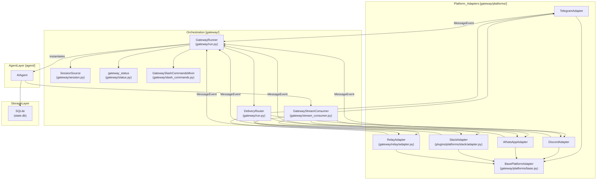
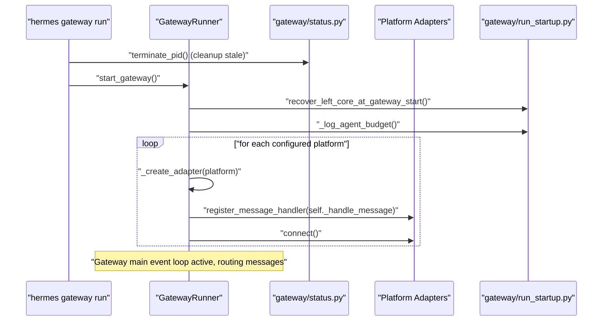
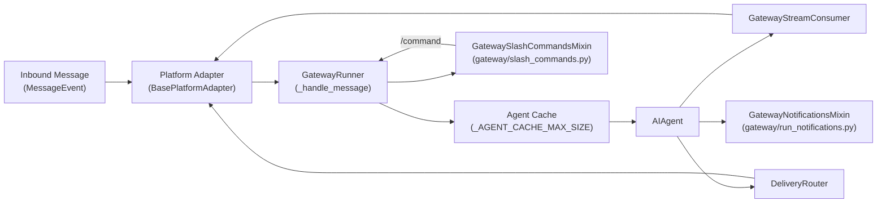
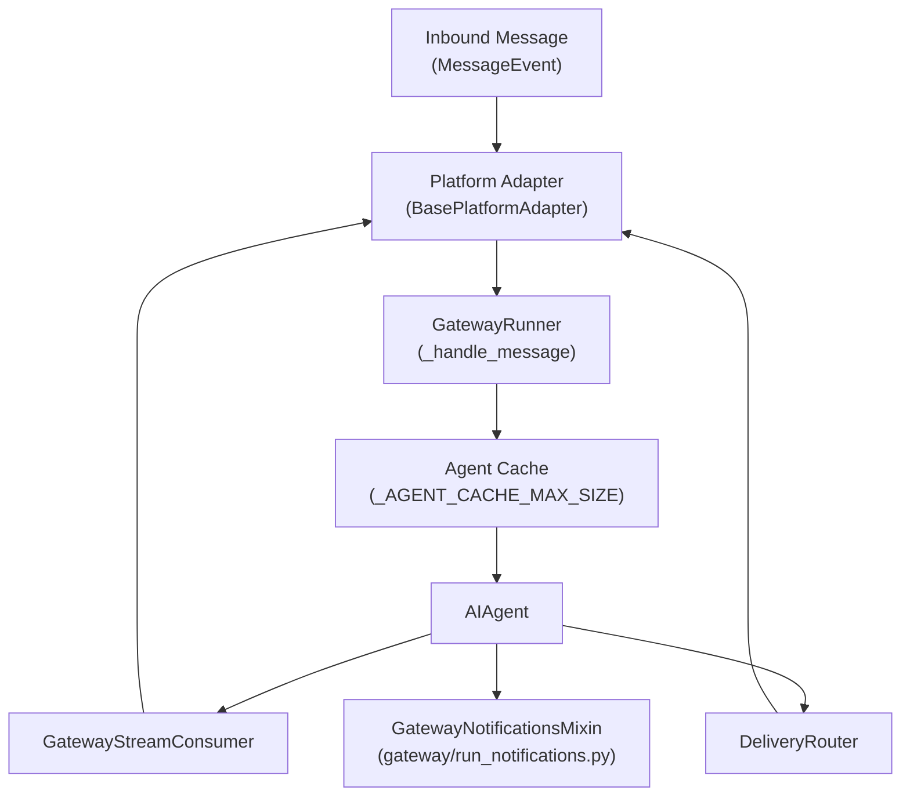

<!-- source: DeepWiki mcp.deepwiki.com · repo nousresearch/hermes-agent · page 7.1 Gateway Architecture · fetched 2026-10-26 -->

# Gateway Architecture

<details>
<summary>Relevant source files</summary>

The following files were used as context for generating this wiki page:

- [agent/AGENTS.md](agent/AGENTS.md)
- [apps/desktop/AGENTS.md](apps/desktop/AGENTS.md)
- [apps/desktop/electron/oauth-partition.test.ts](apps/desktop/electron/oauth-partition.test.ts)
- [apps/desktop/electron/oauth-partition.ts](apps/desktop/electron/oauth-partition.ts)
- [apps/desktop/src/AGENTS.md](apps/desktop/src/AGENTS.md)
- [apps/desktop/src/components/remote-setup/use-remote-connection-test.ts](apps/desktop/src/components/remote-setup/use-remote-connection-test.ts)
- [apps/desktop/src/components/remote-setup/use-remote-oauth.ts](apps/desktop/src/components/remote-setup/use-remote-oauth.ts)
- [apps/desktop/src/components/remote-setup/use-remote-setup.ts](apps/desktop/src/components/remote-setup/use-remote-setup.ts)
- [contributors/emails/caseyrussell1976@gmail.com](contributors/emails/caseyrussell1976@gmail.com)
- [evals/gateway_failure_ownership/README.md](evals/gateway_failure_ownership/README.md)
- [evals/gateway_failure_ownership/foreign_writer.py](evals/gateway_failure_ownership/foreign_writer.py)
- [evals/gateway_failure_ownership/probe.py](evals/gateway_failure_ownership/probe.py)
- [evals/update_unit_client_budget.py](evals/update_unit_client_budget.py)
- [gateway/AGENTS.md](gateway/AGENTS.md)
- [gateway/delivery_ledger.py](gateway/delivery_ledger.py)
- [gateway/disk_status.py](gateway/disk_status.py)
- [gateway/media_policy.py](gateway/media_policy.py)
- [gateway/message_timestamps.py](gateway/message_timestamps.py)
- [gateway/platforms/event.py](gateway/platforms/event.py)
- [gateway/profile_routing.py](gateway/profile_routing.py)
- [gateway/response_filters.py](gateway/response_filters.py)
- [gateway/run_adapters.py](gateway/run_adapters.py)
- [gateway/run_agent_cache.py](gateway/run_agent_cache.py)
- [gateway/run_busy.py](gateway/run_busy.py)
- [gateway/run_inbound.py](gateway/run_inbound.py)
- [gateway/run_notifications.py](gateway/run_notifications.py)
- [gateway/run_notifications_ownership.py](gateway/run_notifications_ownership.py)
- [gateway/run_shutdown.py](gateway/run_shutdown.py)
- [gateway/run_startup.py](gateway/run_startup.py)
- [gateway/run_turn.py](gateway/run_turn.py)
- [gateway/session_identity.py](gateway/session_identity.py)
- [gateway/session_state.py](gateway/session_state.py)
- [gateway/status.py](gateway/status.py)
- [hermes_cli/AGENTS.md](hermes_cli/AGENTS.md)
- [hermes_cli/gateway.py](hermes_cli/gateway.py)
- [hermes_cli/gateway_migrate.py](hermes_cli/gateway_migrate.py)
- [hermes_cli/gateway_migrate_guards.py](hermes_cli/gateway_migrate_guards.py)
- [hermes_cli/gateway_multiplex_mode.py](hermes_cli/gateway_multiplex_mode.py)
- [hermes_cli/gateway_multiplex_s6.py](hermes_cli/gateway_multiplex_s6.py)
- [hermes_cli/gateway_windows.py](hermes_cli/gateway_windows.py)
- [hermes_cli/gateway_windows_legacy.py](hermes_cli/gateway_windows_legacy.py)
- [hermes_cli/profile_channels.py](hermes_cli/profile_channels.py)
- [hermes_cli/update_cmd_fleet_verify.py](hermes_cli/update_cmd_fleet_verify.py)
- [hermes_cli/update_cmd_posix_pause.py](hermes_cli/update_cmd_posix_pause.py)
- [hermes_cli/update_cmd_windows.py](hermes_cli/update_cmd_windows.py)
- [hermes_cli/update_pause_record.py](hermes_cli/update_pause_record.py)
- [hermes_cli/web_server_owner_exit.py](hermes_cli/web_server_owner_exit.py)
- [hermes_cli/web_server_skew_exit.py](hermes_cli/web_server_skew_exit.py)
- [hermes_cli/windows_ssh_runtime.py](hermes_cli/windows_ssh_runtime.py)
- [scripts/check_config_yaml_writers.py](scripts/check_config_yaml_writers.py)
- [tests/agent/test_skill_inline_bash_windows.py](tests/agent/test_skill_inline_bash_windows.py)
- [tests/cron/test_cron_thread_seed_dm_keying.py](tests/cron/test_cron_thread_seed_dm_keying.py)
- [tests/e2e/core/upgrade/git/test_hostile_pause.py](tests/e2e/core/upgrade/git/test_hostile_pause.py)
- [tests/e2e/core/upgrade/hosts/test_hostile_pause_record.py](tests/e2e/core/upgrade/hosts/test_hostile_pause_record.py)
- [tests/e2e/core/windows_update/test_pause_custody.py](tests/e2e/core/windows_update/test_pause_custody.py)
- [tests/e2e/core/windows_update/test_pause_durable.py](tests/e2e/core/windows_update/test_pause_durable.py)
- [tests/gateway/test_agent_cache.py](tests/gateway/test_agent_cache.py)
- [tests/gateway/test_async_delegation_session_binding.py](tests/gateway/test_async_delegation_session_binding.py)
- [tests/gateway/test_background_process_notifications.py](tests/gateway/test_background_process_notifications.py)
- [tests/gateway/test_busy_redirect_anchor.py](tests/gateway/test_busy_redirect_anchor.py)
- [tests/gateway/test_completion_owner_retry.py](tests/gateway/test_completion_owner_retry.py)
- [tests/gateway/test_compress_command.py](tests/gateway/test_compress_command.py)
- [tests/gateway/test_compression_in_flight_check.py](tests/gateway/test_compression_in_flight_check.py)
- [tests/gateway/test_delivery_ledger.py](tests/gateway/test_delivery_ledger.py)
- [tests/gateway/test_delivery_ledger_producer.py](tests/gateway/test_delivery_ledger_producer.py)
- [tests/gateway/test_discord_triggering_note_persistence.py](tests/gateway/test_discord_triggering_note_persistence.py)
- [tests/gateway/test_duplicate_user_message.py](tests/gateway/test_duplicate_user_message.py)
- [tests/gateway/test_failure_writer_ownership.py](tests/gateway/test_failure_writer_ownership.py)
- [tests/gateway/test_gateway_silence_tokens.py](tests/gateway/test_gateway_silence_tokens.py)
- [tests/gateway/test_handoff_thread_session_key.py](tests/gateway/test_handoff_thread_session_key.py)
- [tests/gateway/test_host_rendezvous_windows.py](tests/gateway/test_host_rendezvous_windows.py)
- [tests/gateway/test_hygiene_failure_cooldown_ladder.py](tests/gateway/test_hygiene_failure_cooldown_ladder.py)
- [tests/gateway/test_incomplete_gateway_turns.py](tests/gateway/test_incomplete_gateway_turns.py)
- [tests/gateway/test_internal_event_pin_wiring.py](tests/gateway/test_internal_event_pin_wiring.py)
- [tests/gateway/test_matrix_handoff_thread.py](tests/gateway/test_matrix_handoff_thread.py)
- [tests/gateway/test_message_timestamps.py](tests/gateway/test_message_timestamps.py)
- [tests/gateway/test_moa_one_shot_restore.py](tests/gateway/test_moa_one_shot_restore.py)
- [tests/gateway/test_planned_stop_accepted_debt.py](tests/gateway/test_planned_stop_accepted_debt.py)
- [tests/gateway/test_profile_resolution.py](tests/gateway/test_profile_resolution.py)
- [tests/gateway/test_profile_routing.py](tests/gateway/test_profile_routing.py)
- [tests/gateway/test_queued_final_ledger.py](tests/gateway/test_queued_final_ledger.py)
- [tests/gateway/test_reaped_eviction_interrupts_run.py](tests/gateway/test_reaped_eviction_interrupts_run.py)
- [tests/gateway/test_response_filters.py](tests/gateway/test_response_filters.py)
- [tests/gateway/test_session_hygiene.py](tests/gateway/test_session_hygiene.py)
- [tests/gateway/test_session_identity_restore.py](tests/gateway/test_session_identity_restore.py)
- [tests/gateway/test_startup_failed_platform_reports_degraded.py](tests/gateway/test_startup_failed_platform_reports_degraded.py)
- [tests/gateway/test_status.py](tests/gateway/test_status.py)
- [tests/gateway/test_stop_chat_scope.py](tests/gateway/test_stop_chat_scope.py)
- [tests/gateway/test_stop_thread_sibling.py](tests/gateway/test_stop_thread_sibling.py)
- [tests/gateway/test_wake_delivery.py](tests/gateway/test_wake_delivery.py)
- [tests/gateway/test_webhook_filter_interpreter.py](tests/gateway/test_webhook_filter_interpreter.py)
- [tests/hermes_cli/test_chat_q_exit_clear.py](tests/hermes_cli/test_chat_q_exit_clear.py)
- [tests/hermes_cli/test_config_yaml_comment_preservation.py](tests/hermes_cli/test_config_yaml_comment_preservation.py)
- [tests/hermes_cli/test_gateway.py](tests/hermes_cli/test_gateway.py)
- [tests/hermes_cli/test_gateway_foreign_xdg_runtime.py](tests/hermes_cli/test_gateway_foreign_xdg_runtime.py)
- [tests/hermes_cli/test_gateway_linger.py](tests/hermes_cli/test_gateway_linger.py)
- [tests/hermes_cli/test_gateway_migrate_multiplex.py](tests/hermes_cli/test_gateway_migrate_multiplex.py)
- [tests/hermes_cli/test_gateway_multiplex_mode.py](tests/hermes_cli/test_gateway_multiplex_mode.py)
- [tests/hermes_cli/test_gateway_multiplex_s6.py](tests/hermes_cli/test_gateway_multiplex_s6.py)
- [tests/hermes_cli/test_gateway_service.py](tests/hermes_cli/test_gateway_service.py)
- [tests/hermes_cli/test_gateway_start_attestation.py](tests/hermes_cli/test_gateway_start_attestation.py)
- [tests/hermes_cli/test_gateway_windows.py](tests/hermes_cli/test_gateway_windows.py)
- [tests/hermes_cli/test_legacy_launchers_windows_live.py](tests/hermes_cli/test_legacy_launchers_windows_live.py)
- [tests/hermes_cli/test_model_provider_persistence.py](tests/hermes_cli/test_model_provider_persistence.py)
- [tests/hermes_cli/test_profile_clone_channels.py](tests/hermes_cli/test_profile_clone_channels.py)
- [tests/hermes_cli/test_ssh_ownership_endpoint.py](tests/hermes_cli/test_ssh_ownership_endpoint.py)
- [tests/hermes_cli/test_ssh_session_token_parser.py](tests/hermes_cli/test_ssh_session_token_parser.py)
- [tests/hermes_cli/test_update_cold_start_gateway_liveness.py](tests/hermes_cli/test_update_cold_start_gateway_liveness.py)
- [tests/hermes_cli/test_update_fleet_check_fail_closed.py](tests/hermes_cli/test_update_fleet_check_fail_closed.py)
- [tests/hermes_cli/test_update_fleet_probe_resume_token.py](tests/hermes_cli/test_update_fleet_probe_resume_token.py)
- [tests/hermes_cli/test_update_pause_boundaries.py](tests/hermes_cli/test_update_pause_boundaries.py)
- [tests/hermes_cli/test_update_pause_debt_windows_live.py](tests/hermes_cli/test_update_pause_debt_windows_live.py)
- [tests/hermes_cli/test_update_pause_moved_head_gate.py](tests/hermes_cli/test_update_pause_moved_head_gate.py)
- [tests/hermes_cli/test_update_pause_record.py](tests/hermes_cli/test_update_pause_record.py)
- [tests/hermes_cli/test_update_pause_recover_backoff.py](tests/hermes_cli/test_update_pause_recover_backoff.py)
- [tests/hermes_cli/test_update_posix_pause.py](tests/hermes_cli/test_update_posix_pause.py)
- [tests/hermes_cli/test_update_unit_client_budget.py](tests/hermes_cli/test_update_unit_client_budget.py)
- [tests/hermes_cli/test_web_server_owner_exit.py](tests/hermes_cli/test_web_server_owner_exit.py)
- [tests/hermes_cli/test_web_server_skew_exit.py](tests/hermes_cli/test_web_server_skew_exit.py)
- [tests/hermes_cli/test_windows_gateway_cold_start_desktop_lifecycle.py](tests/hermes_cli/test_windows_gateway_cold_start_desktop_lifecycle.py)
- [tests/hermes_cli/test_windows_relaunch_ready_poll.py](tests/hermes_cli/test_windows_relaunch_ready_poll.py)
- [tests/hermes_cli/test_windows_update_restart_reconciliation.py](tests/hermes_cli/test_windows_update_restart_reconciliation.py)
- [tests/scripts/install/test_install_ps1_skipsetup_alias.py](tests/scripts/install/test_install_ps1_skipsetup_alias.py)
- [tests/tools/test_async_delegation_requeue.py](tests/tools/test_async_delegation_requeue.py)
- [web/src/components/MultiplexStandaloneBanner.tsx](web/src/components/MultiplexStandaloneBanner.tsx)
- [website/docs/developer-guide/cli-internals.md](website/docs/developer-guide/cli-internals.md)
- [website/docs/developer-guide/multiplexing-gateway.md](website/docs/developer-guide/multiplexing-gateway.md)
- [website/docs/user-guide/multi-profile-gateways.md](website/docs/user-guide/multi-profile-gateways.md)
- [website/docs/user-guide/windows-native.md](website/docs/user-guide/windows-native.md)
- [website/i18n/zh-Hans/docusaurus-plugin-content-docs/current/getting-started/installation.md](website/i18n/zh-Hans/docusaurus-plugin-content-docs/current/getting-started/installation.md)
- [website/i18n/zh-Hans/docusaurus-plugin-content-docs/current/user-guide/windows-native.md](website/i18n/zh-Hans/docusaurus-plugin-content-docs/current/user-guide/windows-native.md)

</details>


The Messaging Gateway is a persistent and concurrent service orchestrating communication between multiple messaging platforms and the core `AIAgent`. Unlike the CLI, which handles a single interactive session, the gateway concurrently serves many live conversations across platforms such as Telegram, Discord, Slack, and others. It efficiently multiplexes interactions while isolating sessions, managing agent lifecycle, session persistence, and scheduling through cron jobs.

This page provides a detailed technical overview of the gateway's architecture, focusing on the `GatewayRunner`, its modular `run_*` submodules (`run_startup.py`, `run_adapters.py`, `run_inbound.py`, `run_turn.py`, `run_shutdown.py`, `run_notifications.py`), message routing mechanisms, session expiry handling, service management, and cron scheduler integration.

Sources: [hermes_cli/gateway.py:1-88]()

---

## System Overview

The gateway architecture is composed of several layers working together to manage messaging platform integration, session routing, agent concurrency, and message delivery:

- **Platform Adapters:** Interface with specific messaging platforms, translating native platform messages into the common internal format (`MessageEvent`), and vice versa for outbound messages [gateway/platforms/base.py:47-54]().
- **GatewayRunner:** The central orchestrator managing the gateway process lifecycle, instantiating platform adapters, routing messages, managing session-bound `AIAgent` instances, and dispatching slash commands [gateway/run.py:45-47]().
- **Core Agent Logic:** The main AI agent executing conversation loops, managing tool calls, and producing responses.
- **Supporting Components:** Includes session storage layers, slash command handlers, delivery routing, and async stream consumers that apply progressive response edits.

### Natural Language to Code Mapping

The following diagram maps the physical layers and system components in the Hermes codebase to conceptual messaging gateway layers and natural language concepts.


Sources: [gateway/run.py:45-47](), [gateway/platforms/base.py:47-54](), [plugins/platforms/slack/adapter.py:94-94](), [gateway/session.py:33-35](), [gateway/status.py:38-40](), [gateway/slash_commands.py:1-8]()

---

## GatewayRunner and its `run_*` Submodules

The gateway implementation logic in `gateway/` is factored into clear functional submodules (the `run_*` family) imported and coordinated by `GatewayRunner` in [gateway/run.py]() :

- **`run_startup.py`**: Handles initialization checks, process-level signal handlers, PID file registration, and adapter provisioning [gateway/run_startup.py:63-65](). It also includes `recover_left_core_in` and `recover_left_core_at_gateway_start` for migrating features that have moved out of the core [gateway/run_startup.py:40-61]().
- **`run_adapters.py`**: Manages adapter lifecycle, health checking, connection timeouts, and reconnection watches (`GatewayAdapterLifecycleMixin`) [gateway/run_adapters.py:70-71]().
- **`run_inbound.py`**: Ingests incoming platform events, handles message normalization into `MessageEvent` data structures, and runs allowlist/authz filters [gateway/run_inbound.py:71-73]().
- **`run_turn.py`**: Executes the agent conversation loop per session, manages turn execution boundaries, and handles interruption semantics [gateway/run_turn.py:1-5]().
- **`run_shutdown.py`**: Coordinates graceful draining of active turns, flushes session state to SQLite, and closes socket/process handles [gateway/run_shutdown.py:1-5]().
- **`run_notifications.py`**: Sends system alerts, background error notes, or watchdog warnings to designated admin chat endpoints (`GatewayNotificationsMixin`) [gateway/run_notifications.py:126-127](). It also manages update notifications and async delegation delivery [gateway/run_notifications.py:1-3]().

Sources: [gateway/run.py:45-47](), [gateway/run_startup.py:40-61](), [gateway/run_startup.py:63-65](), [gateway/run_adapters.py:70-71](), [gateway/run_inbound.py:71-73](), [gateway/run_turn.py:1-5](), [gateway/run_shutdown.py:1-5](), [gateway/run_notifications.py:1-3](), [gateway/run_notifications.py:126-127]()

---

## GatewayRunner Lifecycle and Service Management

The `GatewayRunner` class in [gateway/run.py]() manages the gateway's runtime lifecycle, adapter initialization, message routing, and session-aware agent instance management. Process supervision is integrated with native OS service managers (`systemd` on Linux and `launchd` on macOS) via helper functions in [hermes_cli/gateway.py]() and [gateway/status.py]().

### Process State & Snapshot

The CLI uses `GatewayRuntimeSnapshot` to inspect whether a gateway service is installed, running, or mismatched against existing processes [hermes_cli/gateway.py:81-97]():

```python
@dataclass(frozen=True)
class GatewayRuntimeSnapshot:
    manager: str
    service_installed: bool = False
    service_running: bool = False
    gateway_pids: tuple[int, ...] = ()
    service_scope: str | None = None
```

Runtime locks and PID registration are handled atomically via `gateway/status.py`, preventing concurrent gateway instances from clobbering each other's state files under `{HERMES_HOME}` [gateway/status.py:31-45](). The `_get_service_pids` function in [hermes_cli/gateway.py:119-174]() identifies PIDs managed by systemd/launchd services, ensuring they are excluded from stale-process sweeps. The `_RuntimeStatusWriter` class in [gateway/status.py:56-154]() handles persisting the latest complete status snapshot on a daemon thread, ensuring diagnostic state is written reliably.

### Startup and Adapter Initialization

The gateway startup sequence is driven by the `start_gateway()` function, which:
- Loads the gateway configuration.
- Instantiates platform adapters for all configured messaging platforms [gateway/run.py:45-47]().
- Registers message handlers (`_handle_message`) that funnel incoming messages to the gateway runner.
- Starts asynchronous event loops connecting adapters for inbound and outbound communication.

Connection attempts enforce platform-specific timeouts via `_platform_connect_timeout_secs()`; e.g., Telegram connections use a cold-start budget (retried up to 180s via background watchers) to prevent an unreachable platform from locking out the entire gateway [gateway/run_adapters.py:129-141]().

Sources: [hermes_cli/gateway.py:81-97](), [hermes_cli/gateway.py:119-174](), [gateway/status.py:31-45](), [gateway/status.py:56-154](), [gateway/run.py:45-47](), [gateway/run_adapters.py:129-141]()

---

### GatewayRunner Startup Sequence Diagram


Sources: [gateway/run.py:45-47](), [hermes_cli/gateway.py:35-36](), [gateway/status.py:31-45](), [gateway/run_startup.py:50-61](), [gateway/run_startup.py:67-76]()

---

## Message Routing and Slash Command Handling

### Session Identity and Routing

Each inbound message is associated with a session key (derived via `SessionSource` and managed through `GatewayTurnMixin`) [gateway/run_turn.py:33-35](). This key determines which `AIAgent` instance will handle the message, enabling multi-session concurrency and isolation [gateway/slash_commands.py:1-15](). The `_raw_process_event_session_id` function in [gateway/run_notifications.py:117-124]() helps recognize API routes and avoid malformed or partial messaging routes for session IDs.

### Slash Commands Handling

Messages starting with `/` are parsed as slash commands. The gateway enforces policies on how to handle these commands depending on whether the agent for that session is currently busy:
- `dispatch`: Run the command while the agent is busy.
- `reject`: Refuse mid-run with a "busy" notice.
- `interrupt_then_dispatch`: Interrupt/kill the running agent first, then dispatch (e.g., `/stop`, `/new`, `/reset`).

Sources: [gateway/run_turn.py:33-35](), [gateway/slash_commands.py:1-15](), [gateway/run_notifications.py:117-124]()

---

### Message Routing Flow Diagram


Sources: [gateway/run.py:45-47](), [gateway/platforms/base.py:47-54](), [gateway/slash_commands.py:1-14](), [gateway/run_notifications.py:126-127]()

---

## Session Expiry and Eviction

To manage memory and resource usage for long-running gateway processes, the gateway runs a periodic eviction routine that:
- Scans cached `AIAgent` instances for idle time exceeding configured thresholds (`_AGENT_CACHE_IDLE_TTL_SECS`).
- Evicts expired agent sessions from the LRU cache.
- Invokes proper cleanup routines for associated virtual machine sandboxes, browser instances, and transport handles.
- The `_should_clear_resume_pending_after_turn` function ensures that `resume_pending` flags are cleared only after a successful turn, preserving restart recovery markers [tests/gateway/test_restart_resume_pending.py:61-76]().

Sources: [gateway/run_agent_cache.py:1-6](), [tests/gateway/test_restart_resume_pending.py:61-76]()

---

## Cron Scheduler Integration and Multi-Profile Multiplexing

The gateway integrates with Hermes's cron scheduler system, supporting:
- Autonomous running of scheduled agent tasks.
- Integration with `cron_drain_timeout` (default 30s) to ensure active cron runs are safely completed or drained during a gateway restart [gateway/restart.py:27-29]().
- Support for scale-to-zero hosted agent deployments via the Chronos NAS-mediated cron provider plugin.
- **Multiplexing:** When `gateway.multiplex_profiles` is enabled on the default profile, a single gateway process enumerates every configured profile, brings up their respective platform adapters under isolated credentials, and routes incoming messages to the correct profile scope [website/docs/user-guide/multi-profile-gateways.md:65-110](). This is the default behavior, with safeguards to prevent unsafe multiplexing (e.g., duplicate bot credentials, port-binding platforms without ingress paths) [website/docs/user-guide/multi-profile-gateways.md:101-118](). An explicit `gateway.multiplex_profiles: true` bypasses some preflight checks, while `gateway.standalone: true` in a named profile's config allows it to run its own gateway process [website/docs/user-guide/multi-profile-gateways.md:120-137](). The `GATEWAY_MULTIPLEX_PROFILES` environment variable can also override this behavior [gateway/config.py:46-64]().

Sources: [gateway/restart.py:27-29](), [gateway/config.py:46-64](), [website/docs/user-guide/multi-profile-gateways.md:65-110](), [website/docs/user-guide/multi-profile-gateways.md:101-118](), [website/docs/user-guide/multi-profile-gateways.md:120-137]()

---

## Summary Table of Key Components

| Component | Role | Location |
| :--- | :--- | :--- |
| `GatewayRunner` | Main lifecycle orchestrator and adapter manager | [gateway/run.py:45-47]() |
| `GatewayAdapterLifecycleMixin` | Adapter connect/teardown, timeouts, and reconnection logic | [gateway/run_adapters.py:70-71]() |
| `GatewayTurnMixin` | Agent-turn execution, runtime resolution, and session handling | [gateway/run_turn.py:33-35]() |
| `GatewayNotificationsMixin` | Process completion, update notifications, and media delivery | [gateway/run_notifications.py:126-127]() |
| `GatewayRuntimeSnapshot` | Data class representing current service/process status | [hermes_cli/gateway.py:81-88]() |
| `_RuntimeStatusWriter` | Persists gateway runtime status snapshots | [gateway/status.py:56-154]() |
| `BasePlatformAdapter` | Interface for platform-specific communication | [gateway/platforms/base.py:47-54]()
| `RelayAdapter` | Generic adapter for connector-negotiated capability profiles | [gateway/relay/adapter.py:109-112]()

Sources: [gateway/run.py:45-47](), [gateway/run_adapters.py:70-71](), [gateway/run_turn.py:33-35](), [gateway/run_notifications.py:126-127](), [hermes_cli/gateway.py:81-88](), [gateway/status.py:56-154](), [gateway/platforms/base.py:47-54](), [gateway/relay/adapter.py:109-112]()

---

## Natural Language to Code Entities

### Message Processing Flow in Gateway Processing


Sources: [gateway/run.py:45-47](), [gateway/platforms/base.py:47-54](), [gateway/slash_commands.py:1-8](), [gateway/run_notifications.py:126-127]()

---

