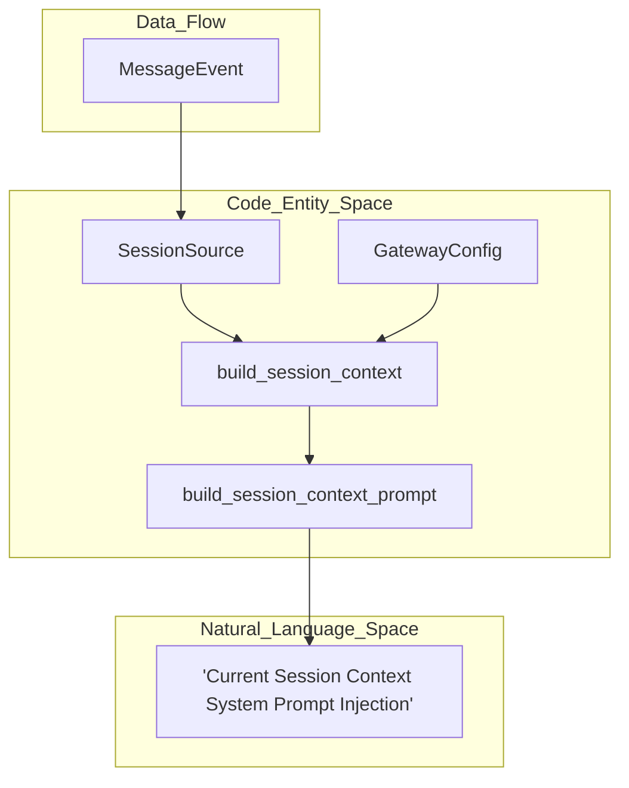
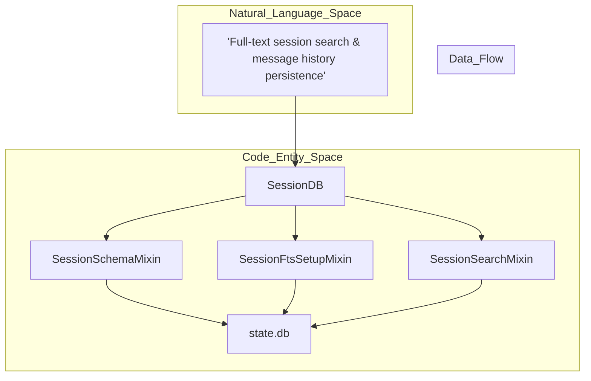
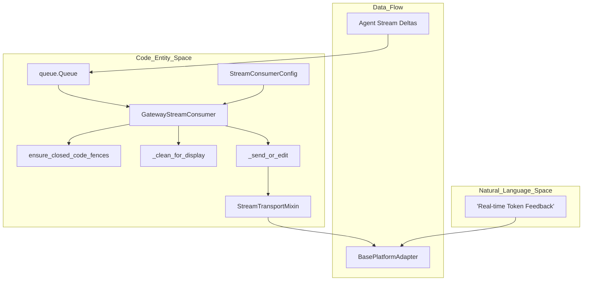
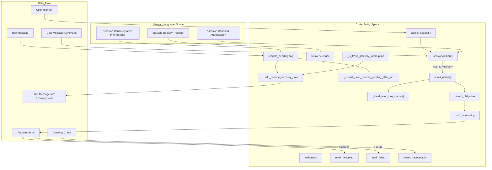

<!-- source: DeepWiki mcp.deepwiki.com · repo nousresearch/hermes-agent · page 7.3 Session and Media Management · fetched 2026-10-26 -->

# Session and Media Management

Relevant source files

The following files were used as context for generating this wiki page:

- [contributors/emails/HaisamAbbas@outlook.com](contributors/emails/HaisamAbbas@outlook.com)
- [gateway/run_turn_runner.py](gateway/run_turn_runner.py)
- [gateway/runtime_bootstrap_windows.py](gateway/runtime_bootstrap_windows.py)
- [gateway/session_authority.py](gateway/session_authority.py)
- [gateway/session_cli_turn.py](gateway/session_cli_turn.py)
- [gateway/session_context.py](gateway/session_context.py)
- [gateway/session_controls.py](gateway/session_controls.py)
- [gateway/session_finite.py](gateway/session_finite.py)
- [gateway/session_ingress.py](gateway/session_ingress.py)
- [gateway/session_operator.py](gateway/session_operator.py)
- [gateway/session_results.py](gateway/session_results.py)
- [gateway/stream_consumer.py](gateway/stream_consumer.py)
- [gateway/stream_consumer_fallback.py](gateway/stream_consumer_fallback.py)
- [gateway/stream_consumer_fences.py](gateway/stream_consumer_fences.py)
- [gateway/stream_consumer_think.py](gateway/stream_consumer_think.py)
- [gateway/stream_consumer_transport.py](gateway/stream_consumer_transport.py)
- [gateway/stream_dispatch.py](gateway/stream_dispatch.py)
- [gateway/stream_events.py](gateway/stream_events.py)
- [tests/cron/test_cron_bot_chat_create_if_missing.py](tests/cron/test_cron_bot_chat_create_if_missing.py)
- [tests/gateway/fixtures/terminal_commit_daemon.py](tests/gateway/fixtures/terminal_commit_daemon.py)
- [tests/gateway/test_admission_results.py](tests/gateway/test_admission_results.py)
- [tests/gateway/test_api_responses_stream_retry.py](tests/gateway/test_api_responses_stream_retry.py)
- [tests/gateway/test_busy_durable_acceptance.py](tests/gateway/test_busy_durable_acceptance.py)
- [tests/gateway/test_busy_followup_marker_handoff.py](tests/gateway/test_busy_followup_marker_handoff.py)
- [tests/gateway/test_feishu_sdk_executor.py](tests/gateway/test_feishu_sdk_executor.py)
- [tests/gateway/test_local_viewer_events_submit.py](tests/gateway/test_local_viewer_events_submit.py)
- [tests/gateway/test_managed_worker_reader_thread.py](tests/gateway/test_managed_worker_reader_thread.py)
- [tests/gateway/test_managed_worker_stop_before_hello.py](tests/gateway/test_managed_worker_stop_before_hello.py)
- [tests/gateway/test_native_epoch_timestamp.py](tests/gateway/test_native_epoch_timestamp.py)
- [tests/gateway/test_native_execution_secret_scope_off_loop.py](tests/gateway/test_native_execution_secret_scope_off_loop.py)
- [tests/gateway/test_native_media_capture_lease.py](tests/gateway/test_native_media_capture_lease.py)
- [tests/gateway/test_native_media_capture_off_loop.py](tests/gateway/test_native_media_capture_off_loop.py)
- [tests/gateway/test_native_operator_provenance.py](tests/gateway/test_native_operator_provenance.py)
- [tests/gateway/test_native_pause_notice.py](tests/gateway/test_native_pause_notice.py)
- [tests/gateway/test_native_recovery_viewer_queue.py](tests/gateway/test_native_recovery_viewer_queue.py)
- [tests/gateway/test_native_reply_delivered_once.py](tests/gateway/test_native_reply_delivered_once.py)
- [tests/gateway/test_responses_idem_replay_record.py](tests/gateway/test_responses_idem_replay_record.py)
- [tests/gateway/test_runtime_bootstrap.py](tests/gateway/test_runtime_bootstrap.py)
- [tests/gateway/test_session_authority_cancel_settlement.py](tests/gateway/test_session_authority_cancel_settlement.py)
- [tests/gateway/test_session_env.py](tests/gateway/test_session_env.py)
- [tests/gateway/test_settlement_off_loop.py](tests/gateway/test_settlement_off_loop.py)
- [tests/gateway/test_stale_finalize_suppression.py](tests/gateway/test_stale_finalize_suppression.py)
- [tests/gateway/test_stream_consumer.py](tests/gateway/test_stream_consumer.py)
- [tests/gateway/test_stream_consumer_continuation_cut.py](tests/gateway/test_stream_consumer_continuation_cut.py)
- [tests/gateway/test_stream_consumer_draft.py](tests/gateway/test_stream_consumer_draft.py)
- [tests/gateway/test_stream_consumer_fresh_final.py](tests/gateway/test_stream_consumer_fresh_final.py)
- [tests/gateway/test_stream_consumer_oversized_leftover.py](tests/gateway/test_stream_consumer_oversized_leftover.py)
- [tests/gateway/test_stream_consumer_thread_routing.py](tests/gateway/test_stream_consumer_thread_routing.py)
- [tests/gateway/test_stream_edit_flood_retry_after.py](tests/gateway/test_stream_edit_flood_retry_after.py)
- [tests/gateway/test_telegram_final_delivery.py](tests/gateway/test_telegram_final_delivery.py)
- [tests/gateway/test_telegram_overflow_partial.py](tests/gateway/test_telegram_overflow_partial.py)
- [tests/gateway/test_telegram_shared_outbound_budget.py](tests/gateway/test_telegram_shared_outbound_budget.py)
- [tests/gateway/test_telegram_typing_retrigger.py](tests/gateway/test_telegram_typing_retrigger.py)
- [tests/hermes_cli/test_gateway_queued_unknown.py](tests/hermes_cli/test_gateway_queued_unknown.py)
- [tests/tui_gateway/test_adversarial_sidecar_availability.py](tests/tui_gateway/test_adversarial_sidecar_availability.py)

**Purpose**:
This page details the core implementation of session storage, media caching, delivery tracking, interrupt handling, and message formatting within the Hermes messaging gateway and state subsystems. It explains how user conversations and associated media are persistently managed, indexed, and routed across multiple platforms, ensuring correct session isolation, privacy, and smooth streaming operations.

**Scope**:
Covers session tracking and persistent storage infrastructure (`SessionDB` in `hermes_state.py`, `SessionSource` in `gateway/session.py`), media extraction and caching in platform adapters (`BasePlatformAdapter` in `gateway/platforms/base.py`), streaming consumer progressive updates (`GatewayStreamConsumer` in `gateway/stream_consumer.py`), and interrupt handling. For related conversation orchestration, see [Core Agent (4.1)]() and platform adapter implementations [Platform Adapters (7.2)]().

---

## Session Identity and Context

Hermes employs a centralized SQLite database as the persistent store for all session data, message history, and search indexing.

### SessionSource: Origin Metadata

- Implemented as the `SessionSource` dataclass [gateway/session.py:63-99](), this entity records message origin details:
  - Platform (enum `Platform`): e.g., `telegram`, `discord`, `whatsapp` [gateway/session.py:67]()
  - Chat ID: Unique conversation or channel identifier [gateway/session.py:68]()
  - Chat Type: `dm`, `group`, `channel`, or `thread` [gateway/session.py:70]()
  - User ID and username within that chat (optional) [gateway/session.py:71-72]()
  - Thread ID for forum topics, threads, e.g., Discord threads or Telegram forum topics [gateway/session.py:73]()
  - Additional fields for platform-specific or routing metadata (`scope_id`, `guild_id`, `message_id`, alt IDs) [gateway/session.py:75-86]()

This metadata is foundational for routing replies back, injecting relevant system prompts, and associating messages with the correct persistent session [gateway/session.py:1-3]().

### Session Key Safety

- Sessions are internally keyed by composite identifiers built from source fields.
- Safety guards reject any key that could lead to path traversal vulnerabilities on disk storage:
  - The strict check `_is_path_unsafe()` forbids any value containing `..`, separators `/` or `\`, or Windows drive letter prefixes [gateway/session.py:43-58]().

### Dynamic Context Injection

- The session source is used to build a dynamic system prompt context via `build_session_context()` and `build_session_context_prompt()` to inform the AI of the platform and chat it is engaged with [tests/gateway/test_session.py:110-111]().
- To protect privacy, sender and chat IDs are hashed deterministically (e.g., `user_<12hex>`) by helpers like `_hash_sender_id()` and `_hash_chat_id()` [gateway/session.py:32-40]().
- Prompt caching across messages is stabilized by excluding volatile message IDs from cached prompt blocks, per test coverage ensuring consistent prompt output regardless of message ID [tests/gateway/test_session.py:117-158]().

Sources: [gateway/session.py:32-99](), [tests/gateway/test_session.py:110-158]()

---

## Session Storage Architecture

Hermes employs a centralized SQLite database as the persistent store for all session data, message history, and search indexing.

### SessionDB: SQLite State Store

- The `SessionDB` class in `hermes_state.py` provides a robust persistent store managing session metadata, message history, model configurations, and FTS5 search indexes [hermes_state.py:2-63]().
- Operates in Write-Ahead Logging (WAL) mode to support concurrent readers alongside a single writer.
- Implements schema initialization and column reconciliation via `hermes_state_schema.py` [hermes_state_schema.py:1-5]().

### Key Core Responsibilities

- `create_session()`: Creates a new session, storing metadata such as session key and optional model configurations.
- `append_message()`: Appends messages to a session's message history in the DB, triggering FTS5 indexing.
- Schema helpers and search mixins (`SessionSearchMixin` in `hermes_state_search.py`) execute efficient text retrieval using FTS5 virtual tables (`messages_fts`, `messages_fts_trigram`) [hermes_state.py:61]().
- Support for Chinese, Japanese, Korean (CJK) text matching is provisioned via native CJK tokenizer extensions loaded by `load_fts5_cjk_extension()` [hermes_state.py:43]().

Sources: [hermes_state.py:2-63](), [hermes_state_schema.py:1-5]()

---

## Media Management and Caching

Media is an integral part of multi-platform messaging; the gateway manages extraction, caching, transcoding, and presentation.

### Media Extraction

The `BasePlatformAdapter` in `gateway/platforms/base.py` provides media extraction and parsing utilities:
- `extract_media()`: Parses custom `MEDIA:<path>` tags and inline attachments from message strings, extracting paths for outbound delivery or processing.
- `filter_media_delivery_paths()`: Validates local file paths against safety policies before outbound dispatch, rejecting any unsafe or disallowed paths to protect platform safety and user privacy [gateway/platforms/base.py:30-72]().

### Transcoding and Audio Handling

- `transcode_to_ogg_opus()` runs an optional best-effort `ffmpeg` transcode to Ogg/Opus format (voip-tuned) for native voice bubble delivery, returning a temporary `.ogg` path or `None` if `ffmpeg` is unavailable or unsupported [gateway/platforms/base.py:51-72]().
- Audio extension mappings categorize MIME types (`_AUDIO_MIME_TYPES`), file extensions (`_AUDIO_EXTS`), video extensions (`_VIDEO_EXTS`), and image extensions (`_IMAGE_EXTS`), decoding how media is dispatched (native voice bubbles, image attachments, etc.) [gateway/platforms/base.py:39-48]().

### Media Caption Splitting

- The helper `_media_caption_split()` in `tools/send_message_senders.py` splits a message string for a native-capable platform: the first caption substring is sent as the native media caption if it's short enough, and the remainder is sent as a separate message [tools/send_message_senders.py:16-17]().

Sources: [gateway/platforms/base.py:30-72](), [tools/send_message_tool.py:121-124](), [tools/send_message_senders.py:16-17]()

---

## Streaming and Progressive Edits

For supported platforms, Hermes uses a streaming consumer to provide real-time token feedback as the LLM generates responses.

### GatewayStreamConsumer

- Implemented in `gateway/stream_consumer.py`, `GatewayStreamConsumer` bridges synchronous agent deltas to asynchronous platform delivery through an internal thread-safe queue queuing deltas for an async worker [gateway/stream_consumer.py:1-140]().
- Controlled via the `StreamConsumerConfig` dataclass, allowing configuration of edit intervals, buffer thresholds, cursor tokens, and choice of transport (`edit`, `draft`, or `auto`) [gateway/stream_consumer.py:61-77]().
- The consumer buffers deltas, rate-limits message edits, and supports progressive "think" filters and fallbacks to work around platform limitations [gateway/stream_consumer.py:99-142]().
- The essential message sending and editing logic is provided by `StreamTransportMixin` in `gateway/stream_consumer_transport.py`:
  - `_edit_message()` handles patch editing of messages.
  - `_try_seed_frame()` opens native streaming drafts or bubbles early.
  - `_send_frame()` sends frames for native streaming.
  - `_delete_previews()` deletes obsolete preview messages.
  - `_resolve_draft_streaming()` queries per-platform and transport capability for native drafts [gateway/stream_consumer_transport.py:20-140]().
- Helper functions strip internal markers (like `MEDIA:` tags) from visible output to the user, ensuring clean presentation [tests/gateway/test_stream_consumer.py:34-78]().
- Handles graceful finalization of streams including platform-specific quirks such as mandatory explicit finalize calls (e.g. DingTalk AI Cards) [tests/gateway/test_stream_consumer.py:75-109]().

Sources: [gateway/stream_consumer.py:1-140](), [gateway/stream_consumer_transport.py:20-140](), [gateway/stream_consumer_fences.py:1-10](), [tests/gateway/test_stream_consumer.py:34-78](), [tests/gateway/test_stream_consumer.py:75-109]()

---

## Session Lifecycle, Interrupt Handling, and Freshness

### Session Authority and Admission

The `SessionAuthority` class [gateway/session_authority.py:70-106]() is central to managing the lifecycle of live sessions. It acts as the gatekeeper for all incoming messages and commands, ensuring proper authorization and session state management.

- **Authorization**: Every handler first calls `authorize()` [gateway/session_authority.py:107-134]() to verify the `Principal` (actor) has the necessary capabilities (`session:read`, `session:submit`, `session:control`, etc.) for the requested action and that the session belongs to the correct profile.
- **Session Recovery**: If a session is not live in memory (`self.sessions`), `authorize()` attempts to recover it from the `SessionDB` [gateway/session_authority.py:118-131](). This involves checking for local or API session data and restoring it using `restore_local_session()` or `restore_api_session()`.
- **Admission**: Incoming messages are admitted via `admit_native()` [gateway/session_ingress.py:24](), which queues them for processing. This process generates an `AdmissionReceipt` [gateway/session_contract.py:16]() and sets up `asyncio.Future` waiters for the response [gateway/session_ingress.py:34]().
- **Turn Marker Handoff**: The `_hand_over_turn_marker()` function [gateway/session_ingress.py:73-87]() ensures that the durable active-turn marker, which indicates an ongoing turn, is correctly transferred between events or released once a reply is delivered. This is crucial for crash recovery and ensuring replies are sent only once.

### Interrupt Handling and Delivery Ledger

- Interruptions are detected during tool execution paths by `is_interrupted()` checks, providing immediate cancellation points in ongoing operations [tools/send_message_tool.py:108-110]().
- The delivery ledger (`gateway/delivery_ledger.py`) is a durable intermediate system that tracks delivery obligations for outbound messages to avoid silent loss or duplication:
  - `record_obligation()`: Records a pending delivery obligation before sending [gateway/delivery_ledger.py:3-4]().
  - `mark_attempting()`: Marks the obligation state as attempting just prior to the sending await [gateway/delivery_ledger.py:3-4]().
  - `mark_delivered()`: Mark a successful delivery on message ACK [gateway/delivery_ledger.py:3-4]().
  - `mark_failed()`: Marks an obligation failed on definitive delivery rejection or error [gateway/delivery_ledger.py:3-4]().
  - `sweep_recoverable()`: Recovers obligations from dead processes, transient failures, and restarts [gateway/delivery_ledger.py:152-155]().
- Redelivery appends standardized prefixes: `RECOVERED_MARKER`, `RECONNECTED_MARKER`, and `FLOOD_MARKER` to notify downstream consumers of recovery state [gateway/delivery_ledger.py:39-50]().
- Flood control is handled carefully with retry delay strategies based on platform-specific error type handling [gateway/delivery_ledger.py:101-127]().
- Duplicate cron dispatch prevention logic exists to avoid sending the same notification multiple times due to gateway restarts [_maybe_skip_cron_duplicate_send()] [tools/send_message_tool.py:130-131]().
- **Cancellation**: The `cancel_queued()` method [tests/gateway/test_session_authority_cancel_settlement.py:45]() allows for the cancellation of pending admissions. This settles all observers and publishes a terminal completion event, ensuring that any waiting consumers are notified and the session state is updated.

### Thread Metadata and Reply Anchoring

- Adapter sends embed platform-specific thread metadata for robust reply threading:
  - `_thread_metadata_for_source()` annotates metadata fields such as `message_thread_id` for Telegram, `slack_team_id` for Slack, or `telegram_dm_topic_reply_fallback` for chat-specific workarounds [gateway/platforms/base.py:95-127]().
- Reply anchors identify the appropriate message to reply to or thread under:
  - `_reply_anchor_for_event()` resolves the triggering message ID, supporting public channels, private DMs, and forums (e.g. Discord threads, Telegram forum topics) [gateway/platforms/base.py:143-167]().

### Resume Pending and Auto-Continue

- Sessions carry a `resume_pending` flag to indicate incomplete turns for gateway recovery and continued conversation integrity after interruption or restart [tests/gateway/test_restart_resume_pending.py:6-16]().
- The system evaluates whether to clear this flag after a turn via `_should_clear_resume_pending_after_turn()` using turn success and error metadata [tests/gateway/test_restart_resume_pending.py:60-75]().
- When resuming a pending session, the system injects a recovery heuristic note (`build_resume_recovery_note()`) to the user message indicating system recovery, improving model awareness and continuity [tests/gateway/test_restart_resume_pending.py:159-161]().
- Fresh interruptions within a configured time window are detected by `_is_fresh_gateway_interruption()` to determine if a recovery notification is needed [tests/gateway/test_restart_resume_pending.py:133-136]().

Sources: [gateway/session_authority.py:70-134](), [gateway/session_ingress.py:24-87](), [tests/gateway/test_session_authority_cancel_settlement.py:45](), [gateway/platforms/base.py:95-167](), [tools/send_message_tool.py:108-131](), [gateway/delivery_ledger.py:1-127](), [tests/gateway/test_delivery_ledger.py:1-163](), [tests/gateway/test_restart_resume_pending.py:6-16](), [tests/gateway/test_restart_resume_pending.py:60-75](), [tests/gateway/test_restart_resume_pending.py:159-161](), [tests/gateway/test_restart_resume_pending.py:133-136]()

---

## Message Formatting per Platform

Hermes adapts message content to platform-specific formatting rules, ensuring proper rendering of text, code, and rich media.

### Telegram MarkdownV2

- The `TelegramAdapter` [plugins/platforms/telegram/adapter.py]() explicitly handles escaping and formatting for Telegram MarkdownV2 syntax:
  - `_escape_mdv2()` escapes Telegram MarkdownV2 special characters to avoid parsing errors [tests/gateway/test_telegram_format.py:44-63]().
  - `format_message()` converts generic markdown structures to Telegram's MarkdownV2 format, respecting code blocks, inline code, bold, italic, and headers [tests/gateway/test_telegram_format.py:70-188]().
    - Code blocks wrap triple backticks, and inline code is sanitized with precise handling of backslashes and backticks to preserve reading clarity [tests/gateway/test_telegram_format.py:85-115]().
    - Headers are converted to bold text as Telegram does not support native markdown headers [tests/gateway/test_telegram_format.py:175-188]().
  - `_strip_mdv2()` removes Telegram specific markdown so plain text can be extracted for platforms or UI elements that do not support markdown [tests/gateway/test_telegram_format.py:20-25]().

### General Formatting and Silence Filtering

- `_is_silence_narration()` identifies messages likely intended as silent placeholders (e.g., `(silent)`, `...`) to avoid unnecessary delivery or logging [gateway/delivery.py:34-37]().
- `_clean_for_display()` strips internal directives such as `MEDIA:` and custom voice markers before messages are shown to users, ensuring clean output [tests/gateway/test_stream_consumer.py:34-78]().
- `_wrap_markdown_tables()` ensures markdown tables are formatted correctly for readability on platforms that might otherwise misrender them [tests/gateway/test_telegram_format.py:20-25]().

### Approval Buttons and Rich Messages

- `send_exec_approval()` sends interactive approval buttons (e.g., "Allow Once", "Deny") for potentially dangerous or terminal commands, ensuring buttons and messages fit platform-specific length constraints [tests/gateway/test_telegram_approval_buttons.py:50-174]().
- `send_slash_confirm()` similar confirmation messaging with buttons for inline slash command confirmations [tests/gateway/test_telegram_approval_buttons.py:120-126]().

Sources: [plugins/platforms/telegram/adapter.py](), [tests/gateway/test_telegram_format.py:20-188](), [gateway/delivery.py:34-37](), [tests/gateway/test_stream_consumer.py:34-78](), [tests/gateway/test_telegram_approval_buttons.py:50-174]()

---

This page presents a comprehensive technical view of the critical systems managing session persistence, message indexing, media handling, durable streaming feedback, delivery robustness, and platform-adaptive formatting across the Hermes multi-platform AI agent gateway. For deeper inquiry into message flows, interruption mitigation, or multi-profile session multiplexing, see related sections outlined in the documentation tree.

---

